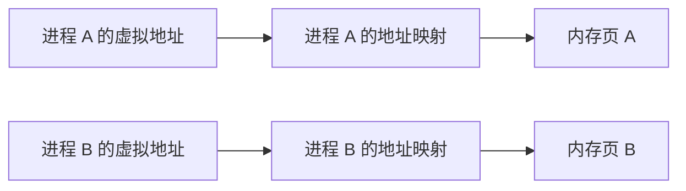

# 0.1 从 main.c 到 Linux 进程

## 0.1.1 这一节解决什么问题

我们希望最终能够像调用 `add(1, 2)` 一样，让一个进程请求另一个进程完成加法。在实现它之前，先弄清楚：普通函数调用发生在哪里？两个进程是否能直接共享局部变量？

学完本节，你应该能解释程序与进程的区别、线程与地址空间的关系，以及 `fork()` 后父子进程为什么不能通过普通局部变量交换结果。本节只研究用户态程序，尚未实现跨进程通信或 Binder 驱动。

## 0.1.2 一次普通函数调用

`examples` 仓库中 `0.1/call.c` 的核心是：

源码：`examples/0.1/call.c`，第 3–14 行。

```c
static int add(int a, int b)
{
    return a + b;
}

int main(void)
{
    int result = add(1, 2);

    printf("add(1, 2) = %d\n", result);
    return result == 3 ? 0 : 1;
}
```

`main` 和 `add` 在同一个进程中执行。调用者传递参数，函数计算并返回结果；编译器和平台的调用约定负责安排寄存器、栈及返回位置。这里没有启动另一个进程，也没有内核替我们转发请求。

程序是磁盘上的可执行文件；进程是运行中的程序实例，拥有自己的虚拟地址空间和其他资源。线程是进程内的执行单元：同一进程的线程通常共享地址空间，但各自拥有执行状态和栈；共享数据还需要同步。两个独立进程通常拥有彼此隔离的地址空间。

## 0.1.3 虚拟地址不是物理位置

进程看到的指针是虚拟地址。操作系统和硬件根据当前进程的地址空间，将虚拟地址转换成实际访问的内存。不同进程中数值相同的指针，不保证指向相同的数据；也不能把一个进程的普通指针直接交给另一个进程解引用。



这是普通私有内存的概念示意。操作系统也可以通过显式共享映射让不同进程访问同一内存；地址相同本身并不能证明共享。

## 0.1.4 用 fork 验证隔离

`0.1/fork.c` 先定义 `value = 10`，再调用 `fork()`：

- 成功时，父进程得到子进程 PID，子进程得到返回值 0；失败时返回 -1，并且没有创建子进程。
- 子进程将自己的 `value` 改为 20，打印后退出。
- 父进程使用 `waitpid()` 等待子进程并检查退出状态，再打印自己的 `value`。

`fork()` 创建一个子进程，初始时它的地址空间内容与父进程对应内容一致，但之后对普通私有内存的修改不会改变对方的数据。Linux 通常使用写时复制优化：开始可以共享物理页，写入时再为需要隔离的数据建立独立副本。这是实现细节，实验结论是父子进程各自的值独立。

`waitpid()` 在这里用于回收子进程并保证父进程在子进程退出后打印；它不负责传递 `value`。

### 0.1.4.1 对照代码看父子分支

以下片段来自 `examples` 仓库的 `0.1/fork.c`，其余错误处理见完整文件：

源码：`examples/0.1/fork.c`，第 9–21 行。

```c
    int value = 10;
    pid_t child = fork();

    if (child < 0) {
        perror("fork");
        return 1;
    }
    if (child == 0) {
        value = 20;
        printf("child:  pid=%ld, value=%d, address=%p\n",
               (long)getpid(), value, (void *)&value);
        return 0;
    }
```

`fork()` 成功后，父子进程都会从调用返回处继续，但 `child` 在子进程中为 0，在父进程中是子进程 PID。因此只有子进程进入第二个 `if` 并写入 20；父进程跳过该分支，自己的 `value` 仍为 10。这里的 `return 0` 是子进程从 `main()` 正常退出，并不是直接把局部变量返回给父进程。

父进程随后检查子进程是否成功退出：

源码：`examples/0.1/fork.c`，第 23–31 行。

```c
    int status;
    if (waitpid(child, &status, 0) == -1) {
        perror("waitpid");
        return 1;
    }
    if (!WIFEXITED(status) || WEXITSTATUS(status) != 0) {
        fprintf(stderr, "child failed\n");
        return 1;
    }
```

`status` 是等待得到的状态信息，需要使用 `WIFEXITED` 和 `WEXITSTATUS` 判断；它不是子进程的 `value`。程序先等待再打印父进程结果，保证本例中子进程的输出先于父进程输出，但这不是 `fork()` 默认提供的调度顺序。

## 0.1.5 编译和运行

在 Linux 环境中，进入下载或克隆的 `examples` 仓库，然后编译运行：

```sh
cd examples
make
./build/p01-call
./build/p01-fork
```

`examples` 是源码目录名；如果下载时使用了其他名称，请替换为实际目录。

一组示例输出如下，PID 和地址每次可能不同：

```text
add(1, 2) = 3
child:  pid=1235, value=20, address=0xfffff1234560
parent: pid=1234, value=10, address=0xfffff1234560
```

检查两点：`add` 得到 3；子进程写入 20 后，父进程的值仍为 10。两个地址数值即使相同，也分别属于不同进程的虚拟地址空间。实际输出中的 PID、地址不应作为固定测试值。

执行 `make clean` 删除生成的 `build/` 目录。

本节示例已在 Ubuntu 24.04、ARM64、Linux 6.8 环境中编译运行；具体 PID 和地址会随运行变化。

## 0.1.6 这与 Binder 有什么关系

如果把 `add` 放进另一个进程，调用者无法像本节的普通函数调用一样，直接依靠自己的栈和指针执行对方的代码。双方需要约定请求和回复，并通过某种 IPC 机制交换数据。Binder 是 Android 使用的一种 IPC 机制；后续章节会逐步设计一套简化的机制，了解其中的选择和代价。

本节的 `fork()` 没有建立请求通道，也没有传递对象或执行远程调用。下一节从用户态与内核态的边界出发，学习系统调用如何让程序请求内核提供服务。

## 0.1.7 自测

1. 子进程修改 `value` 后，父进程为什么仍然看到 10？
2. 父子进程打印相同地址，是否代表它们共享这个变量？
3. `waitpid()` 与传递函数返回值有什么区别？
4. 如果两个线程修改同一个全局变量，是否还可以直接套用本节父子进程的结论？

参考：普通私有内存属于各自的地址空间；相同虚拟地址不证明共享；`waitpid()` 等待并获取退出状态而非传递任意局部变量；同进程线程通常共享地址空间，对共享变量的并发访问需要适当同步。
