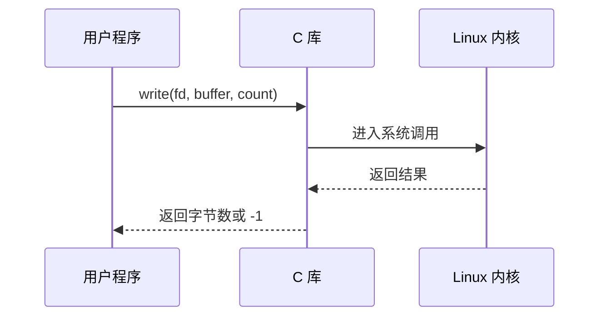

# 0.2 从函数调用到系统调用

## 0.2.1 这一节解决什么问题

0.1 中，`add()` 在调用者进程中计算。如果程序要输出文字、打开设备，或等待另一个进程，就需要操作系统提供服务。本节通过实际程序观察用户态程序如何请求内核，以及请求失败时如何报告错误。

完成本节后，你应该能区分普通函数调用、C 库函数和系统调用，能用 `strace` 观察一次调用，并理解返回值和 `errno` 的关系。本节尚未创建驱动或实现 IPC。

## 0.2.2 用户态与内核态

Linux 将应用运行所需的权限与内核运行所需的权限分开。普通程序通常运行在用户态；内核负责管理进程、内存、文件和设备等资源。应用不能把内核函数当作本进程内的普通函数随意调用，而是通过系统调用接口提出请求。



这个图表示常见的调用路径，不意味着每个 C 库函数都需要系统调用，也不意味着每个系统调用都必须由应用直接调用。比如 `add()` 通常只是进程内的函数调用；`printf()` 是 C 库函数，它可能先缓冲输出，之后才通过 `write()` 等系统调用交给内核。

## 0.2.3 文件描述符与 write

文件描述符（FD）是进程用于引用已打开文件等资源的整数。标准输出通常是 FD 1，C 代码中可使用 `STDOUT_FILENO`。调用 `write(fd, buffer, count)` 请求写入最多 `count` 字节：成功时返回实际写入字节数，可能少于请求数；失败时返回 `-1`。

`examples` 仓库中的 `0.2/syscalls.c` 循环调用 `write()`，直到消息写完；被信号中断时重试，其他错误通过 `perror()` 输出。它还检查写入零字节的情况，避免一直循环。

### 0.2.3.1 对照代码：为什么要循环写？

`0.2/syscalls.c` 中的写入循环如下：

源码：`examples/0.2/syscalls.c`，第 12–26 行。

```c
    while (offset < sizeof(message) - 1) {
        ssize_t count = write(STDOUT_FILENO, message + offset,
                              sizeof(message) - 1 - offset);
        if (count < 0) {
            if (errno == EINTR)
                continue;
            perror("write");
            return 1;
        }
        if (count == 0) {
            fprintf(stderr, "write made no progress\n");
            return 1;
        }
        offset += (size_t)count;
    }
```

`offset` 是已写出的字节数，`message + offset` 指向剩余数据；`sizeof(message) - 1` 排除了字符串末尾的 `\0`。如果这次写入少于剩余长度，更新 `offset` 后继续写。返回 `-1` 且 `errno == EINTR` 时本例重试；其他错误报告后退出。返回 0 时没有进展，本例退出而不是无限循环。

文件描述符本身不是文件内容，也不是另一个进程能直接使用的通用指针。后续驱动章节会通过设备文件获得 FD，再通过该 FD 向驱动发出请求。

## 0.2.4 观察错误：open 与 errno

示例尝试以只读方式打开 `/dev/binderabc-p02-nonexistent`，这个路径是实验用的预期不存在的设备名。路径不存在时，`open()` 返回 `-1`，并设置 `errno` 为 `ENOENT`。程序保存 `errno`，通过 `strerror()` 打印说明，并检查错误是否符合预期。

`errno` 只在相关函数报告失败时才有解释意义；成功调用后不要依据旧的 `errno` 判断结果。其他函数也可能改变它，因此需要在检查到失败后及时保存。若这个设备路径恰好存在，示例会关闭 FD 并报错退出，此时应选择一个确认不存在的路径后重新编译。

### 0.2.4.1 对照代码：保存错误原因

源码：`examples/0.2/syscalls.c`，第 28–36 行。

```c
    int fd = open("/dev/binderabc-p02-nonexistent", O_RDONLY);
    if (fd >= 0) {
        close(fd);
        fprintf(stderr, "expected the example device to be absent\n");
        return 1;
    }
    int saved_errno = errno;
    printf("open failed: errno=%d (%s)\n", saved_errno, strerror(saved_errno));
    return saved_errno == ENOENT ? 0 : 1;
```

`fd >= 0` 表示路径意外存在，程序关闭打开的 FD 并报告实验条件不满足。失败路径立即将 `errno` 保存到 `saved_errno`，之后再调用 `strerror` 和 `printf`；最后用保存的值检查是否为预期的 `ENOENT`。因此，观察到预期错误时程序返回 0，这表示**实验验证成功**，而非 `open()` 成功。

## 0.2.5 编译和运行

在 Linux 中进入下载或克隆的 `examples` 仓库：

```sh
cd examples
make
./build/p02-syscalls
```

需要 C 编译器和 GNU Make；运行 `strace` 实验还需要安装 `strace`。一组示例输出如下，错误说明的语言取决于系统环境：

```text
Hello from userspace
open failed: errno=2 (No such file or directory)
```

执行 `echo $?` 应得到 `0`，表示程序观察到了预期的 `ENOENT`。

## 0.2.6 用 strace 观察内核接口

```sh
strace -e trace=write,openat ./build/p02-syscalls
```

输出中应能找到类似以下记录，其他行及顺序可能因环境、动态链接和缓冲行为不同而变化：

```text
write(1, "Hello from userspace\n", 21) = 21
openat(AT_FDCWD, "/dev/binderabc-p02-nonexistent", O_RDONLY) = -1 ENOENT (No such file or directory)
```

这里程序调用的是 C 库的 `open()`，在本实验环境中它通过 `openat` 系统调用实现；具体调用依赖 C 库、架构和系统，不能假设所有环境都一样。`strace` 展示的是进程与内核之间的系统调用，不是全部 C 函数调用，因此不会显示 0.1 中的普通 `add()` 调用。

`strace` 默认将跟踪信息写入标准错误，程序本身的输出仍在标准输出；两者可能交错。若运行环境限制跟踪，`strace` 可能被拒绝，此时需要在允许进程跟踪的 Linux 环境中运行。

本节示例及上述跟踪命令已在 Ubuntu 24.04、ARM64、Linux 6.8 环境中验证。

## 0.2.7 与 Binder 的联系

将来客户端会打开 Binder 设备，并使用设备 FD 与内核驱动交互。这个边界使内核能够检查请求、管理跨进程资源，并协调不同进程。打开设备本身并不等于完成一次 Binder 事务；协议、驱动和服务端都还需要设计。

下一节将编写第一个 Linux 内核模块，认识构建和加载模块的基本过程。

## 0.2.8 自测

1. 为什么 `add()` 通常不会出现在 `strace` 输出中？
2. `write()` 返回值小于请求字节数时，程序应怎样处理？
3. 为什么不能在 `open()` 成功后直接根据 `errno` 判断是否出错？
4. `open()` 显示为 `openat` 是否表示程序没有调用 `open()`？

参考：`strace` 跟踪系统调用；应继续处理未写完的数据；`errno` 的值只在函数报告失败时用于解释错误；C 库可用其他底层系统调用实现其接口。
