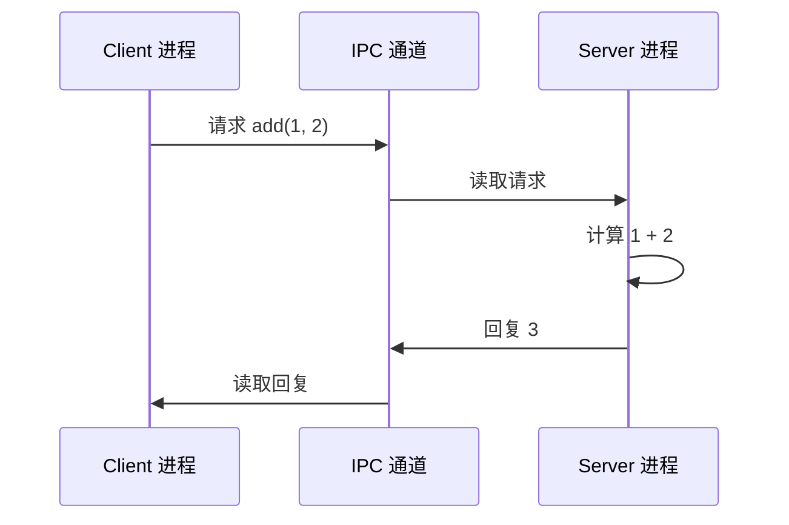

# 1.1 为什么需要 Binder？

## 1.1.1 从一个问题开始

假设我们已经有一个 `add(a, b)` 函数。它和调用者在同一个进程中时，我们可以直接调用它并取得返回值。现在把计算工作交给另一个进程：调用者该如何找到它、传递参数、等待计算并获得结果？

这一章先用现有的 Linux 管道模拟跨进程调用，识别一个 IPC 系统要解决的问题。管道示例不是 Binder，也不声称 Binder 是唯一的 IPC 方案；真正的 mini-binder 驱动将在后续章节逐步构建。

## 1.1.2 普通调用和跨进程调用

普通函数调用中，调用者和被调用者在同一进程的地址空间内；函数返回后，调用者继续执行。跨进程调用时，两个进程有独立的地址空间，不能直接使用对方的普通指针。即使两个进程使用同样的函数名，也需要通信机制协调请求与返回。

我们可以把一次最简单的同步远程过程调用（RPC）拆成：

1. 客户端把参数组织成请求。
2. 通过通信通道发送请求。
3. 服务端读取请求，执行相应操作。
4. 服务端把结果作为回复发回。
5. 客户端等待并读取回复，继续执行。



同步表示客户端等待结果后再继续，不表示请求一定成功：服务端可能退出，通信可能中断，错误必须有可观察的处理方式。

## 1.1.3 先用管道模拟

`examples` 仓库的 `1.1/rpc_pipe.c` 使用两条匿名管道：一条传请求，另一条传回复。程序调用 `fork()` 后，父进程充当客户端，子进程充当服务端；双方关闭自己不使用的管道端点。父进程发送结构体 `{1, 2}`，子进程读完后计算并返回 `3`。父进程读取结果，再用 `waitpid()` 检查子进程退出状态。

这两个角色是同一程序派生出的两个进程，不是两个独立启动的服务。这里借助 `fork()` 继承管道描述符，省去了服务发现；后续仍需解决独立客户端如何找到服务。

### 1.1.3.1 管道是字节流

一次 `read()` 不保证返回调用者请求的全部字节，程序因此使用 `read_all()` 循环读取直到得到完整结构或遇到错误、EOF；`write_all()` 同样处理短写和被信号中断。双方只发送固定大小的请求和回复，所以知道何时收齐。真实协议还需要定义消息长度和边界，以及如何应对恶意或异常输入。

这里直接传递 C 结构体的内存字节，仅适用于本例这种同一程序、同一机器的约定。结构体布局、填充和字节序都可能影响跨环境兼容；它不是可移植的通用网络协议。为了避免有符号加法溢出，服务端先以更宽的整数计算，再检查结果能否放进 `int32_t`。

### 1.1.3.2 两条管道为什么分别关闭一端？

以下片段来自 `examples/1.1/rpc_pipe.c`。`pipe()` 返回两个 FD：下标 0 用于读，下标 1 用于写。`fork()` 之后父子进程各自持有这些 FD，因此双方需要关闭不使用的端点。

| 进程 | 请求管道 `requests` | 回复管道 `replies` |
|---|---|---|
| 父进程 / 客户端 | 保留写端 `[1]`，关闭读端 `[0]` | 保留读端 `[0]`，关闭写端 `[1]` |
| 子进程 / 服务端 | 保留读端 `[0]`，关闭写端 `[1]` | 保留写端 `[1]`，关闭读端 `[0]` |

子进程中的片段是：

源码：`examples/1.1/rpc_pipe.c`，第 74–77 行。

```c
        close(requests[1]);
        close(replies[0]);
        if (read_all(requests[0], &req, sizeof(req)) != 0)
            _exit(1);
```

关闭多余端点不仅减少无用的 FD：管道所有写端都关闭、缓冲数据读完后，读者才能观察到 EOF；如果错误地保留写端，读操作可能继续等待。子进程这里用 `_exit(1)` 直接退出，父进程会通过读取失败和退出状态发现请求没有正常完成。

### 1.1.3.3 字节流如何读满一条请求？

`read_all()` 的循环摘录如下：

源码：`examples/1.1/rpc_pipe.c`，第 33–41 行。

```c
    while (length > 0) {
        ssize_t n = read(fd, p, length);
        if (n < 0 && errno == EINTR)
            continue;
        if (n <= 0)
            return -1;
        p += n;
        length -= (size_t)n;
    }
```

`p` 指向下一段要填充的内存，`length` 是剩余字节数。每次成功读取后指针前移、剩余长度减少；`EINTR` 时重试；0 表示 EOF，其他负值表示错误，均返回失败。`write_all()` 使用相同的进度思路处理短写，但管道读端全部关闭时还可能收到 `SIGPIPE`；代码没有处理这个信号。

### 1.1.3.4 一次 add(1, 2) 的代码路径

先看请求的数据格式。`1.1/rpc_pipe.c` 在文件开头定义了一个包含两个参数的结构体：

源码：`examples/1.1/rpc_pipe.c`，第 8–11 行。

```c
struct request {
    int32_t a;
    int32_t b;
};
```

父进程在 `fork()` 后构造这次请求，并准备一个变量接收回复：

源码：`examples/1.1/rpc_pipe.c`，第 90–93 行。

```c
    struct request req = { .a = 1, .b = 2 };
    int32_t result = 0;
    int failed = 0;
    int status;
```

这里的 `req.a` 和 `req.b` 就是要传给服务端的 `1` 和 `2`；`result` 是父进程自己的接收变量，初始为 0，并不会自动与子进程的 `result` 共享。

#### 1.1.3.4.1 第一步：客户端发送参数并等待结果

父进程保留请求写端和回复读端，发送固定大小的 `req`，关闭请求写端，然后等待回复：

源码：`examples/1.1/rpc_pipe.c`，第 95–102 行。

```c
    close(requests[0]);
    close(replies[1]);
    if (write_all(requests[1], &req, sizeof(req)) != 0)
        failed = 1;
    close(requests[1]);
    if (!failed && read_all(replies[0], &result, sizeof(result)) != 0)
        failed = 1;
    close(replies[0]);
```

`write_all(requests[1], &req, sizeof(req))` 把 `req` 的字节写入请求管道。写完后关闭请求写端；随后 `read_all(replies[0], &result, sizeof(result))` 从回复管道读取结果到父进程的 `result`。如果写入或读取失败，程序将 `failed` 置为 1，后续不会把结果当作成功。

#### 1.1.3.4.2 第二步：服务端读取参数、计算并发送回复

子进程使用自己的 `req` 和 `result` 局部变量。下面是 `child == 0` 分支中的实际代码，端点关闭和读取的作用见前文：

源码：`examples/1.1/rpc_pipe.c`，第 71–84 行。

```c
        struct request req;
        int32_t result;

        close(requests[1]);
        close(replies[0]);
        if (read_all(requests[0], &req, sizeof(req)) != 0)
            _exit(1);
        /* The example only accepts values whose sum fits in int32_t. */
        int64_t sum = (int64_t)req.a + req.b;
        if (sum < INT32_MIN || sum > INT32_MAX)
            _exit(1);
        result = (int32_t)sum;
        if (write_all(replies[1], &result, sizeof(result)) != 0)
            _exit(1);
```

`read_all()` 把请求管道的字节填入子进程的 `req`；收到参数后，服务端将 `req.a` 提升为 `int64_t` 再相加，避免在检查前发生 32 位有符号溢出。结果不在 `int32_t` 范围内时子进程以失败状态退出；否则将结果转换成 `int32_t`，通过 `write_all(replies[1], &result, sizeof(result))` 发送到回复管道。

这次的返回结果是**通过管道发送的字节**，不是把子进程的局部变量地址传给父进程。子进程写入自己的 `result`，父进程的 `read_all()` 将这些字节写入父进程自己的 `result`。

#### 1.1.3.4.3 第三步：客户端检查并使用结果

父进程读完回复后，还会用 `waitpid()` 等待子进程；下面是检查等待结果之后的代码：

源码：`examples/1.1/rpc_pipe.c`，第 107–112 行。

```c
    if (failed || !WIFEXITED(status) || WEXITSTATUS(status) != 0) {
        fprintf(stderr, "RPC failed\n");
        return 1;
    }
    printf("remote add(%d, %d) = %d\n", (int)req.a, (int)req.b, (int)result);
    return result == 3 ? 0 : 1;
```

只有管道读写没有报告失败、子进程正常退出且退出码为 0，父进程才打印 `remote add(1, 2) = 3`。本例最后还检查结果是否恰好为 3，作为演示的验收条件。

实验中的 `strace` 可以看到父进程写请求、子进程读请求和写回复、父进程读回复及等待子进程；操作交错顺序受调度影响。

## 1.1.4 运行实验

在 Linux 中进入本章源码目录：

```sh
cd examples/1.1
make
./build/1.1-rpc-pipe
```

预期输出包含：

```text
remote add(1, 2) = 3
```

观察系统调用需要 `strace`：

```sh
strace -f -e trace=pipe2,read,write,wait4 ./build/1.1-rpc-pipe
```

`-f` 跟踪子进程。输出通常包括创建管道、父子进程的读写以及等待子进程的调用；具体调用名、PID、输出顺序和动态链接器的额外读操作可能因环境而异。`strace` 输出与程序输出可能交错。

本例已在 Ubuntu 24.04、ARM64、Linux 6.8 环境中编译、运行并使用 `strace` 验证。

## 1.1.5 从演示到 IPC 系统

这个例子证明请求和结果可以跨进程传递，但离通用系统还有距离：

| 需求 | 本例 | 后续需要考虑 |
|---|---|---|
| 找到服务 | 父子进程继承管道 | 独立进程如何注册、发现和寻址服务 |
| 请求与回复 | 固定一个请求和一个回复 | 并发请求如何关联对应回复 |
| 数据 | 固定的本机结构体 | 序列化、边界、长度和资源限制 |
| 并发 | 一个客户端、一个子进程 | 多客户端和服务端线程如何协调 |
| 故障 | 检查读写及子进程退出 | 超时、对端死亡、取消和资源回收 |

本例没有处理 `SIGPIPE`：如果管道读端提前关闭，写入可能导致进程被该信号终止。生产实现需要明确处理信号、错误报告、超时和清理策略；本例只演示正常路径及基本错误检查。

Linux 已有管道、Unix 域套接字、共享内存等 IPC 机制。Android 使用 Binder，除了传输请求与回复，还需要处理跨进程对象引用、生命周期、线程调度及安全边界等问题。我们会逐步设计简化版本，后面再与真实 Binder 比较。

下一章将建立字符设备，通过文件操作进入自己的内核驱动；它还不会立刻拥有完整的 RPC 能力。

## 1.1.6 自测

1. 为什么客户端不能把普通指针直接交给另一个进程使用？
2. 管道传输字节流时，为什么要循环读取固定长度的请求？
3. 如果服务端还没回复就退出，客户端会如何发现？
4. 为什么此例不能直接充当跨机器的通用协议？

参考：地址空间隔离；一次读取可能短于请求长度；读到 EOF 或错误且子进程状态异常；本机结构体布局、填充和字节序未定义跨环境协议。
