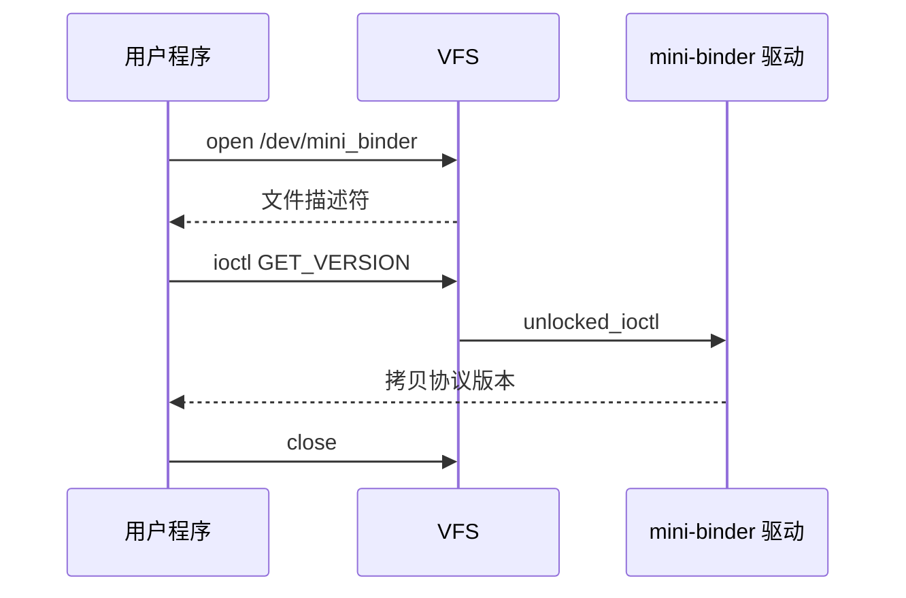

# 1.2 设计第一个字符设备驱动

## 1.2.1 这一章解决什么问题

上一章用匿名管道在父子进程间传递加法请求。我们希望让独立进程有一个共同的内核入口，逐步构建自己的 IPC 系统。先实现最小的一步：注册 `/dev/mini_binder`，让用户程序打开设备并向驱动查询协议版本。

本章完成的是**设备入口和一次控制请求**。它没有服务端、请求队列和 RPC；也不是 Android Binder 的驱动或兼容协议。下一章再设计请求与回复。

第 1.1 章依赖 `fork()` 继承匿名管道。独立启动的进程没有自动继承这些管道，需要一个双方约定的入口。Linux 也有 Unix 域套接字等现成机制；本教程选择字符设备，是为了学习用户态请求如何进入自己编写的驱动。字符设备本身不会自动提供服务发现或请求回复。

相对上一章，本章新增设备注册、共享的 `ioctl` 定义和用户态版本查询；加法服务将在下一章实现。以下片段来自独立的 `examples/1.2/` 目录。

## 1.2.2 从用户态进入驱动

Linux 将设备文件纳入 VFS（虚拟文件系统）的文件接口。应用调用 `open()` 获得文件描述符；设备驱动注册相应的文件操作，之后应用对这个 FD 的操作可被分派到驱动。本例使用 `ioctl()` 发起设备控制请求。



设备文件是访问内核设备的入口，不包含驱动代码，也不代表服务已经注册。模块退出时需要注销设备。驱动的 `.owner = THIS_MODULE` 使打开的文件持有模块引用，防止设备仍被使用时正常卸载模块。

这里的文件描述符是进程内文件描述符表的索引；它指向打开文件的内核对象，而不是设备号本身。`file_operations` 是驱动提供的一组回调。VFS 根据已打开文件关联的操作表分派 `ioctl`；用户程序并不直接调用内核 C 函数。

## 1.2.3 注册字符设备

`1.2/kernel/mini_binder.c` 使用 `miscdevice`：

源码：`examples/1.2/kernel/mini_binder.c`，第 31–36 行。

```c
static struct miscdevice mini_binder_device = {
    .minor = MISC_DYNAMIC_MINOR,
    .name = "mini_binder",
    .fops = &mini_binder_fops,
    .mode = 0666,
};
```

`misc_register()` 将设备注册到内核的 misc 子系统并分配动态次设备号，`misc_deregister()` 撤销注册。正常配置的 `devtmpfs` 或设备管理器会创建对应设备节点；节点是否出现及权限也受系统设备管理策略影响。

示例将节点模式设为 `0666`，方便在隔离实验系统中使用。真实 IPC 驱动需要针对访问控制、身份和资源配额单独设计，不能把这个设置直接当作生产安全方案。

### 1.2.3.1 注册和注销对应哪段代码？

模块入口调用注册函数，退出函数撤销注册：

源码：`examples/1.2/kernel/mini_binder.c`，第 38–52 行。

```c
static int __init mini_binder_init(void)
{
    int ret = misc_register(&mini_binder_device);

    if (ret)
        return ret;
    pr_info("mini_binder: registered\n");
    return 0;
}

static void __exit mini_binder_exit(void)
{
    misc_deregister(&mini_binder_device);
    pr_info("mini_binder: unregistered\n");
}
```

`ret` 非零表示注册失败，入口直接返回该错误，模块不会被当作成功加载；成功后日志才会打印 `registered`。注册失败后并没有成功注册的设备需要注销。设备结构是静态对象，整个模块加载期间有效，退出时才调用 `misc_deregister()`。

### 1.2.3.2 文件操作表怎样接入 ioctl？

同一文件的操作表是：

源码：`examples/1.2/kernel/mini_binder.c`，第 25–29 行。

```c
static const struct file_operations mini_binder_fops = {
    .owner = THIS_MODULE,
    .unlocked_ioctl = mini_binder_ioctl,
    .llseek = no_llseek,
};
```

上一节的 `.fops = &mini_binder_fops` 将设备连接到此表。打开设备后，`ioctl()` 分派到 `mini_binder_ioctl`；`no_llseek` 表示不支持把它当普通可定位文件使用。本阶段没有自定义 `read`、`write` 或 `open` 回调，不要把查询版本理解为已经支持数据收发。

## 1.2.4 定义用户态与内核的协议

`1.2/include/mini_binder.h` 同时供驱动和用户程序使用：

源码：`examples/1.2/include/mini_binder.h`，第 8–10 行。

```c
#define MINI_BINDER_PROTOCOL_VERSION 1U
#define MINI_BINDER_IOC_MAGIC 'M'
#define MINI_BINDER_GET_VERSION _IOR(MINI_BINDER_IOC_MAGIC, 0, __u32)
```

`_IOR` 描述一个由内核写给用户空间的 `ioctl` 请求及其数据类型。这里输出为 32 位无符号数；请求号和数据布局是两个组件的接口约定。用户程序调用 `ioctl(fd, MINI_BINDER_GET_VERSION, &version)`。

内核不能直接信任或解引用用户提供的指针。驱动通过 `copy_to_user()` 复制结果，若未能复制全部字节，返回 `-EFAULT`；未知请求返回 `-ENOTTY`。用户态调用失败时看到 `ioctl()` 返回 `-1`，并通过 `errno` 获取错误原因。

此阶段只实现本机 `unlocked_ioctl` 路径；尚未为 32 位兼容进程提供 `compat_ioctl`，也未定义跨进程事务或对象协议。

### 1.2.4.1 用户程序发出查询

`1.2/userspace/version.c` 的正常路径先打开设备，再传入版本变量的地址：

源码：`examples/1.2/userspace/version.c`，第 21–25 行。

```c
    int fd = open("/dev/mini_binder", O_RDONLY);
    if (fd < 0) {
        perror("open /dev/mini_binder");
        return 1;
    }
```

源码：`examples/1.2/userspace/version.c`，第 46–50 行。

```c
    if (ioctl(fd, MINI_BINDER_GET_VERSION, &version) == -1) {
        perror("MINI_BINDER_GET_VERSION");
        close(fd);
        return 1;
    }
```

这里 `&version` 是当前进程的用户态地址。虽然本例以只读模式打开设备，`_IOR` 表示驱动把数据复制**到调用者的内存**，不等同于向设备文件写入。调用返回后程序读取 `version`，并关闭 FD。

### 1.2.4.2 驱动处理查询和错误

`1.2/kernel/mini_binder.c` 中完整的版本查询分支如下：

源码：`examples/1.2/kernel/mini_binder.c`，第 16–21 行。

```c
    case MINI_BINDER_GET_VERSION:
        if (copy_to_user((void __user *)arg, &version, sizeof(version)))
            return -EFAULT;
        return 0;
    default:
        return -ENOTTY;
```

`arg` 是用户提供的地址值，`__user` 标明它属于用户地址空间。`copy_to_user` 返回**未成功复制的字节数**，不是普通 C 的 `memcpy` 返回值；非零时本例返回 `-EFAULT`。这不保证错误时没有任何字节被复制，调用者必须以返回值判断成功与否。

内核回调使用负错误码；用户态的 `ioctl` 包装将错误表现为 `-1` 和对应的 `errno`。`--bad-address` 传入空指针以检查 `EFAULT`；`--invalid` 使用未定义的请求号以检查 `ENOTTY`。这两个实验分别对应上面两个分支。

### 1.2.4.3 追踪一次查询

以版本号 1 为例：模块入口注册设备；应用打开 `/dev/mini_binder` 得到 FD；`ioctl` 通过该 FD 到达操作表中的 `mini_binder_ioctl`；驱动识别请求后将内核局部变量复制到用户态 `version`；应用打印结果并关闭 FD。卸载模块时才注销设备。`version` 是应用自己的变量，驱动不保留它的地址或跨调用使用它。

## 1.2.5 实验准备与构建

需要允许加载模块的 Linux 实验环境、编译工具、`kmod` 和与运行内核匹配的内核构建目录。准备方法见 [0.3](../00-preparation/0.3-kernel-environment.md)。

进入 `examples` 仓库的第 1.2 章目录：

```sh
cd examples/1.2
uname -r
make
```

生成 `kernel/mini_binder.ko` 和 `build/version`。`make` 调用内核构建系统构建模块，再编译用户程序。目标构建目录不在默认位置时可以指定 `make KDIR=/path/to/kernel-build`；它必须与将要加载模块的内核匹配。

各章节使用同名 `mini_binder` 模块和 `/dev/mini_binder` 设备。运行本章前请先停止其他章节的服务端并卸载已加载的同名模块，避免程序与其他章节的驱动版本不匹配。

## 1.2.6 加载并验收

在隔离的实验环境中执行：

```sh
sudo insmod kernel/mini_binder.ko
ls -l /dev/mini_binder
./build/version
./build/version --invalid
./build/version --bad-address
sudo rmmod mini_binder
sudo dmesg | tail -n 20
```

三次程序调用应分别输出：

```text
mini-binder protocol version: 1
unknown ioctl rejected: ENOTTY
invalid user address rejected: EFAULT
```

日志应包括 `mini_binder: registered` 和 `mini_binder: unregistered`。设备节点若未出现，先检查模块是否已加载、内核日志及设备管理服务，不能简单把节点问题当成驱动已成功注册。运行期间避免重复加载同名模块；确认其他进程已关闭设备再卸载。

模块未加载时运行 `./build/version` 应报告打开设备失败。加载后，可用 `strace -e trace=openat,ioctl,close ./build/version` 观察用户态系统调用；跟踪信息会因 C 库和环境而略有不同。`ioctl` 请求号并非跨所有设备全局唯一：在部分 `strace` 版本中，本例的请求号会被显示为 `MIXER_READ(0)`，这是数值解码名称的重合，实际请求仍由打开的 mini-binder 设备处理。使用 `make clean` 清理生成文件；如果构建时指定了 `KDIR`，清理时也应指定相同的值。

本章已在 Ubuntu 24.04、ARM64、Linux 6.8 环境中验证构建、加载、正常查询、未知请求、无效地址、卸载和卸载后访问。

## 1.2.7 自测

1. `open()` 返回的 FD 与设备文件、驱动分别是什么关系？
2. 为什么驱动不能直接把用户态传来的地址当作普通内核指针使用？
3. 未知的 `ioctl` 和用户空间地址无效时，驱动分别返回什么错误？
4. 当前设备能否直接完成上一章的跨进程 `add()`？

参考：FD 是进程内已打开文件的引用，VFS 将操作分派给设备对应驱动；用户指针需要通过内核用户访问接口安全处理；分别为 `ENOTTY`、`EFAULT`；不能，本章还没有请求队列与服务端协议。
