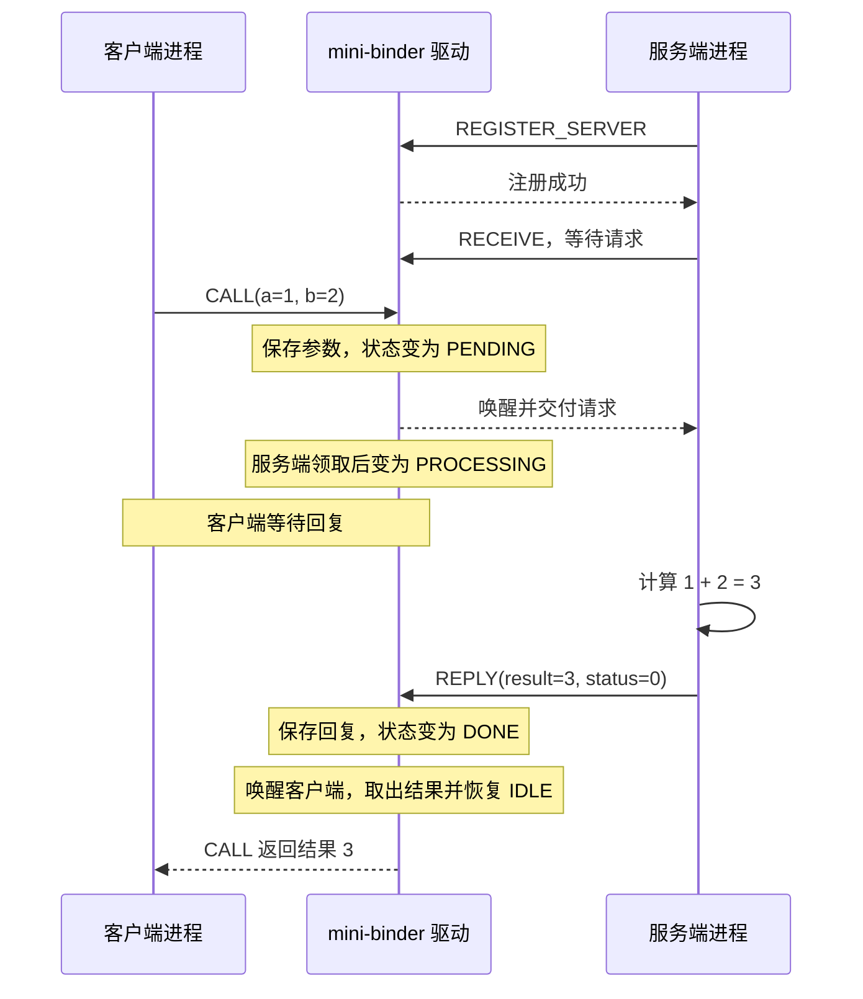
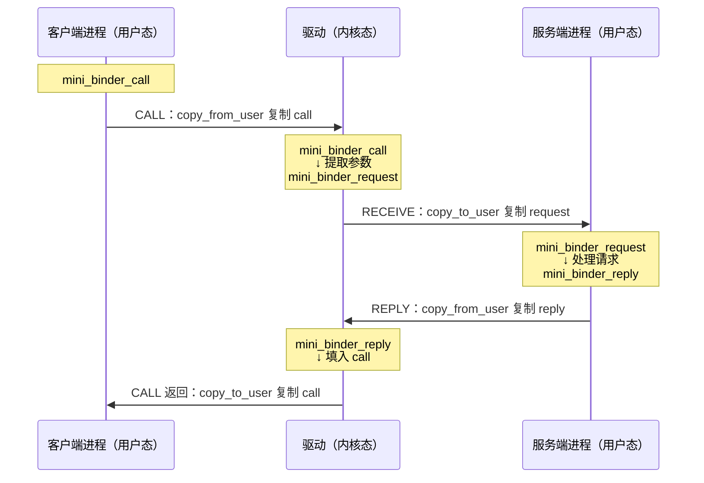

# 1.3 实现第一个同步 RPC

## 1.3.1 从设备入口到函数调用

第 1.2 章建立了 `/dev/mini_binder`，客户端能够查询协议版本，但驱动还不能把加法请求送给另一个进程。本章实现最小的一次同步调用：

```text
客户端：提交 add(1, 2)，等待结果
驱动：保存请求，唤醒服务端，等待回复
服务端：读取 1 和 2，计算并回复 3
驱动：唤醒客户端，交付结果
```

本章只允许**一个服务端和一笔在途调用**；第二笔请求不会排队，而是返回 `EBUSY`。这是为了先弄清一笔调用的过程。多客户端排队、事务编号和更完整的异常处理放到后续阶段。

本章代码位于 `examples/1.3/`，协议版本为 3；运行实验时使用该目录中的驱动和程序。

### 1.3.1.1 一次调用的时序

下图展示服务端先注册并等待，随后客户端发起调用的一种正常时序。客户端和服务端实际何时被调度并不固定。



图中的箭头表示跨进程调用和结果交付，`PENDING` 等状态保存在驱动中；等待时驱动不会一直持有保护状态的 mutex。

## 1.3.2 先设计请求和回复

客户端和服务端都是独立的用户态进程。驱动在内核中放置一个请求槽和一个回复槽，传递的是参数与结果，不是对方的用户态指针。用户态和内核共享以下协议定义：

源码：`examples/1.3/include/mini_binder.h`，第 12–27 行。

```c
struct mini_binder_call {
    __s32 a;
    __s32 b;
    __s32 result;
    __s32 status;
};

struct mini_binder_request {
    __s32 a;
    __s32 b;
};

struct mini_binder_reply {
    __s32 result;
    __s32 status;
};
```

`call` 供客户端传入参数、接收结果；`request` 是驱动交给服务端的数据；`reply` 是服务端交回驱动的数据。`status == 0` 表示服务端计算成功，负数表示服务端计算错误；`ioctl()` 本身失败则通过返回值和 `errno` 报告。

下图展示三个结构体在用户态和内核态之间的传递。箭头上的复制操作均由驱动执行。



图中的客户端 `call` 前后是同一个用户态结构；驱动先复制整个结构取出参数，收到回复后填入结果，再将整个结构复制回客户端。服务端的 `req` 和 `reply` 是它自己的用户态变量。本章还没有映射缓冲区，也没有 `mini_binder_payload`。

源码：`examples/1.3/include/mini_binder.h`，第 29–32 行。

```c
#define MINI_BINDER_REGISTER_SERVER _IO(MINI_BINDER_IOC_MAGIC, 1)
#define MINI_BINDER_CALL _IOWR(MINI_BINDER_IOC_MAGIC, 2, struct mini_binder_call)
#define MINI_BINDER_RECEIVE _IOR(MINI_BINDER_IOC_MAGIC, 3, struct mini_binder_request)
#define MINI_BINDER_REPLY _IOW(MINI_BINDER_IOC_MAGIC, 4, struct mini_binder_reply)
```

服务端注册后用 `RECEIVE` 等待请求，用 `REPLY` 返回结果；客户端用 `CALL` 提交并等待。`_IOR`、`_IOW` 和 `_IOWR` 的方向从**用户态调用者**角度描述，分别表示读取、写入和读写数据。

## 1.3.3 为什么还需要一把锁？

即使只有一个客户端，客户端和服务端也是不同进程，可能同时进入驱动。假设客户端刚写好 `a`，服务端就开始读，可能看见尚未更新的 `b`；修改状态和数据时需要保护它们。

源码：`examples/1.3/kernel/mini_binder.c`，第 12–20 行。

```c
enum rpc_state { IDLE, PENDING, PROCESSING, DONE, FAILED, CANCELLED };

static DEFINE_MUTEX(lock);
static DECLARE_WAIT_QUEUE_HEAD(server_wait);
static DECLARE_WAIT_QUEUE_HEAD(client_wait);
static struct file *server_file;
static enum rpc_state state = IDLE;
static struct mini_binder_request request;
static struct mini_binder_reply reply;
```

`lock` 是本章唯一的 mutex，保护共享状态和请求、回复数据。`server_wait` 让服务端在没有请求时睡眠，`client_wait` 让客户端等待回复。睡眠前必须释放 `lock`，否则另一方无法获得它并推进请求。

正常调用先认识四个状态：`IDLE`（空闲）、`PENDING`（请求已提交）、`PROCESSING`（服务端已领取）、`DONE`（回复已提交）。`FAILED` 和 `CANCELLED` 用于下面的基本异常保护，无需在第一次阅读时记住所有分支。

## 1.3.4 沿代码跟踪 add(1, 2)

### 1.3.4.1 服务端先注册

`userspace/server.c` 打开设备后调用注册命令。驱动用 `server_file` 记录该打开文件，第二次注册返回 `EBUSY`。

源码：`examples/1.3/kernel/mini_binder.c`，第 22–33 行。

```c
static long register_server(struct file *file)
{
    long ret = 0;

    mutex_lock(&lock);
    if (server_file)
        ret = -EBUSY;
    else
        server_file = file;
    mutex_unlock(&lock);
    return ret;
}
```

服务端输出 `server ready` 后，进入 `RECEIVE` 等待。`server_file` 标识已注册的打开文件，不是用户态的 FD 数值。文件最后一个引用释放时驱动撤销注册。

### 1.3.4.2 客户端发送参数

`userspace/client.c` 把命令行参数解析到 `call.a` 和 `call.b`，打开设备后执行：

源码：`examples/1.3/userspace/client.c`，第 35–44 行。

```c
    fd = open("/dev/mini_binder", O_RDONLY);
    if (fd == -1) {
        perror("open /dev/mini_binder");
        return 1;
    }
    if (ioctl(fd, MINI_BINDER_CALL, &call) == -1) {
        perror("call");
        close(fd);
        return 1;
    }
```

`mini_binder_ioctl()` 把命令分派给 `call_server()`。驱动先通过 `copy_from_user()` 将 `call` 复制到内核；检查服务端已注册且事务槽空闲后，在锁内保存参数。以下片段只展示成功分支和等待部分：

源码：`examples/1.3/kernel/mini_binder.c`，第 49–61 行。

```c
    else {
        request.a = call.a;
        request.b = call.b;
        WRITE_ONCE(state, PENDING);
        ret = 0;
    }
    mutex_unlock(&lock);
    if (ret)
        return ret;

    wake_up_interruptible(&server_wait);
    ret = wait_event_interruptible(client_wait,
            READ_ONCE(state) == DONE || READ_ONCE(state) == FAILED);
```

参数和 `PENDING` 状态设置完成后先释放锁，再唤醒服务端。客户端随后在 `client_wait` 上等待，不会持锁睡眠。等待条件由 `wait_event_interruptible` 检查；收到唤醒后仍需检查条件，不应把唤醒等同于调用成功。`READ_ONCE`、`WRITE_ONCE` 用于条件相关变量访问，不能代替保护共享数据的 mutex。

### 1.3.4.3 服务端读取并计算

驱动的 `receive_request()` 检查调用者是否为已注册服务端；状态为 `PENDING` 时将它改为 `PROCESSING`，并用 `copy_to_user()` 把请求复制给服务端。没有请求时释放锁并等待 `server_wait`；复制失败则标记 `FAILED` 并唤醒客户端。

服务端在用户态计算加法，再发送回复。下面是计算与发送的关键片段：

源码：`examples/1.3/userspace/server.c`，第 37–47 行。

```c
        sum = (int64_t)req.a + req.b;
        if (sum < INT32_MIN || sum > INT32_MAX)
            reply.status = -ERANGE;
        else
            reply.result = (__s32)sum;
        if (ioctl(fd, MINI_BINDER_REPLY, &reply) == -1) {
            if (errno == ECANCELED)
                continue;
            perror("reply");
            break;
        }
```

使用 `int64_t` 计算并检查范围，避免 32 位有符号加法溢出。正常例子中 `reply.result` 为 3、`reply.status` 为 0；服务端通过 `REPLY` 将它复制回驱动。计算发生在服务端，内核不替服务端执行加法。

### 1.3.4.4 驱动交付回复

驱动的 `send_reply()` 先用 `copy_from_user()` 取得服务端回复，再在锁内检查服务端身份和事务状态。以下片段保留正常回复路径，省略中间的异常分支。

源码：`examples/1.3/kernel/mini_binder.c`，第 114–118、126–134 行（`send_reply()` 节选）。

```c
    if (copy_from_user(&incoming, arg, sizeof(incoming)))
        return -EFAULT;
    mutex_lock(&lock);
    if (server_file != file)
        ret = -EPERM;
    /* ... 检查取消状态、处理状态和回复状态 ... */
    else {
        reply = incoming;
        WRITE_ONCE(state, DONE);
        ret = 0;
    }
    mutex_unlock(&lock);
    if (!ret)
        wake_up_interruptible(&client_wait);
    return ret;
```

驱动在锁内保存 `reply` 并将状态改为 `DONE`，释放锁后才唤醒客户端；如果检查失败，则不按成功回复唤醒。

客户端等待结束后，在 `call_server()` 中重新获得锁，读取结果并释放事务槽，再将 `call` 复制回客户端：

源码：`examples/1.3/kernel/mini_binder.c`，第 63–78 行。

```c
    mutex_lock(&lock);
    if (!ret && state == DONE) {
        call.result = reply.result;
        call.status = reply.status;
    } else if (!ret) {
        ret = -EPIPE;
    }
    if (ret && state == PROCESSING)
        WRITE_ONCE(state, CANCELLED);
    else
        WRITE_ONCE(state, IDLE);
    mutex_unlock(&lock);

    if (!ret && copy_to_user(arg, &call, sizeof(call)))
        ret = -EFAULT;
    return ret;
```

正常完成时，`result` 和 `status` 从驱动的 `reply` 填入 `call`，然后槽位回到 `IDLE`。如果服务端退出，客户端得到 `EPIPE`；客户端在服务端处理过程中被中断时，槽位进入 `CANCELLED`，防止旧回复被当成新回复。最后的 `copy_to_user()` 复制的是整个 `call` 结构；它失败时返回 `EFAULT`。`ioctl()` 成功返回后，客户端检查 `status` 并打印结果。

一次正常调用的状态顺序为：

```text
IDLE -> PENDING -> PROCESSING -> DONE -> IDLE
```

## 1.3.5 两个基本失败情况

- **服务端退出**：如果请求还在等待或处理中，服务端文件释放时驱动将状态设为 `FAILED` 并唤醒客户端；客户端得到 `EPIPE`。文件仍有其他引用时，释放会相应延后。
- **客户端被信号中断**：如果服务端已经领取请求，驱动暂时将槽标为 `CANCELLED`，拒绝新的调用。服务端提交旧回复时得到 `ECANCELED`，该回复被丢弃，槽恢复空闲；如果服务端先退出，释放时也会恢复空闲。这样在没有请求编号的版本中，不会把旧结果交给新请求。

这些状态对应本章已经允许发生的情况：`PROCESSING` 区分请求是否已被领取，`FAILED` 让等待中的客户端观察到服务端退出，`CANCELLED` 阻止已领取请求的迟到回复污染新调用。即使只有一个事务槽，客户端也可能被中断；不能仅凭第二个调用会得到 `EBUSY` 就省略取消保护。

本章没有超时；服务端仍存活却一直不回复时，客户端可能一直等待，取消后的槽也可能一直无法复用。教学驱动不提供访问控制，也未实现 `compat_ioctl`、服务发现或 Android Binder 兼容性。

## 1.3.6 构建与实验

在允许加载模块且有匹配内核构建目录的 Linux 环境中，进入 `examples` 仓库的本章目录：

```sh
cd examples/1.3
make
sudo insmod kernel/mini_binder.ko
./build/version
./build/server
```

服务端所在终端的预期输出为：

```text
mini-binder protocol version: 3
server ready
```

看到 `server ready` 后，在另一个终端进入同一目录并运行：

```sh
./build/client 1 2
./build/client -20 100
```

客户端终端的预期输出为：

```text
remote add(1, 2) = 3
remote add(-20, 100) = 80
```

本章服务端不会为每次请求额外打印日志；它保持运行并等待下一笔调用。驱动只在模块注册和注销时写内核日志，不打印逐笔事务。需要观察用户态调用时，可以在服务端运行期间执行 `strace -e trace=ioctl ./build/client 1 2`；具体命令名称的解码会随 `strace` 版本变化。

在服务端终端按 Ctrl+C 退出；服务端未注册时运行客户端应得到 `ENOTCONN`。有服务端时再启动第二个服务端应得到 `EBUSY`；加法溢出时服务端回复 `-ERANGE`。

停止普通服务端后，可执行 `timeout 10 ./build/cancel_test`，验证客户端中断后旧回复被丢弃、下一次调用可以成功。确认进程均已退出，再运行 `sudo rmmod mini_binder` 和 `make clean`。不同章节使用同名模块和设备，开始本章前也要先停止其他章节的服务端并卸载已有的 `mini_binder` 模块。

本章已在 Ubuntu 24.04、ARM64、Linux 6.8 环境中验证编译、加载、正常调用、无服务端、重复注册、溢出、客户端中断恢复、服务端死亡和卸载。第 1.2 章的 `--invalid`、`--bad-address` 也已回归验证。

## 1.3.7 复盘与下一步

本章完成了一笔真正经过内核驱动的同步请求和回复。[第 1.4 章](1.4-multiple-clients.md) 将从第二个客户端遇到的 `EBUSY` 出发，加入客户端等待和请求编号；之后再讨论更复杂的数据传输与映射缓冲区。

## 1.3.8 自测

为什么一笔请求仍需保护共享数据？为什么等待时要释放锁？服务端计算出的 3 怎样到达客户端？客户端中断后为什么不能立即复用正在处理的事务槽？

参考：客户端和服务端会并发访问状态；等待时持锁会阻止对方推进。服务端提交 reply，驱动填入 call 返回客户端；已领取的请求可能仍在处理，必须等旧回复丢弃后才能复用。
