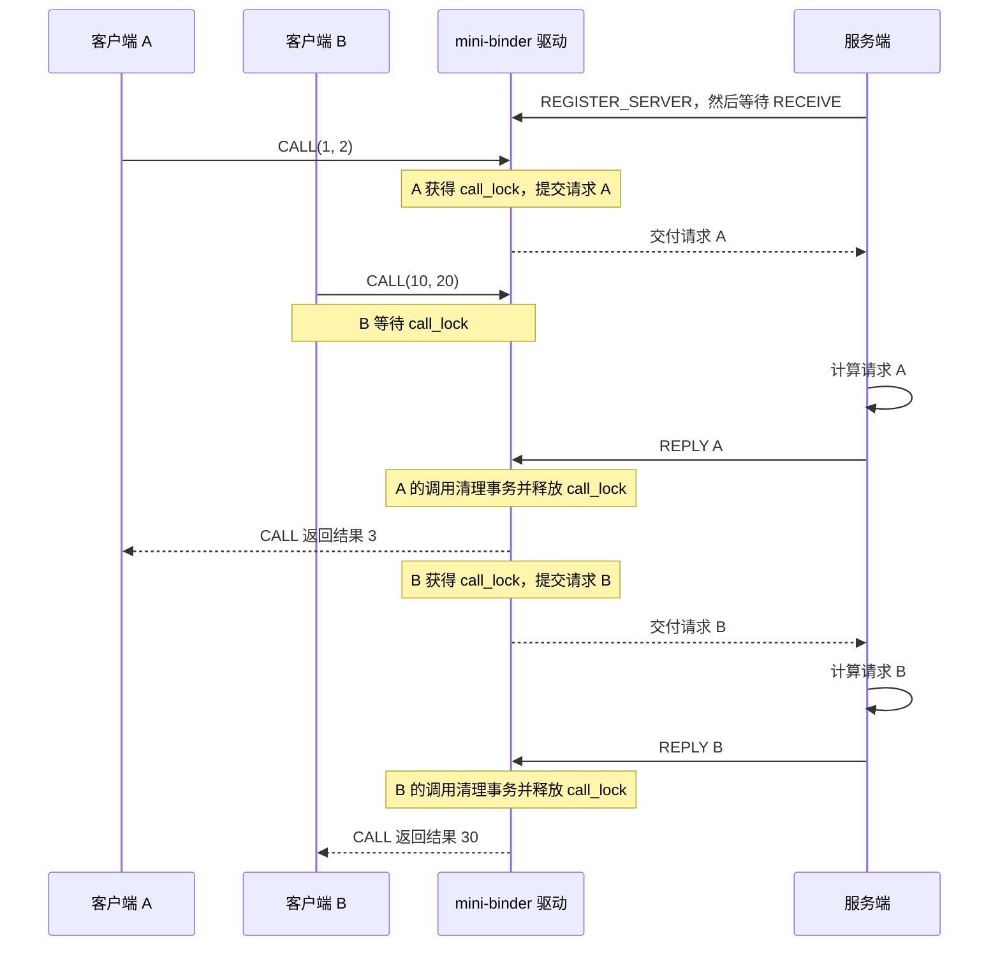

# 1.4 让多个客户端等待调用

## 1.4.1 上一章遇到了什么问题？

第 1.3 章只有一个请求槽。客户端 A 正在调用时，客户端 B 如果也发起调用，会得到 `EBUSY`。这避免了请求互相覆盖，但对客户端并不方便：B 必须自己决定是否重试。

这一章仍然只保留**一个服务端、一笔在途事务**，但让多个客户端在驱动里等待使用请求槽。A 完成后，等待中的客户端才有机会提交下一笔。服务端仍是逐笔处理，内核并没有并行执行多个事务。

本章源码位于 `examples/1.4/`。与 `examples/1.3/` 相比，本章新增客户端串行等待和请求编号；协议版本从 3 变为 4。两个目录可独立构建。

### 1.4.1.1 两个客户端的时序

下图展示 A 先获得 `call_lock`、B 随后发起调用的一种正常时序；实际获取锁的顺序取决于调度，mutex 不保证严格先进先出。



这里为了说明排队，假设 B 在 A 占用事务槽时到达。B 等待的是 `call_lock`；服务端处理 A 时仍可取得 `state_lock`。由于释放锁发生在 A 的 `ioctl` 返回用户态之前，实际运行中 B 的请求也可能先于 A 在用户态收到结果。

## 1.4.2 为什么需要两把锁？

只保留第 1.3 章的状态锁不能让 B 一直持锁等待：A 和服务端也需要那把锁来完成事务。如果 B 持有状态锁睡眠，处理流程就可能无法推进。

因此本章把职责分开：

- `call_lock`：一次只允许一个客户端占用请求槽。其他客户端等待该锁，可以被信号中断。
- `state_lock`：短暂保护服务端、事务状态、请求和回复数据。不能在等待服务端时一直持有它。

源码：`examples/1.4/kernel/mini_binder.c`，第 14–17 行。

```c
static DEFINE_MUTEX(state_lock);
static DEFINE_MUTEX(call_lock);
static DECLARE_WAIT_QUEUE_HEAD(server_wait);
static DECLARE_WAIT_QUEUE_HEAD(client_wait);
```

两把锁的关系是：客户端获得 `call_lock` 后，才短暂获得 `state_lock` 更新状态；它可以带着 `call_lock` 等待服务端，但必须先释放 `state_lock`。服务端只需要状态锁，所以能够读取请求并写入回复。

下面按一次正常调用观察锁与等待的范围；`client_wait` 是等待队列，不是第三把 mutex：

```text
客户端 A 的驱动线程                    服务端的驱动线程
获得 call_lock                         RECEIVE 等待请求
  获得 state_lock
  写请求，设置 PENDING
  释放 state_lock
  唤醒服务端                           获得 state_lock，领取请求
  等待 client_wait（仍持有 call_lock）  释放 state_lock，用户态计算
                                       获得 state_lock，保存回复
                                       释放 state_lock，唤醒客户端
  获得 state_lock，取回复并重置状态
  释放 state_lock
  复制结果到客户端
释放 call_lock
```

等待中的客户端 B 不能获得 `call_lock`，但服务端不需要这把锁，仍能推进 A 的请求。图只展示正常路径；客户端中断和服务端退出时也必须释放已持有的锁。

## 1.4.3 客户端如何等待轮到自己？

`call_server()` 先将参数从用户态复制到内核局部变量，再请求事务锁：

源码：`examples/1.4/kernel/mini_binder.c`，第 42–47 行。

```c
    if (copy_from_user(&call, arg, sizeof(call)))
        return -EFAULT;
    ret = mutex_lock_interruptible(&call_lock);
    if (ret)
        return ret;
    mutex_lock(&state_lock);
```

如果 A 已经占用 `call_lock`，B 会等待；等待被信号中断时返回错误。获得锁后，驱动再检查服务端和请求状态，发布请求并唤醒服务端。等到回复或失败后，A 恢复事务槽并释放 `call_lock`，其他等待者才能继续。mutex 不承诺本章所有客户端按严格先进先出的顺序获得锁。

源码：`examples/1.4/kernel/mini_binder.c`，第 67–81 行。

```c
    ret = wait_event_interruptible(client_wait,
            READ_ONCE(state) == RPC_DONE || READ_ONCE(state) == RPC_FAILED);
    mutex_lock(&state_lock);
    if (!ret && state == RPC_DONE) {
        call.result = reply.result;
        call.status = reply.status;
    } else if (!ret) {
        ret = -EPIPE;
    }
    WRITE_ONCE(state, RPC_IDLE);
    mutex_unlock(&state_lock);
    if (!ret && copy_to_user(arg, &call, sizeof(call)))
        ret = -EFAULT;
    mutex_unlock(&call_lock);
    return ret;
```

等待条件满足后先持状态锁取回复、重置状态；再向当前客户端复制结果，最后释放事务锁。`copy_to_user()` 可能失败，此时返回 `EFAULT`。不论成功还是失败，槽和事务锁都需要清理。

## 1.4.4 旧回复为什么需要编号？

第 1.3 章的做法是：客户端中断后，如果服务端已经领取请求，暂时禁止重用该槽，等旧回复被丢弃或服务端退出。本章希望中断的客户端释放事务锁，让下一个客户端继续，但旧服务端回复仍可能迟到。

考虑下面的顺序：

1. 客户端 A 的请求被服务端领取，A 被信号中断并离开。
2. 客户端 B 获得事务锁，提交并等待自己的请求。
3. 服务端此时回复 A 的旧结果。

如果只看“当前有一笔正在处理的请求”，旧结果可能被错误交给 B。因此，本章为每笔请求分配递增的 `id`，服务端将该编号原样放入回复。

源码：`examples/1.4/include/mini_binder.h`，第 19–29 行。

```c
struct mini_binder_request {
    __u64 id;
    __s32 a;
    __s32 b;
};

struct mini_binder_reply {
    __u64 id;
    __s32 result;
    __s32 status;
};
```

驱动在 `call_server()` 的状态锁内增加 `next_id` 并填入请求。若编号达到上限，后续请求返回 `EOVERFLOW`，不会让编号回绕重用。`send_reply()` 同时检查服务端身份、事务状态和编号：

源码：`examples/1.4/kernel/mini_binder.c`，第 126–135 行。

```c
    if (server_file != file)
        ret = -EPERM;
    else if (state != RPC_PROCESSING || incoming.id != request.id)
        ret = -ENOENT;
    else if (incoming.status > 0)
        ret = -EINVAL;
    else {
        reply = incoming;
        WRITE_ONCE(state, RPC_DONE);
    }
```

旧回复的编号不匹配时返回 `ENOENT`；示例服务端丢弃该回复，继续等待请求。编号只解决本章的回复匹配问题，不代表已经实现 Android Binder 的事务模型。

## 1.4.5 构建和实验

在准备好内核构建目录的 Linux 实验环境中，进入 `examples` 仓库的本章目录：

```sh
cd examples/1.4
make
sudo insmod kernel/mini_binder.ko
./build/version
./build/server
```

服务端所在终端的预期输出为：

```text
mini-binder protocol version: 4
server ready
```

服务端显示 `server ready` 后，在**另一个终端**进入同一目录并运行：

```sh
./build/client 1 2 &
./build/client 10 20 &
wait
```

客户端终端应看到以下输出，两行顺序不固定：

```text
remote add(1, 2) = 3
remote add(10, 20) = 30
```

两个客户端分别发起调用，但服务端一次只处理一笔。此处的 `wait` 假定服务端运行在另一个终端。服务端不会为每个请求打印日志；驱动只记录模块注册和注销。可以使用 `strace -e trace=ioctl ./build/client 1 2` 观察客户端系统调用。

停止普通服务端后，执行下面的测试，再卸载模块：

```sh
timeout 10 ./build/stale_reply
timeout 10 ./build/server_death
sudo rmmod mini_binder
make clean
```

`stale_reply` 验证中断后的旧回复被拒绝，下一笔请求仍能获得正确结果；`server_death` 验证服务端收到请求后退出时，等待中的客户端得到 `EPIPE`。这两个测试会自行注册测试服务端，运行时不能有其他服务端占用设备。

所有驱动章节使用同名模块和设备；开始本章之前，应先停止其他章节的服务端并卸载已加载的 `mini_binder` 模块。

## 1.4.6 验证与限制

本章在 Ubuntu 24.04、ARM64、Linux 6.8 上验证了 50 个并发客户端各自获得正确结果，以及旧回复、服务端退出、服务重启和第 1.2 章的 `ioctl` 错误路径。

多个客户端只是等待同一个事务槽；没有公平调度保证，也没有超时、访问控制或资源配额。服务端活着但不回复时，持有事务锁的客户端及其后的等待者可能一直等待。后续章节再研究数据传输和更完整的事务管理。

## 1.4.7 自测

为什么 B 等待时不能持有 `state_lock`？`call_lock` 在哪里释放？只有一个槽时为何仍需要请求编号？互斥锁是否保证客户端严格按到达顺序执行？

参考：服务端需要取得 `state_lock` 来推进事务；客户端在调用结束时释放 `call_lock`。编号用于匹配和拒绝旧回复；互斥锁不保证严格 FIFO。

完成第一篇后，可以做[第一篇自测卷](../appendices/1-review.md)。
