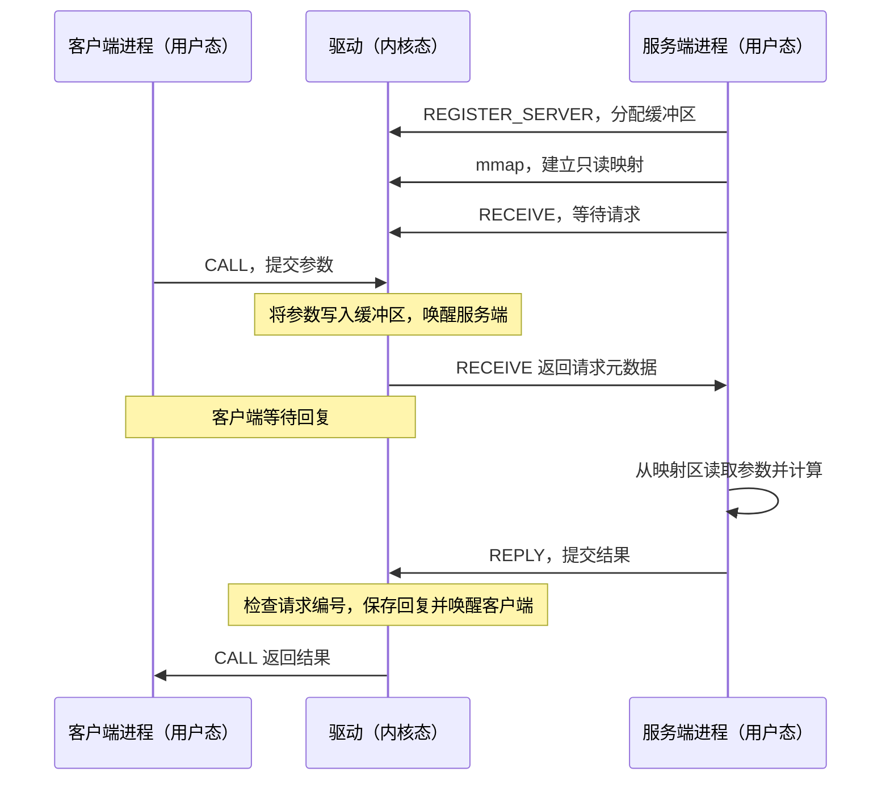
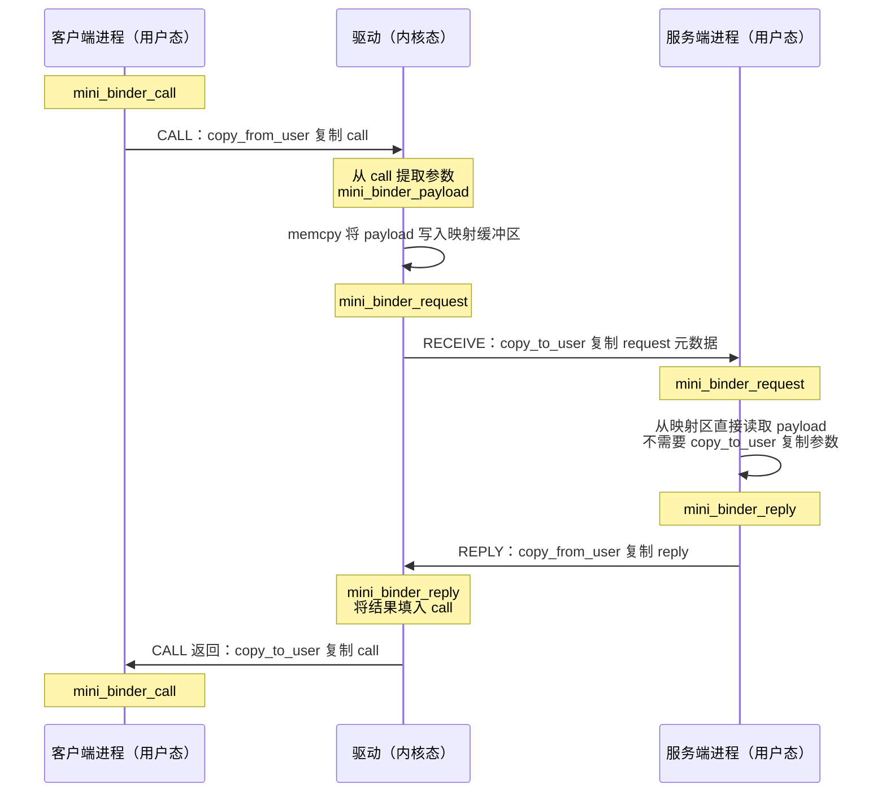

# 2.1 从数据复制到映射缓冲区

## 2.1.1 上一章的数据怎样到达服务端？

第 1.4 章中，客户端把 `mini_binder_call` 交给驱动，驱动通过 `copy_from_user()` 取得参数；服务端调用 `RECEIVE` 时，驱动再通过 `copy_to_user()` 将包含参数的请求结构复制到服务端的用户缓冲区。

如果未来请求包含更大的数据，这种逐次把载荷复制到接收端用户缓冲区的方式可能有成本。本章尝试另一种设计：驱动为服务端准备一页缓冲区，将它映射进服务端地址空间；请求到达时，驱动写入这页，服务端取得元数据后直接从映射地址读取参数。

**本章没有实现零拷贝，也没有证明性能更快。** 客户端结构仍通过 `copy_from_user()` 进入内核，内核还用 `memcpy()` 将参数放进映射缓冲区；`RECEIVE` 仍复制请求元数据，回复路径也仍有复制。本章只是避免了逐次使用 `copy_to_user()` 把**请求参数本身**复制到服务端另一个用户缓冲区。对两个整数而言，映射的建立与管理成本很可能超过收益，需要基准测试才能比较实际性能。

本章源码位于 `examples/2.1/`，协议版本显示为 `0201`；本章代码与第 1.4 章的请求布局不同，驱动、客户端和服务端必须使用同一章节版本。

## 2.1.2 虚拟地址、物理页与映射

进程中的指针是虚拟地址，内核也使用自己的虚拟地址。两个不同的虚拟地址可以通过各自的映射访问同一物理页；地址数值不同并不妨碍共享数据。


`mmap()` 是用户态请求建立映射的系统调用；VMA（虚拟内存区域）描述一段用户态地址范围及其访问属性。调用成功后服务端得到一个自己的用户虚拟地址，不能把驱动的内核指针当作用户态指针使用。`mmap` 本身不会自动发送请求或唤醒线程，仍需要协议和同步。

本例使用一页由 `vmalloc_user()` 分配、可供用户映射的内核缓冲区。`remap_vmalloc_range()` 将相应页面映射给用户；不要因为内核虚拟地址连续就假定一般的 `vmalloc` 分配在物理上连续。

## 2.1.3 设计数据流

先看一次正常调用的时序：服务端提前建立映射并等待请求，客户端提交请求后等待服务端回复。



本章使用以下四个结构体。源码：`examples/2.1/include/mini_binder.h`，第 12–33 行。

```c
struct mini_binder_call {
    __s32 a;
    __s32 b;
    __s32 result;
    __s32 status;
};

struct mini_binder_request {
    __u64 id;
    __u32 size;
};

struct mini_binder_payload {
    __s32 a;
    __s32 b;
};

struct mini_binder_reply {
    __u64 id;
    __s32 result;
    __s32 status;
};
```

`call` 用于客户端提交参数和接收结果；`payload` 保存写入映射区的请求参数；`request` 携带请求编号和长度；`reply` 携带编号、结果和状态。当前只有一个固定槽，服务端直接读取映射起始地址。

下面看结构体和数据如何传递：



图中服务端对页的访问使用它自己的用户态虚拟地址；驱动写入使用内核虚拟地址。`RECEIVE` 复制的是请求元数据，不复制 `payload`；当前实验将固定大小的加法参数放在映射页起始位置。客户端的 `call` 和服务端的 `reply` 仍通过用户态与内核态之间的复制传递。

这只是本机同架构的教学协议，不是通用序列化格式，也不是 Android Binder UAPI。

## 2.1.4 内核分配并建立映射

### 2.1.4.1 缓冲区属于谁？

驱动的 `mini_binder_open()` 为每次打开设备创建 `mini_binder_file`，保存在 `file->private_data`。服务端注册时为其分配一页，注册失败则释放该页：

源码：`examples/2.1/kernel/mini_binder.c`，第 44–63 行。

```c
static long register_server(struct file *file)
{
    struct mini_binder_file *ctx = file->private_data;
    void *buffer = vmalloc_user(PAGE_SIZE);
    long ret = 0;

    if (!buffer)
        return -ENOMEM;
    mutex_lock(&state_lock);
    if (server_file)
        ret = -EBUSY;
    else {
        ctx->buffer = buffer;
        WRITE_ONCE(server_file, file);
    }
    mutex_unlock(&state_lock);
    if (ret)
        vfree(buffer);
    return ret;
}
```

`vmalloc_user()` 返回内核地址，内存已清零；本例将它附着于服务端打开的文件，而不是放在客户端进程中。分配和注册是两个可能失败的步骤；如果已经有服务端，刚分配的页会被 `vfree()` 回收。

### 2.1.4.2 服务端调用 mmap

源码：`examples/2.1/userspace/server.c`，第 27–38 行。

```c
    page_size = sysconf(_SC_PAGESIZE);
    if (page_size <= 0 || (size_t)page_size < sizeof(struct mini_binder_payload)) {
        fprintf(stderr, "cannot determine page size\n");
        close(fd);
        return 1;
    }
    mapping = mmap(NULL, (size_t)page_size, PROT_READ, MAP_SHARED, fd, 0);
    if (mapping == MAP_FAILED) {
        perror("mmap");
        close(fd);
        return 1;
    }
```

服务端在注册后、接收请求前映射一页：`PROT_READ` 表示只读，`MAP_SHARED` 请求共享映射，偏移为 0。返回的 `mapping` 是服务端自己的用户地址。此后同一映射可供多笔**串行**事务使用；服务端退出前调用 `munmap()`。

### 2.1.4.3 驱动检查 VMA 并映射

源码：`examples/2.1/kernel/mini_binder.c`，第 65–83 行。

```c
static int mini_binder_mmap(struct file *file, struct vm_area_struct *vma)
{
    struct mini_binder_file *ctx = file->private_data;
    int ret;

    if (vma->vm_pgoff || vma->vm_end - vma->vm_start != PAGE_SIZE ||
        !(vma->vm_flags & VM_MAYSHARE) || (vma->vm_flags & (VM_WRITE | VM_EXEC)))
        return -EINVAL;
    mutex_lock(&state_lock);
    if (server_file != file || !ctx->buffer) {
        ret = -EPERM;
    } else {
        vm_flags_clear(vma, VM_MAYWRITE | VM_MAYEXEC);
        vm_flags_set(vma, VM_DONTEXPAND | VM_DONTDUMP);
        ret = remap_vmalloc_range(vma, ctx->buffer, 0);
    }
    mutex_unlock(&state_lock);
    return ret;
}
```

这里检查页偏移为 0、VMA 的页对齐后长度为一页、映射是共享方式且没有写或执行权限；只有注册服务端的文件可以映射。`VM_MAYSHARE` 用于识别共享映射，不能在所有只读文件映射中简单依赖 `VM_SHARED`。清除 `VM_MAYWRITE` 和 `VM_MAYEXEC` 后，不能再通过 `mprotect()` 将映射升级为可写或可执行；`VM_DONTEXPAND` 和 `VM_DONTDUMP` 限制扩展及转储。

这些检查是此教学实验的选择，不代表真实 Binder 的全部权限策略。`file_operations` 的 `.mmap = mini_binder_mmap` 将用户的 `mmap()` 请求连接到此函数；内核 API 的可用性与版本相关，本章已针对下方所列内核验证。

## 2.1.5 一次请求如何读取映射？

客户端 `CALL` 仍先通过 `copy_from_user()` 复制客户端结构。驱动拿到事务槽及状态锁后，将参数写进服务端关联的页，再发布元数据：

源码：`examples/2.1/kernel/mini_binder.c`，第 116–124 行。

```c
    server_ctx = server_file->private_data;
    payload.a = call.a;
    payload.b = call.b;
    memcpy(server_ctx->buffer, &payload, sizeof(payload));
    request.id = ++next_id;
    request.size = sizeof(payload);
    WRITE_ONCE(state, RPC_PENDING);
    mutex_unlock(&state_lock);
    wake_up_interruptible(&server_wait);
```

服务端的 `RECEIVE` 拿到元数据后，先检查大小，再从映射页起始地址读取参数：

源码：`examples/2.1/userspace/server.c`，第 53–63 行。

```c
        if (req.size != sizeof(*payload)) {
            fprintf(stderr, "invalid mapped payload\n");
            break;
        }
        payload = (const struct mini_binder_payload *)mapping;
        sum = (int64_t)payload->a + payload->b;
        reply.id = req.id;
        if (sum < INT32_MIN || sum > INT32_MAX)
            reply.status = -ERANGE;
        else
            reply.result = (__s32)sum;
```

映射页起始地址满足结构体访问的对齐需要。本章只使用固定起始位置；`mmap()` 自身的文件偏移参数是另一个概念，本章要求它为零。

## 2.1.6 回复如何返回客户端？

服务端读取映射中的两个整数后计算结果，构造与当前请求编号关联的回复，再通过 `REPLY` 交给驱动。源码：`examples/2.1/userspace/server.c`，第 57–69 行。

```c
        payload = (const struct mini_binder_payload *)mapping;
        sum = (int64_t)payload->a + payload->b;
        reply.id = req.id;
        if (sum < INT32_MIN || sum > INT32_MAX)
            reply.status = -ERANGE;
        else
            reply.result = (__s32)sum;
        if (ioctl(fd, MINI_BINDER_REPLY, &reply) == -1) {
            if (errno == ENOENT || errno == ECANCELED)
                continue;
            perror("reply");
            break;
        }
```

`reply.id` 是本次请求编号；结果放在 `reply.result`，溢出时通过 `reply.status` 报错。这个回复结构在服务端用户态，不在请求映射页中。

驱动先将回复从服务端复制到内核，核对当前服务端、事务状态与编号。源码：`examples/2.1/kernel/mini_binder.c`，第 187–207 行（节选）。

```c
    if (copy_from_user(&incoming, arg, sizeof(incoming)))
        return -EFAULT;
    mutex_lock(&state_lock);
    if (server_file != file)
        ret = -EPERM;
    /* ... 取消请求和编号不匹配的情况 ... */
    else {
        reply = incoming;
        WRITE_ONCE(state, RPC_DONE);
    }
    mutex_unlock(&state_lock);
    if (!ret)
        wake_up_interruptible(&client_wait);
```

客户端原先在 `CALL` 中等待；被唤醒后，驱动取出结果并将整个调用结构复制回客户端。源码：`examples/2.1/kernel/mini_binder.c`，第 126–142 行（节选）。

```c
    ret = wait_event_interruptible(client_wait,
            READ_ONCE(state) == RPC_DONE || READ_ONCE(state) == RPC_FAILED);
    mutex_lock(&state_lock);
    if (!ret && state == RPC_DONE) {
        call.result = reply.result;
        call.status = reply.status;
    } else if (!ret) {
        ret = -EPIPE;
    }
    /* ... 恢复事务槽状态 ... */
    mutex_unlock(&state_lock);
    wake_up_interruptible(&slot_wait);
    if (!ret && copy_to_user(arg, &call, sizeof(call)))
        ret = -EFAULT;
```

因此 2.1 只有请求参数通过服务端映射读取；回复依次经过服务端到驱动的 `copy_from_user()` 和驱动到客户端的 `copy_to_user()`。客户端检查 `call.status` 后使用 `call.result`，后面的 2.4 才让客户端从映射页读取回复载荷。

## 2.1.7 缓冲区什么时候可以复用？

只有一页缓冲区，如果服务端正在读取时客户端因信号退出，下一笔请求立即覆盖这一页，服务端可能读到新请求的数据。因此本章不能仅靠请求编号来保护**数据内容**。

正常情况下，服务端完成读取和计算后提交 `REPLY`，客户端接收结果后事务槽回到空闲；下一笔才可写入该页。若客户端在服务端领取请求后被中断，状态变为 `RPC_CANCELLED`，后续客户端在 `slot_wait` 等待；服务端提交旧回复时得到 `ECANCELED`，旧回复被丢弃并唤醒等待者。服务端文件释放也会解除这个等待。若服务端一直不回复且不退出，等待可能无限持续；本章没有超时。

缓冲区释放也与映射生命周期有关：映射通常持有对打开文件的引用，因此仅关闭 FD 不一定立即触发驱动的 `release`；最后一个文件引用（包括映射持有的引用）释放后，`mini_binder_release()` 才执行 `vfree()` 和 `kfree()`。`mmap_access` 测试会检查关闭 FD 但保留映射时无法注册第二个服务端，解除映射后才可重新注册。复制 FD、`fork()` 继承映射等也可能延长引用生命周期。

## 2.1.8 构建与实验

在支持模块加载且有匹配内核构建目录的 Linux 实验环境中，进入 `examples` 仓库的本章目录：

```sh
cd examples/2.1
make
sudo insmod kernel/mini_binder.ko
./build/version
./build/server
```

第一个终端中，版本查询和服务端分别输出：

```text
mini-binder protocol version: 0201
server ready
```

服务端显示 `server ready` 后，在另一个终端进入源码目录执行：

```sh
./build/client 1 2
./build/client -20 100
```

客户端终端输出：

```text
remote add(1, 2) = 3
remote add(-20, 100) = 80
```

服务端不会逐次打印请求结果。它内部已使用映射读取参数；客户端输出格式与上一章相同，但服务端读取请求的数据路径发生了变化。

停止普通服务端后运行：

```sh
timeout 10 ./build/mmap_access
timeout 10 ./build/stale_reply
timeout 10 ./build/server_death
sudo rmmod mini_binder
make clean
```

`mmap_access` 验证未注册映射、长度和偏移、私有映射、写权限升级以及关闭 FD 后的映射生命周期。`stale_reply` 验证中断请求的回复被丢弃、下一笔请求可以读取新参数；`server_death` 验证服务端退出后客户端被唤醒。运行这些测试时不能已有普通服务端注册。

所有驱动章节使用同名模块和设备；开始本章之前，应先停止其他章节的服务端并卸载已加载的 `mini_binder` 模块。

## 2.1.9 与真实 Binder 的距离

Android 16 的参考内核代码中，`drivers/android/binder.c` 的 `binder_mmap()` 将映射处理交给 `binder_alloc_mmap_handler()`；`binder_alloc.c` 中还有向接收方缓冲区复制用户数据的逻辑。这说明映射与事务数据传输有关，但本章的一页固定缓冲区、`ioctl` 协议和生命周期处理只是教学设计，并不等同于真实 Binder 的分配器、对象转换或安全机制。

真实 Binder 的同步回复数据也放在客户端的 Binder 映射缓冲区中：驱动把服务端提供的回复数据复制到该缓冲区，客户端从映射中读取。相比之下，本章只有服务端通过映射读取请求参数，回复结果仍通过 `ioctl` 复制给客户端；使用映射也不意味着发送方到接收方完全没有数据复制。

本章已在 Ubuntu 24.04、ARM64、Linux 6.8 实验环境验证构建、加载、映射权限及生命周期、正常调用、客户端中断、服务端死亡和 50 个并发客户端的正确结果。没有进行性能基准测试或穷尽所有内存、并发异常。

下一章将讨论如何把不同类型的数据组织为可解析的结构，而不是继续把参数固定为两个整数。

## 2.1.10 自测

映射后客户端到内核还有复制吗？服务端读取的地址为什么不能直接当作内核指针？为什么客户端中断后缓冲区不能马上覆盖？为什么关闭 FD 不一定立即释放映射页？

参考：客户端请求仍通过 `copy_from_user` 进入内核。服务端指针属于它的地址空间；请求被领取后旧数据可能仍被读取；VMA 可继续持有文件引用。
