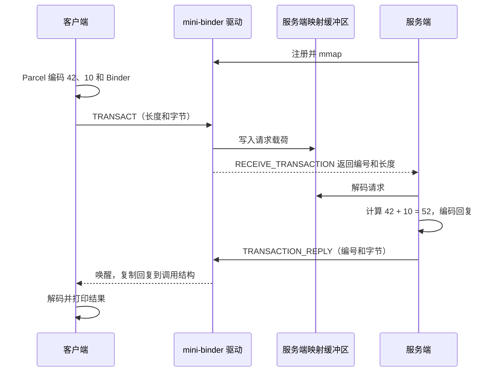
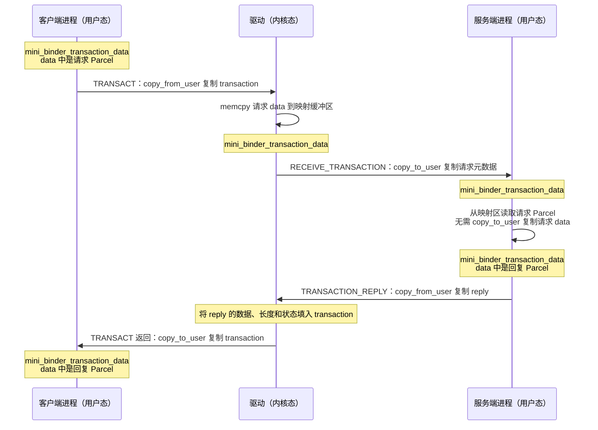

# 2.3 让 Parcel 通过驱动传输

## 2.3.1 从内存编码到跨进程调用

第 2.2 章的 Parcel 只在一个进程的内存中读写；第 2.1 章虽然有跨进程调用，却只能传递两个固定整数。现在把两者连起来：客户端编码两个整数和一段字符串，驱动把请求载荷放到服务端映射区，服务端解码后将两个整数相加，再把结果和字符串编码为回复。

本章源码在 `examples/2.3/`，驱动协议版本显示为 `0203`。本章使用 Parcel 事务接口，运行实验时需使用本章配套的驱动和程序。

## 2.3.2 事务走过哪些位置？



映射只用于服务端读取请求。客户端到驱动、服务端回复到驱动，以及驱动返回客户端均有复制；它不是零拷贝。与第 2.2 章相同，这里的 Parcel 格式是教学设计，不能与 Android Parcel 互通。

## 2.3.3 定义事务数据

源码：`examples/2.3/include/mini_binder.h`，第 13–19 行。

```c
struct mini_binder_transaction_data {
    __u64 id;
    __u32 size;
    __s32 status;
    __u32 code;
    __u8 data[MINI_BINDER_MAX_DATA];
};
```

客户端提交时 `size` 是请求长度；调用成功后驱动把它改为实际回复长度，`status` 表示处理结果，`data` 被回复字节替换。客户端解析 Parcel 时用返回的 `size` 作为有效数据边界。服务端的回复包含驱动分配的请求编号 `id`，驱动通过它匹配当前事务并拒绝过期回复；它不是服务对象 handle 或操作命令。数组上限为 256 字节，长度大于上限返回 `EMSGSIZE`。这是一种固定容量的教学接口，不是 Android 的事务结构。

客户端提交、服务端领取和服务端回复都使用同一结构。服务端领取时，驱动返回 `id` 和 `size`，请求载荷位于映射页起始位置，不使用接收结构中的 `data`。`code` 暂时预留，本章不使用；第 2.5 章将用它选择操作。



映射只避免了驱动向服务端另一个用户缓冲区复制请求载荷；请求进入驱动、写入映射区，以及回复返回客户端仍有复制。

## 2.3.4 客户端编码请求

源码：`examples/2.3/userspace/transaction_client.c`，第 20–30 行（节选）。

```c
    parcel_init(&p, transaction.data, sizeof(transaction.data));
    if (parcel_write_u32(&p, 42) || parcel_write_u32(&p, 10) || parcel_write_string(&p, "Binder", 6))
        return 1;
    transaction.size = (__u32)p.size;
    fd = open("/dev/mini_binder", O_RDONLY);
    if (fd < 0 || ioctl(fd, MINI_BINDER_TRANSACT, &transaction) < 0) {
        perror("transaction");
        if (fd >= 0)
            close(fd);
        return 1;
    }
```

请求载荷由第 2.2 章的编码函数生成，包含两个整数和一个字符串，长度为 20 字节。`TRANSACT` 是同步调用，客户端在驱动内等待服务端回复；系统调用失败和服务端返回的 `status` 是两种不同的错误来源。

## 2.3.5 驱动接收并发布请求

源码：`examples/2.3/kernel/mini_binder.c`，第 91–94、117–123 行（节选；中间省略等待事务槽和检查服务端的代码）。

```c
    if (copy_from_user(&transaction, arg, sizeof(transaction)))
        return -EFAULT;
    if (transaction.size > MINI_BINDER_MAX_DATA)
        return -EMSGSIZE;
    /* ... */
    server_ctx = server_file->private_data;
    memcpy(server_ctx->buffer, transaction.data, transaction.size);
    request.size = transaction.size;
    request.id = ++next_id;
    WRITE_ONCE(state, RPC_PENDING);
    mutex_unlock(&state_lock);
    wake_up_interruptible(&server_wait);
```

驱动先从用户地址复制整个事务结构并验证长度，取得事务槽和 `state_lock` 后才把有效载荷写入服务端页。它记录编号和长度，再发布 `RPC_PENDING` 并唤醒服务端；驱动不解析整数和字符串。`call_lock` 串行化客户端，`state_lock` 保护共享事务状态；第 2.1 章的取消和映射生命周期规则仍适用。

## 2.3.6 服务端解析并生成回复

源码：`examples/2.3/userspace/transaction_server.c`，第 43–67 行（节选）。

```c
        if (ioctl(fd, MINI_BINDER_RECEIVE_TRANSACTION, &request) < 0) {
            if (errno == EINTR)
                continue;
            perror("receive");
            break;
        }
        reply.id = request.id;
        parcel_init(&input, (void *)mapping, (size_t)page_size);
        input.size = request.size;
        parcel_init(&output, reply.data, sizeof(reply.data));
        if (request.size > MINI_BINDER_MAX_DATA ||
            parcel_read_u32(&input, &number) || parcel_read_u32(&input, &other) ||
            parcel_read_string(&input, &text, &length) || input.position != input.size ||
            number > UINT32_MAX - other || parcel_write_u32(&output, number + other) ||
            parcel_write_string(&output, (const char *)text, length)) {
            reply.status = -EINVAL;
        } else {
            reply.size = (__u32)output.size;
        }
        if (ioctl(fd, MINI_BINDER_TRANSACTION_REPLY, &reply) < 0) {
            if (errno == ENOENT || errno == ECANCELED)
                continue;
            perror("reply");
            break;
        }
```

服务端先验证映射数据长度，再按约定顺序读取两个无符号整数和字符串；`input.position != input.size` 拒绝尾随数据。加法前检查整数溢出，随后将结果与原字符串写入回复缓冲区。请求内容不合法或结果溢出时返回负的 `EINVAL` 状态和空回复。`ECANCELED` 表示客户端已经取消，服务端丢弃该回复并继续接收。

## 2.3.7 驱动与客户端处理回复

源码：`examples/2.3/kernel/mini_binder.c`，第 125–143 行（节选）。

```c
    ret = wait_event_interruptible(client_wait,
            READ_ONCE(state) == RPC_DONE || READ_ONCE(state) == RPC_FAILED);
    mutex_lock(&state_lock);
    if (!ret && state == RPC_DONE) {
        transaction.size = transaction_reply.size;
        transaction.status = transaction_reply.status;
        memset(transaction.data, 0, sizeof(transaction.data));
        memcpy(transaction.data, transaction_reply.data, transaction_reply.size);
    } else if (!ret) {
        ret = -EPIPE;
    }
    if (ret && state == RPC_PROCESSING)
        WRITE_ONCE(state, RPC_CANCELLED);
    else
        WRITE_ONCE(state, RPC_IDLE);
    mutex_unlock(&state_lock);
    wake_up_interruptible(&slot_wait);
    if (!ret && copy_to_user(arg, &transaction, sizeof(transaction)))
        ret = -EFAULT;
```

服务端提交回复时，驱动在 `send_reply()` 验证长度、编号和状态，保存回复并唤醒客户端。客户端线程在锁内取出回复，释放事务槽，再通过 `copy_to_user()` 返回。取消后的事务不会立刻覆盖仍可能被服务端读取的映射区。

源码：`examples/2.3/kernel/mini_binder.c`，第 196–214 行（节选）。

```c
    mutex_lock(&state_lock);
    if (server_file != file)
        ret = -EPERM;
    else if (state == RPC_CANCELLED && id == request.id) {
        WRITE_ONCE(state, RPC_IDLE);
        release_slot = true;
        ret = -ECANCELED;
    }
    else if (state != RPC_PROCESSING || id != request.id)
        ret = -ENOENT;
    /* ... 检查状态并保存回复 ... */
```

这里的 `id` 与当前请求编号匹配后才能接受回复；客户端中断后迟到的回复也不会误当作下一笔请求的回复。

源码：`examples/2.3/userspace/transaction_client.c`，第 32–43 行（节选）。

```c
    if (transaction.status || transaction.size > sizeof(transaction.data)) {
        fprintf(stderr, "invalid reply: status=%d size=%u\n", transaction.status, transaction.size);
        return 1;
    }
    parcel_init(&p, transaction.data, sizeof(transaction.data));
    p.size = transaction.size;
    if (parcel_read_u32(&p, &number) || parcel_read_string(&p, &text, &length) ||
        p.position != p.size) {
        fprintf(stderr, "invalid reply parcel\n");
        return 1;
    }
    printf("reply: number=%" PRIu32 ", text=%.*s\n", number, (int)length, text);
```

客户端先检查状态和长度，再按相同规则解码，避免把不完整回复当成有效数据。返回的字符串指向事务结构内的字节，不要求有结束符。

## 2.3.8 构建和实验

在具备匹配内核构建目录且允许加载模块的 Linux 环境中，先停止其他章节服务端并卸载已加载的 `mini_binder`。在第一个终端运行：

```sh
cd examples/2.3
make
sudo insmod kernel/mini_binder.ko
./build/version
./build/transaction_server
```

实际输出：

```text
mini-binder protocol version: 0203
transaction server ready
```

服务端准备好后，在另一个终端进入同一目录：

```sh
./build/transaction_client
./build/transaction_test
./build/transaction_client
```

实际输出：

```text
reply: number=52, text=Binder
oversized, malformed and overflowing requests rejected
reply: number=52, text=Binder
```

测试先验证驱动拒绝超长请求，再验证服务端拒绝被截断的 Parcel 和加法溢出；最后一次正常请求证明异常请求后服务仍可继续工作。停止服务端后可运行 `timeout 10 ./build/stale_reply`、`timeout 10 ./build/server_death`、`timeout 10 ./build/mmap_access` 和 `./build/parcel_test`；这些测试覆盖事务取消、服务端死亡、映射及基础编码，不能代替所有异常和并发场景的测试。最后执行 `sudo rmmod mini_binder` 和 `make clean`。

## 2.3.9 限制和下一步

本章只有一个服务端、单笔在途事务和 256 字节载荷，没有超时、服务发现、对象传递、文件描述符或权限控制。驱动保存字节但不理解 Parcel 字段。实际验证环境为 Ubuntu 24.04 ARM64、Linux 6.8，尚未穷尽并发和故障情况。

本章客户端没有调用 `mmap()`，回复仍通过 `ioctl` 复制到客户端的事务结构；只有服务端使用映射读取请求。Android Binder 的同步回复数据也进入客户端映射缓冲区，事务还支持更丰富的元数据和对象转换。第 2.4 章将增加客户端映射回复，再进入远程对象的设计。

## 2.3.10 自测

1. 同一事务结构中的 `size` 在请求和回复时分别表示什么？
2. 服务端收到的事务结构中，如何找到请求 Parcel？
3. 为什么驱动仍要检查回复的 `id`？

参考：分别是请求长度和实际回复长度；服务端从映射页起始位置读取载荷，结构只返回元数据；编号用于匹配事务并拒绝旧回复。
