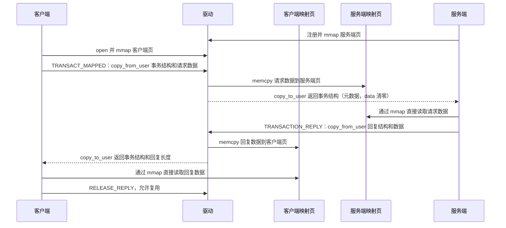
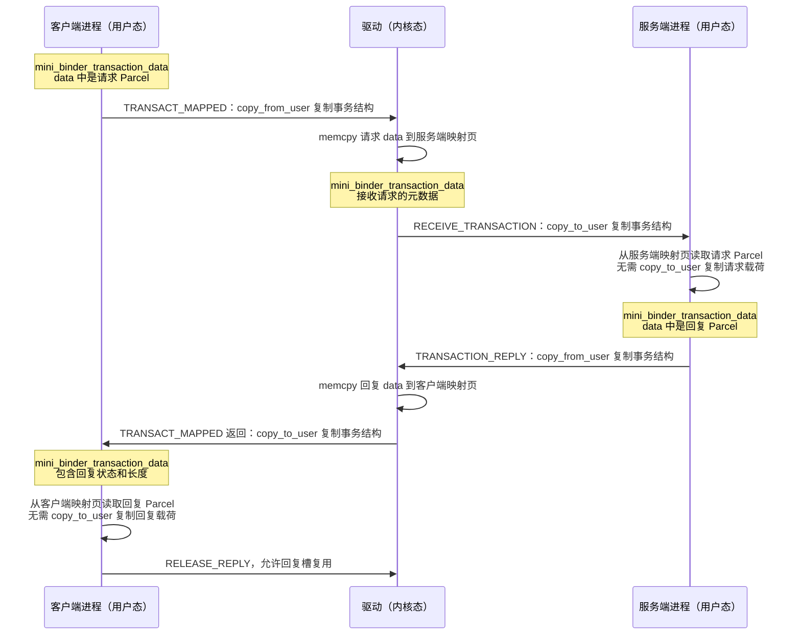

# 2.4 让客户端从映射区读取回复

## 2.4.1 为什么还要映射回复？

第 2.3 章的服务端通过映射区读取请求，回复却由驱动复制到客户端传入的事务结构中。真实 Binder 的同步回复也使用接收方的映射缓冲区。本章为客户端增加只读映射，让服务端回复的数据最终写入客户端自己的缓冲区，客户端从映射地址解码。

源码位于 `examples/2.4/`，协议版本显示为 `0204`。本章保留第 2.3 章的事务结构和复制回复方式，同时新增映射回复；服务端仍使用 `transaction_server`。实验时使用本章配套驱动与程序。

这不是完全零拷贝：服务端把回复结构交给驱动，驱动复制回复数据到客户端缓冲区。事务结构也仍通过 `ioctl` 在两个方向复制，其中的 `data` 保存的是请求，不是映射回复。本章只避免了再通过 `copy_to_user()` 将回复载荷复制到客户端另一个用户缓冲区，没有做性能基准测试。

## 2.4.2 数据如何复制和映射？



每次 `open()` 都创建一个文件上下文，同一个文件上下文可持有一页缓冲区。服务端页保存请求，客户端页保存回复；分别打开设备的客户端拥有不同的页。`dup()` 或 `fork()` 继承的同一打开文件则共享上下文和回复槽。

图中的 `copy_from_user`、`copy_to_user` 和 `memcpy` 是本实现实际执行的复制；`mmap` 建立映射后，服务端和客户端分别直接读取对应映射页。由于本教学事务结构内嵌固定大小的 `data` 数组，驱动返回客户端时 `copy_to_user` 仍会复制整个事务结构，包括其中保留的请求字节；回复载荷则从客户端映射页读取。这不是一次复制都没有的“零拷贝”。

## 2.4.3 创建客户端映射

源码：`examples/2.4/kernel/mini_binder.c`，第 66–86 行。

```c
static int mini_binder_mmap(struct file *file, struct vm_area_struct *vma)
{
    struct mini_binder_file *ctx = file->private_data;
    int ret;

    if (vma->vm_pgoff || vma->vm_end - vma->vm_start != PAGE_SIZE ||
        !(vma->vm_flags & VM_MAYSHARE) || (vma->vm_flags & (VM_WRITE | VM_EXEC)))
        return -EINVAL;
    mutex_lock(&state_lock);
    if (!ctx->buffer)
        ctx->buffer = vmalloc_user(PAGE_SIZE);
    if (!ctx->buffer) {
        ret = -ENOMEM;
    } else {
        vm_flags_clear(vma, VM_MAYWRITE | VM_MAYEXEC);
        vm_flags_set(vma, VM_DONTEXPAND | VM_DONTDUMP);
        ret = remap_vmalloc_range(vma, ctx->buffer, 0);
    }
    mutex_unlock(&state_lock);
    return ret;
}
```

第 2.1 章只有注册服务端才能映射；本章允许客户端映射其文件上下文的页。驱动要求偏移为 0、一页、共享且不能写或执行，并禁止之后用 `mprotect()` 升级为可写或可执行。同一个文件多次映射会映射同一页。服务端须先注册再映射；已拥有缓冲区的文件不能再注册为服务端。

客户端使用 `mmap(NULL, page_size, PROT_READ, MAP_SHARED, fd, 0)`。本教学实现检查的是上下文中是否已分配缓冲区，并不跟踪当前是否仍有有效映射：如果应用提前 `munmap()`，调用仍可能成功，但应用需要重新映射才能读取。因此程序应保持映射有效直至读取完成。

## 2.4.4 请求、回复和回复槽

客户端提交、服务端接收和服务端回复沿用第 2.3 章的 `mini_binder_transaction_data`，驱动内部也用它保存请求元数据。源码：`examples/2.4/include/mini_binder.h`，第 13–19、22–26 行。

```c
struct mini_binder_transaction_data {
    __u64 id;
    __u32 size;
    __s32 status;
    __u32 code;
    __u8 data[MINI_BINDER_MAX_DATA];
};
/* ... */
#define MINI_BINDER_TRANSACT _IOWR(MINI_BINDER_IOC_MAGIC, 5, struct mini_binder_transaction_data)
#define MINI_BINDER_TRANSACTION_REPLY _IOW(MINI_BINDER_IOC_MAGIC, 6, struct mini_binder_transaction_data)
#define MINI_BINDER_TRANSACT_MAPPED _IOWR(MINI_BINDER_IOC_MAGIC, 7, struct mini_binder_transaction_data)
#define MINI_BINDER_RELEASE_REPLY _IO(MINI_BINDER_IOC_MAGIC, 8)
#define MINI_BINDER_RECEIVE_TRANSACTION _IOR(MINI_BINDER_IOC_MAGIC, 20, struct mini_binder_transaction_data)
```

同一种结构在不同阶段的字段用途不同：客户端提交时 `size` 和 `data` 是请求；服务端接收时 `id` 和 `size` 描述映射页起始处的请求，`data` 不承载接收数据；服务端回复时 `id`、`size`、`status` 和 `data` 描述回复。客户端完成调用后，`status` 和 `size` 描述结果及回复长度。`TRANSACT_MAPPED` 的回复载荷在客户端映射页，`TRANSACT` 则把它复制到事务结构的 `data` 中。

以下图展示 `TRANSACT_MAPPED` 路径中，事务结构和 Parcel 数据如何传递：



返回客户端的事务结构仍包含之前的请求 `data`，回复载荷位于客户端映射页；因此这条路径并非没有数据复制。

Android Binder 也在常规事务和回复中复用 `binder_transaction_data`，但本章结构和 ioctl 是独立的简化教学协议，不能与 Android Binder 互通。请求和回复的 Parcel 内容可以不同：本例请求是两个整数和字符串，回复是一个结果和字符串。

源码：`examples/2.4/userspace/transaction_server.c`，第 35–49 行（节选）。

```c
        struct mini_binder_transaction_data request;
        struct mini_binder_transaction_data reply = {0};
        /* ... */
        if (ioctl(fd, MINI_BINDER_RECEIVE_TRANSACTION, &request) < 0) {
            if (errno == EINTR)
                continue;
            perror("receive");
            break;
        }
        reply.id = request.id;
```

服务端使用统一结构接收事务，再用同一类型构造回复；`reply.id` 将回复与本次请求关联。字段存在于结构中，并不意味着每次都需要填写全部字段。

源码：`examples/2.4/kernel/mini_binder.c`，第 117–124 行（`call_server()` 节选）。

```c
    if (mapped_reply && !client_ctx->buffer) {
        ret = -ENXIO;
        goto unlock_state;
    }
    if (mapped_reply && client_ctx->reply_ready) {
        ret = -EBUSY;
        goto unlock_state;
    }
```

映射回复需要先分配客户端缓冲区；上次回复尚未释放时，同一打开文件不能再发起映射回复调用。检查发生在事务槽和 `state_lock` 下；不同客户端各有自己的回复槽，但驱动仍只有一个全局在途事务。

## 2.4.5 驱动写入，客户端读取

源码：`examples/2.4/kernel/mini_binder.c`，第 137–149 行（`call_server()` 节选）。

```c
    ret = wait_event_interruptible(client_wait,
            READ_ONCE(state) == RPC_DONE || READ_ONCE(state) == RPC_FAILED);
    mutex_lock(&state_lock);
    if (!ret && state == RPC_DONE) {
        transaction.size = transaction_reply.size;
        transaction.status = transaction_reply.status;
        if (mapped_reply) {
            memcpy(client_ctx->buffer, transaction_reply.data, transaction_reply.size);
            client_ctx->reply_ready = true;
        } else {
            memset(transaction.data, 0, sizeof(transaction.data));
            memcpy(transaction.data, transaction_reply.data, transaction_reply.size);
        }
```

服务端回复先由驱动的 `send_reply()` 验证长度、编号和模式并保存。等待中的客户端线程被唤醒后，在 `state_lock` 内把回复复制到该客户端的页并标记 `reply_ready`。即使服务端返回错误状态，完成的映射调用也需要释放回复槽。随后驱动返回事务结构；如果返回结构的 `copy_to_user()` 失败，驱动清除 `reply_ready`，避免留下无法消费的回复。

源码：`examples/2.4/userspace/mapped_client.c`，第 37–59 行（节选）。

```c
    transaction.size = (__u32)p.size;
    if (ioctl(fd, MINI_BINDER_TRANSACT_MAPPED, &transaction) < 0) {
        perror("transaction");
        goto out;
    }
    if (transaction.status || transaction.size > MINI_BINDER_MAX_DATA) {
        fprintf(stderr, "invalid reply: status=%d size=%u\n", transaction.status, transaction.size);
        goto release;
    }
    parcel_init(&p, (void *)mapping, (size_t)page_size);
    p.size = transaction.size;
    if (parcel_read_u32(&p, &number) || parcel_read_string(&p, &text, &length) ||
        p.position != p.size) {
        fprintf(stderr, "invalid reply parcel\n");
        goto release;
    }
    printf("mapped reply: number=%" PRIu32 ", text=%.*s\n", number, (int)length, text);
    result = 0;
release:
    if (ioctl(fd, MINI_BINDER_RELEASE_REPLY) < 0) {
        perror("release reply");
        result = 1;
    }
```

客户端先检查状态和返回的回复长度，再把映射地址作为 Parcel 输入。读取和使用字符串指针必须在释放回复槽之前完成：释放后下一笔调用可以覆盖该页。复用事务结构发起新请求时，还需要重新设置请求 `size`。共享同一打开文件的多个线程需要由用户态协调读取、释放和下一次调用，驱动无法知道某个线程是否还在使用指针。

### 2.4.5.1 两块映射何时可以复用？

本章的服务端请求页与客户端回复页是不同文件上下文中的两块缓冲区，复用信号也不同：

```text
服务端请求页                              客户端回复页
驱动写入请求                             驱动写入回复，reply_ready = true
       ↓                                         ↓
服务端读取请求                           客户端 ioctl 返回后读取回复
       ↓                                         ↓
服务端提交 TRANSACTION_REPLY              客户端提交 RELEASE_REPLY
       ↓                                         ↓
驱动取走回复并将事务状态恢复 IDLE         驱动清除 reply_ready
       ↓                                         ↓
下一笔请求可以覆盖请求页                 下一笔映射回复可以覆盖回复页
```

服务端提交回复后必须不再使用本次请求页中的数据；它没有单独发送请求页释放命令。客户端则在 ioctl 返回后才开始读回复，驱动不能自行判断用户态何时读完，所以需要显式的 `RELEASE_REPLY`。两者都只是允许复用，映射页不会因此立即释放。客户端中断且服务端已领取请求时，请求槽会保持取消状态，直到旧回复被丢弃或服务端退出，避免覆盖服务端可能仍在读取的数据。

## 2.4.6 释放与退出

源码：`examples/2.4/kernel/mini_binder.c`，第 176–188 行。

```c
static long release_reply(struct file *file)
{
    struct mini_binder_file *ctx = file->private_data;
    long ret = 0;

    mutex_lock(&state_lock);
    if (!ctx->reply_ready)
        ret = -ENOENT;
    else
        ctx->reply_ready = false;
    mutex_unlock(&state_lock);
    return ret;
}
```

这个操作只是允许该文件的回复页复用，不会解除映射或立即释放物理页。未准备好回复时调用返回 `ENOENT`。最终文件引用释放时，驱动的 `release` 才释放上下文和缓冲区；映射可以持有文件引用，所以先 `close()` 不一定立即释放。客户端退出或解除映射与关闭所有文件引用后，内核会清理对应资源。

客户端在等待服务端时被信号中断，仍遵循第 2.1 章的取消状态处理；服务端死亡则唤醒等待者。若服务端一直不回复也不退出，本例没有超时机制。

## 2.4.7 构建与实验

在支持模块加载并有匹配内核构建目录的 Linux 环境中，先停止其他章节服务端并卸载旧的 `mini_binder`。第一个终端运行：

```sh
cd examples/2.4
make
sudo insmod kernel/mini_binder.ko
./build/version
./build/transaction_server
```

实际输出：

```text
mini-binder protocol version: 0204
transaction server ready
```

在另一个终端进入相同目录：

```sh
./build/mapped_client
./build/mapped_test
./build/transaction_client
./build/transaction_test
```

实际输出：

```text
mapped reply: number=52, text=Binder
mapped reply permissions and reuse passed
reply: number=52, text=Binder
oversized, malformed and overflowing requests rejected
```

`mapped_test` 检查未准备缓冲区、只读权限、回复未释放时拒绝复用、重复释放、释放后再次调用，以及两个独立文件的回复互不覆盖。后两个程序验证第 2.3 章的复制回复接口仍可使用。停止服务端后，可执行 `timeout 10 ./build/stale_reply`、`timeout 10 ./build/server_death`、`timeout 10 ./build/mmap_access` 和 `./build/parcel_test`；最后执行 `sudo rmmod mini_binder` 和 `make clean`。

实验已在 Ubuntu 24.04 ARM64、Linux 6.8 中完成；上述取消和服务端死亡测试覆盖普通事务路径，不等于已穷尽映射回复的中断、退出及并发组合。

## 2.4.8 与真实 Binder 的距离

本章只有每个打开文件一个固定页和一个回复槽，回复固定从偏移 0 开始；没有通用缓冲区分配器、对象偏移表、事务栈或多笔并行事务。Android Binder 管理的是进程的 Binder 映射缓冲区，并具有更完整的事务和缓冲区生命周期机制。两者都需要处理数据复制和资源回收，不能把示例的文件级单槽实现等同于 Android Binder。

下一章探讨在事务中加入命令号，让同一服务按不同命令执行加减乘除：[2.5 用事务命令选择服务函数](2.5-command-dispatch.md)。实验时使用各章配套的驱动与程序。

## 2.4.9 自测

如果客户端尚未释放回复，为什么不能复用它的页？两个分别 `open()` 的客户端为什么不会覆盖对方的回复？关闭 FD 后映射为什么可能仍然有效？

参考：驱动不知道用户态何时读完；每次独立打开都有自己的文件上下文和回复页；映射可以继续持有文件引用。
