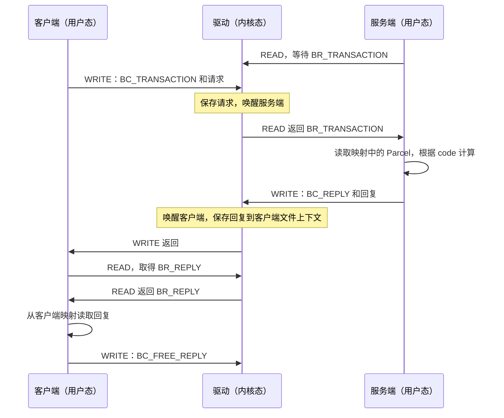

# 2.6 使用 BC 和 BR 命令

## 2.6.1 从独立事务接口到命令

第 2.5 章用不同 ioctl 提交事务、接收请求和提交回复。本章先简化为两个方向：用户态通过 `MINI_BINDER_WRITE` 向驱动发送 BC 命令，通过 `MINI_BINDER_READ` 从驱动接收 BR 命令。服务端注册仍使用单独的 ioctl。

源码位于 `examples/2.6/`，协议版本显示为 `0206`。运行时使用本章配套驱动和程序。

## 2.6.2 命令结构

源码：`examples/2.6/include/mini_binder.h`，第 21–32、41–43 行。

```c
enum mini_binder_command_code {
    MINI_BC_TRANSACTION = 1,
    MINI_BC_REPLY = 2,
    MINI_BC_FREE_REPLY = 3,
    MINI_BR_TRANSACTION = 101,
    MINI_BR_REPLY = 102,
};

struct mini_binder_command {
    __u32 cmd;
    struct mini_binder_transaction_data transaction;
};
/* ... */
#define MINI_BINDER_REGISTER_SERVER _IO(MINI_BINDER_IOC_MAGIC, 1)
#define MINI_BINDER_WRITE _IOW(MINI_BINDER_IOC_MAGIC, 21, struct mini_binder_command)
#define MINI_BINDER_READ _IOR(MINI_BINDER_IOC_MAGIC, 22, struct mini_binder_command)
```

`cmd` 表示用户态与驱动交换的 BC 或 BR 命令；`transaction.code` 选择计算器服务上的加、减、乘、除。每次 ioctl 只传递一个固定大小的命令结构，这不是 Android Binder 的实际 UAPI。

## 2.6.3 一次调用



客户端的 `WRITE(BC_TRANSACTION)` 仍然是同步调用，会等待服务端回复；它成功返回后，客户端再调用 `READ` 取出回复元数据。回复的 Parcel 在客户端映射页，读取完后通过 `BC_FREE_REPLY` 允许复用回复槽。服务端的 `READ` 没有请求时会等待。

## 2.6.4 用户态如何调用

源码：`examples/2.6/userspace/command.h`，第 9–27 行。

```c
static inline int exchange_command(int fd, struct mini_binder_command *write_cmd,
                                   struct mini_binder_command *read_cmd)
{
    if (write_cmd) {
        if (ioctl(fd, MINI_BINDER_WRITE, write_cmd) < 0)
            return -errno;
    }
    if (read_cmd) {
        if (ioctl(fd, MINI_BINDER_READ, read_cmd) < 0) {
            int error = -errno;
            if (write_cmd && write_cmd->cmd == MINI_BC_TRANSACTION) {
                struct mini_binder_command release = {.cmd = MINI_BC_FREE_REPLY};
                ioctl(fd, MINI_BINDER_WRITE, &release);
            }
            return error;
        }
    }
    return 0;
}
```

客户端将参数编码到事务的 `data`，设置操作 `code`，再发送 `BC_TRANSACTION` 并检查读回的命令是 `BR_REPLY`。源码：`examples/2.6/userspace/calc_ipc.h`，第 15–18、25–33 行（节选）。

```c
    struct mini_binder_transaction_data tx = { .code = code };
    struct mini_binder_command request = { .cmd = MINI_BC_TRANSACTION };
    struct mini_binder_command reply = {0};
    struct mini_binder_command release = { .cmd = MINI_BC_FREE_REPLY };
    /* ... */
    parcel_init(&p, tx.data, sizeof(tx.data));
    if (parcel_write_u32(&p, bits_a) || parcel_write_u32(&p, bits_b)) return -EINVAL;
    tx.size = (__u32)p.size;
    request.transaction = tx;
    status = exchange_command(fd, &request, &reply);
    if (status) return status;
    if (reply.cmd != MINI_BR_REPLY) return -EPROTO;
    tx = reply.transaction;
    status = tx.status;
```

服务端读取 `BR_TRANSACTION`，处理后发送 `BC_REPLY`。请求参数从服务端映射页读取；事务结构和命令仍通过用户态与内核之间的复制传递。

## 2.6.5 驱动如何分派

源码：`examples/2.6/kernel/mini_binder.c`，第 255–271 行。

```c
static long write_command(struct file *file, void __user *arg)
{
    struct mini_binder_command __user *write_cmd = arg;
    __u32 command;
    if (get_user(command, &write_cmd->cmd))
        return -EFAULT;
    switch (command) {
    case MINI_BC_TRANSACTION:
        return call_server(file, &write_cmd->transaction);
    case MINI_BC_REPLY:
        return send_reply(file, &write_cmd->transaction);
    case MINI_BC_FREE_REPLY:
        return release_reply(file);
    default:
        return -EINVAL;
    }
}
```

驱动收到回复后，在 `state_lock` 下把回复载荷写入客户端映射页，并将事务元数据保存到客户端文件上下文。源码：`examples/2.6/kernel/mini_binder.c`，第 140–149 行（节选）。

```c
    ret = wait_event_interruptible(client_wait,
            READ_ONCE(state) == RPC_DONE || READ_ONCE(state) == RPC_FAILED);
    mutex_lock(&state_lock);
    if (!ret && state == RPC_DONE) {
        transaction.size = transaction_reply.size;
        transaction.status = transaction_reply.status;
        memcpy(client_ctx->buffer, transaction_reply.data, transaction_reply.size);
        client_ctx->pending_reply = transaction;
        client_ctx->reply_ready = true;
        client_ctx->reply_delivered = false;
```

之后客户端的 `READ` 复制 `BR_REPLY` 和保存的元数据；读取成功才标记已交付，复制失败时可以重试。没有待取回复或已取过回复时返回 `ENOENT`。服务端的 `READ` 走等待请求的路径。源码：`examples/2.6/kernel/mini_binder.c`，第 273–296 行。

## 2.6.6 构建与实验

在支持加载模块且有匹配内核构建目录的 Linux 环境中，先停止其他章节服务端并卸载旧模块。终端一：

```sh
cd examples/2.6
make
sudo insmod kernel/mini_binder.ko
./build/version
./build/calc_server
```

Ubuntu 24.04 ARM64、Linux 6.8.0-147 上实际输出：

```text
mini-binder protocol version: 0206
calculator server ready
```

终端二执行：

```sh
cd examples/2.6
./build/calc_client add 7 3
./build/calc_client sub 7 3
./build/calc_test
./build/command_test
./build/mapped_test
```

实际输出：

```text
add(7, 3) = 10
sub(7, 3) = 4
arithmetic commands and error recovery passed
unknown command, invalid address and empty read rejected
mapped reply permissions and reuse passed
```

停止服务端后，可以运行 `timeout 10 ./build/stale_reply`、`timeout 10 ./build/server_death`、`timeout 10 ./build/mmap_access` 和 `./build/parcel_test`。最后执行 `sudo rmmod mini_binder` 和 `make clean`。测试覆盖取消、服务端退出和回复复用，但没有穷尽并发与所有错误组合。

## 2.6.7 与 Android Binder 的区别

Android 并不是将 BC 和 BR 分成两个 ioctl，而是使用一个 `BINDER_WRITE_READ` 交换写缓冲区和读缓冲区，并记录各自已消费的字节数。参考源码：`kernel-common/include/uapi/linux/android/binder.h`，第 224–231、309 行（Android 16 内核参考提交 `894a317b5382555614ef2be7a79cca79083c6cf2`，节选）。

```c
struct binder_write_read {
    binder_size_t write_size;
    binder_size_t write_consumed;
    binder_uintptr_t write_buffer;
    binder_size_t read_size;
    binder_size_t read_consumed;
    binder_uintptr_t read_buffer;
};
/* ... */
BINDER_WRITE_READ = _IOWR('b', 1, struct binder_write_read),
```

Android 的 `BC_TRANSACTION`、`BC_REPLY`、`BR_TRANSACTION` 和 `BR_REPLY` 使用 `binder_transaction_data`。源码：同一文件第 430–431、539–540 行（节选）。

```c
BR_TRANSACTION = _IOR('r', 2, struct binder_transaction_data),
BR_REPLY = _IOR('r', 3, struct binder_transaction_data),
/* ... */
BC_TRANSACTION = _IOW('c', 0, struct binder_transaction_data),
BC_REPLY = _IOW('c', 1, struct binder_transaction_data),
```

Android 用户态先向输出缓冲区依次写入 BC 命令值和事务结构。源码：`frameworks-native/libs/binder/IPCThreadState.cpp`，第 1301、1304–1305、1313–1316、1328–1329 行（Android 16 提交 `2827a4a16b0340ecd07c2d5a6c89991799b362bb`，节选）。

```cpp
    binder_transaction_data tr;
    /* ... */
    tr.target.handle = handle;
    tr.code = code;
    /* ... */
    tr.data_size = data.ipcDataSize();
    tr.data.ptr.buffer = data.ipcData();
    tr.offsets_size = data.ipcObjectsCount()*sizeof(binder_size_t);
    tr.data.ptr.offsets = data.ipcObjects();
    /* ... */
    mOut.writeInt32(cmd);
    mOut.write(&tr, sizeof(tr));
```

这里 `cmd` 是 BC 命令，`tr.code` 是目标服务操作码。Android 的命令缓冲区可以包含多条命令，并涉及部分消费和更完整的线程与事务管理；本章两个 ioctl 每次只传一个固定结构，不支持这些能力。两者布局、命令值和行为不兼容。

## 2.6.8 限制和下一步

本章仍只有一笔在途事务，请求固定写入服务端映射页起始位置。相同打开文件的多个线程需要自行协调回复读取与释放。[第 2.7 章](2.7-concurrent-transactions.md)实现多个请求同时在途、固定映射位置分配、回复匹配和回收。

## 2.6.9 自测

1. BC 和 BR 分别表示哪两个方向？
2. `BC_FREE_REPLY` 为什么在读取回复之后发送？
3. 本章两个 ioctl 与 Android 的 `BINDER_WRITE_READ` 有什么区别？

参考：BC 从用户态发送给驱动，BR 从驱动返回用户态；读取完成后释放回复槽，才允许覆盖；Android 使用一个 ioctl 交换读写缓冲区并记录消费进度。
