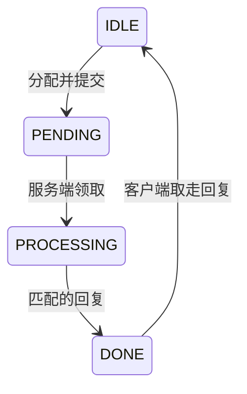
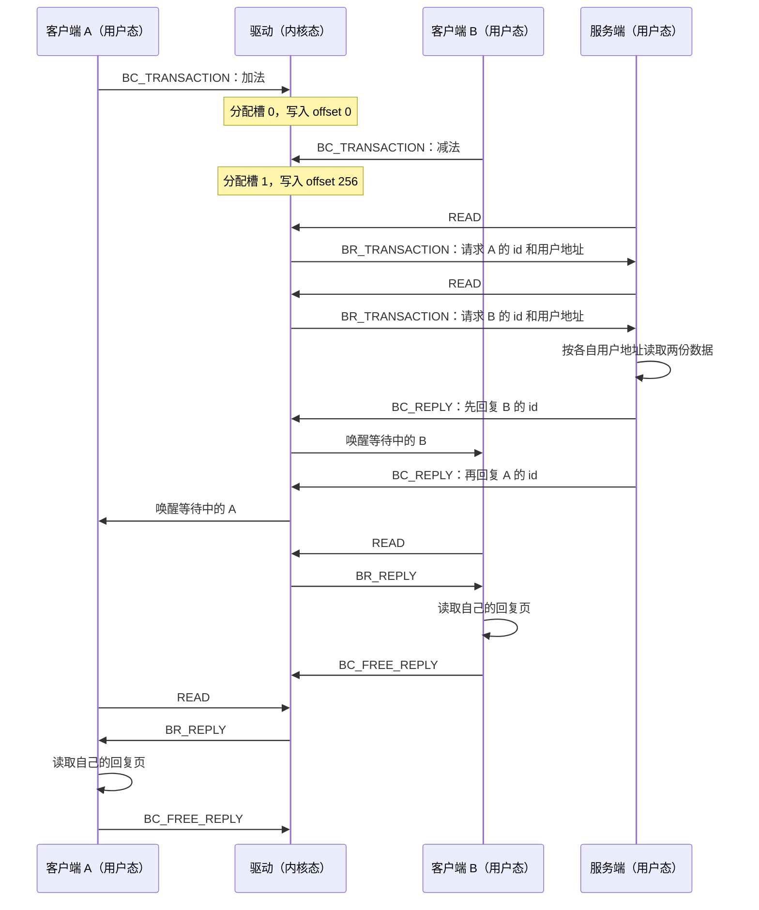

# 2.7 多笔事务与用户地址

## 2.7.1 一个事务槽不够用

第 2.6 章虽然能让多个客户端等待，但 `call_lock` 覆盖整个同步调用，同一时刻只有一笔事务在途，请求固定放在映射区起点。本章使用两个固定槽，让两笔请求同时存在，向服务端返回各自的用户态数据地址，并由服务端根据请求编号回复。

假设客户端 A 请求加法、B 请求减法：如果两笔请求同时写到同一个位置，B 可能覆盖服务端尚未读取的 A 的参数；如果只保存一个回复，服务端先回复 B 时也无法仅凭位置判断要唤醒谁。因此需要为每笔在途事务分别保存数据位置、状态和回复，并用 `id` 匹配结果。

源码位于 `examples/2.7/`，协议版本显示为 `0207`。使用本章配套驱动和程序，不能与其他章节混用。

## 2.7.2 槽位和用户地址

驱动将服务端映射页划分为两个固定的 256 字节位置。每个事务槽保存状态、请求元数据和回复；槽位编号决定本章的请求数据偏移。

```text
服务端映射页 mapping
  + 0       槽位 0 的请求数据，例如加法参数
  + 256     槽位 1 的请求数据，例如减法参数

事务槽 0：id=1，返回地址 mapping + 0
事务槽 1：id=2，返回地址 mapping + 256

服务端从 transaction.data_address 读取请求数据
```

图中编号和槽位只是示意，调度顺序不固定。`data_address` 是服务端进程的用户态地址；槽位位置由驱动内部计算，并不作为偏移字段交给服务端。`id` 标识一笔事务；位置回收后可以复用，编号不能沿用旧值。

同一份数据可以有两个不同的虚拟地址：

```text
驱动内核地址                         服务端用户地址
server_ctx->buffer                  user_base（mmap 返回的 mapping）
       │                                    │
       ├─ + 0   ─────── 同一份数据 ────────┤ + 0
       └─ + 256 ─────── 同一份数据 ────────┘ + 256

驱动写入：server_ctx->buffer + 槽位位置
驱动交付：data_address = user_base + 槽位位置
服务端读取：(用户态指针)data_address
```

内核指针和用户指针不能互换；驱动只返回服务端可访问的地址。相对位置相同，是因为两边映射的是相同缓冲区，不要求两个虚拟基址数值相同。

本章事务结构新增 `data_address`。源码：`examples/2.7/include/mini_binder.h`，第 13–20 行。

```c
struct mini_binder_transaction_data {
    __u64 id;
    __u64 data_address;
    __u32 size;
    __s32 status;
    __u32 code;
    __u8 data[MINI_BINDER_MAX_DATA];
};
```

`data_address` 用于驱动向服务端交付请求；本章客户端请求和服务端回复仍使用内嵌的 `data`，客户端回复仍从自己的映射页起点读取。

源码：`examples/2.7/kernel/mini_binder.c`，第 16、27–39 行（节选）。

```c
enum rpc_state { RPC_IDLE, RPC_PENDING, RPC_PROCESSING, RPC_DONE, RPC_FAILED, RPC_CANCELLED };
/* ... */
struct transaction_slot {
    enum rpc_state state;
    struct mini_binder_transaction_data request;
    struct mini_binder_transaction_data reply;
};

#define SLOT_COUNT 2
static DEFINE_MUTEX(state_lock);
static DEFINE_SPINLOCK(mapping_lock);
static DECLARE_WAIT_QUEUE_HEAD(server_wait);
static DECLARE_WAIT_QUEUE_HEAD(client_wait);
static struct file *server_file;
static struct transaction_slot slots[SLOT_COUNT];
```

本章移除了串行化完整调用的 `call_lock`；`state_lock` 保护事务、槽位和文件上下文，`mapping_lock` 保护服务端映射记录。等待队列用于休眠和唤醒。下面先沿正常路径理解槽位如何流转；代码中还保留了失败和取消状态，暂不展开。

### 2.7.2.1 每个事务槽的状态



每个槽位独立经历这四个状态。等待线程被唤醒后仍要检查自己的槽位状态；同一个等待队列唤醒多个客户端，不表示所有事务都完成。图中只画正常路径，源码还有 `FAILED` 和 `CANCELLED` 分支。

## 2.7.3 分配、等待与回收

客户端提交时，驱动持锁寻找 `RPC_IDLE` 槽位；两个槽都在使用则返回 `EBUSY`，本章不排队等待空槽。源码：`examples/2.7/kernel/mini_binder.c`，第 183、191–208 行（节选）。

```c
    server_ctx = server_file->private_data;
    /* ... 检查服务端映射 ... */
    for (i = 0; i < SLOT_COUNT; i++) {
        if (slots[i].state == RPC_IDLE) {
            slot = &slots[i];
            break;
        }
    }
    if (!slot) {
        ret = -EBUSY;
        goto unlock_state;
    }
    slot->request.id = ++next_id;
    memcpy((char *)server_ctx->buffer + i * MINI_BINDER_MAX_DATA, transaction.data, transaction.size);
    slot->request.size = transaction.size;
    slot->request.code = transaction.code;
    client_ctx->inflight = true;
    WRITE_ONCE(slot->state, RPC_PENDING);
    mutex_unlock(&state_lock);
    wake_up_interruptible(&server_wait);
```

服务端接收请求时，驱动确认映射有效且属于当前地址空间，再计算用户态地址。源码：`examples/2.7/kernel/mini_binder.c`，第 271–291 行（节选）。

```c
            struct mini_binder_file *ctx = file->private_data;
            spin_lock(&mapping_lock);
            if (!ctx->server_vma || ctx->server_vma->vm_mm != current->mm) {
                spin_unlock(&mapping_lock);
                mutex_unlock(&state_lock);
                return -ENXIO;
            }
            user_base = ctx->server_vma->vm_start;
            spin_unlock(&mapping_lock);
            /* ... 找到 PENDING 槽位 ... */
            delivered.id = slot->request.id;
            delivered.data_address = user_base + i * MINI_BINDER_MAX_DATA;
            delivered.size = slot->request.size;
            delivered.code = slot->request.code;
```

服务端只能使用属于自己地址空间的有效映射，并须在处理请求期间保持映射有效。驱动会检查映射记录，但不能保证返回用户态后的地址一直有效；映射解除和回收的细节留到后续生命周期章节。

客户端随后在 `client_wait` 上等待自己的槽位变为 `DONE` 或 `FAILED`，等待时不持有 `state_lock`。服务端从 `PENDING` 槽位读取请求，依次领取两笔后，可以按任意顺序回复；驱动持锁按 `id` 找到对应槽位。以下是正常路径的节选，省略权限、状态和取消检查。源码：`examples/2.7/kernel/mini_binder.c`，第 327–333、346–352 行（节选）。

```c
    mutex_lock(&state_lock);
    for (i = 0; i < SLOT_COUNT; i++) {
        if (slots[i].state != RPC_IDLE && slots[i].request.id == id) {
            slot = &slots[i];
            break;
        }
    }
    /* ... 权限、状态和取消检查 ... */
    else {
        slot->reply = incoming_transaction;
        WRITE_ONCE(slot->state, RPC_DONE);
    }
    mutex_unlock(&state_lock);
    if (!ret)
        wake_up_interruptible(&client_wait);
```

成功回复后，等待的客户端被唤醒，驱动把该槽的回复复制到客户端自己的映射页，并释放请求槽；客户端读取回复后仍须发送 `BC_FREE_REPLY`。每个打开文件只允许一笔在途调用或一个尚未释放的回复，共享同一打开文件的线程需自行协调。

### 2.7.3.1 请求槽与回复槽是两种资源

```text
服务端请求槽                          客户端回复槽
分配槽，写请求数据                    等待服务端回复
       ↓                                    ↓
服务端读取并提交回复                  驱动写入客户端映射页
       ↓                                    ↓
等待中的客户端取走槽内回复            客户端读取回复数据
       ↓                                    ↓
请求槽恢复 IDLE，可供新请求使用       BC_FREE_REPLY 后回复页可复用
```

请求槽控制服务端映射中的位置，不是客户端的回复页。驱动将回复载荷复制进客户端页后，客户端需要用完其中的指针再释放回复槽；服务端提交回复后也不能继续使用该请求地址。`BC_FREE_REPLY` 延续第 2.6 章的接口，只处理客户端回复槽。

## 2.7.4 两笔请求与倒序回复



两笔事务同时在途，不代表服务端必须多线程并行计算。两个客户端各自的 `WRITE` 返回后，还需要 `READ` 取得 `BR_REPLY`、读取自己的回复页并发送 `BC_FREE_REPLY`。测试服务端依次领取两笔，再倒序回复；实际计算器服务依次读取、处理并回复。

## 2.7.5 Binder allocator 和历史偏移

本章的两个固定位置是极简教学方案。真实 Binder 的 allocator 管理接收进程的 Binder 映射缓冲区：按事务需要分配和回收缓冲区，跟踪空闲和已分配区域，并处理页及缓冲区生命周期。Android 16 参考源码中，`kernel-common/drivers/android/binder_alloc.h` 第 43、114 行分别定义 `binder_buffer` 和 `binder_alloc`；`binder_alloc.c` 第 664、876 行提供分配和释放函数（内核参考提交 `894a317b5382555614ef2be7a79cca79083c6cf2`）。

需要区分三种位置描述：

- 本章驱动内部按槽位计算位置，再以映射基址加位置得出 `data_address`；用户态直接收到自己的地址。
- 较早内核的 `user_buffer_offset`：同一缓冲区用户虚拟地址与内核虚拟地址的差值，用于地址转换；它不是本章内部的槽位位置。参考 [历史 binder_alloc.h](https://android.googlesource.com/kernel/common/+/27e3055fbb4e32a07fd6941cf99c89fae7896f12/drivers/android/binder_alloc.h)。
- Android 事务的对象偏移表：记录 Parcel 中 Binder 对象的位置，供驱动处理对象转换；它也不是上述两种位置关系。

Android 内核在 2017 年已有将 allocator 职责逐步从 Binder 驱动中拆分的工作，例如 [binder_alloc 函数拆分提交](https://android.googlesource.com/kernel/common/+/19c987241ca1216a51118b2bd0185b8bc5081783)。这说明当时已有独立 allocator 结构及拆分工作，不能把该日期等同于 Binder 缓冲区分配功能第一次出现的日期。不同内核版本的地址映射实现也会变化；本章不模拟完整 Android allocator。

## 2.7.6 构建与实验

在支持加载模块且有匹配内核构建目录的 Linux 环境中，先停止其他章节的服务端并卸载旧模块：

```sh
cd examples/2.7
make
sudo insmod kernel/mini_binder.ko
./build/version
timeout 15 ./build/concurrent_test
```

以下为第三版源码在 Ubuntu 24.04 ARM64、Linux 6.8.0-147 上的实际输出：

```text
mini-binder protocol version: 0207
two slots, distinct user addresses, reverse replies, full capacity and reuse passed
```

`concurrent_test` 让两笔使用不同操作码的加法、减法请求同时在途，先领取两笔，检查编号和用户地址不同，再倒序回复；它还验证槽满返回 `EBUSY` 和完成后的槽位复用。为了突出槽位，测试请求使用两字节数据，不是计算器 Parcel 格式。源码：`examples/2.7/tests/concurrent_test.c`，第 65–77、84–93 行（节选）。

```c
    for (i = 0; i < 2; i++) {
        if (exchange_command(fd, NULL, &received[i]) || received[i].cmd != MINI_BR_TRANSACTION ||
            received[i].transaction.size != 2 ||
            received[i].transaction.data_address < (uintptr_t)mapping ||
            received[i].transaction.data_address - (uintptr_t)mapping > (size_t)page - 2 ||
            ((const unsigned char *)(uintptr_t)received[i].transaction.data_address)[1] != 1)
            goto out;
        values[i] = *(const unsigned char *)(uintptr_t)received[i].transaction.data_address;
    }
    if (received[0].transaction.id == received[1].transaction.id ||
        received[0].transaction.data_address == received[1].transaction.data_address ||
        values[0] == values[1] || values[0] + values[1] != 21 ||
        received[0].transaction.code == received[1].transaction.code) goto out;
    /* ... 验证槽满 ... */
    for (i = 2; i-- > 0;) {
        reply.transaction.id = received[i].transaction.id;
        reply.transaction.size = 1;
        if (received[i].transaction.code == MINI_CALC_ADD)
            reply.transaction.data[0] = values[i] + 1;
        else if (received[i].transaction.code == MINI_CALC_SUB)
            reply.transaction.data[0] = values[i] - 1;
        else goto out;
        if (exchange_command(fd, &reply, NULL)) goto out;
    }
```

只有两次接收均完成且地址、编号不同后，测试才按相反顺序发送回复；两个客户端分别验证收到的结果。源码目录还保留 `server_mapping_test`、`stale_reply`、`server_death`、`mmap_access` 和 `command_test`，用于验证映射、取消、退出和命令错误；这些情况留到后续章节分析。

继续运行 `./build/calc_server`，在另一终端执行 `./build/calc_test` 和 `./build/mapped_test`，验证完整 Parcel 计算器和映射回复。停止服务端后执行 `sudo rmmod mini_binder` 和 `make clean`。

## 2.7.7 限制和下一步

固定槽不支持可变大小的区域分配、等待空槽、公平排队或事务超时；槽满立即返回 `EBUSY`。服务端多线程并行处理、通用 allocator 与对象传递留待后续章节。

本章只追踪正常路径。源码保留了取消、服务端退出和映射失效的保护及相关测试，但尚未穷尽这些情况的并发组合。处理期间服务端必须保持映射有效；如果映射已关闭且服务端既不重新映射处理也不退出，等待中的客户端可能一直阻塞。

接下来还需要回答：客户端在服务端处理时取消，旧请求的槽何时才能复用？服务端退出后等待中的客户端如何得到结果？服务端解除映射后，已经返回的用户地址还有效吗？这些问题留到生命周期章节集中讨论。

## 2.7.8 自测

1. 两个请求同时在途时，服务端如何找到各自的数据？
2. 为什么按 `id` 匹配后才能支持倒序回复？
3. 请求槽与客户端回复槽分别在什么时候可以复用？

参考：驱动返回接收进程中对应映射位置的 `data_address`；编号让回复找到所属事务；正常情况下，客户端取走回复后请求槽可复用，客户端读完映射回复并发送 `BC_FREE_REPLY` 后回复槽可复用。

完成第二篇后，可以做[第二篇自测卷](../appendices/2-review.md)。
