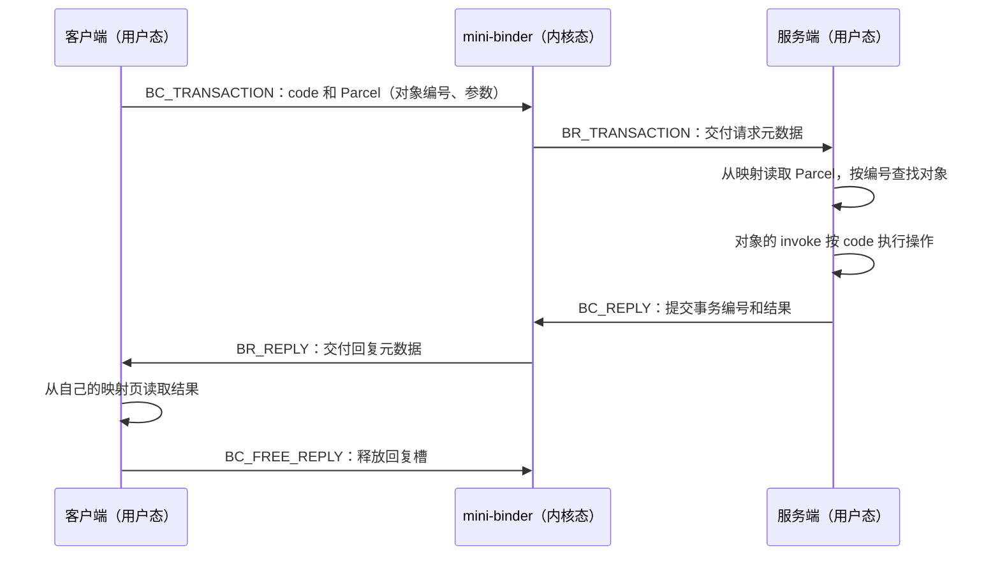

# 3.1 一个服务端，两个用户态对象

## 3.1.1 一个请求应该交给谁？

第 2.7 章的驱动能同时保存两笔事务，但服务端只有一个计算器入口。假设同一服务进程里有两个计算器对象：对象 1 按原顺序计算参数，对象 2 交换两个参数再计算。两者都支持加、减、乘。客户端除了发送操作 `code` 和参数，还要说明请求交给哪个对象。

本章只新增用户态对象分派。先预测：同样发送 `sub(7, 3)`，选择对象 1 和对象 2，结果会一样吗？保持对象 1 不变，再把 `sub` 换成 `add`，又会改变哪一步？

本章先用 Parcel 中的整数作为临时对象编号，由服务端在用户态查表。驱动继续使用第 2.7 章的事务、映射和回复机制，不认识对象编号。本章没有 Node、Ref 或 handle；先把用户态对象和函数分派讲清楚。

源码位于 `examples/3.1/`，驱动协议版本显示为 `0301`。使用本章目录中的驱动、程序和测试。

## 3.1.2 对象和操作是两次选择



对象编号决定把请求交给谁；`code` 决定对这个对象做什么。两者都不是第 2.7 章用于匹配请求与回复的事务 `id`。此处编号是服务端自定义的数据，不能直接认为它是 Binder 的 handle。

## 3.1.3 客户端编码目标和参数

源码：`examples/3.1/userspace/object_ipc.h`，第 23–29 行（节选）。

```c
    memcpy(&bits_a, &a, sizeof(a));
    memcpy(&bits_b, &b, sizeof(b));
    parcel_init(&p, tx.data, sizeof(tx.data));
    if (parcel_write_u32(&p, object) || parcel_write_u32(&p, bits_a) || parcel_write_u32(&p, bits_b)) return -EINVAL;
    tx.size = (__u32)p.size;
    request.transaction = tx;
    status = exchange_command(fd, &request, &reply);
```

客户端按顺序写入对象编号、两个整数。事务的 `code` 已在函数开始时填入；`exchange_command()` 沿用第 2.6 章的 BC/BR 调用。驱动只转交 Parcel 字节，不解析对象编号或执行函数。

## 3.1.4 服务端对象与函数指针

源码：`examples/3.1/userspace/object_server.c`，第 14–17、38–44 行（节选）。

```c
struct service_object {
    __u32 id;
    int (*invoke)(__u32 code, int32_t a, int32_t b, int32_t *result);
};
/* ... */
static int dispatch(__u32 id, __u32 code, int32_t a, int32_t b, int32_t *result)
{
    static const struct service_object objects[] = {{1, calculate}, {2, reverse_calculate}};
    for (unsigned int i = 0; i < sizeof(objects) / sizeof(objects[0]); i++)
        if (objects[i].id == id) return objects[i].invoke(code, a, b, result);
    return -ENOENT;
}
```

两个 `service_object` 都在服务端进程内，分别保存指向 `calculate` 和 `reverse_calculate` 的函数指针。`dispatch()` 按编号找到对象，再调用其 `invoke`；未知编号返回 `-ENOENT`。对象编号没有决定操作，操作仍由传入的 `code` 决定。

源码：`examples/3.1/userspace/object_server.c`，`calculate`、`reverse_calculate`，第 19–36 行。

```c
static int calculate(__u32 code, int32_t a, int32_t b, int32_t *result)
{
    int64_t value;
    switch (code) {
    case MINI_CALC_ADD: value = (int64_t)a + b; break;
    case MINI_CALC_SUB: value = (int64_t)a - b; break;
    case MINI_CALC_MUL: value = (int64_t)a * b; break;
    default: return -ENOTTY;
    }
    if (value < INT32_MIN || value > INT32_MAX) return -ERANGE;
    *result = (int32_t)value;
    return 0;
}

static int reverse_calculate(__u32 code, int32_t a, int32_t b, int32_t *result)
{
    return calculate(code, b, a, result);
}
```

对象 1 按 `a, b` 计算，对象 2 的入口先交换为 `b, a`，再复用运算函数。因此减法可以区分两个对象；加法和乘法则不会因为交换参数改变结果。这是为了观察对象身份而选择的教学行为，没有增加内核对象或状态。

函数指针只在服务端用户态使用，不会发送到客户端，也不会由内核执行。编号与函数的对应关系是本例写死的教学约定，不是安全授权。

## 3.1.5 服务端读取请求

源码：`examples/3.1/userspace/object_server.c`，第 71–90 行（节选）。

```c
        if (request.data_address < (uintptr_t)mapping ||
            request.data_address - (uintptr_t)mapping > (size_t)page_size ||
            request.size > (size_t)page_size - (request.data_address - (uintptr_t)mapping) ||
            request.size > MINI_BINDER_MAX_DATA) {
            reply.status = -EINVAL;
        } else {
            parcel_init(&input, (void *)(uintptr_t)request.data_address, request.size);
            input.size = request.size;
            if (parcel_read_u32(&input, &object) || parcel_read_u32(&input, &bits_a) || parcel_read_u32(&input, &bits_b) ||
                input.position != input.size) {
                reply.status = -EINVAL;
            } else {
                memcpy(&a, &bits_a, sizeof(a));
                memcpy(&b, &bits_b, sizeof(b));
                reply.status = dispatch(object, request.code, a, b, &result);
                if (!reply.status) {
                    memcpy(&bits_result, &result, sizeof(result));
                    if (parcel_write_u32(&output, bits_result)) reply.status = -EINVAL;
                    else reply.size = (__u32)output.size;
                }
```

服务端先检查驱动返回的地址和长度是否落在映射范围内，再按约定顺序解码。格式错误返回 `-EINVAL`；成功时调用目标对象，将结果写入回复 Parcel。后续代码使用请求的事务 `id` 提交回复。客户端读取回复页后仍要发送 `BC_FREE_REPLY`。

## 3.1.6 构建与实验

在支持加载模块且具有匹配内核构建目录的 Linux 环境中，先停止其他章节的服务端并卸载旧模块。

终端一：

```sh
cd examples/3.1
make
sudo insmod kernel/mini_binder.ko
./build/version
./build/object_server
```

实际输出：

```text
mini-binder protocol version: 0301
object server ready
```

保持服务端运行，在另一个终端执行：

```sh
cd examples/3.1
./build/object_client 1 sub 7 3
./build/object_client 2 sub 7 3
./build/object_client 1 add 7 3
./build/object_client 2 mul 7 3
```

实际输出：

```text
object 1: sub(7, 3) = 4
object 2: sub(7, 3) = -4
object 1: add(7, 3) = 10
object 2: mul(7, 3) = 21
```

前两次调用保持 `code` 和参数不变，只切换对象，得到 4 和 -4；第一、三次调用保持对象和参数不变，只切换操作，得到 4 和 10。由此分别观察“交给谁”和“做什么”。函数指针始终由服务端在自己的用户态调用。

服务端还会打印请求的事务 `id`、`code` 和长度；`id` 与请求到达顺序有关。保持服务端运行，执行 `./build/object_test`，检查未知对象、未知操作、正逆序减法、整数溢出和出错后的正常调用；通过时输出 `two objects, invalid target and code, recovery passed`。这些边界检查放在正常演示之后。结束时停止服务端，执行 `sudo rmmod mini_binder` 与 `make clean`。

以上实验已在 Ubuntu 24.04 ARM64、Linux 6.8.0-147 实际编译、加载并运行。服务端异常、中断和映射等复杂并发组合仍未穷尽。

## 3.1.7 限制与下一步

客户端必须预先知道服务端的对象编号；编号没有所有权、引用或跨进程转换语义。两个对象都由同一个进程处理，驱动仍不知道它们的存在。真实 Binder 的 Node、Ref 和对象传递比这里的用户态查表完整得多。

下一章需要回答：如果由驱动记录服务端对象，如何建立对象与内核 Node 的对应关系？下一章选用加法、乘法两个简单对象，重点观察 Node 与 cookie；对象的具体运算行为由服务端决定。

## 3.1.8 自测

1. 对象编号、`code` 和事务 `id` 分别解决什么问题？
2. 为什么函数指针不能由客户端直接调用？
3. 服务端收到未知对象编号后，客户端还能继续使用同一个文件发起调用吗？

参考：它们分别用于选择对象、选择操作和匹配事务；指针属于服务端地址空间；本例会返回错误并释放回复槽，后续调用可以继续。
