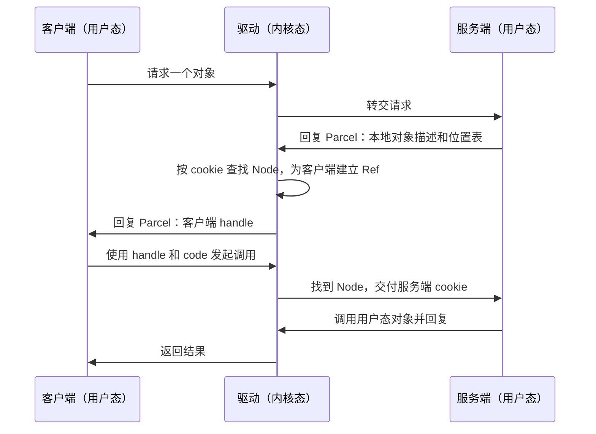

# 3.4 从 Node 到客户端 Ref

## 3.4.1 对象怎样交给另一个进程？

第 3.3 章能在用户态标记 Parcel 中的对象，但驱动还看不到位置表。本章让服务端在回复中写入本地对象描述，驱动根据位置表找到对应 Node，为接收方的打开文件建立 Ref，并将描述改为接收方的 handle。

可以把对象看成一次远程调用的**返回值**：服务端返回一个对象，客户端收到后还可以调用它。这个对象像整数、字符串一样占据 Parcel 的一个数据项，但需要驱动根据对象位置做特殊转换。

Node 和 Ref 是驱动内部的表示，用户态并不把内核结构体本身放进 Parcel：对象拥有者写入本地对象描述，驱动找到对应 Node；另一进程收到的是关联该 Node 的 Ref 所对应的 handle。本章的数据流是“本地对象描述 → Node → 接收方 Ref / handle”。

对象也可以作为**请求参数**传给对端，例如调用方提供一个供对方后续调用的对象。无论放在请求还是回复中，对象拥有者提交本地对象描述，驱动都需要找到 Node，再为接收方建立 Ref。本章实验只实现回复方向；请求方向在第 3.6 章的 `local_transfer_test` 中验证。

本章仍只有一个服务端。测试使用一个临时的查询操作取得对象，它只是实验入口，不是 ServiceManager。源码在 `examples/3.4/`，版本为 `0304`。

## 3.4.2 一次对象交付



客户端看见的 handle 是打开文件上下文中的表项编号，不是全局 Node 编号。两个独立打开文件都可能使用 handle 1，但它们可以指向不同 Node。服务端 cookie 只交给服务端，不会作为客户端回复返回。

## 3.4.3 Ref 保存在哪里？

源码：`examples/3.4/kernel/mini_binder.c`，第 19–27 行。

```c
struct mini_binder_file {
    void *buffer;
    struct vm_area_struct *server_vma;
    bool inflight;
    bool reply_ready;
    bool reply_delivered;
    __u64 refs[MINI_BINDER_MAX_OBJECTS];
    struct mini_binder_transaction_data pending_reply;
};
```

本例用 Node 编号数组代表 Ref 表，handle 是数组下标加一，0 表示未指定 handle。表属于一次 `open()` 创建的文件上下文，并由 `state_lock` 保护；同一个文件经 `fork()` 或 `dup()` 共享时也共享该表。本章没有实现 Android 的完整 `binder_proc`、引用计数或死亡通知。

## 3.4.4 转换回复中的对象

源码：`examples/3.4/kernel/mini_binder.c`，第 60–85 行（节选）。

```c
    if (reply->object_count > MINI_BINDER_MAX_OBJECTS) return -EINVAL;
    memcpy(refs, ctx->refs, sizeof(refs));
    for (i = 0; i < reply->object_count; i++) {
        __u32 offset = reply->object_offsets[i];
        __u64 cookie;
        if ((offset & 3) || offset > reply->size || reply->size - offset < 12 ||
            (i && (offset < previous || offset - previous < 12))) return -EINVAL;
        if (get_unaligned_le32(reply->data + offset) != MINI_BINDER_OBJECT_LOCAL) return -EINVAL;
        cookie = get_unaligned_le32(reply->data + offset + 4);
        cookie |= (__u64)get_unaligned_le32(reply->data + offset + 8) << 32;
        for (j = 0; j < ARRAY_SIZE(nodes); j++)
            if (nodes[j].owner == server_file && nodes[j].cookie == cookie) break;
        if (j == ARRAY_SIZE(nodes)) return -ENOENT;
        for (k = 0; k < ARRAY_SIZE(refs); k++) if (refs[k] == nodes[j].id) break;
        if (k == ARRAY_SIZE(refs)) {
            for (k = 0; k < ARRAY_SIZE(refs); k++) if (!refs[k]) break;
            if (k == ARRAY_SIZE(refs)) return -ENOSPC;
            refs[k] = nodes[j].id;
        }
        put_unaligned_le32(MINI_BINDER_OBJECT_HANDLE, reply->data + offset);
        put_unaligned_le32(k + 1, reply->data + offset + 4);
        put_unaligned_le32(0, reply->data + offset + 8);
        previous = offset;
    }
    memcpy(ctx->refs, refs, sizeof(refs));
    return 0;
```

驱动先检查对象数量、对齐、长度、顺序和类型，再按服务端 cookie 查找 Node。相同 Node 在同一文件中复用已有 Ref；否则分配空表项。所有对象转换成功后才提交 Ref 表副本，避免后一个对象无效时留下前一个对象的半成品引用。函数在 `state_lock` 下运行；错误使本次客户端调用失败，不交付映射回复。

## 3.4.5 使用 handle

源码：`examples/3.4/kernel/mini_binder.c`，第 255–268 行（节选）。

```c
    if (transaction.target_handle) {
        if (transaction.target_node || transaction.target_handle > ARRAY_SIZE(client_ctx->refs) ||
            !client_ctx->refs[transaction.target_handle - 1]) { ret = -ENOENT; goto unlock_state; }
        transaction.target_node = client_ctx->refs[transaction.target_handle - 1];
    }
    if (transaction.target_node) {
        for (i = 0; i < ARRAY_SIZE(nodes); i++)
            if (nodes[i].owner == server_file && nodes[i].id == transaction.target_node)
                break;
        if (i == ARRAY_SIZE(nodes)) { ret = -ENOENT; goto unlock_state; }
        transaction.object_cookie = nodes[i].cookie;
    } else {
        transaction.object_cookie = 0;
    }
```

驱动先在当前文件的 Ref 表中查 handle，再检查 Node 是否仍属于当前服务端。这里仍保留 3.2 的直接 Node 编号路径以运行旧实验，因此本章不提供安全授权边界。服务端退出后旧 Node 被清除，旧 Ref 不再能找到对应 Node；本章没有主动释放单个 Ref 或回收失效表项。

## 3.4.6 实验

运行前先预测：两个独立打开文件都得到 handle 1，它们调用的一定是同一个对象吗？在支持模块加载且具有匹配内核头文件的 Linux 环境中，先停止其他章节服务端并卸载旧模块。

终端一：

```sh
cd examples/3.4
make
sudo insmod kernel/mini_binder.ko
./build/version
./build/object_server
```

首次加载时实际输出：

```text
mini-binder protocol version: 0304
object 1: node=1
object 2: node=2
object server ready
```

终端二：

```sh
cd examples/3.4
./build/ref_test
```

实际输出：

```text
file A: local add object -> handle 1, add(7, 3) = 10
file B: local multiply object -> handle 1, mul(7, 3) = 21
same handle number, separate open files, different Nodes
regression: invalid handle, malformed object table and a fresh process
per-file handles, node conversion and calls passed
```

先沿成功路径观察：文件 A 请求加法对象，文件 B 请求乘法对象。服务端回复本地对象描述，驱动找到相应 Node，再分别在 A、B 中建立 Ref。两个文件得到的 handle 都是 1，但实际调用得到 10 和 21，说明 handle 必须连同所属上下文一起解释。

正常演示完成后，测试再检查未知 handle 返回 `ENOENT`，并在新进程中重新打开设备：先请求故意重叠的位置表，再成功取得 handle 1，验证失败转换没有消耗新上下文的首个 Ref 编号。服务端查询操作的索引 2 专门生成错误位置表，仅用于测试。停止服务端后执行 `sudo rmmod mini_binder` 和 `make clean`。

上述实验以及原有并发、取消、服务端退出和 Parcel 测试已在 Ubuntu 24.04 ARM64、Linux 6.8.0-147 上运行。尚未覆盖全部转换失败、服务端退出交错和引用耗尽情况。

## 3.4.7 限制与下一步

对象描述目前只在服务端回复到客户端时转换；客户端还不能把 handle 在请求中转给其他进程。驱动仍使用单一全局服务端，Ref 不保活服务对象；直接 Node 编号、固定容量和临时查询操作都只是教学简化。下一章需要先引入多个服务端上下文，再讨论对象转交。

## 3.4.8 自测

1. 两个文件中的 handle 1 为什么可能指向不同对象？
2. 为什么需要先验证位置表再提交 Ref 表？
3. 本章的 Ref 与 Android Binder 的引用机制有哪些差距？

参考：每个打开文件有自己的 Ref 表；失败时不能留下部分已分配引用；本例没有引用计数、死亡通知、单个引用释放和多服务端路由。
