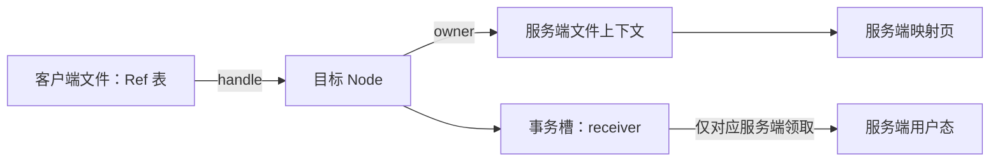

# 3.5 多个服务端与事务路由

## 3.5.1 一个全局服务端够吗？

上一章的 Node 和 Ref 能表示不同对象，但驱动只允许一个服务端注册。现在让两个进程分别提供对象：驱动需要知道每个 Node 属于哪个打开文件，收到调用后才能把事务交给正确的服务端。

本章在 `examples/3.5/` 中实现多个服务端和按 Node 路由，协议版本为 `0305`。服务端依然逐条读取请求；全局只有两个事务槽，不代表每个服务端都有两个独立槽。

## 3.5.2 关联 Node、文件和事务



每次打开设备都会创建独立文件上下文；服务端注册后，该上下文拥有自己的请求映射。Node 保存所属 `struct file`，事务槽保存本次接收者。它们受 `state_lock` 保护，映射状态另外由 `mapping_lock` 保护。一个进程重复打开设备得到不同上下文；通过 `dup` 或 `fork` 共享文件时则共享上下文，这还不是 Android 的完整 `binder_proc`。

## 3.5.3 选择接收者

源码：`examples/3.5/kernel/mini_binder.c`，第 253–271 行（节选）。

```c
    if (transaction.target_handle) {
        if (transaction.target_node || transaction.target_handle > ARRAY_SIZE(client_ctx->refs) ||
            !client_ctx->refs[transaction.target_handle - 1]) { ret = -ENOENT; goto unlock_state; }
        transaction.target_node = client_ctx->refs[transaction.target_handle - 1];
    }
    if (transaction.target_node) {
        for (i = 0; i < ARRAY_SIZE(nodes); i++)
            if (nodes[i].owner && nodes[i].id == transaction.target_node)
                break;
        if (i == ARRAY_SIZE(nodes)) { ret = -ENOENT; goto unlock_state; }
        transaction.object_cookie = nodes[i].cookie;
        receiver = nodes[i].owner;
    } else {
        transaction.object_cookie = 0;
        receiver = server_file;
    }
    if (!receiver) { ret = -ENOTCONN; goto unlock_state; }
    if (receiver == file) { ret = -EINVAL; goto unlock_state; }
    server_ctx = receiver->private_data;
```

handle 先在调用者的 Ref 表中转换为 Node 编号；驱动再找到 Node 的 owner，并选择它的映射。相同 cookie 可以出现在不同服务端：它只在所属服务端内有意义。直接指定 Node 编号的旧实验入口仍然存在，不能作为访问控制机制。

`target_node == 0` 暂时使用首个注册的服务端作为旧查询入口；它不是 ServiceManager。该服务端退出后，入口不会自动迁移到其他服务端，但已有 Node 和 Ref 仍可路由到存活的服务端。

## 3.5.4 只有目标服务端能领取

源码：`examples/3.5/kernel/mini_binder.c`，第 379–392 行（节选）。

```c
        for (i = 0; i < SLOT_COUNT; i++) {
            struct mini_binder_transaction_data delivered = {0};
            struct transaction_slot *slot = &slots[i];
            if (slot->state != RPC_PENDING || slot->receiver != file)
                continue;

            delivered.id = slot->request.id;
            delivered.data_address = user_base + i * MINI_BINDER_MAX_DATA;
            delivered.size = slot->request.size;
            delivered.code = slot->request.code;
            delivered.target_node = slot->request.target_node;
            delivered.object_cookie = slot->request.object_cookie;

            WRITE_ONCE(slot->state, RPC_PROCESSING);
```

所有服务端暂时共享等待队列，提交请求后唤醒全部等待者，各自只领取 `receiver` 指向自己的事务。回复同样检查接收者，避免另一个服务端使用事务编号提交回复。客户端等待回复时不持有状态锁。

## 3.5.5 退出和实验

服务端最后一个文件引用关闭时，驱动删除属于它的 Node，并将发往它且客户端尚未取走的事务标为失败，唤醒客户端；其他服务端的 Node 和事务不因此被清除。即使回复已提交，若客户端尚未取走也会失败，避免使用已经失效的对象归属。映射持有文件引用，因此单纯关闭文件描述符不一定立即执行该清理。

在支持模块加载且已安装匹配内核头文件的 Linux 上，停止其他章节的服务并卸载旧模块：

```sh
cd examples/3.5
make
sudo insmod kernel/mini_binder.ko
./build/version
./build/multi_server_test
./build/node_test
./build/mmap_access
./build/concurrent_test
./build/server_death
./build/stale_reply
sudo rmmod mini_binder
```

实际输出包括：

```text
mini-binder protocol version: 0305
two servers: routing and exit isolation passed
node permission, duplicate, capacity and restart passed
mapping permissions and lifetime passed
two slots, distinct user addresses, reverse replies, full capacity and reuse passed
server death wakes both clients with EPIPE
cancelled reply discarded; next client received correct result
```

双服务端测试让两个服务端注册相同 cookie，通过不同 Node 调用并检查不同结果；杀死其中一个后检查旧 Node 失效、另一服务端仍可调用。上述实验在 Ubuntu 24.04 ARM64、Linux 6.8.0-147 上运行。该测试使用直接 Node 编号，尚未覆盖两个服务端各自分发 Ref 的组合及所有退出交错。

## 3.5.6 限制与自测

Ref 表和 Node 表固定容量，Ref 不保活服务端，也没有死亡通知；所有服务端共享两个事务槽和等待队列。客户端还不能在请求中把已有 handle 转交给第三个进程。后续要解决对象转交，再引入正式的服务发现入口。

1. 为什么相同 cookie 可以对应不同的 Node？
2. 为什么唤醒等待队列后，每个服务端仍要检查 `receiver`？
3. 文件描述符关闭后，为什么 Node 不一定立刻销毁？

参考：cookie 属于对应服务端；共享队列中的请求有不同接收者；映射或共享文件描述符可能继续持有文件引用。
