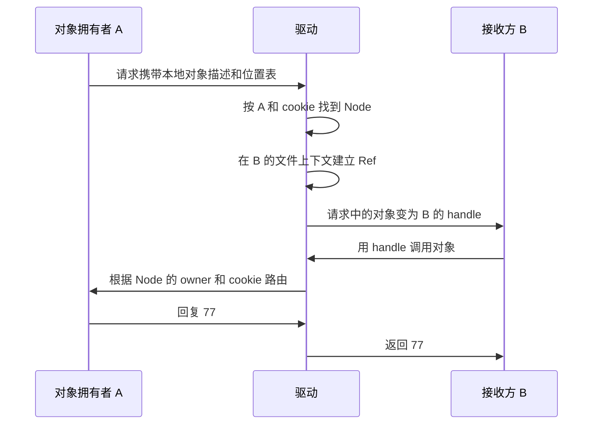

# 3.6 在请求中传递本地对象

## 3.6.1 问题与思路

3.4 的服务端可以在**回复**中交出本地对象，驱动为收到回复的客户端建立 Ref。如果对象拥有者想主动在**请求**中把对象交给对端，该怎么做？

把它理解为远程函数的一个**参数**：除了整数和字符串，调用方还可以把一个可供后续调用的对象交给被调用方。例如，向对端提交一个回调对象。这里强调的是对象在事务数据中的角色；示例本身使用的是第 3.6 章的测试对象，并没有实现完整的回调框架。

本章继续使用 Parcel 的对象位置表：发送方把本地对象描述写入请求，驱动按发送方文件和 cookie 找到 Node，为接收方建立 Ref，并把描述替换成接收方的 handle。源码在 `examples/3.6/`，协议版本 `0306`。

所谓“传递 Node”是方便理解的说法：Node 仍在内核中，真正经过 Parcel 的是本地对象描述。对端收到的是代表该 Node 的 handle；它不是 Node 结构体，也不是发送方的用户态指针。

## 3.6.2 一次对象传递



示例中 A 和 B 都注册为服务端，以便各自接收事务；同一文件也可发起调用。它们是普通示例进程，没有服务管理者。B 的 Node 编号通过测试管道交给 A，仅用于找到接收方；本章重点是随请求发送的对象。

## 3.6.3 从本地对象找到 Node

源码：`examples/3.6/kernel/mini_binder.c`，第 63–89 行（节选）。

```c
    if (transaction->object_count > MINI_BINDER_MAX_OBJECTS) return -EINVAL;
    memcpy(refs, receiver->refs, sizeof(refs));
    for (i = 0; i < transaction->object_count; i++) {
        __u32 offset = transaction->object_offsets[i];
        __u64 id;
        if ((offset & 3) || offset > transaction->size || transaction->size - offset < 12 ||
            (i && (offset < previous || offset - previous < 12))) return -EINVAL;
        if (get_unaligned_le32(transaction->data + offset) != MINI_BINDER_OBJECT_LOCAL) return -EINVAL;
        id = get_unaligned_le32(transaction->data + offset + 4);
        id |= (__u64)get_unaligned_le32(transaction->data + offset + 8) << 32;
        for (j = 0; j < ARRAY_SIZE(nodes); j++)
            if (nodes[j].owner == sender_file && nodes[j].cookie == id) break;
        if (j == ARRAY_SIZE(nodes)) return -ENOENT;
        id = nodes[j].id;
        for (k = 0; k < ARRAY_SIZE(refs); k++) if (refs[k] == id) break;
        if (k == ARRAY_SIZE(refs)) {
            for (k = 0; k < ARRAY_SIZE(refs); k++) if (!refs[k]) break;
            if (k == ARRAY_SIZE(refs)) return -ENOSPC;
            refs[k] = id;
        }
        put_unaligned_le32(MINI_BINDER_OBJECT_HANDLE, transaction->data + offset);
        put_unaligned_le32(k + 1, transaction->data + offset + 4);
        put_unaligned_le32(0, transaction->data + offset + 8);
        previous = offset;
    }
    memcpy(receiver->refs, refs, sizeof(refs));
    return 0;
```

位置表指出对象描述在 Parcel 中的位置。驱动先检查数量、范围、对齐和重叠，再按发送文件及 cookie 找 Node。接收方已有这个 Node 的 Ref 就复用，否则分配表项；handle 是表下标加一。全部对象验证成功后才提交 Ref 表副本。这里的 offset 是 Parcel 内位置，与映射地址转换不同。

源码：`examples/3.6/kernel/mini_binder.c`，第 327–336 行（节选）。

```c
    ret = translate_request(file, server_ctx, &transaction);
    if (ret) goto unlock_state;
    slot->request.id = ++next_id;
    memcpy((char *)server_ctx->buffer + i * MINI_BINDER_MAX_DATA, transaction.data, transaction.size);
    slot->request.size = transaction.size;
    slot->request.code = transaction.code;
    slot->request.target_node = transaction.target_node;
    slot->request.object_cookie = transaction.object_cookie;
    slot->request.object_count = transaction.object_count;
    memcpy(slot->request.object_offsets, transaction.object_offsets, sizeof(transaction.object_offsets));
```

转换在请求数据写入接收方映射之前完成，因此对端读取到的是自己的 handle。事务状态与 Ref 表由 `state_lock` 保护；接收时沿用前章的映射与等待机制。

## 3.6.4 实验

在可加载模块且安装了匹配内核头文件的 Linux 上，先停止其他章节服务端并卸载旧模块：

```sh
cd examples/3.6
make
sudo insmod kernel/mini_binder.ko
./build/version
./build/local_transfer_test
sudo rmmod mini_binder
```

在 Ubuntu 24.04 ARM64、Linux 6.8.0-147 上的实际输出：

```text
mini-binder protocol version: 0306
local Node -> receiver Ref 1 -> original object: 77
```

测试还检查不存在的本地 cookie 和本章不支持的对象类型。接收方取得 handle 1 后调用它，拥有者按 cookie 找到自己的对象并返回 77。

## 3.6.5 限制与自测

本章请求方向只支持发送本地对象，尚不支持发送已有 handle。Ref 不保活 Node，没有单个 Ref 释放或死亡通知；固定槽位和简化读取协议不支持任意并行及嵌套调用。下一章在此基础上转交已有 Ref。

1. 为什么查 Node 时必须同时检查发送方文件和 cookie？
2. 为什么接收方得到的是 handle，而不是发送方的 cookie？
3. 为什么先修改 Ref 表副本，再一次提交？

参考：不同进程可使用相同 cookie；handle 属于接收方；副本可避免多个对象中途失败留下部分 Ref。
