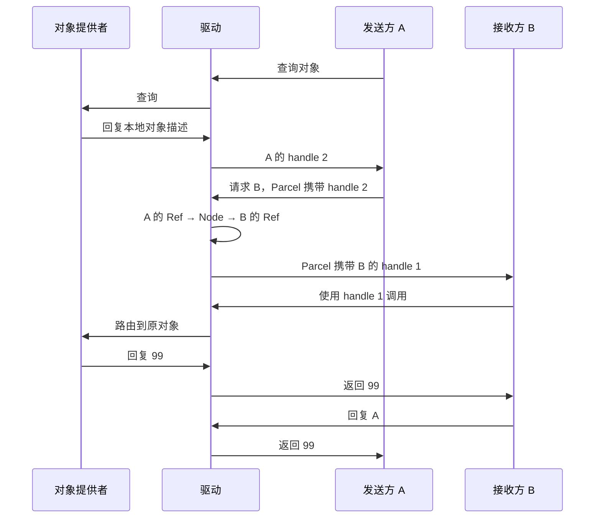

# 3.6 转交已有引用

## 3.6.1 为什么不能直接传 handle？

第 3.4 章的 handle 只在持有它的打开文件中有效。进程 A 要把对象交给进程 B 时，直接复制数字并不能保证 B 的同一数字指向相同对象。本章让驱动读取请求 Parcel 的对象位置表，查找 A 的 Ref 和 Node，再为 B 建立或复用 Ref。

这次事务的**参数**不是发送方自己创建的本地对象，而是它已经持有的远程对象引用。发送方在 Parcel 中写入 handle 对象描述；驱动根据它找到发送方的 Ref 和目标 Node，接收方取得自己的 handle。Ref 和 Node 都留在驱动中，并没有将内核结构体作为参数复制到用户态。

源码在 `examples/3.6/`，协议版本为 `0306`。这是请求方向的 handle 转换；它不是完整的 Android 对象传递协议。

## 3.6.2 三个进程的一次调用



图中的数字来自实验，不要求所有运行场景都恰好得到这两个编号。B 的服务端文件既能接收请求，也能作为客户端发起调用；本例只演示串行的嵌套调用，不提供完整线程模型。

## 3.6.3 转换位置表中的对象

源码：`examples/3.6/kernel/mini_binder.c`，第 71–99 行（节选；本地对象分支省略）。

```c
        type = get_unaligned_le32(transaction->data + offset);
        if (type == MINI_BINDER_OBJECT_HANDLE) {
            if (get_unaligned_le32(transaction->data + offset + 8)) return -EINVAL;
            handle = get_unaligned_le32(transaction->data + offset + 4);
            if (!handle || handle > ARRAY_SIZE(sender->refs) || !sender->refs[handle - 1]) return -ENOENT;
            id = sender->refs[handle - 1];
            for (j = 0; j < ARRAY_SIZE(nodes); j++)
                if (nodes[j].owner && nodes[j].id == id) break;
        /* ... 本地对象分支 ... */
        } else return -EINVAL;
        if (j == ARRAY_SIZE(nodes)) return -ENOENT;
        for (k = 0; k < ARRAY_SIZE(refs); k++) if (refs[k] == id) break;
        if (k == ARRAY_SIZE(refs)) {
            for (k = 0; k < ARRAY_SIZE(refs); k++) if (!refs[k]) break;
            if (k == ARRAY_SIZE(refs)) return -ENOSPC;
            refs[k] = id;
        }
        put_unaligned_le32(MINI_BINDER_OBJECT_HANDLE, transaction->data + offset);
        put_unaligned_le32(k + 1, transaction->data + offset + 4);
        put_unaligned_le32(0, transaction->data + offset + 8);
        previous = offset;
    }
    memcpy(receiver->refs, refs, sizeof(refs));
    return 0;
```

驱动在 `state_lock` 下验证对象边界、对齐、顺序和类型，再用发送方的 Ref 查找仍然存在的 Node。接收方已有相同 Node 的 Ref 时复用，否则分配表项。引用表先写入副本，所有对象验证通过后才提交；因此第二个对象无效不会留下第一个对象的半成品 Ref。协议中每个对象描述占 12 字节。

源码：`examples/3.6/kernel/mini_binder.c`，第 337–349 行（节选）。

```c
    ret = translate_request(file, server_ctx, &transaction);
    if (ret) goto unlock_state;
    slot->request.id = ++next_id;
    memcpy((char *)server_ctx->buffer + i * MINI_BINDER_MAX_DATA, transaction.data, transaction.size);
    slot->request.size = transaction.size;
    slot->request.code = transaction.code;
    slot->request.target_node = transaction.target_node;
    slot->request.object_cookie = transaction.object_cookie;
    slot->request.object_count = transaction.object_count;
    memcpy(slot->request.object_offsets, transaction.object_offsets, sizeof(transaction.object_offsets));
    WRITE_ONCE(slot->receiver, receiver);
    client_ctx->inflight = true;
    WRITE_ONCE(slot->state, RPC_PENDING);
```

转换发生在请求复制进接收方映射之前；位置表随事务元数据传递。它描述 Parcel 内对象位置，与映射地址转换不是同一个 offset。Ref 一旦提交不会因接收失败或调用取消自动撤销，本例没有单个 Ref 释放机制。

## 3.6.4 实验

在具有匹配内核头文件且支持加载模块的 Linux 环境中，先停止其他章节服务端并卸载旧模块：

```sh
cd examples/3.6
make
sudo insmod kernel/mini_binder.ko
./build/version
./build/local_transfer_test
./build/transfer_test
./build/multi_server_test
sudo rmmod mini_binder
```

实际输出：

```text
mini-binder protocol version: 0306
local Node -> receiver Ref 1 -> original object: 77
handle 2 translated to recipient handle 1 and invoked successfully
two servers: routing and exit isolation passed
```

`local_transfer_test` 验证本地对象作为请求参数交给对端；`transfer_test` 验证已有 handle 的转交。后者先尝试带有无效 handle 的两个对象和重叠位置，分别得到 `ENOENT`、`EINVAL`；随后有效转交仍为接收方分配 handle 1，再调用原对象。实验在 Ubuntu 24.04 ARM64、Linux 6.8.0-147 上运行。

## 3.6.5 限制与自测

本章请求支持本地对象和已有 handle，回复仍只转换服务端本地对象；尚不支持一般性的双向对象类型组合。固定槽位、共享缓冲区和简化的读命令不支持任意嵌套或并行线程；嵌套调用时回复可能覆盖服务端映射中的请求数据，因此服务端必须先取出自己需要的数据。没有引用计数、死亡通知和单个引用释放。服务发现仍依赖实验入口，尚未引入管理者。

1. 为什么 A 的 handle 2 可以转换为 B 的 handle 1？
2. 多个对象中后一个无效时，为什么先更新 Ref 表副本？
3. 对象位置表中的 offset 与映射地址转换有什么不同？

参考：handle 属于文件上下文；副本避免部分更新；前者定位 Parcel 中的对象描述，后者定位接收方映射数据。
