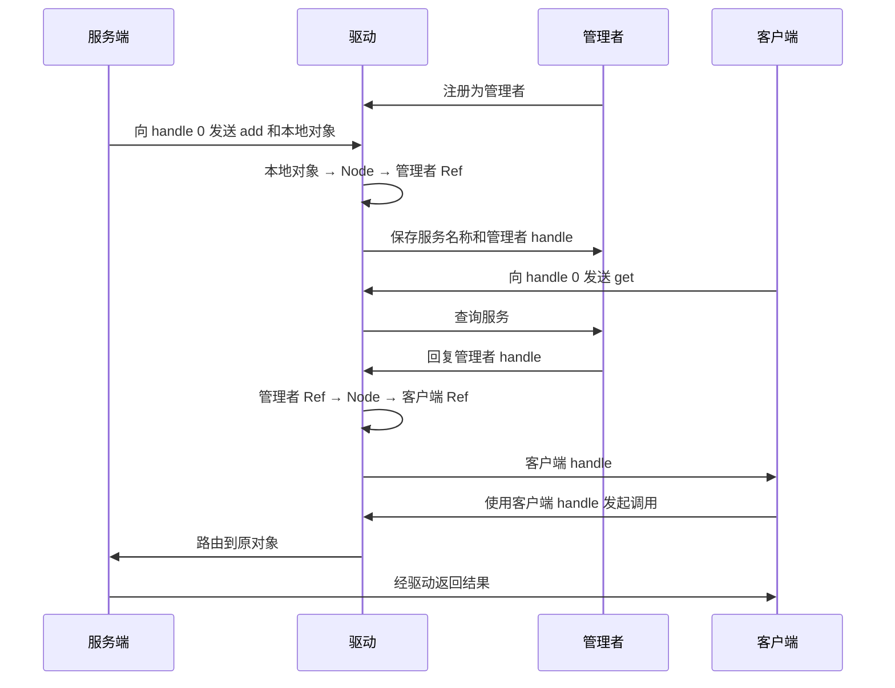

# 3.7 用管理者发现服务

## 3.7.1 第一个引用从哪里来？

前两章可以转交对象引用，但实验仍借助直接 Node 编号或临时查询入口。客户端如果事先不知道服务对象，怎样找到它？本章约定目标 handle 0 指向管理者：服务端把自己的对象交给管理者，客户端再按名称查询，得到属于自己文件上下文的 handle。

源码在 `examples/3.7/`，协议版本 `0307`。为了专注传递过程，实验用数字 7 代表服务名称，管理者只保存一个条目；这是教学用 ServiceManager，不是 Android 系统服务实现。

## 3.7.2 从注册到调用



管理者保存的是自己文件中的 handle，客户端收到的是另一个文件中的 handle；两个数字可以相同，也可以不同，不能据此判断是否是同一个引用表项。

## 3.7.3 注册管理者

源码：`examples/3.7/kernel/mini_binder.c`，第 527–538 行（节选）。

```c
    case MINI_BINDER_REGISTER_SERVER:
        return register_server(file);
    case MINI_BINDER_REGISTER_MANAGER: {
        struct mini_binder_file *ctx = file->private_data;
        long ret = 0;
        mutex_lock(&state_lock);
        if (!ctx->is_server) ret = -EPERM;
        else if (server_file) ret = -EBUSY;
        else WRITE_ONCE(server_file, file);
        mutex_unlock(&state_lock);
        return ret;
    }
```

进程先注册服务端并映射缓冲区，再通过管理者 ioctl 注册唯一入口。驱动在 `state_lock` 下维护入口；请求的目标 Node 和 handle 均为 0 时选择该文件，没有管理者则返回 `ENOTCONN`。此处直接保存管理者文件，没有为管理者建立普通 Node，且任何能打开设备的进程都能抢先注册；它仅说明引导过程，并非 Android 的权限控制或完整上下文管理者实现。

## 3.7.4 管理者如何保存和返回对象？

源码：`examples/3.7/tests/manager_test.c`，第 33–49 行（节选）。

```c
    for (;;) {
        struct mini_binder_command req = {0}, reply = {.cmd = MINI_BC_REPLY};
        const unsigned char *data;
        assert(ioctl(fd, MINI_BINDER_READ, &req) == 0);
        data = (const unsigned char *)(uintptr_t)req.transaction.data_address;
        reply.transaction.id = req.transaction.id;
        if (req.transaction.code == 1 && req.transaction.size == 16 && req.transaction.object_count == 1 &&
            req.transaction.object_offsets[0] == 4 && get32(data) == 7 && get32(data + 4) == MINI_BINDER_OBJECT_HANDLE) {
            saved = get32(data + 8);
        } else if (req.transaction.code == 2 && req.transaction.size == 4 && get32(data) == 7 && saved) {
            reply.transaction.size = 12;
            reply.transaction.object_count = 1;
            put32(reply.transaction.data, MINI_BINDER_OBJECT_HANDLE);
            put32(reply.transaction.data + 4, saved);
        } else reply.transaction.status = -ENOENT;
        assert(ioctl(fd, MINI_BINDER_WRITE, &reply) == 0);
    }
```

测试程序的 `manager()` 在独立进程中执行。`code == 1` 注册：驱动已把服务端的本地对象转换成管理者的 handle，管理者保存它。`code == 2` 查询：管理者把自己的 handle 放在回复 Parcel 中；驱动根据位置表将其转换成客户端的 Ref 和 handle。查询不存在的名称返回状态 `-ENOENT`。

源码：`examples/3.7/kernel/mini_binder.c`，第 72–96 行（节选）。

```c
        type = get_unaligned_le32(transaction->data + offset);
        if (type == MINI_BINDER_OBJECT_HANDLE) {
            if (get_unaligned_le32(transaction->data + offset + 8)) return -EINVAL;
            handle = get_unaligned_le32(transaction->data + offset + 4);
            if (!handle || handle > MINI_BINDER_MAX_OBJECTS || !sender_refs[handle - 1]) return -ENOENT;
            id = sender_refs[handle - 1];
            for (j = 0; j < ARRAY_SIZE(nodes); j++)
                if (nodes[j].owner && nodes[j].id == id) break;
        } else if (type == MINI_BINDER_OBJECT_LOCAL) {
            __u64 cookie = get_unaligned_le32(transaction->data + offset + 4);
            cookie |= (__u64)get_unaligned_le32(transaction->data + offset + 8) << 32;
            for (j = 0; j < ARRAY_SIZE(nodes); j++)
                if (nodes[j].owner == sender_file && nodes[j].cookie == cookie) break;
            if (j < ARRAY_SIZE(nodes)) id = nodes[j].id;
        } else return -EINVAL;
        if (j == ARRAY_SIZE(nodes)) return -ENOENT;
        /* ... 在接收方查找或创建 Ref ... */
        put_unaligned_le32(MINI_BINDER_OBJECT_HANDLE, transaction->data + offset);
        put_unaligned_le32(k + 1, transaction->data + offset + 4);
        put_unaligned_le32(0, transaction->data + offset + 8);
```

请求和回复使用同一转换函数：本地对象按发送方文件与 cookie 找 Node，已有 handle 按发送方 Ref 找 Node；随后转换为接收方 handle。位置表和 Ref 表仍按上一章验证、暂存与提交。服务端在客户端取走回复前退出时，该事务失败，避免转换时使用已销毁的对象归属。

## 3.7.5 实验

在具有匹配内核头文件且支持加载模块的 Linux 环境中，先停止其他章节服务端并卸载旧模块：

```sh
cd examples/3.7
make
sudo insmod kernel/mini_binder.ko
./build/version
./build/manager_test
./build/multi_server_test
./build/node_test
./build/mmap_access
sudo rmmod mini_binder
```

实际输出：

```text
mini-binder protocol version: 0307
manager handle 0: add, get, call and manager exit passed
two servers: routing and exit isolation passed
node permission, duplicate, capacity and restart passed
mapping permissions and lifetime passed
```

测试还检查第二个管理者注册失败、查询不存在的名称、管理者退出后已有引用仍可调用存活服务，以及服务退出后引用失效。实验在 Ubuntu 24.04 ARM64、Linux 6.8.0-147 上运行。

## 3.7.6 限制与自测

管理者示例只保存一个数字名称和一个 handle，没有字符串服务名、权限、引用计数、死亡通知、服务列表或自动恢复。管理者退出后不能再发现服务，但已交付客户端且仍指向存活服务的 Ref 仍可调用。服务端退出后管理者可能保留失效 handle，查询时对象转换失败；本章没有实现自动清理。直接 Node 路径也仍然存在，不是安全边界。完整 Android Binder 的上下文管理者、`binder_proc`、`binder_thread` 和生命周期机制需要后续单独讨论。

1. 为什么管理者返回自己的 handle 后客户端不能直接使用这个数字？
2. 管理者退出后，客户端已有的 Ref 为什么还能调用存活服务？
3. 本章管理者与 Android 中的上下文管理者有哪些差距？

参考：handle 属于发送方文件，需要转换；Ref 直接关联服务 Node；本例没有管理者 Node、完整协议和权限控制。
