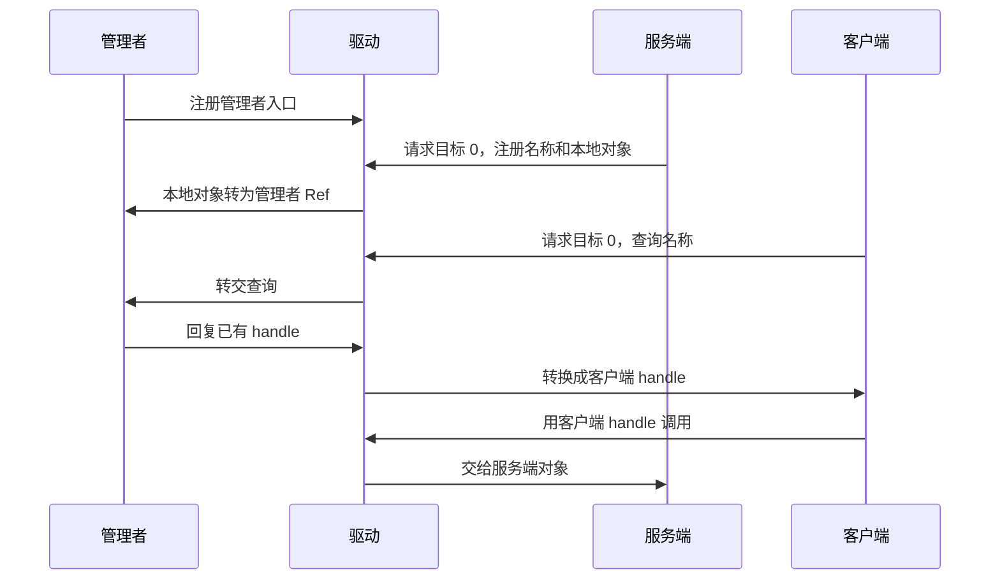

# 4.2 从哪里找到服务？

## 4.2.1 问题与设计

第三篇可以把对象或 Ref 交给另一个进程，但实验依靠 Node 编号和管道找到接收方。客户端并不知道有哪些服务时，如何取得第一个服务的 Ref？

本章引入一个简化管理者。它注册为特殊入口；服务端向入口交出对象，管理者保存名称和自己的 Ref；客户端向入口查询名称，驱动把管理者的 Ref 转成客户端自己的 Ref。示例源码 `examples/4.2/`，协议版本 `0402`。



目标 handle 和 Node 都为 0 时，驱动选择管理者入口。它是引导路径；普通服务仍以自己的 handle 调用。示例使用字符串服务名 `calculator`，管理者暂时只保存一个服务。

## 4.2.2 注册唯一入口

源码：`examples/4.2/kernel/mini_binder.c`，第 531–542 行（节选）。

```c
    case MINI_BINDER_REGISTER_SERVER:
        return register_server(file);
    case MINI_BINDER_REGISTER_MANAGER: {
        struct mini_binder_proc *ctx = file->private_data;
        long ret = 0;
        mutex_lock(&state_lock);
        if (!ctx->is_server) ret = -EPERM;
        else if (server_file) ret = -EBUSY;
        else WRITE_ONCE(server_file, file);
        mutex_unlock(&state_lock);
        return ret;
    }
```

示例先注册服务端并映射缓冲区，再注册管理者；注册管理者时驱动检查服务端身份和入口是否已占用，并不检查映射。准备好映射后管理者才能接收请求。第二个管理者被拒绝。驱动用 `state_lock` 保护入口，管理者文件最后一个引用释放时入口被清除。此实现直接保存文件，**没有**为管理者创建 Android 那样的上下文管理者 Node，也没有权限校验。

## 4.2.3 保存和返回 Ref

源码：`examples/4.2/tests/manager_test.c`，第 42–68 行（章节版本 `0402`，节选）。

```c
    for (;;) {
        struct mini_binder_command req = {0}, reply = {.cmd = MINI_BC_REPLY};
        struct object_parcel request, response;
        struct parcel_object object;
        const unsigned char *text;
        size_t length;
        assert(ioctl(fd, MINI_BINDER_READ, &req) == 0);
        reply.transaction.id = req.transaction.id;
        object_parcel_init(&response, reply.transaction.data, sizeof(reply.transaction.data));
        int invalid = parcel_from_transaction(&request, &req.transaction,
                          (const void *)(uintptr_t)req.transaction.data_address);
        if (invalid || parcel_read_string(&request.bytes, &text, &length) ||
            !length || length > 32 || memchr(text, '\0', length)) {
            reply.transaction.status = -EINVAL;
        } else if (req.transaction.code == 1 && request.count == 1 &&
                   object_parcel_read_next(&request, &object) == 0 &&
                   object.type == OBJECT_PARCEL_HANDLE && object.value &&
                   request.bytes.position == request.bytes.size) {
            memcpy(name, text, length); name[length] = '\0';
            saved = (uint32_t)object.value;
        } else if (req.transaction.code == 2 && !request.count &&
                   request.bytes.position == request.bytes.size && saved &&
                   strlen(name) == length && memcmp(name, text, length) == 0) {
            assert(object_parcel_write(&response, OBJECT_PARCEL_HANDLE, saved) == 0);
        } else reply.transaction.status = -ENOENT;
        parcel_to_transaction(&reply.transaction, &response);
        assert(ioctl(fd, MINI_BINDER_WRITE, &reply) == 0);
```

`parcel_from_transaction()`（`examples/4.2/include/parcel_binding.h`，第 11–25 行）校验长度和对象位置，借用映射数据建立读取视图，不复制内核 Node/Ref。`parcel_read_string()` 推进读取位置，`object_parcel_read_next()` 再从该位置取得对象；不是把 handle 当作普通整数猜测其位置。回复使用本地可写 Parcel，`parcel_to_transaction()` 将实际长度和对象位置写回事务头。请求视图必须在提交回复前读完，客户端回复视图必须在 FREE_REPLY 前读完。

服务名沿用 2.2 的 Parcel 字符串编码，object_parcel 顺序读取名称后的对象，不再手算对齐与对象字节位置；它不是 Android ServiceManager 的完整字符串协议。注册时，服务端把名称和本地对象作为请求参数；驱动已将对象转为管理者文件的 handle。查询时，管理者比较完整名称，把已有 handle 作为回复返回值。用户态保存的是 handle 数字，Node 与 Ref 仍在内核。

源码：`examples/4.2/kernel/mini_binder.c`，第 321–331 行（节选）。

```c
    ret = wait_event_interruptible(client_wait,
            READ_ONCE(slot->state) == RPC_DONE || READ_ONCE(slot->state) == RPC_FAILED);
    mutex_lock(&state_lock);
    if (!ret && slot->state == RPC_DONE) {
        ret = translate_objects(slot->receiver, client_ctx, &slot->reply);
        if (ret) goto finish_call;
        transaction.size = slot->reply.size;
        transaction.status = slot->reply.status;
        transaction.object_count = slot->reply.object_count;
        memcpy(transaction.object_offsets, slot->reply.object_offsets, sizeof(transaction.object_offsets));
        memcpy(client_ctx->buffer, slot->reply.data, slot->reply.size);
```

调用方等待回复时不持有 `state_lock`。回复完成后，驱动以服务端文件为发送方、客户端 proc 为接收方复用对象转换函数：管理者 Ref → Node → 客户端 Ref。它沿用 3.6 的位置校验和 Ref 表副本；转换失败不交付回复。函数改名为 `translate_objects`，表明请求和回复都可以使用。

## 4.2.4 实验

运行前先预测：查询服务名时访问 handle 0，拿到服务后是否还需要通过管理者调用？管理者和客户端都可能持有数字 1，它们属于同一张 Ref 表吗？在可加载模块且安装匹配内核头文件的 Linux 环境中，先停止其他章节服务端并卸载旧模块：

```sh
cd examples/4.2
make
sudo insmod kernel/mini_binder.ko
./build/version
./build/manager_test --demo
sudo rmmod mini_binder
```

Ubuntu 24.04 ARM64、Linux 6.8.0-147 的实际输出：

```text
mini-binder protocol version: 0402
manager: handle 0 ready
provider: calculator registered with manager
client: get calculator through handle 0 -> local handle 1
client: call handle 1 -> result 42
service calculator: registered, found and called (result 42)
```

前四条过程日志依次对应管理者就绪、提供者完成注册、客户端完成查询、客户端直接调用服务。测试用管道等待注册完成后才开始查询；这些同步管道不传递服务 Node 编号或 handle。客户端通过名称取得自己的 handle 1，之后调用的目标就是服务对象，不再由管理者转发。

示例服务名是 `calculator`，但服务端只是固定返回 42，并没有执行加法；本章要观察的是服务发现和对象调用。`--demo` 到此结束；不带参数的完整验收才继续执行重复注册管理者、畸形查询、未知名称、管理者退出后已有 Ref 继续调用，以及服务端退出后引用失效等回归。

## 4.2.5 限制与自测

管理者只保存一个字符串名称和一个 handle，名称最长 32 字节；没有访问权限、服务列表、死亡通知或自动恢复，任何可打开设备的进程都可以抢先注册。管理者退出后已有有效 Ref 可继续调用，但不能再通过入口查询。服务端退出时管理者保留的 Ref 会失效。直接 Node 路径仍是教学入口，不构成访问控制。

1. 客户端为什么不能直接使用管理者保存的 handle？
2. 这次 Ref 转换和 3.6 的转换有什么共同点？
3. 为什么管理者退出后，已经取得的 Ref 仍可能有效？

参考：handle 属于各自的 proc；两者都通过发送方 Ref 找 Node，再建立接收方 Ref；已有 Ref 指向服务 Node，不依赖管理者继续存活。

主实验的 `--demo` 仅完成注册、查询和调用。需要完整验收时，在本章模块仍加载时运行 `./build/manager_test`；重复管理者、截断名称、查询失败和进程退出是额外回归，不是读懂服务发现的前置条件。
