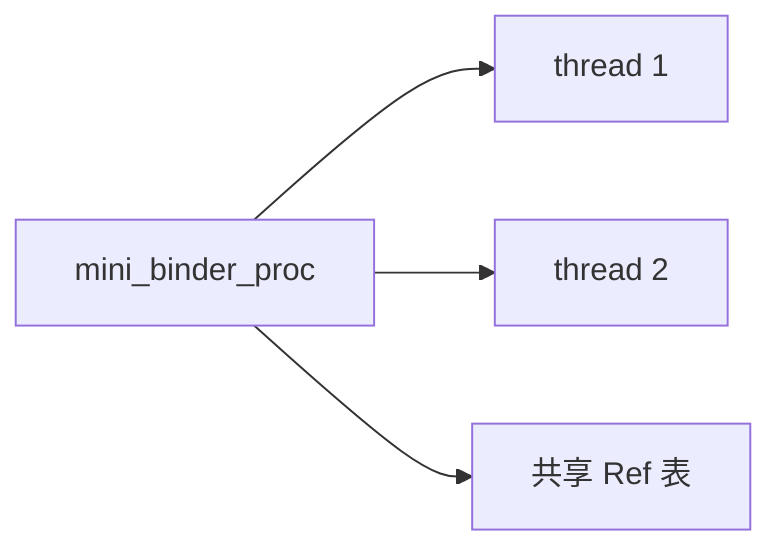

# 4.3 一个 Binder 上下文中的多个线程

## 4.3.1 为什么需要线程记录？

前面用 proc 表示一次打开设备的上下文，但同一个上下文可能被多个线程使用。仅知道所属 proc，还不能区分当前是哪一个线程进入驱动，也不能在后续把工作或回复交给指定线程。

本章在 proc 中记录线程身份，不改变前面的事务分配方式。源码在 `examples/4.3/`，协议版本 `0403`。



这里的 proc 仍是打开文件上下文；两个线程使用同一文件时共享它的映射和 Ref，但有不同的线程记录。

## 4.3.2 记录当前线程

源码：`examples/4.3/kernel/mini_binder.c`，第 24–40 行（节选）。

```c
struct mini_binder_thread {
    struct pid *pid;
    __u32 id;
};

struct mini_binder_proc {
    struct file *file;
    bool is_server;
    void *buffer;
    struct vm_area_struct *server_vma;
    bool inflight;
    bool reply_ready;
    bool reply_delivered;
    struct mini_binder_ref refs[MINI_BINDER_MAX_OBJECTS];
    struct mini_binder_thread threads[8];
    struct mini_binder_transaction_data pending_reply;
};
```

`pid` 保存内核线程身份引用，`id` 是本 proc 中的教学编号，不是 Linux TID。固定数组最多记录八个线程；不同 proc 的编号可以相同。线程记录由 `state_lock` 保护。

源码：`examples/4.3/kernel/mini_binder.c`，第 66–90 行（完整函数）。

```c
static long get_thread_id(struct mini_binder_proc *proc, __u32 *id)
{
    struct pid *pid = task_pid(current);
    unsigned int i, empty = ARRAY_SIZE(proc->threads);
    long ret = 0;

    mutex_lock(&state_lock);
    for (i = 0; i < ARRAY_SIZE(proc->threads); i++) {
        if (proc->threads[i].pid == pid) {
            *id = proc->threads[i].id;
            goto out;
        }
        if (!proc->threads[i].pid && empty == ARRAY_SIZE(proc->threads)) empty = i;
    }
    if (empty == ARRAY_SIZE(proc->threads)) {
        ret = -ENOSPC;
    } else {
        proc->threads[empty].pid = get_pid(pid);
        proc->threads[empty].id = empty + 1;
        *id = empty + 1;
    }
out:
    mutex_unlock(&state_lock);
    return ret;
}
```

读取或写入命令时，驱动用 `current` 查找或建立记录；实验用 `MINI_BINDER_GET_THREAD_ID` 观察编号。`get_pid()` 保存身份引用，proc 最终释放时用 `put_pid()` 释放；记录满时返回 `ENOSPC`。

## 4.3.3 实验

在支持加载模块且安装匹配内核头文件的 Linux 环境中，先停止其他章节服务端并卸载旧模块：

```sh
cd examples/4.3
make
sudo insmod kernel/mini_binder.ko
./build/version
./build/thread_test --demo
sudo rmmod mini_binder
```

Ubuntu 24.04 ARM64、Linux 6.8.0-147 的实际输出：

```text
mini-binder protocol version: 0403
proc A: main thread 1, workers 3 and 2
dup A: thread 1; proc B: thread 1
one proc, distinct thread records; dup shares proc passed
```

线程测试检查同一线程重复进入、两个线程分别进入、`dup()` 共享文件和独立 `open()` 的编号；完整模式另检查八个表项用完后返回 `ENOSPC`。两个工作线程获得编号的顺序可能因调度而变化。服务发现和对象传递的额外测试源码保留在本章 `tests/` 目录中，不是理解线程记录的前提。

## 4.3.4 限制与自测

记录在 proc 最终释放时一起回收，线程退出时不会回收表项；长时间创建线程可能耗尽八个表项。`GET_THREAD_ID` 是教学接口，不是 Android Binder 协议。现有请求仍使用全局事务槽和等待队列，线程记录尚不参与工作分配；同一文件仍有单个回复槽，不能据此声称支持任意并发调用。

1. 为什么同一 proc 中需要多个线程记录？
2. `dup()` 后为什么仍查到同一线程记录？
3. 为什么线程退出后本例仍可能耗尽表项？

参考：同一文件可被多个线程使用；dup 共享文件和 proc；本章仅在 proc 释放时回收线程记录。

`--demo` 只运行本章正常机制的最小场景；不带参数执行 `./build/thread_test`，再检查容量、错误输入或重复清理等原有完整验收。两种模式共用同一驱动，不能将主实验通过当作已执行全部回归。
