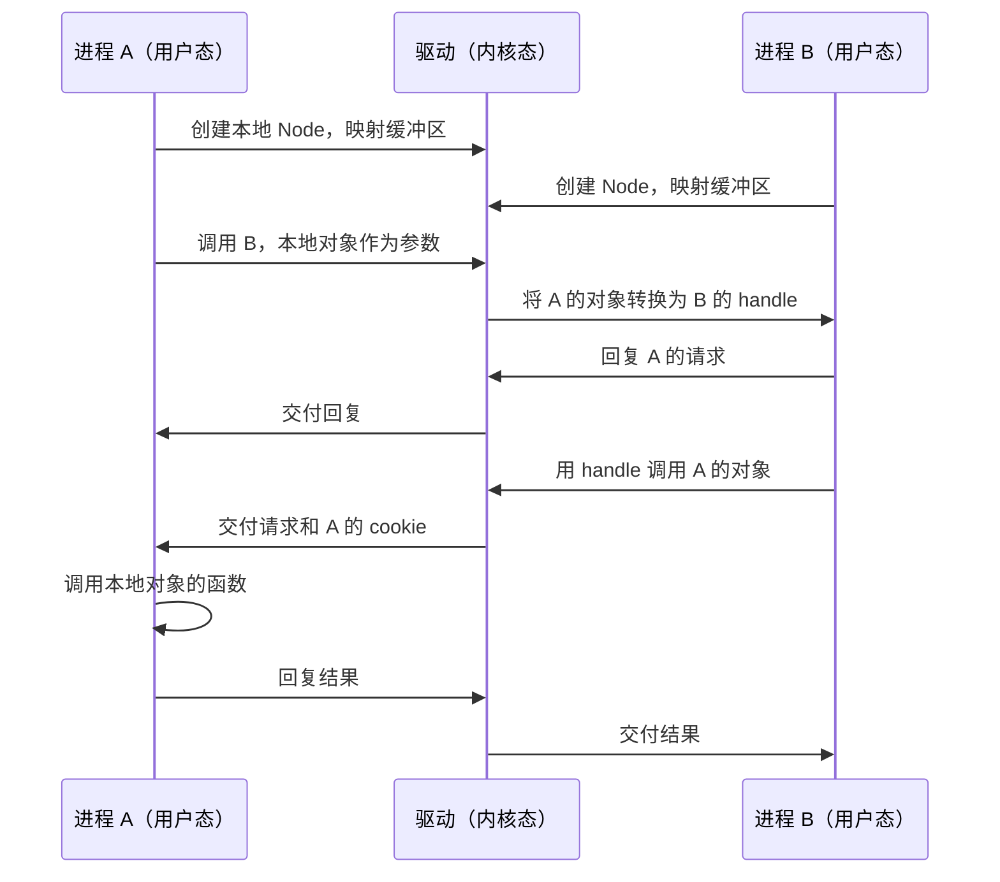

# 4.3 同一个上下文既能调用，也能提供对象

4.2 已经能将引用传回对象拥有者，但仍要求对象拥有者先注册为服务端。本章撤掉这个角色门槛：一个上下文既能调用别人的对象，也能提供自己的对象。双向调用按先后完成，不涉及等待中的同步重入。

## 4.3.1 问题与思路

前面的例子要求先调用 `MINI_BINDER_REGISTER_SERVER` 才能创建本地 Node 和接收请求，容易让人误以为一个进程必须先决定自己是客户端还是服务端。但同一个 Binder 上下文既可能调用其他对象，也可能拥有供别人调用的本地对象。

本章移除服务端注册。任意打开设备的上下文可以创建 Node；准备好映射后，它既能发送调用，也能主动读取并处理发给自己的请求。本章只用管道交换 Node 编号，下一章再引入管理者作为服务发现入口。

源码在 `examples/4.3/`，协议版本 `0403`。对象仍通过教学 ioctl 显式创建 Node；这个临时接口在 [7.1](../07-protocol/7.1-auto-node.md) 删除，之后只通过 LOCAL 对象传输自动创建或复用。

## 4.3.2 对象作为参数传给对端



本例先完成 A 对 B 的调用，然后 B 再调用 A 的对象；这不涉及等待中的同步回调重入。测试通过管道提供 B 的 Node 编号，仅作为首次寻址入口，不能作为安全授权机制。

## 4.3.3 创建 Node 不再检查角色

源码：`examples/4.3/kernel/mini_binder.c`，第 119–133 行（节选）。

```c
    if (copy_from_user(&create, arg, sizeof(create))) return -EFAULT;
    if (!create.cookie) return -EINVAL;
    mutex_lock(&state_lock);
    for (i = 0; i < ARRAY_SIZE(nodes); i++) {
        if (nodes[i].owner == file->private_data && nodes[i].cookie == create.cookie) { ret = -EEXIST; goto out; }
        if (!nodes[i].owner && free_index == ARRAY_SIZE(nodes)) free_index = i;
    }
    if (free_index == ARRAY_SIZE(nodes)) { ret = -ENOSPC; goto out; }
    i = free_index;
    if (next_node_id == U64_MAX) { ret = -EOVERFLOW; goto out; }
    create.node_id = next_node_id + 1;
    if (copy_to_user(arg, &create, sizeof(create))) { ret = -EFAULT; goto out; }
    nodes[i].id = ++next_node_id;
    nodes[i].cookie = create.cookie;
    nodes[i].owner = file->private_data;
```

不再检查 `is_server`。Node 归当前打开文件的 proc 所有，重复 cookie、容量和无效地址仍有检查。创建 Node 不要求先映射，但对端调用前，拥有者必须建立有效映射并安排线程读取请求；否则调用可能失败或等待。

## 4.3.4 明确读取请求还是回复

同一上下文既能发送也能接收，因此驱动不能再靠“是否注册服务端”判断 `READ` 的意图。本章要求用户态在命令的 `cmd` 字段写入 `MINI_READ_REQUEST` 或 `MINI_READ_REPLY`。

| 阶段 | 用户态如何选择读取内容 |
| --- | --- |
| 4.2 | 驱动根据是否注册服务端以及回复状态选择请求或回复 |
| 4.3 | 调用方显式指定 `MINI_READ_REQUEST` 或 `MINI_READ_REPLY` |

源码：`examples/4.3/kernel/mini_binder.c`，第 484–501 行（节选）。

```c
    if (get_user(kind, &read_cmd->cmd)) return -EFAULT;
    if (kind == MINI_READ_REQUEST) {
        if (put_user(MINI_BR_TRANSACTION, &read_cmd->cmd))
            return -EFAULT;
        return receive_request(file, &read_cmd->transaction);
    }
    if (kind != MINI_READ_REPLY) return -EINVAL;
    mutex_lock(&state_lock);
    if (!ctx->reply_ready || ctx->reply_delivered) {
        ret = -ENOENT;
    } else {
        reply.transaction = ctx->pending_reply;
        if (copy_to_user(read_cmd, &reply, sizeof(reply)))
            ret = -EFAULT;
        else
            ctx->reply_delivered = true;
    }
    mutex_unlock(&state_lock);
```

读取请求会扫描发给当前上下文的事务槽，没有请求时在等待队列中睡眠；读取回复只领取当前打开文件已完成的回复。所有上下文统一使用一页只读映射：前两个 256 字节位置保存两个事务槽的请求，回复固定从页内偏移 512 开始；请求和回复不能互相覆盖。本章仍按打开文件保存一份回复，保留事务 id 来匹配服务端回复，不提前引入第五篇的线程回复位置和事务绑定。这两个读取选择值是教学协议，不是 Android 的 BC/BR 命令。

每个打开文件同时只允许一个映射，映射不随 fork 继承；读取请求及发起调用时检查调用线程的地址空间。最后一个文件引用释放时，驱动清除该 proc 的 Node 并处理发送给它的未完成事务，不再依赖服务端角色标记。

## 4.3.5 实验

在可加载模块且安装匹配内核头文件的 Linux 中，先停止其他章节服务并卸载旧模块：

```sh
cd examples/4.3
make
sudo insmod kernel/mini_binder.ko
./build/version
./build/role_test
sudo rmmod mini_binder
```

Ubuntu 24.04 ARM64、Linux 6.8.0-147 上的实验输出：

```text
mini-binder protocol version: 0403
ordinary client passed a local object and handled its call: twice(7) = 14
```

`role_test` 的两个进程都没有注册服务端。A 把自己的对象作为请求参数传给 B；B 得到 handle 并在第一笔调用完成后使用它调用 A，A 在自己的用户态执行函数并回复。本章已在上述环境构建并实际运行；验收还包括映射地址空间、对象往返、取消和服务进程退出；共享文件的多个调用线程留到第五篇。

## 4.3.6 与 Android 的差距

Android 16 参考驱动 `kernel-common/drivers/android/binder.c` 的 `binder_translate_binder()`（固定提交 `894a317b5382555614ef2be7a79cca79083c6cf2`）先根据发送方 proc 和本地对象标识查找 Node，找不到时创建，再为接收方建立 Ref。本例仍需显式 `CREATE_NODE`，只按 cookie 标识对象，也没有强弱引用或完整生命周期。

本章没有实现同步回调重入和线程事务栈；如果对象拥有者不读取请求，调用方可能一直等待。映射关闭、同时退出和复杂并发的所有交错尚未穷尽。同一上下文尚不支持两个调用线程同时等待回复，第五篇再拆分线程状态。

1. 为什么可以创建 Node 却暂时不能接收调用？
2. 同一个 proc 为什么需要区分读取请求和读取回复？
3. 本章与 Android 自动查找或创建 Node 有什么不同？

参考：接收还需要有效映射和工作线程；它可以同时拥有待处理请求和已完成回复；本章必须先显式创建 Node。

下一章增加服务发现，不再要求客户端通过管道取得服务 Node 编号。

本章重排后的源码已在 Ubuntu 24.04 ARM64、Linux `6.8.0-147-generic` 重新构建并运行；实际覆盖范围及原始输出见[本轮验证记录](../../validation/README.md)。
