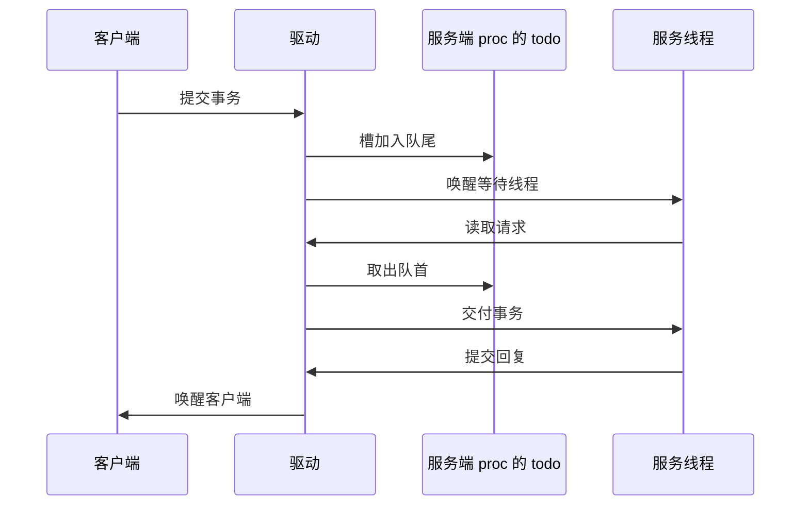

# 4.4 让服务线程领取待办事务

## 4.4.1 问题与思路

4.3 已经可以区分线程，但请求仍存放在全局事务槽里，服务端需要扫描所有槽，找出发给自己的请求。原来的扫描也可以让多个线程在锁保护下领取请求；随着服务端增多，能否把待处理工作明确归到目标 proc，让其工作线程直接领取？

本章给每个 proc 增加 `todo` 链表。事务槽仍保存数据和状态；请求到达时把槽加入目标 proc 的队列，服务线程从该队列领取。源码在 `examples/4.4/`，协议版本 `0404`。



`todo` 保存的是待办工作，`server_wait` 是让线程休眠和唤醒的等待队列。它们分工不同；本章还没有线程专属的 todo。

## 4.4.2 请求入队

源码：`examples/4.4/kernel/mini_binder.c`，第 344–360 行（节选）。

```c
    ret = translate_objects(file, server_ctx, &transaction);
    if (ret) goto unlock_state;
    slot->request.id = ++next_id;
    memcpy((char *)server_ctx->buffer + i * MINI_BINDER_MAX_DATA, transaction.data, transaction.size);
    slot->request.size = transaction.size;
    slot->request.code = transaction.code;
    slot->request.target_node = transaction.target_node;
    slot->request.object_cookie = transaction.object_cookie;
    slot->request.object_count = transaction.object_count;
    memcpy(slot->request.object_offsets, transaction.object_offsets, sizeof(transaction.object_offsets));
    WRITE_ONCE(slot->receiver, receiver);
    client_ctx->inflight = true;
    WRITE_ONCE(slot->state, RPC_PENDING);
    list_add_tail(&slot->work, &server_ctx->todo);
    atomic_inc(&server_ctx->pending_count);
    mutex_unlock(&state_lock);
    wake_up_interruptible_all(&server_wait);
```

驱动先完成对象转换和数据复制，再将槽尾插入目标 proc 的 todo。`state_lock` 保护槽、链表及其增减；随后释放锁并唤醒等待线程。`pending_count` 是供等待条件读取的原子计数，不保存事务内容。全局仍只有两个槽，队列并不增加在途容量。

## 4.4.3 工作线程领取

源码：`examples/4.4/kernel/mini_binder.c`，第 436–452 行（节选）。

```c
        if (!list_empty(&ctx->todo)) {
            struct mini_binder_transaction_data delivered = {0};
            struct transaction_slot *slot = list_first_entry(&ctx->todo, struct transaction_slot, work);
            i = slot - slots;
            list_del_init(&slot->work);
            atomic_dec(&ctx->pending_count);

            delivered.id = slot->request.id;
            delivered.data_address = user_base + i * MINI_BINDER_MAX_DATA;
            delivered.size = slot->request.size;
            delivered.code = slot->request.code;
            delivered.target_node = slot->request.target_node;
            delivered.object_cookie = slot->request.object_cookie;
            delivered.object_count = slot->request.object_count;
            memcpy(delivered.object_offsets, slot->request.object_offsets, sizeof(delivered.object_offsets));

            WRITE_ONCE(slot->state, RPC_PROCESSING);
```

线程持锁取出队首并改变状态，因此两个线程不会领取同一槽。之后元数据通过 `copy_to_user` 交给用户态；复制失败时事务标为失败并唤醒客户端。队列为空时，线程释放锁等待；唤醒后重新持锁检查。尾插和取首使入队工作按入队次序领取，但不保证哪个线程领取，也不保证处理或回复顺序。

## 4.4.4 取消与退出

源码：`examples/4.4/kernel/mini_binder.c`，第 380–389 行（节选）。

```c
finish_call:
    if (slot->state == RPC_PENDING) {
        struct mini_binder_proc *receiver_ctx = slot->receiver->private_data;
        list_del_init(&slot->work);
        atomic_dec(&receiver_ctx->pending_count);
    }
    if (ret && slot->state == RPC_PROCESSING)
        WRITE_ONCE(slot->state, RPC_CANCELLED);
    else
        WRITE_ONCE(slot->state, RPC_IDLE);
```

客户端中断时，如果请求还在队列中，就持锁删除它并回收槽；如果服务端已经领取，则保留 `RPC_CANCELLED`，等待旧回复或服务端退出后回收。服务端退出时也先移除它尚未领取的工作，再让相关客户端失败并唤醒。上述转换由 `state_lock` 串行化。

## 4.4.5 实验

在可加载模块且有匹配内核头文件的 Linux 环境中，先停止其他章节服务端并卸载旧模块：

```sh
cd examples/4.4
make
sudo insmod kernel/mini_binder.ko
./build/version
./build/workers_test
sudo rmmod mini_binder
```

Ubuntu 24.04 ARM64、Linux 6.8.0-147 的实际输出：

```text
mini-binder protocol version: 0404
two client requests queued before workers started
thread 1 handled request 1: 10 -> 11
thread 2 handled request 2: 11 -> 12
two server threads receive separate queued requests
```

`workers_test` 先启动两个客户端，观察它们都在同步 ioctl 中睡眠后，再启动两个服务线程领取请求。此前没有工作线程，两个客户端也已通过目标检查，因此两笔请求都已在目标 proc 的 todo 中。每行的线程编号、事务编号、输入和回复均来自本次运行；请求和线程的对应关系可能因调度而变化。此同步检查需要能读取子进程的 `/proc/<pid>/status` 和 `syscall`。

为了让客户端找到服务端，测试把服务端临时注册为目标 0 的管理者入口；这只是本实验的寻址方式，todo 本身不依赖管理者。未领取请求的取消、倒序回复和服务端退出等检查见[回归测试说明](../appendices/3-4-regression.md)。

## 4.4.6 限制与自测

线程记录目前不保存线程待办队列或事务调用栈；回复元数据和缓冲区仍属于文件上下文，不支持同一文件的任意并发客户端调用或完整嵌套调用。等待队列仍由所有服务端共享并唤醒所有等待者，链表容量受两个全局槽限制。后续需要独立设计线程专属工作、回复路由和线程退出清理；不应将本章实现视为完整 Android Binder 线程池。

1. 为什么 todo 链表和等待队列要分开？
2. 请求取消时为什么要先判断是否已经被领取？
3. 有两个服务线程是否意味着同一个文件可以并发发起任意客户端调用？

参考：todo 记录工作，等待队列负责休眠唤醒；领取后服务端仍可能提交旧回复；本章回复槽仍按文件共享。
