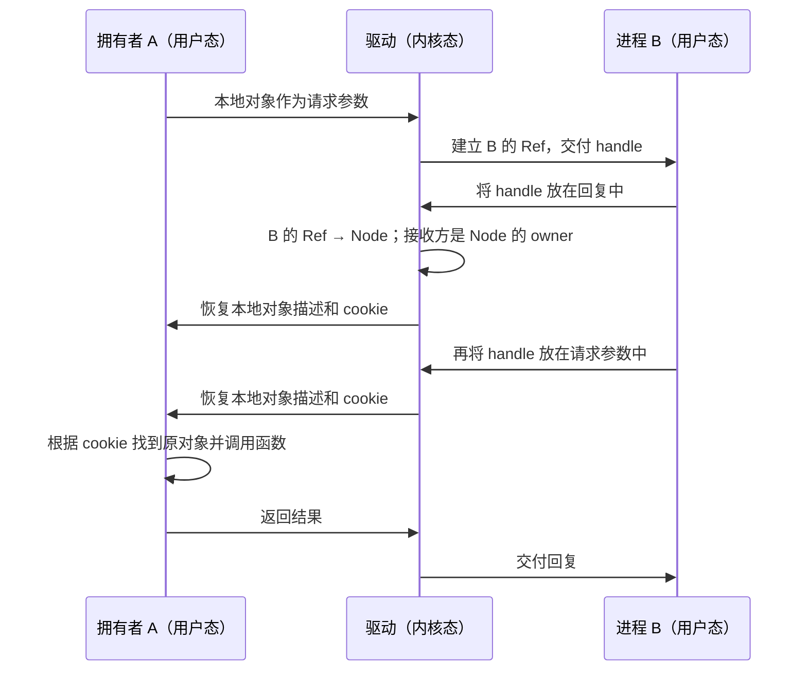

# 4.5 把引用传回对象拥有者

## 4.5.1 问题与思路

3.6 中，一个进程把 Ref 交给另一个进程，驱动为接收方建立指向同一 Node 的 Ref。如果接收方正好是这个 Node 的拥有者，是否还要创建一个指向自己对象的 Ref？

本章增加一个分支：驱动通过发送方的 handle 找到 Node 后，比较接收方 proc 和 Node 的 owner。如果相同，就把 Parcel 中的 handle 描述改回本地对象描述；否则仍按前面的方式为接收方建立或复用 Ref。源码在 `examples/4.5/`，协议版本 `0405`。

Node 和 Ref 是内核结构体，不会被复制给用户态。所谓“拿回本地对象”，是驱动把对象拥有者先前登记的 cookie 写入接收方的对象描述，拥有者再按自己的规则找到原对象。

## 4.5.2 对象往返



本实验使用管道预先交换接收方的 Node 编号，只作为实验寻址入口，不承担对象传递。实际对象描述和位置表通过 mini-binder 事务传递。

## 4.5.3 驱动怎样选择转换方式？

源码：`examples/4.5/kernel/mini_binder.c`，第 113–145 行（节选；本地对象发送分支省略）。

```c
        type = get_unaligned_le32(transaction->data + offset);
        if (type == MINI_BINDER_OBJECT_HANDLE) {
            if (get_unaligned_le32(transaction->data + offset + 8)) return -EINVAL;
            handle = get_unaligned_le32(transaction->data + offset + 4);
            if (!handle || handle > ARRAY_SIZE(sender->refs) || !sender->refs[handle - 1].node_id) return -ENOENT;
            id = sender->refs[handle - 1].node_id;
            for (j = 0; j < ARRAY_SIZE(nodes); j++)
                if (nodes[j].owner && nodes[j].id == id) break;
        /* ... 本地对象发送分支 ... */
        } else return -EINVAL;
        if (j == ARRAY_SIZE(nodes)) return -ENOENT;
        if (nodes[j].owner == receiver) {
            __u64 cookie = nodes[j].cookie;
            put_unaligned_le32(MINI_BINDER_OBJECT_LOCAL, transaction->data + offset);
            put_unaligned_le32((__u32)cookie, transaction->data + offset + 4);
            put_unaligned_le32((__u32)(cookie >> 32), transaction->data + offset + 8);
            previous = offset;
            continue;
        }
        for (k = 0; k < ARRAY_SIZE(refs); k++) if (refs[k].node_id == id) break;
        if (k == ARRAY_SIZE(refs)) {
            for (k = 0; k < ARRAY_SIZE(refs); k++) if (!refs[k].node_id) break;
            if (k == ARRAY_SIZE(refs)) return -ENOSPC;
            refs[k].node_id = id;
        }
        put_unaligned_le32(MINI_BINDER_OBJECT_HANDLE, transaction->data + offset);
        put_unaligned_le32(k + 1, transaction->data + offset + 4);
        put_unaligned_le32(0, transaction->data + offset + 8);
```

发送方的 handle 先在发送方 proc 的 Ref 表中解析为 Node ID。Node 不存在返回 `ENOENT`；找到后，如果 `owner == receiver`，驱动写入本地类型及原 cookie，不给拥有者新增 Ref；否则在接收方查找或创建 Ref。此函数由请求和回复复用，在 `state_lock` 下运行；多对象位置表的校验及 Ref 表副本提交沿用 4.4。

## 4.5.4 拥有者如何使用 cookie？

源码：`examples/4.5/tests/return_to_owner_test.c`，第 101–117 行（节选）。

```c
    assert(ioctl(fd, MINI_BINDER_WRITE, &call) == 0);
    assert(ioctl(fd, MINI_BINDER_READ, &result) == 0);
    assert(result.transaction.object_count == 1 && get32(mapping) == MINI_BINDER_OBJECT_LOCAL);
    assert(get64(mapping + 4) == cookie);
    returned = (const struct service_object *)(uintptr_t)get64(mapping + 4);
    assert(returned->invoke(21) == 42);
    free_reply(fd);

    assert(ioctl(fd, MINI_BINDER_READ, &req) == 0);
    payload = (const unsigned char *)(uintptr_t)req.transaction.data_address;
    assert(req.transaction.object_count == 1 && get32(payload) == MINI_BINDER_OBJECT_LOCAL);
    assert(get64(payload + 4) == cookie);
    returned = (const struct service_object *)(uintptr_t)get64(payload + 4);
    reply.transaction.id = req.transaction.id;
    reply.transaction.size = 4;
    put32(reply.transaction.data, (uint32_t)returned->invoke(21));
    assert(ioctl(fd, MINI_BINDER_WRITE, &reply) == 0);
```

实验中的 cookie 恰好是 A 自己的 `service_object` 地址。A 先验证返回的 cookie 与已登记对象一致，再在自己的用户态解引用并调用函数指针；驱动不执行该指针，其他进程也不使用它。实际应用不能把不可信数据任意强转为指针，必须维护有效对象和生命周期。

## 4.5.5 对照 Android Binder

Android 16 参考源码 `kernel-common/drivers/android/binder.c` 的 `binder_translate_handle()`（固定提交 `894a317b5382555614ef2be7a79cca79083c6cf2`，第 2494–2501 行）有对应分支，以下为节选：

```c
	binder_node_lock(node);
	if (node->proc == target_proc) {
		if (fp->hdr.type == BINDER_TYPE_HANDLE)
			fp->hdr.type = BINDER_TYPE_BINDER;
		else
			fp->hdr.type = BINDER_TYPE_WEAK_BINDER;
		fp->binder = node->ptr;
		fp->cookie = node->cookie;
```

原生驱动把强或弱 handle 分别转换为对应本地类型，并恢复 Node 中的 `ptr` 和 `cookie`；其他接收方走 Ref 转换。它还处理引用计数、安全检查和锁，mini-binder 只使用一个 cookie，且没有强弱引用或安全检查，不能等同于原生实现。

## 4.5.6 实验

在支持加载模块且安装匹配内核头文件的 Linux 环境中，先停止其他章节服务端并卸载旧模块：

```sh
cd examples/4.5
make
sudo insmod kernel/mini_binder.ko
./build/version
./build/return_to_owner_test
sudo rmmod mini_binder
```

Ubuntu 24.04 ARM64、Linux 6.8.0-147 上的实际输出：

```text
mini-binder protocol version: 0405
reply Ref -> owner local object: 42
request Ref -> owner local object: 42
```

测试检查 B 收到 handle，A 在回复和请求方向都收到 `MINI_BINDER_OBJECT_LOCAL` 及原 cookie，并在 A 的用户态调用原对象。服务发现和传给非拥有者的对象转换等额外检查见[回归测试说明](../appendices/3-4-regression.md)。

## 4.5.7 限制与自测

本例没有 Node/Ref 引用计数或死亡通知，不能保证复杂生命周期中的对象仍然有效；cookie 的有效性由拥有者管理。Node ID 和数组容量仍是固定的教学简化；线程专属 todo 和完整嵌套调用也尚未实现。测试没有穷尽多对象转换失败和进程退出并发交错。

1. 为什么传回拥有者时不需要新建 Ref？
2. 驱动返回的是内核 Node、函数指针，还是用户态 cookie？
3. 为什么传给第三个进程时仍要转换为该进程的 handle？

参考：拥有者已有本地对象；驱动返回本例的用户态 cookie；第三方不能使用拥有者的用户态地址。
