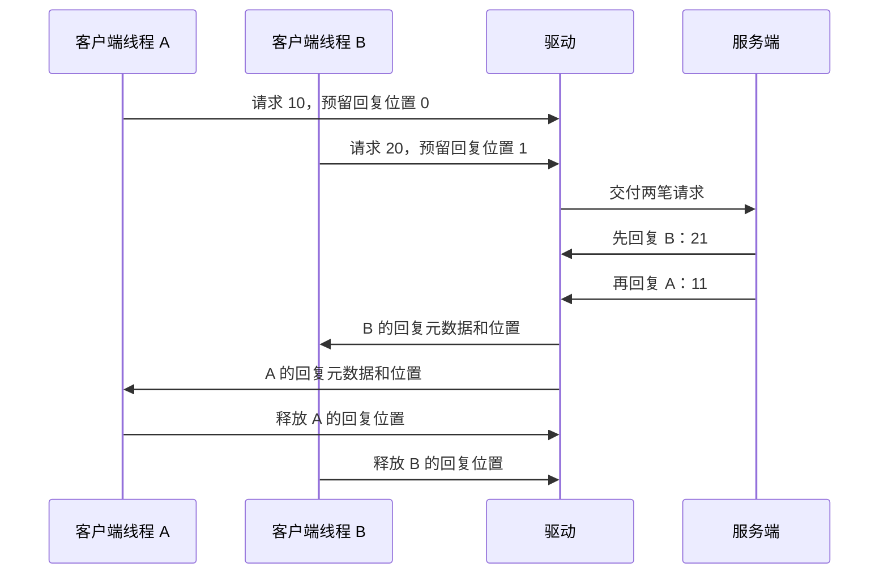

# 5.1 同一个 Binder 上下文中的两个调用线程

## 5.1.1 问题与思路

第四篇中，同一个打开文件的线程共享一份 `inflight` 和回复映射位置。一个线程的请求尚未完成或回复未释放时，另一个线程调用会得到 `EBUSY`。如果两个线程分别调用服务，如何让它们各自得到正确回复？

本章把调用和回复状态放到 `mini_binder_thread`，并在同一 proc 的映射中预留两个固定回复位置。驱动在提交事务时保留一个位置，回复返回后，发起调用的线程读取并释放它。两个全局事务槽仍限制同时在途的事务数；这不是完整的 Android Binder allocator。

源码在 `examples/5.1/`，协议版本 `0501`。本章调整了共享事务结构，必须使用本章配套驱动和程序。

## 5.1.2 一次倒序回复



实际运行时，哪个线程先获得位置不固定。线程共享 proc 的 Ref 表和映射，但每个线程分别持有请求中状态与待领取回复；同一个线程不能同时持有两笔调用。

## 5.1.3 哪些状态属于线程？

源码：`examples/5.1/kernel/mini_binder.c`，第 25–45 行（节选）。

```c
struct mini_binder_thread {
    struct pid *pid;
    __u32 id;
    bool inflight;
    bool reply_ready;
    bool reply_delivered;
    unsigned int reply_index;
    struct mini_binder_transaction_data pending_reply;
};

struct mini_binder_proc {
    struct file *file;
    bool is_server;
    void *buffer;
    struct vm_area_struct *server_vma;
    unsigned long reply_used;
    struct mini_binder_ref refs[MINI_BINDER_MAX_OBJECTS];
    struct mini_binder_thread threads[8];
    struct list_head todo;
    atomic_t pending_count;
};
```

`inflight` 表示线程的同步调用仍在等待；`reply_ready` 和 `reply_delivered` 控制该线程的回复是否已存在、是否已读取。`reply_used` 属于 proc，记录两个映射位置是否被占用。它们由 `state_lock` 保护，线程记录通过当前线程身份查找。

## 5.1.4 预留与交付回复位置

源码：`examples/5.1/kernel/mini_binder.c`，第 310–316、367–370 行（节选）。

```c
    if (thread->reply_ready || thread->inflight) {
        ret = -EBUSY;
        goto unlock_state;
    }
    for (reply_index = 0; reply_index < SLOT_COUNT; reply_index++)
        if (!(client_ctx->reply_used & (1UL << reply_index))) break;
    if (reply_index == SLOT_COUNT) { ret = -EBUSY; goto unlock_state; }
    /* ... 选择服务端和空闲事务槽，转换请求中的对象 ... */
    WRITE_ONCE(slot->receiver, receiver);
    client_ctx->reply_used |= 1UL << reply_index;
    thread->reply_index = reply_index;
    thread->inflight = true;
```

驱动在状态锁下找到空闲回复位置；选择目标、事务槽及对象转换成功后才标记占用。位置已满、同一线程尚有回复或事务槽已满时返回 `EBUSY`。客户端在等待服务端回复时不持有状态锁。

源码：`examples/5.1/kernel/mini_binder.c`，第 380–392 行（节选）。

```c
    if (!ret && slot->state == RPC_DONE) {
        ret = translate_objects(slot->receiver, client_ctx, &slot->reply);
        if (ret) goto finish_call;
        transaction.size = slot->reply.size;
        transaction.status = slot->reply.status;
        transaction.object_count = slot->reply.object_count;
        memcpy(transaction.object_offsets, slot->reply.object_offsets, sizeof(transaction.object_offsets));
        transaction.reply_offset = (thread->reply_index + (client_ctx->is_server ? SLOT_COUNT : 0)) * MINI_BINDER_MAX_DATA;
        memcpy((char *)client_ctx->buffer + transaction.reply_offset, slot->reply.data, slot->reply.size);
        transaction.object_cookie = 0;
        thread->pending_reply = transaction;
        WRITE_ONCE(thread->reply_ready, true);
        thread->reply_delivered = false;
```

回复数据复制到预留位置，元数据保存在线程中；随后该线程通过 `MINI_BINDER_READ` 领取 `BR_REPLY`。如果领取元数据时用户地址无效，返回 `EFAULT`，仍可重试。`BC_FREE_REPLY` 只能释放当前线程的回复，释放后对应位置才可复用。调用中断、服务端退出或对象转换失败时，没有交付的回复位置会被回收。

## 5.1.5 映射中的位置

普通客户端的一页映射：

```text
映射基址
  + 0       回复位置 0（256 字节）
  + 256     回复位置 1（256 字节）
```

如果同一个 proc 也注册为服务端，其前两个位置供收到的请求使用，两个回复位置从偏移 512 开始。这使服务线程持有请求数据时，另一个线程发起调用得到的回复不会覆盖该请求。

`BR_REPLY` 的 `reply_offset` 是**这页映射内的位置**。用户态保持映射有效，并检查 `reply_offset` 与回复长度落在映射范围后，通过 `mapping + reply_offset` 读取数据。它不是内核与用户虚拟地址的差值，也不是 Parcel 对象位置表的 offset。

Android 16 参考驱动使用 Binder allocator 管理接收方缓冲区，并通过 `binder_buffer.user_data` 记录接收方地址；本章的两个固定位置和 `reply_offset` 是为展示共享映射中的隔离而设计的教学协议，并不是原生事务字段。

源码：`examples/5.1/tests/thread_reply_test.c`，第 38–52 行（节选）。

```c
    call.transaction.size = 1;
    call.transaction.data[0] = worker->input;
    assert(ioctl(worker->fd, MINI_BINDER_WRITE, &call) == 0);
    barrier(worker->phase);
    barrier(worker->phase);
    if (!demo && worker->input == 10)
        assert(ioctl(worker->fd, MINI_BINDER_READ, (void *)0) == -1 && errno == EFAULT);
    assert(ioctl(worker->fd, MINI_BINDER_READ, &reply) == 0 && reply.cmd == MINI_BR_REPLY);
    assert(reply.transaction.size == 1 && reply.transaction.reply_offset < 2 * MINI_BINDER_MAX_DATA);
    worker->offset = reply.transaction.reply_offset;
    worker->result = worker->mapping[worker->offset];
    assert(worker->result == worker->input + 1);
    barrier(worker->phase);
    barrier(worker->phase);
    assert(ioctl(worker->fd, MINI_BINDER_WRITE, &release) == 0);
```

`demo` 只决定是否附加无效地址验收，不改变回复匹配；主实验跳过这条错误路径。这里的回复长度固定为 1，且实验约定只有两个客户端回复位置，因此该边界检查适用于这个测试；一般程序应结合实际映射长度检查偏移与数据长度，避免越界。屏障用于确保两份回复同时存在并检查隔离，不是驱动协议的一部分。

## 5.1.6 实验

在可加载模块且安装匹配内核头文件的 Linux 环境中，先停止其他章节服务并卸载旧模块：

```sh
cd examples/5.1
make
sudo insmod kernel/mini_binder.ko
./build/version
./build/thread_reply_test --demo
sudo rmmod mini_binder
```

Ubuntu 24.04 ARM64、Linux 6.8.0-147 上一次实际输出：

```text
mini-binder protocol version: 0501
thread input 10: reply 11 at offset 0
thread input 20: reply 21 at offset 256
reverse replies and thread isolation passed
```

主实验让服务端倒序回复，验证两个线程取得自己的数据、位置不同；完整模式再验证第三个线程不能读取或释放别人的回复，回复位置满时新调用返回 `EBUSY`，释放后可以复用。线程与偏移的对应关系随调度变化，可能与上面相反。测试为了寻址，将服务端注册为目标 0 的管理者入口。

附加回归 `./build/thread_cancel_test` 检查共享文件的一笔调用被取消而另一笔仍能完成；`./build/server_mapping_isolation_test` 检查服务端在处理请求时发起调用，请求和回复的映射位置互不覆盖。两项均在上述环境实际运行，此外还验证了管理者、对象往返、并发槽、服务端退出和迟到回复。

## 5.1.7 限制与自测

`MINI_BINDER_WRITE` 仍同步等待服务端；本章没有线程 todo、事务调用栈或 Android 的 `BINDER_WRITE_READ`。每个 proc 仍仅两个回复位置和八个线程记录，线程退出时不会自动回收记录；线程获得回复后若退出而未释放，该位置也要等 proc 最终释放才能回收。客户端必须保持映射有效。复杂映射解除、线程退出和多事务交错尚未穷尽。

1. 为什么只把 `inflight` 移到线程中还不够？
2. 服务端的回复位置为什么从偏移 512 开始？
3. `reply_offset`、Parcel 对象位置表和地址转换的偏移有什么不同？

参考：回复数据也需要独立位置；服务端请求使用前两个位置；此处是回复数据在映射内的位置，Parcel 位置表标记对象，地址转换处理不同虚拟地址空间。

`--demo` 只运行本章正常机制的最小场景；不带参数执行 `./build/thread_reply_test`，再检查容量、错误输入或重复清理等原有完整验收。两种模式共用同一驱动，不能将主实验通过当作已执行全部回归。
