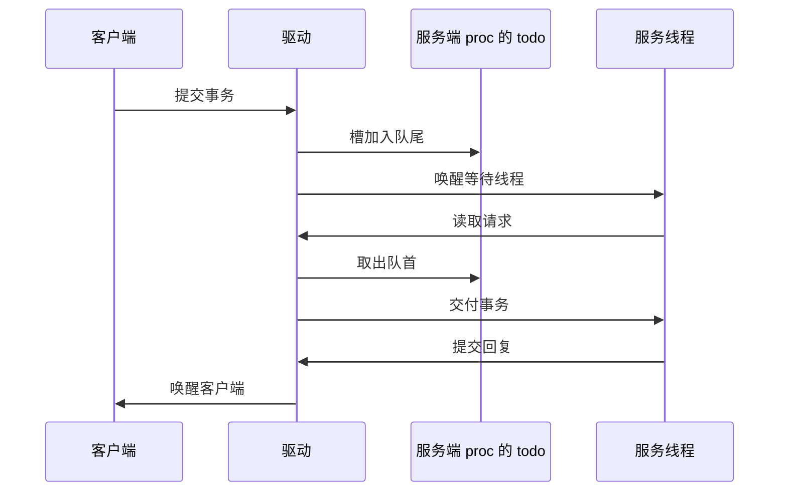

# 5.2 服务线程如何等待并领取请求？

## 5.2.1 问题与思路

5.1 已经可以区分线程，但请求仍存放在全局事务槽里，服务端需要扫描所有槽，找出发给自己的请求。原来的扫描也可以让多个线程在锁保护下领取请求；随着服务端增多，能否把待处理工作明确归到目标 proc，让其工作线程直接领取？

本章给每个 proc 增加 `todo` 链表。事务槽仍保存数据和状态；请求到达时把槽加入目标 proc 的队列，服务线程从该队列领取。源码在 `examples/5.2/`，协议版本 `0502`。



`todo` 保存的是待办工作，`server_wait` 是让线程休眠和唤醒的等待队列。它们分工不同；本章还没有线程专属的 todo。

## 5.2.2 请求入队

源码：`examples/5.2/kernel/mini_binder.c`，第 329–345 行（节选）。

```c
    ret = translate_objects(file, server_ctx, &transaction);
    if (ret) goto unlock_state;
    slot->request.id = ++next_id;
    memcpy((char *)server_ctx->buffer + i * MINI_BINDER_MAX_DATA, transaction.data, transaction.size);
    slot->request.size = transaction.size;
    slot->request.code = transaction.code;
    slot->request.target_node = transaction.target_node;
    slot->request.object_cookie = transaction.object_cookie;
    slot->request.object_count = transaction.object_count;
    memcpy(slot->request.object_offsets, transaction.object_offsets, sizeof(transaction.object_offsets));
    WRITE_ONCE(slot->receiver, receiver);
    client_ctx->inflight = true;
    WRITE_ONCE(slot->state, RPC_PENDING);
    list_add_tail(&slot->work, &server_ctx->todo);
    atomic_inc(&server_ctx->pending_count);
    mutex_unlock(&state_lock);
    wake_up_interruptible_all(&server_wait);
```

驱动先完成对象转换和数据复制，再将槽尾插入目标 proc 的 todo。`state_lock` 保护槽、链表及其增减；随后释放锁并唤醒等待线程。`pending_count` 是供等待条件读取的原子计数，不保存事务内容。全局仍只有两个槽，队列并不增加在途容量。

## 5.2.3 工作线程领取

源码：`examples/5.2/kernel/mini_binder.c`，第 417–433 行（节选）。

```c
        if (!list_empty(&ctx->todo)) {
            struct mini_binder_transaction_data delivered = {0};
            struct transaction_slot *slot = list_first_entry(&ctx->todo, struct transaction_slot, work);
            i = slot - slots;
            list_del_init(&slot->work);
            atomic_dec(&ctx->pending_count);

            delivered.id = slot->request.id;
            delivered.data_address = user_base + i * MINI_BINDER_MAX_DATA;
            delivered.size = slot->request.size;
            delivered.code = slot->request.code;
            delivered.target_node = slot->request.target_node;
            delivered.object_cookie = slot->request.object_cookie;
            delivered.object_count = slot->request.object_count;
            memcpy(delivered.object_offsets, slot->request.object_offsets, sizeof(delivered.object_offsets));

            WRITE_ONCE(slot->state, RPC_PROCESSING);
```

线程持锁取出队首并改变状态，因此两个线程不会领取同一槽。之后元数据通过 `copy_to_user` 交给用户态；复制失败时事务标为失败并唤醒客户端。队列为空时，线程释放锁等待；唤醒后重新持锁检查。尾插和取首使入队工作按入队次序领取，但不保证哪个线程领取，也不保证处理或回复顺序。

## 5.2.4 一次打开，两个服务线程循环工作

服务进程只 `open()` 一次设备，建立一份映射，再把同一 fd 交给两个 pthread。线程共享 proc、Ref 表、映射和请求队列，各自领取后用收到的事务 id 回复。这一步尚未建立服务线程与事务的自动绑定。

`fd` 就是 `open("/dev/mini_binder", O_RDWR)` 返回的设备文件描述符。同一进程的线程共享文件描述符表，因此可以直接使用主线程打开的同一个 fd。每个服务线程若分别 `open()`，本实现就会创建不同 proc，各有自己的映射、Ref 表与请求队列，无法从同一个队列共同领取任务。

Android 16 libbinder 也采用这个组织方式：进程共享的 `ProcessState` 打开驱动并保存 `mDriverFD`，每线程的 `IPCThreadState` 引用它，通过该 fd 执行 ioctl。参考固定提交 `2827a4a16b0340ecd07c2d5a6c89991799b362bb` 的 [ProcessState.cpp](https://android.googlesource.com/platform/frameworks/native/+/2827a4a16b0340ecd07c2d5a6c89991799b362bb/libs/binder/ProcessState.cpp#606) 和 [IPCThreadState.cpp](https://android.googlesource.com/platform/frameworks/native/+/2827a4a16b0340ecd07c2d5a6c89991799b362bb/libs/binder/IPCThreadState.cpp#1237)。共享范围是同一进程内使用该 ProcessState 的线程；各进程有各自的上下文。本章的两个 pthread 由程序显式创建，尚未实现原生的线程池扩容。

源码：`examples/5.2/tests/service_threads_demo.c`，第 136–147 行（章节版本 `0502`，节选）。

```c
    /* Service threads share one open file; callers use separate open files. */
    int fd = open("/dev/mini_binder", O_RDWR); assert(fd >= 0);
    void *mapping = map_buffer(fd);
    assert(ioctl(fd, MINI_BINDER_REGISTER_MANAGER) == 0);
    pthread_t threads[2];
    pthread_barrier_t ready, received;
    assert(pthread_barrier_init(&ready, NULL, 3) == 0);
    assert(pthread_barrier_init(&received, NULL, 2) == 0);
    struct service workers[2] = {{.fd = fd, .ready = &ready, .received = &received},
                                 {.fd = fd, .ready = &ready, .received = &received}};
    for (int i = 0; i < 2; i++) assert(pthread_create(&threads[i], NULL, serve, &workers[i]) == 0);
    phase(&ready);
```

`ready` 屏障让主线程等到两个工作线程就绪。随后主线程通过自身线程的 proc 状态和 syscall，确认它们已经在 READ ioctl 中睡眠，才通知客户端提交请求。共享 fd 不意味着每个线程重新打开设备，也不意味着现在就能通过同一客户端 fd 发起并发调用。

源码：`examples/5.2/tests/service_threads_demo.c`，第 59–69 行（章节版本 `0502`，节选）。

```c
    for (int round = 0; round < ROUNDS; round++) {
        struct mini_binder_command event = {0}, reply = {.cmd = MINI_BC_REPLY};
        assert(read_request(worker->fd, &event) == 0 && event.cmd == MINI_BR_TRANSACTION);
        worker->address[round] = (uintptr_t)event.transaction.data_address;
        worker->input[round] = decode((const void *)worker->address[round], event.transaction.size);
        /* Keep both requests in flight, so both service threads take one. */
        phase(worker->received);
        worker->result[round] = worker->input[round] + 1;
        reply.transaction.id = event.transaction.id;
        encode(&reply.transaction, worker->result[round]);
        assert(ioctl(worker->fd, MINI_BINDER_WRITE, &reply) == 0);
```

参数从接收方只读映射的 data_address 读取，用 Parcel 解码整数；结果在本线程的命令包中编码。两个服务线程之间的 received 屏障只为观察本轮两笔请求同时在途，不属于 Binder 协议。回复之后继续 READ，第二轮再次领取任务。

本实验的两个调用线程**各自打开设备并各有映射**，因此属于两个独立调用上下文。这是为了只观察服务端的共同队列；同一个客户端 fd 的并发回复隔离留到 5.3。主线程正常等待工作线程结束后，再解除映射、关闭共享 fd。

## 5.2.5 实验：先等待，再提交两轮请求

在可加载模块并安装匹配头文件的 Linux 中，先停止旧实验并卸载同名模块：

```sh
cd examples/5.2
make
sudo insmod kernel/mini_binder.ko
./build/version
./build/service_threads_demo
sudo rmmod mini_binder
```

Ubuntu 24.04 ARM64、Linux 6.8.0-147 上的输出示例，线程与任务的对应关系随调度变化：

```text
mini-binder protocol version: 0502
one service fd and mapping; two service threads sleeping in READ
round 1, worker 1: 10 -> 11
round 1, worker 2: 20 -> 21
round 2, worker 1: 11 -> 12
round 2, worker 2: 21 -> 22
two service threads completed four calls; callers received their own replies
```

实验检查两名服务线程身份不同，同一轮请求地址不同，并由调用者核对每笔结果。需要允许读取自身线程的 `/proc/self/task/<tid>/stat` 和 `syscall`；检查有时间上限，不能观测时测试失败。它能验证受控条件下的等待与领取，不证明调度公平性。

## 5.2.6 附加回归中的队列回收

源码：`examples/5.2/kernel/mini_binder.c`，第 365–374 行（节选）。

```c
finish_call:
    if (slot->state == RPC_PENDING) {
        struct mini_binder_proc *receiver_ctx = slot->receiver->private_data;
        list_del_init(&slot->work);
        atomic_dec(&receiver_ctx->pending_count);
    }
    if (ret && slot->state == RPC_PROCESSING)
        WRITE_ONCE(slot->state, RPC_CANCELLED);
    else
        WRITE_ONCE(slot->state, RPC_IDLE);
```

客户端中断时，如果请求还在队列中，就持锁删除它并回收槽；如果服务端已经领取，则保留 `RPC_CANCELLED`，等待旧回复或服务端退出后回收。服务端退出时也先移除它尚未领取的工作，再让相关客户端失败并唤醒。上述转换由 `state_lock` 串行化。

## 5.2.7 限制与自测

本章没有线程专属回复 todo 或事务绑定；调用状态和回复仍按打开文件保存。同一文件只允许一笔调用或一份未释放回复。两个服务线程不意味着两个调用线程已经能共用一个客户端 fd。等待队列仍由所有接收上下文共享，唤醒后需重新持锁检查；两个全局事务槽限制总容量，没有自动线程池扩容。

1. proc.todo 与 server_wait 分别保存什么、负责什么？
2. 等待请求前为什么必须释放 state_lock？
3. 两个服务线程同时醒来，为什么不会取到同一请求？
4. 为什么客户端暂时各自打开设备，而服务线程共用一次打开？
5. 这时回复仍需要填写哪个字段？下一章先解决哪个限制？

参考：todo 保存工作，等待队列负责睡眠唤醒；提交方也需要状态锁；持锁取出工作；调用状态和回复仍按文件共享；回复仍用 id 匹配，5.3 再拆分调用线程的状态和回复位置。

本章重排后的源码已在 Ubuntu 24.04 ARM64、Linux `6.8.0-147-generic` 重新构建并运行；实际覆盖范围及原始输出见[本轮验证记录](../../validation/README.md)。
