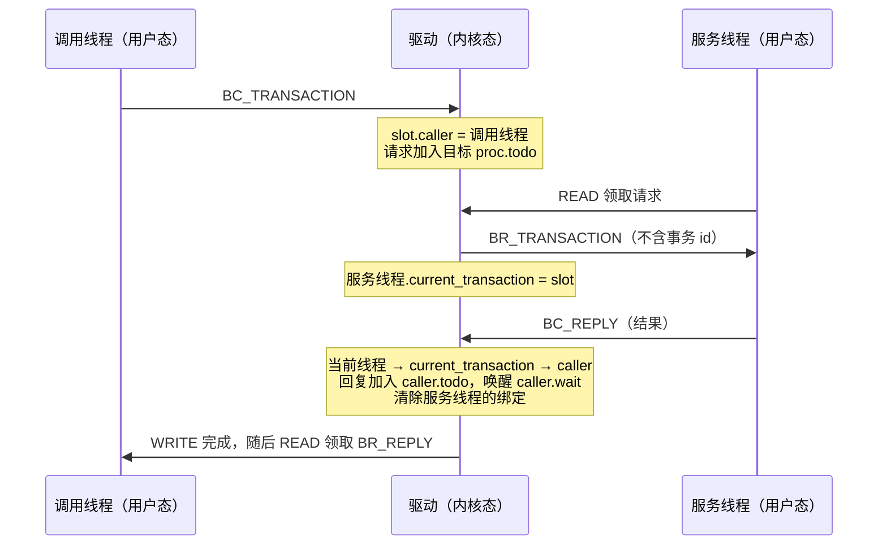

# 5.2 服务线程怎样找到该回复的调用线程？

## 5.2.1 问题与思路

5.1 解决了同一进程中调用线程的回复隔离，但服务端回复时仍要填写事务 id。既然驱动知道请求被哪个服务线程领取，能否让这个线程直接回复自己正在处理的事务？

本章把两端连起来：事务的 `caller` 记录调用线程，服务线程的 `current_transaction` 记录它领取的事务。`BC_REPLY` 沿这两个关系找到目标，不再接受用户传入的事务编号。源码在 `examples/5.2/`，协议版本 `0502`；从本章开始，公开的 `mini_binder_transaction_data` 删除 `id`，后续章节也不恢复按 id 回复的接口。

约束随之明确：一个服务线程同时只处理一笔请求，回复后才能领取下一笔。两个服务线程仍能各自持有一笔请求，并按不同顺序完成。

## 5.2.2 从请求队列到线程绑定



`proc.todo` 存放尚未领取的普通请求，多个服务线程竞争领取；`thread.todo` 存放指定调用线程的回复。两种队列的归属不同，不需要用户再提供 id 关联它们。

源码：`examples/5.2/kernel/mini_binder.c`，第 25–37 行（章节版本 `0502`，节选）。

```c
struct mini_binder_thread {
    struct transaction_slot *current_transaction;
    struct pid *pid;
    __u32 id;
    struct list_head todo;
    atomic_t todo_count;
    wait_queue_head_t wait;
    bool inflight;
    bool reply_ready;
    bool reply_delivered;
    unsigned int reply_index;
    struct mini_binder_transaction_data pending_reply;
};
```

源码：`examples/5.2/kernel/mini_binder.c`，第 51–59 行（章节版本 `0502`，节选）。

```c
struct transaction_slot {
    struct list_head work;
    struct list_head reply_work;
    struct file *receiver;
    struct mini_binder_thread *caller;
    enum rpc_state state;
    struct mini_binder_transaction_data request;
    struct mini_binder_transaction_data reply;
};
```

`current_transaction` 是驱动中的事务槽指针，不是用户态函数指针，也不会传给应用。`caller` 指向发起调用的线程记录；线程记录仍属于各自 proc。同一进程的两个服务线程即使共用 fd，也有各自的绑定。

## 5.2.3 领取成功后才绑定

源码：`examples/5.2/kernel/mini_binder.c`，第 449–452 行（章节版本 `0502`，节选）。

```c
        if (thread->current_transaction) {
            mutex_unlock(&state_lock);
            return -EBUSY;
        }
```

源码：`examples/5.2/kernel/mini_binder.c`，第 482–491 行（章节版本 `0502`，节选）。

```c
            WRITE_ONCE(slot->state, RPC_PROCESSING);
            if (copy_to_user(arg, &delivered, sizeof(delivered))) {
                WRITE_ONCE(slot->state, RPC_FAILED);
                wake_up_interruptible(&slot->caller->wait);
                mutex_unlock(&state_lock);
                return -EFAULT;
            }
            thread->current_transaction = slot;
            mutex_unlock(&state_lock);
            return 0;
```

领取入口在 `state_lock` 下检查 `current_transaction`：已有待回复请求就返回 `EBUSY`。从 proc 队列取出的槽变为 `RPC_PROCESSING`，驱动把请求元数据复制给服务线程；复制成功后才建立绑定。元数据复制失败返回 `EFAULT`，本次请求失败并唤醒调用者，不能留下用户从未收到的待回复事务。

请求负载仍从 `data_address` 指向的只读映射读取。删除 id 不改变数据映射方式，也不改变 Node、Ref 的寻址方式。

## 5.2.4 回复沿线程关系返回

源码：`examples/5.2/kernel/mini_binder.c`，第 515–542 行（章节版本 `0502`，节选）。

```c
    slot = thread->current_transaction;
    if (!((struct mini_binder_proc *)file->private_data)->is_server)
        ret = -EPERM;
    else if (!slot)
        ret = -ENOENT;
    else if (slot->receiver != file)
        ret = -EPERM;
    else if (slot->state == RPC_CANCELLED) {
        WRITE_ONCE(slot->state, RPC_IDLE);
        ret = -ECANCELED;
    }
    else if (slot->state != RPC_PROCESSING)
        ret = -ENOENT;
    else if (status > 0)
        ret = -EINVAL;
    else {
        slot->reply = incoming_transaction;
        list_add_tail(&slot->reply_work, &slot->caller->todo);
        atomic_inc(&slot->caller->todo_count);
        WRITE_ONCE(slot->state, RPC_DONE);
        pr_info("mini_binder: service thread=%u replies to caller thread=%u\n",
                thread->id, slot->caller->id);
        wake_up_interruptible(&slot->caller->wait);
    }
    if (!ret || ret == -ECANCELED)
        thread->current_transaction = NULL;
    mutex_unlock(&state_lock);
    return ret;
```

未领取请求的线程和已经回复过的线程得到 `ENOENT`；即使它持有同一个服务端 fd，也不能代替其他线程回复。正常回复加入 `slot->caller->todo`，状态变为 `RPC_DONE`，只唤醒该调用线程的等待队列，然后清除当前服务线程的绑定。调用线程醒来后仍需取得状态锁，再把结果放入自己的回复位置，READ 领取元数据，最后用 `BC_FREE_REPLY` 释放回复。

若调用线程已中断，槽保留为 `RPC_CANCELLED`，服务线程的绑定暂时保留。迟到回复返回 `ECANCELED`，同时归还槽并清除绑定；在此之前不能领取新请求，旧结果就不会误当成新请求的结果。长度或状态错误等可重试错误不清除绑定，服务线程可以修正后再提交。

教学线程编号仍用于观测线程记录；它不是事务 id，也不是 Linux TID。`state_lock` 保护绑定、槽状态和队列，睡眠与唤醒由等待队列完成，互斥锁本身不负责等待回复。

## 5.2.5 实验

在 Linux 中执行；切换章节前先停止旧实验并卸载同名模块：

```sh
cd examples/5.2
make
sudo insmod kernel/mini_binder.ko
./build/version
./build/thread_reply_test --demo
sudo rmmod mini_binder
```

```text
mini-binder protocol version: 0502
thread 1: 10 -> 11, offset 0
thread 2: 20 -> 21, offset 256
reverse replies and thread isolation passed
```

两个调用线程共享一个打开文件，分别发送 10 和 20；两个服务线程各领取一笔，测试控制 20 对应的回复先提交。客户端分别得到 11 和 21，并占有不同回复位置。线程编号与位置可能随调度变化。目标 handle 0 仅用于找到测试服务，不是线程绑定机制的一部分。

不带 `--demo` 的 `thread_reply_test` 还检查：两笔请求使用不同请求地址、回复位置满时第三笔调用得到 `EBUSY`、释放后可以复用，以及错误用户地址后重新读取。两种模式都检查跨线程代回和重复回复得到 `ENOENT`，以及同一服务线程未回复就再次领取得到 `EBUSY`。原来的单服务线程倒序回复测试已由这个场景取代。

加载模块后，`sudo ./build/target_wakeup_test` 用独立 tracefs 实例观察 `sched_waking`：先允许一个接收线程回复，确认对应调用线程被唤醒，而另一调用线程仍在等待。测试需要 root、可用的 tracefs 和读取自身线程 proc 状态的权限；它验证一次受控场景，不能证明线程不会因信号等其他原因醒来。

`thread_cancel_test` 验证一笔调用取消而另一笔正常完成；`stale_reply`、`pending_cancel_test`、`server_death` 分别验证迟到回复、未领取请求取消以及整个服务进程退出。上述实验已在 Ubuntu 24.04 ARM64、Linux `6.8.0-147-generic` 实际运行，记录见 `validation/2026-11-13-thread-binding.log`。

## 5.2.6 限制与下一步

本章只有单层 `current_transaction`，没有嵌套调用栈。服务线程必须自己回复，不能把事务转交给任意工作线程。服务线程若直接消失而没有回复，其他线程仍持有 fd 时，调用方可能继续等待；5.3 为显式线程退出补齐这条清理路径。

Android Binder 也由回复线程的事务关系寻找调用者，但使用事务栈支持更复杂的调用关系。本章的单指针、固定槽位和独立 WRITE/READ 是教学简化，不与原生协议互通。

## 5.2.7 自测

1. 没有事务 id，驱动怎样从 BC_REPLY 找到调用者？
2. 为什么同一个 fd 的另一个线程不能代回？
3. 为什么要在请求元数据复制成功后才建立绑定？
4. 客户端取消后，为什么不能立即把服务线程绑定到下一笔请求？
5. 两个服务线程怎样实现乱序完成？
