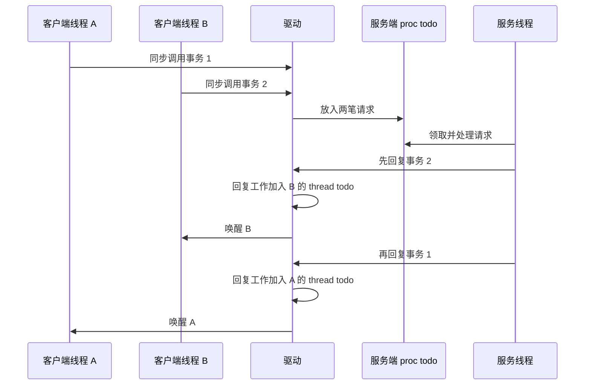

# 5.2 把回复交给发起调用的线程

## 5.2.1 问题与思路

5.1 已让同一个 proc 中的调用线程分别保存回复，但客户端等待时仍共用一个等待队列。服务端回复时会唤醒等待者，再由每个线程检查自己的事务。能否明确表示：这份回复属于哪个线程，并只唤醒它？

本章给每个 `mini_binder_thread` 增加自己的 todo 和等待队列。提交事务时记录调用线程；服务端回复时把工作放入该线程的 todo，并唤醒它。源码在 `examples/5.2/`，协议版本 `0502`。

本章仍使用同步的 `MINI_BINDER_WRITE`：线程在 WRITE 中等待并消费回复工作，再通过 READ 领取 `BR_REPLY` 元数据。它还不是 Android 的完整 `BINDER_WRITE_READ` 循环。

## 5.2.2 两种待办队列



proc todo 保存可由该服务端工作线程领取的请求；thread todo 保存指定调用线程的回复工作。每个线程的 `wait` 负责休眠和唤醒，本身不保存工作。

## 5.2.3 记住调用线程

源码：`examples/5.2/kernel/mini_binder.c`，第 25–36、50–58 行（节选）。

```c
struct mini_binder_thread {
    struct pid *pid;
    __u32 id;
    struct list_head todo;
    atomic_t todo_count;
    wait_queue_head_t wait;
    bool inflight;
    bool reply_ready;
    bool reply_delivered;
    unsigned int reply_index;
    struct mini_binder_transaction_data pending_reply;
};

/* ... */

struct transaction_slot {
    struct list_head work;
    struct list_head reply_work;
    struct file *receiver;
    struct mini_binder_thread *caller;
    enum rpc_state state;
    struct mini_binder_transaction_data request;
    struct mini_binder_transaction_data reply;
};
```

事务槽的 `caller` 指向发起这笔调用的线程；`work` 用于服务端 proc todo，`reply_work` 用于调用线程 todo。两个链表、事务状态和线程归属由 `state_lock` 保护；`todo_count` 是等待条件使用的原子计数。

源码：`examples/5.2/kernel/mini_binder.c`，第 374–390 行（节选）。

```c
    WRITE_ONCE(slot->receiver, receiver);
    slot->caller = thread;
    client_ctx->reply_used |= 1UL << reply_index;
    thread->reply_index = reply_index;
    thread->inflight = true;
    WRITE_ONCE(slot->state, RPC_PENDING);
    list_add_tail(&slot->work, &server_ctx->todo);
    atomic_inc(&server_ctx->pending_count);
    mutex_unlock(&state_lock);
    wake_up_interruptible_all(&server_wait);

    ret = wait_event_interruptible(thread->wait,
            atomic_read(&thread->todo_count) || READ_ONCE(slot->state) == RPC_FAILED);
    mutex_lock(&state_lock);
    if (slot->state == RPC_DONE) {
        list_del_init(&slot->reply_work);
        atomic_dec(&thread->todo_count);
    }
```

调用线程等待时不持有状态锁。服务端回复后，线程醒来并持锁取走自己的回复工作；即便等待被信号中断但回复已经入队，也会移除该工作，防止槽复用时留下旧链表项。成功时随后做对象转换，将数据写入 5.1 保留的回复位置。

## 5.2.4 回复入队与唤醒

源码：`examples/5.2/kernel/mini_binder.c`，第 532–547 行（节选）。

```c
    else if (slot->state == RPC_CANCELLED) {
        WRITE_ONCE(slot->state, RPC_IDLE);
        ret = -ECANCELED;
    }
    else if (slot->state != RPC_PROCESSING)
        ret = -ENOENT;
    else if (status > 0)
        ret = -EINVAL;
    else {
        slot->reply = incoming_transaction;
        list_add_tail(&slot->reply_work, &slot->caller->todo);
        atomic_inc(&slot->caller->todo_count);
        WRITE_ONCE(slot->state, RPC_DONE);
        wake_up_interruptible(&slot->caller->wait);
    }
    mutex_unlock(&state_lock);
```

服务端根据事务 ID 找槽，并检查回复确实来自该槽的接收者。正常回复加入 `caller` 的 todo，标记完成并唤醒这个线程；已取消的请求拒绝迟到回复。唤醒发生在持有状态锁时，调用线程醒来后需等待该锁才能消费工作。

如果服务端退出，驱动会移除仍在 proc todo 中的请求或已排入 thread todo 的回复，把事务标记失败并唤醒调用线程。复制请求元数据失败也会唤醒对应调用线程。已有测试覆盖服务端退出时客户端等待、请求取消和迟到回复；回复已入队但尚未消费时服务端退出的精确交错尚未单独验证。

## 5.2.5 实验

在可加载模块且安装匹配内核头文件的 Linux 环境中，先停止其他章节服务并卸载旧模块：

```sh
cd examples/5.2
make
sudo insmod kernel/mini_binder.ko
./build/version
./build/thread_reply_test
sudo rmmod mini_binder
```

Ubuntu 24.04 ARM64、Linux 6.8.0-147 上一次实际输出：

```text
mini-binder protocol version: 0502
thread 1: transaction 1, 10 -> 11, offset 0
thread 2: transaction 2, 20 -> 21, offset 256
reverse replies, thread isolation, full slots and reuse passed
```

测试让服务端按领取顺序的反序提交两份回复；两个调用线程分别验证自己的事务编号、结果和映射位置。线程、事务与偏移的对应关系可能随调度变化。测试用目标 0 的管理者入口找到服务端，该入口不是 thread todo 的组成部分。

附加回归 `./build/thread_cancel_test` 检查一个线程取消而另一个线程继续完成；`./build/server_death`、`./build/stale_reply`、`./build/pending_cancel_test` 分别检查服务端退出、迟到回复和未领取请求取消。它们及 5.1 的服务端映射隔离、管理者和对象传递实验已在同一环境运行。

## 5.2.6 限制与自测

本章每个线程仍只能有一笔同步在途调用，thread todo 当前只接收该调用的回复工作；不处理嵌套请求、线程事务栈或线程池创建。线程退出时未领取或未释放回复的完整回收仍未实现，复杂中断、退出和映射交错也未穷尽。服务端 proc 等待仍使用全局 `server_wait`，只在回复方向实现线程定向唤醒。

1. proc todo 和 thread todo 各自交给谁领取？
2. 为什么事务槽需要记录 `caller`？
3. 回复和取消发生竞争时，为什么必须在状态锁下移除工作项？

参考：前者交给目标服务端工作线程，后者交给发起调用的线程；它决定回复归属；防止旧工作残留或被重复删除。
