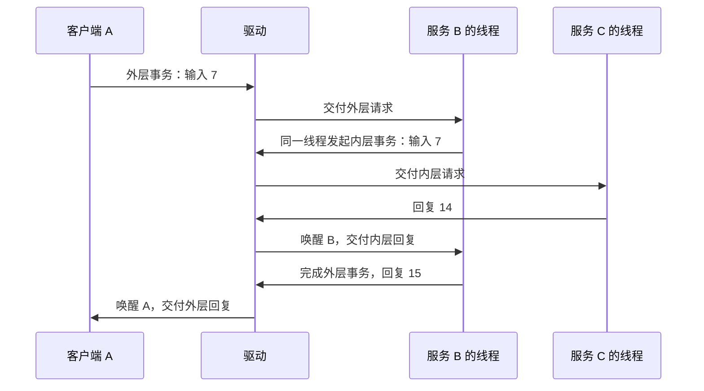

# 5.3 一条同步调用链

## 5.3.1 服务处理到一半还要调用其他服务

客户端 A 调用服务 B，B 处理请求时还需要服务 C 的结果。这时 B 的同一个服务线程能否先同步调用 C，拿到结果后再回复 A？

本章用三个进程追踪这条调用链。请求、线程 todo 和回复位置沿用 5.2，驱动没有新增事务栈；本章通过一个独立实验展示已有机制能完成的两层调用，以及它的边界。源码在 `examples/5.3/`，协议版本 `0503`。

## 5.3.2 两笔事务同时存在



外层事务在 B 处理期间仍占据一个全局事务槽，内层事务占据另一个槽。C 回复内层事务后，驱动通过该槽记录的 `caller` 找到 B 的线程，将回复工作放入它的 thread todo。B 的线程从同步 WRITE 返回，读取并释放内层回复，然后使用先前保存的外层事务 ID 回复 A。

这里的“调用链”指用户态程序依次执行两笔同步事务；驱动没有维护完整的线程事务栈，也没有处理等候中的线程被回调的情形。

## 5.3.3 同一个服务线程怎样继续工作？

源码：`examples/5.3/tests/nested_call_test.c`，第 63–84 行（节选）。

```c
    assert(fd >= 0 && ioctl(fd, MINI_BINDER_REGISTER_SERVER) == 0);
    assert(ioctl(fd, MINI_BINDER_REGISTER_MANAGER) == 0);
    mapping = map(fd);
    assert(ioctl(fd, MINI_BINDER_GET_THREAD_ID, &t.thread_id) == 0);
    assert(write(ready, "R", 1) == 1); close(ready);
    assert(ioctl(fd, MINI_BINDER_READ, &req) == 0 && req.transaction.size == 1);
    payload = (const unsigned char *)(uintptr_t)req.transaction.data_address;
    t.input = payload[0]; t.outer_id = req.transaction.id;
    call.transaction.target_node = target;
    call.transaction.size = 1; call.transaction.data[0] = t.input;
    assert(ioctl(fd, MINI_BINDER_WRITE, &call) == 0);
    assert(ioctl(fd, MINI_BINDER_READ, &result) == 0 && result.transaction.size == 1);
    assert(result.transaction.reply_offset >= 2 * MINI_BINDER_MAX_DATA);
    t.inner = mapping[result.transaction.reply_offset];
    t.nested_id = result.transaction.id;
    assert(payload[0] == t.input);
    assert(ioctl(fd, MINI_BINDER_GET_THREAD_ID, &thread_again) == 0 && thread_again == t.thread_id);
    free_reply(fd);
    t.output = t.inner + 1;
    reply.transaction.id = req.transaction.id;
    reply.transaction.size = 1; reply.transaction.data[0] = t.output;
    assert(ioctl(fd, MINI_BINDER_WRITE, &reply) == 0);
```

B 在线程自己的函数中先接收外层请求，再通过同一个文件发起内层调用。内层回复落在服务端映射的回复区域，实验检查外层请求数据没有被覆盖；两次 `GET_THREAD_ID` 也确认前后是同一线程。B 使用外层 `req.transaction.id` 回复 A，不把内层事务 ID 当成外层 ID。

示例通过管道把 C 的 Node 编号交给 B，仅用于找到内层目标；A 通过目标 0 找到 B。它们不是生产环境的服务发现协议。

## 5.3.4 第三笔调用为什么失败？

源码：`examples/5.3/tests/nested_call_test.c`，第 43–49 行（节选）。

```c
    assert(ioctl(fd, MINI_BINDER_READ, &req) == 0 && req.transaction.size == 1);
    data = (const unsigned char *)(uintptr_t)req.transaction.data_address;
    assert(ioctl(fd, MINI_BINDER_WRITE, &callback) == -1 && errno == EBUSY);
    assert(dprintf(STDOUT_FILENO, "third call rejected: EBUSY (two slots occupied)\n") > 0);
    reply.transaction.id = req.transaction.id;
    reply.transaction.size = 1; reply.transaction.data[0] = data[0] * 2;
    assert(ioctl(fd, MINI_BINDER_WRITE, &reply) == 0);
```

实验让 C 试图再调用 B。此时外层和内层事务各占一个槽，本章没有第三个空槽，因此返回 `EBUSY`，然后 C 继续回复内层请求。这个结果证明的是**固定槽容量限制**，并不能单独证明或模拟 Android Binder 的回调与事务栈行为。

## 5.3.5 实验

在可加载模块且安装匹配内核头文件的 Linux 环境中，先停止其他章节服务并卸载旧模块：

```sh
cd examples/5.3
make
sudo insmod kernel/mini_binder.ko
./build/version
./build/nested_call_test
sudo rmmod mini_binder
```

Ubuntu 24.04 ARM64、Linux 6.8.0-147 上一次实际输出：

```text
mini-binder protocol version: 0503
third call rejected: EBUSY (two slots occupied)
server thread 1: transaction 1 -> nested transaction 2
client: 7 -> 14 -> 15
same service thread completed a nested synchronous call
```

线程编号和事务 ID 由实际运行决定。实验还检查内外层 ID 不同、输入映射没有被内层回复覆盖。5.2 的线程回复、取消和管理者实验也已回归。

## 5.3.6 限制与自测

本章最多两笔事务同时在途。同步 WRITE 等待时只处理回复工作，无法让该线程在等待期间接收回调；没有事务栈、重入调用、线程退出自动回收或完整 `BINDER_WRITE_READ`。实际 Android Binder 处理调用链和线程选择的方式比本例完整。

1. 为什么 B 等待 C 时，A 的事务槽仍然不能回收？
2. B 最后回复 A 时应使用哪个事务 ID？
3. 实验中的第三次调用失败能否证明 Android 不支持回调？

参考：外层事务仍在处理；使用外层请求的 ID；不能，本例只是两个固定槽用满。
