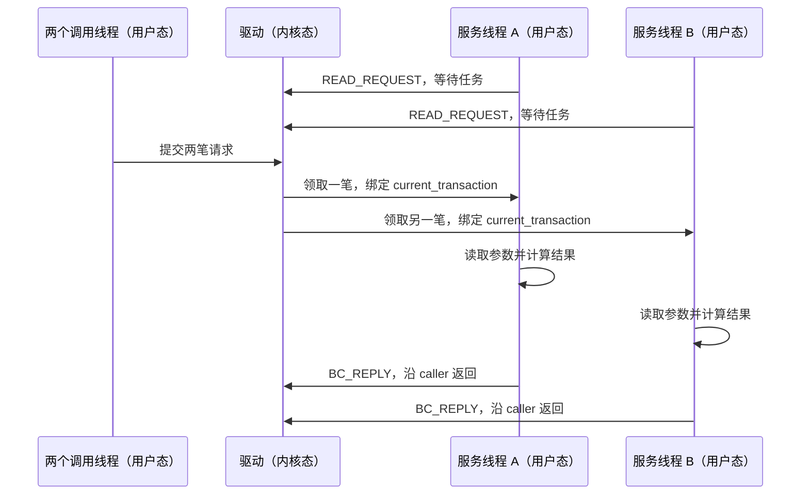

# 5.3 两个服务线程怎样共同处理请求？

## 5.3.1 从线程绑定到共同服务

5.1 让两个调用线程分别收到自己的回复，5.2 让服务线程直接回复自己领取的事务。本章不再增加新的正常调用协议，而是把它们组合成一个完整实验：两个服务线程共用同一个设备 fd，先等待请求，再各自领取、处理并回复，随后继续接收下一笔任务。

源码在 `examples/5.3/`，协议版本 `0503`。本章主线只观察正常任务处理；两轮实验共完成四笔调用。

## 5.3.2 打开一次设备，创建两个服务线程

`fd` 是 `open("/dev/mini_binder", O_RDWR)` 返回的文件描述符。同一进程的线程共享文件描述符表，因此主线程打开一次设备，就可以把同一个 fd 交给两个服务线程使用。不要在每个服务线程中重新 `open()`：本例每次独立打开都会创建独立的 `mini_binder_proc`，它们将拥有不同的 Ref 表和请求队列。

本例只有一份服务端映射和一个 `proc.todo`，但每个服务线程有自己的身份记录和 `current_transaction`。共享 fd 不等于共享当前正在处理的事务。

源码：`examples/5.3/tests/service_threads_demo.c`，第 134–145 行（章节版本 `0503`，节选）。

```c
    /* One open and one mapping for the whole service process. */
    int fd = open("/dev/mini_binder", O_RDWR); assert(fd >= 0);
    void *mapping = map_buffer(fd);
    assert(ioctl(fd, MINI_BINDER_REGISTER_MANAGER) == 0);
    pthread_t threads[2];
    pthread_barrier_t ready, received;
    assert(pthread_barrier_init(&ready, NULL, 3) == 0);
    assert(pthread_barrier_init(&received, NULL, 2) == 0);
    struct service workers[2] = {{.fd = fd, .ready = &ready, .received = &received},
                                 {.fd = fd, .ready = &ready, .received = &received}};
    for (int i = 0; i < 2; i++) assert(pthread_create(&threads[i], NULL, serve, &workers[i]) == 0);
    phase(&ready);
```

两个 `pthread_create()` 都把包含同一 fd 的 worker 记录传给 `serve()`。`ready` 屏障等待主线程和两个服务线程全部就绪；它是实验同步工具，不负责驱动的请求调度。测试用 handle 0 找到这个服务，注册管理入口只是省去服务发现过程。

Android 16 的 libbinder 采用进程共享的 [`ProcessState`](https://android.googlesource.com/platform/frameworks/native/+/android-16.0.0_r1/libs/binder/ProcessState.cpp) 保存驱动 fd，每线程的 [`IPCThreadState`](https://android.googlesource.com/platform/frameworks/native/+/android-16.0.0_r1/libs/binder/IPCThreadState.cpp) 使用它通信（参考版本 `android-16.0.0_r1`）。本例暂不实现 libbinder 的自动线程池，两个服务线程由程序显式创建；服务端资格从 4.6 起也不再需要单独注册。

## 5.3.3 没有任务时，线程等在哪里？

服务线程通过 `read_request()` 设置 `MINI_READ_REQUEST`，然后进入 `MINI_BINDER_READ`。这个输入选择来自 4.6，表示本次要领取普通请求。

源码：`examples/5.3/include/test_io.h`，第 6–10 行（章节版本 `0503`，节选）。

```c
static inline int read_request(int fd, struct mini_binder_command *event)
{
    if (event) event->cmd = MINI_READ_REQUEST;
    return ioctl(fd, MINI_BINDER_READ, event);
}
```

驱动检查映射和当前线程绑定，然后在 `state_lock` 下查看 `proc.todo`。队列为空时先释放锁，再进入 `server_wait` 等待队列睡眠；不能拿着状态锁等待新任务，否则调用线程也无法取得锁并提交请求。

调用线程把新请求加入目标 `proc.todo` 后唤醒等待者。醒来的服务线程重新竞争状态锁；只有从队列成功取出事务的线程才能处理它。线程被唤醒不代表已经分配到任务，没有领到任务的线程会再次检查并等待。本例使用共享等待队列，不保证线程轮流执行，也不保证公平调度。

## 5.3.4 谁领取，谁处理，谁回复



图中的 A、B 表示两名服务线程，不承诺哪一个先领取或先回复。

源码：`examples/5.3/tests/service_threads_demo.c`，第 59–68 行（章节版本 `0503`，节选）。

```c
    for (int round = 0; round < ROUNDS; round++) {
        struct mini_binder_command event = {0}, reply = {.cmd = MINI_BC_REPLY};
        assert(read_request(worker->fd, &event) == 0 && event.cmd == MINI_BR_TRANSACTION);
        worker->address[round] = (uintptr_t)event.transaction.data_address;
        worker->input[round] = decode((const void *)worker->address[round], event.transaction.size);
        /* Keep both requests in flight, so both service threads take one. */
        phase(worker->received);
        worker->result[round] = worker->input[round] + 1;
        encode(&reply.transaction, worker->result[round]);
        assert(ioctl(worker->fd, MINI_BINDER_WRITE, &reply) == 0);
```

`event.transaction.data_address` 是本服务进程映射中的用户地址。线程在回复前从中读出参数；两个在途请求占用不同位置。`decode()` 使用前章的 Parcel 读取一个整数，`encode()` 写入加一后的结果；映射输入只读，回复负载写在本线程的命令包中。

`received` 是两个服务线程之间的实验屏障：本轮两笔请求都领取后，才允许开始回复，确保可以观察两笔事务同时在途。它不属于 Binder 协议。驱动仍沿用 5.2：服务线程自己的 `current_transaction` 找到事务，再沿 `slot.caller` 将回复送回原调用线程；用户态不填写事务 id。

回复成功后驱动清除当前事务绑定，循环进入下一次 READ。每个服务线程每轮处理一笔，两轮后正常返回；主线程等待两个线程和客户端结束，再解除映射并关闭 fd。服务线程本身不会关闭进程共享的 fd。

## 5.3.5 实验：先看到等待，再提交请求

在可加载模块并安装匹配头文件的 Linux 中，先停止旧实验并卸载同名模块：

```sh
cd examples/5.3
make
sudo insmod kernel/mini_binder.ko
./build/version
./build/service_threads_demo
sudo rmmod mini_binder
```

程序启动后，客户端先等待管道通知。主线程读取自身服务线程的 `/proc/self/task/<tid>/syscall` 和 `stat`，确认两个线程已在 ioctl 中睡眠，才允许客户端发送请求。需要允许读取自身线程的 proc 信息；检查有时间上限，无法观测时会失败，不把打印“准备就绪”当作已经阻塞的证据。

输出示例（任务分配随调度变化）：

```text
mini-binder protocol version: 0503
one service fd and mapping; two service threads sleeping in READ
round 1, worker 1: 10 -> 11
round 1, worker 2: 20 -> 21
round 2, worker 1: 11 -> 12
round 2, worker 2: 21 -> 22
two service threads completed four calls; callers received their own replies
```

验收既检查两个服务线程的身份不同，也检查同一轮请求地址不同，并由调用线程逐笔核对结果、释放自己的回复位置。工作线程编号只是输出标签，不是驱动事务编号；不能据此推断实际调度顺序。

本章已在 Ubuntu 24.04 ARM64、Linux `6.8.0-147-generic` 的 binder-lab 中构建并实际运行，正常主实验额外连续五次通过，任务分配随调度变化。记录见 `validation/2026-11-13-service-threads.log`。

## 5.3.6 限制与自测

本章固定两个服务线程、两个事务槽，每个服务线程同时只处理一笔请求；没有自动扩容、嵌套调用栈或负载均衡。屏障用于构造可观察的并发，不代表真实服务必须等待其他线程才能回复。

1. 两个服务线程为什么共用一次打开得到的 fd？各自重新打开会怎样？
2. 共享的是哪些资源？每个线程独立保存的又是什么？
3. 为什么等待请求前必须释放 `state_lock`？
4. 两个线程同时醒来，为什么不会处理同一笔请求？
5. 两个线程都领取请求后，驱动怎样把回复送回正确的调用线程？

参考：同一次打开共享 proc、Ref 表、映射和请求队列；线程记录与当前事务绑定独立；等待前释放状态锁让提交方能入队；领取在状态锁下从队列移除；回复沿当前服务线程的事务绑定找到原调用者。

完成第五篇后，可以做[第五篇自测卷](../appendices/5-review.md)。
