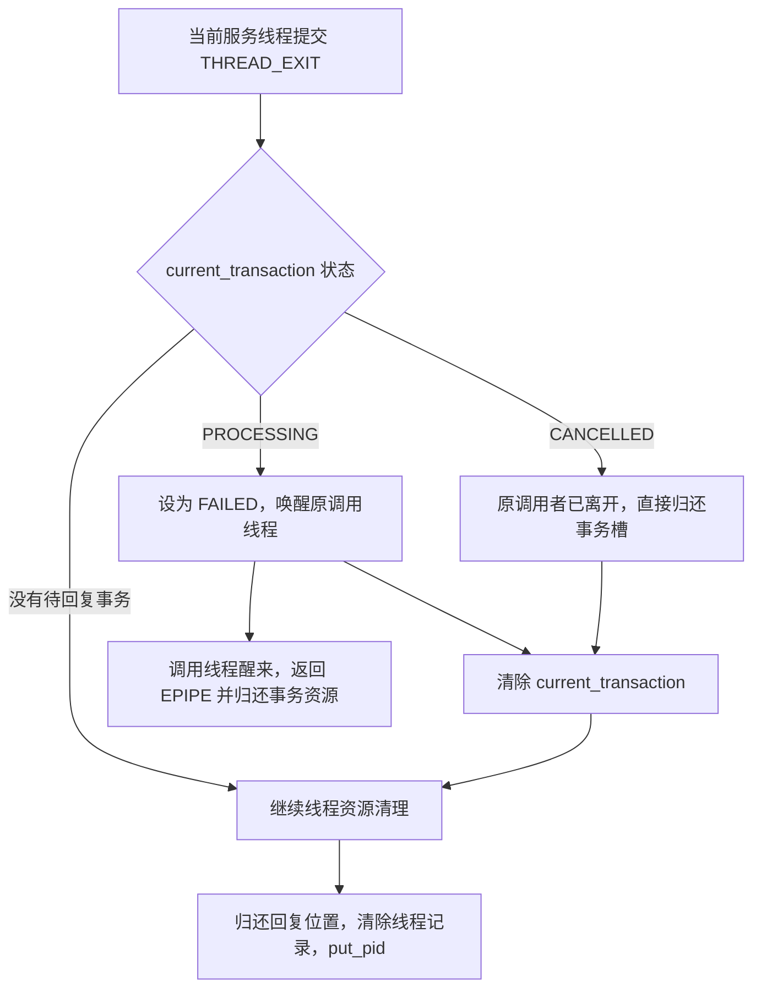

# 5.3 服务线程退出后，谁结束待回复事务？

## 5.3.1 问题与思路

5.2 中，服务线程领取请求后与事务绑定。如果它还没回复就退出，而进程中的其他线程继续持有 fd，整个文件不会释放，等待回复的客户端也不会自然醒来。

本章增加 `MINI_BINDER_THREAD_EXIT`：线程离开 Binder 前主动通知驱动。驱动先结束该服务线程尚未回复的事务，再归还线程记录和它占有的回复位置。源码在 `examples/5.3/`，协议版本 `0503`；继续使用 5.2 的线程绑定规则，公开事务结构不含 id。

这是显式退出。没有调用接口就终止的线程，本章不会自动发现；不能把此实验当作完整的异常线程死亡处理。

## 5.3.2 先断开事务，再回收线程



仍在等待的调用线程需要观察 `RPC_FAILED`，所以服务线程退出时不能立即无条件复用事务槽。调用线程醒来后负责收尾；已经取消、没有等待者的事务可以直接变回 `RPC_IDLE`。

其他服务线程不会接手这笔半处理的请求，因为驱动不知道用户态函数执行到哪一步、能否安全重做。它们仍能领取自己的请求并继续工作。

## 5.3.3 关键清理代码

源码：`examples/5.3/kernel/mini_binder.c`，第 105–142 行（章节版本 `0503`，节选）。

```c
static long mini_binder_thread_exit(struct mini_binder_proc *proc)
{
    struct pid *pid = NULL;
    unsigned int i;
    long ret = -ENOENT;

    mutex_lock(&state_lock);
    for (i = 0; i < ARRAY_SIZE(proc->threads); i++) {
        struct mini_binder_thread *thread = &proc->threads[i];
        if (thread->pid != task_pid(current)) continue;
        if (thread->inflight || !list_empty(&thread->todo)) {
            ret = -EBUSY;
            break;
        }
        if (thread->current_transaction) {
            struct transaction_slot *slot = thread->current_transaction;
            if (slot->state == RPC_CANCELLED) {
                WRITE_ONCE(slot->state, RPC_IDLE);
            } else if (slot->state == RPC_PROCESSING) {
                WRITE_ONCE(slot->state, RPC_FAILED);
                wake_up_interruptible(&slot->caller->wait);
            }
            thread->current_transaction = NULL;
        }
        if (thread->reply_ready) {
            proc->reply_used &= ~(1UL << thread->reply_index);
            WRITE_ONCE(thread->reply_ready, false);
        }
        thread->reply_delivered = false;
        pid = thread->pid;
        thread->pid = NULL;
        ret = 0;
        break;
    }
    mutex_unlock(&state_lock);
    put_pid(pid);
    return ret;
}
```

查找和清理都由 `state_lock` 保护。驱动按 `task_pid(current)` 找当前线程，不允许用户指定销毁其他线程。先处理当前服务事务、清空绑定，再归还未释放的回复位置和线程记录；`put_pid()` 在解锁后释放先前持有的身份引用。

没有线程记录时返回 `ENOENT`。本章仍拒绝清理存在自身在途调用或回复 todo 的记录，返回 `EBUSY`；它不是跨线程取消接口。同步调用中的当前线程正在 WRITE 内等待，不能同时执行自身的退出 ioctl。待回复的服务事务通过 `current_transaction` 单独处理，不能因为它存在就一概拒绝退出。

退出 ioctl 在自动查找或创建线程记录之前处理，避免一个尚未进入 Binder 的线程因为“退出”反而被新建记录。显式退出后，同一 Linux 线程再次使用 Binder 时可以重新取得记录。

## 5.3.4 实验：文件还活着，调用者也能结束等待

```sh
cd examples/5.3
make
sudo insmod kernel/mini_binder.ko
./build/version
./build/service_exit_test --demo
sudo rmmod mini_binder
```

```text
mini-binder protocol version: 0503
service thread exit: waiting caller received EPIPE
next service thread: reply = 42; slots reused
```

主线程持续持有服务端 fd 和映射，临时服务线程领取请求后不回复，直接显式退出。客户端得到 `EPIPE`；随后创建另一个服务线程，新调用得到 42。这证明清理触发于服务线程退出，而不是整个进程关闭。

源码：`examples/5.3/tests/service_exit_test.c`，第 36–43 行（章节版本 `0503`，节选）。

```c
    assert(exchange_command(s->fd, NULL, &event) == 0 && event.cmd == MINI_BR_TRANSACTION);
    phase(&s->gate); phase(&s->gate);
    if (s->success) {
        reply.transaction.size = 1; reply.transaction.data[0] = 42;
        assert(exchange_command(s->fd, &reply, NULL) == 0);
    }
    /* Explicit notification while the fd and other service threads stay alive. */
    assert(ioctl(s->fd, MINI_BINDER_THREAD_EXIT) == 0);
```

片段中的 `phase` 是测试使用的屏障：让主线程确认请求已经领取，并在需要时先完成客户端取消，再允许服务线程退出。它只控制实验顺序，不属于驱动协议。`success` 分支用于最后一笔正常调用，确认清理后仍能返回 42。

完整验收执行 `./build/service_exit_test`，还覆盖客户端先取消再退出服务线程，以及连续 12 次创建、退出和复用线程记录，避免八个记录或两个事务槽被耗尽。

原来的 `./build/thread_exit_test` 保留为附加实验：调用线程收到回复后不发送 `BC_FREE_REPLY`，改为显式退出，验证回复位置回收；还检查未读取回复就退出、无记录退出和重复退出。`thread_reply_test`、`thread_cancel_test` 等继续验证 5.2 的线程绑定、回复隔离和取消路径。

上述程序已在 Ubuntu 24.04 ARM64、Linux `6.8.0-147-generic` 编译、加载驱动并实际运行，记录见 `validation/2026-11-13-thread-binding.log`。后续驱动章节也保留 `service_exit_test` 回归这套规则。

## 5.3.5 对照与限制

Android Binder 的 BINDER_THREAD_EXIT 进入线程释放逻辑，处理的事务关系比本章单层绑定更复杂。本章没有线程退出的自动检测，没有嵌套事务栈，也不重试用户态已经开始执行的操作。服务线程退出、信号与映射解除的全部并发组合尚未穷尽。

服务线程退出不等于关闭 proc：共享 Ref 表、其他线程、映射仍然存在。与线程绑定的待回复事务必须先结束，才允许复用线程记录。后续章节沿用此顺序，不恢复按 id 查找或回复的入口。

## 5.3.6 自测

1. 为什么服务线程结束不一定导致文件的 release 被调用？
2. PROCESSING 和 CANCELLED 为什么采用不同的回收方式？
3. 客户端得到 EPIPE 时，驱动能否保证用户态业务完全没有执行？
4. 清除线程记录前为什么必须清除事务绑定？
5. 线程不调用退出接口就直接消失，本章能否自动清理？
