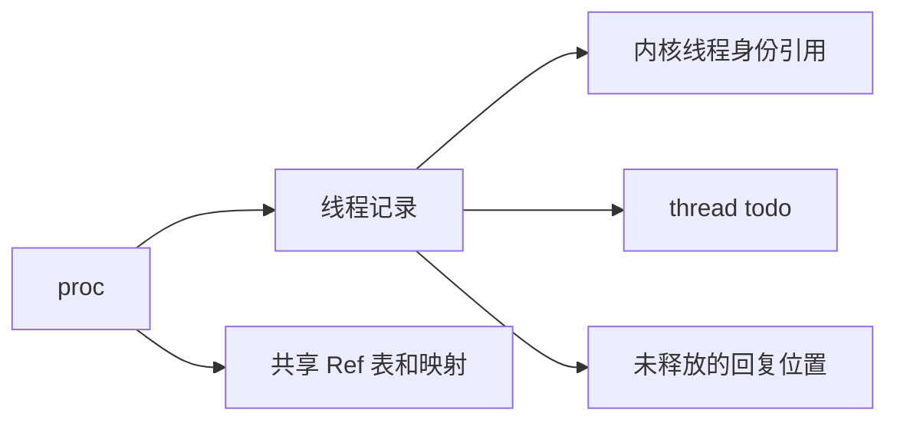

# 5.3 线程离开时怎样释放资源？

## 5.3.1 问题与思路

前面每个 proc 最多记录八个线程。线程即使已经退出，其记录和未释放的回复位置仍会留在 proc 中；进程长期创建线程可能最终得到 `ENOSPC` 或 `EBUSY`。

本章增加 `MINI_BINDER_THREAD_EXIT`：线程离开 Binder 前主动通知驱动。驱动只查找当前线程的记录，检查它没有在途调用或待办工作，再释放它的回复位置和线程身份引用。源码在 `examples/5.3/`，协议版本 `0503`。

这是**显式退出**：线程没有调用该接口就终止时，本章不会自动发现或回收它的记录。proc 最终释放时仍会统一释放剩余资源。

## 5.3.2 哪些资源由线程持有？



退出当前线程不等于关闭文件，也不会清除共享的 Ref 表和映射；其他线程仍可使用这个 proc。若有已经交付但没有 `BC_FREE_REPLY` 的回复，显式退出会丢弃它并归还位置。

## 5.3.3 检查并释放线程记录

源码：`examples/5.3/kernel/mini_binder.c`，第 105–132 行（完整函数）。

```c
static long mini_binder_thread_exit(struct mini_binder_proc *proc)
{
    struct pid *pid = NULL;
    unsigned int i;
    long ret = -ENOENT;

    mutex_lock(&state_lock);
    for (i = 0; i < ARRAY_SIZE(proc->threads); i++) {
        struct mini_binder_thread *thread = &proc->threads[i];
        if (thread->pid != task_pid(current)) continue;
        if (thread->inflight || !list_empty(&thread->todo)) {
            ret = -EBUSY;
            break;
        }
        if (thread->reply_ready) {
            proc->reply_used &= ~(1UL << thread->reply_index);
            WRITE_ONCE(thread->reply_ready, false);
        }
        thread->reply_delivered = false;
        pid = thread->pid;
        thread->pid = NULL;
        ret = 0;
        break;
    }
    mutex_unlock(&state_lock);
    put_pid(pid);
    return ret;
}
```

驱动在 `state_lock` 下按当前线程查找记录。没有记录时返回 `ENOENT`；存在在途调用或待办工作时返回 `EBUSY`，不回收仍被使用的记录。成功时清除占用的回复位置、使该表项可复用，并在解锁后释放之前由 `get_pid()` 持有的引用。

本例的同步调用由当前线程在 WRITE 中等待；退出接口不是跨线程取消接口，也不能替代服务端请求、事务栈和异常线程死亡的完整清理。本章没有单独构造 `EBUSY` 分支的并发实验。

源码：`examples/5.3/kernel/mini_binder.c`，第 632–639 行（节选）。

```c
    if (cmd == MINI_BINDER_THREAD_EXIT)
        return mini_binder_thread_exit(file->private_data);
    if (cmd == MINI_BINDER_WRITE || cmd == MINI_BINDER_READ || cmd == MINI_BINDER_GET_THREAD_ID) {
        ret = get_thread_id(file->private_data, &thread_id);
        if (ret) return ret;
        if (cmd == MINI_BINDER_GET_THREAD_ID)
            return copy_to_user(user_arg, &thread_id, sizeof(thread_id)) ? -EFAULT : 0;
        thread = &((struct mini_binder_proc *)file->private_data)->threads[thread_id - 1];
    }
```

退出命令在自动查找或创建线程记录之前处理，避免“线程没有记录，却因退出命令新建一条记录”。成功退出后若同一个线程再次使用 Binder，驱动会按普通进入流程重新创建记录。

## 5.3.4 实验

在可加载模块且安装匹配内核头文件的 Linux 环境中，先停止其他章节服务并卸载旧模块：

```sh
cd examples/5.3
make
sudo insmod kernel/mini_binder.ko
./build/version
./build/thread_exit_test
sudo rmmod mini_binder
```

Ubuntu 24.04 ARM64、Linux 6.8.0-147 上一次实际输出：

```text
mini-binder protocol version: 0503
12 exited threads reused record; reply offset 0 reused
explicit thread exit and reply cleanup passed
```

测试依次创建 12 个线程，每个线程注册后显式退出，验证八个表项不会因这些已退出线程而耗尽。随后分别验证：线程尚未读取回复就退出、已经读取但未释放回复就退出，两种情况都可由显式退出归还位置；下一线程再次使用同一个位置。重复退出和没有记录的线程退出返回 `ENOENT`。

## 5.3.5 对照与限制

Android 16 参考驱动有 `BINDER_THREAD_EXIT`，在 `kernel-common/drivers/android/binder.c` 的 ioctl 分支中调用 `binder_thread_release()`；固定参考提交为 `894a317b5382555614ef2be7a79cca79083c6cf2`。原生释放逻辑还处理事务和待办工作，本章的接口与 `_IO` 编码、数据结构及行为均是教学简化，不能互通。

本例不自动检测未调用退出接口的线程死亡；它不回收仍在途的调用，不实现完整事务栈和服务线程死亡处理。`thread_exit_test` 覆盖显式退出后的记录与回复位置复用；复杂信号、异常退出以及服务端退出与回复同时发生的交错尚未穷尽。

## 5.3.6 自测

1. 为什么先检查线程的在途状态和 todo，再允许表项复用？
2. 显式退出线程后，其他线程的 Ref 表和映射为什么还在？
3. 线程突然退出且没有发送退出命令时，本章会发生什么？

参考：未完成的工作可能仍引用线程记录；它们属于共享 proc；记录和可能占用的回复位置保留到 proc 最终释放。
