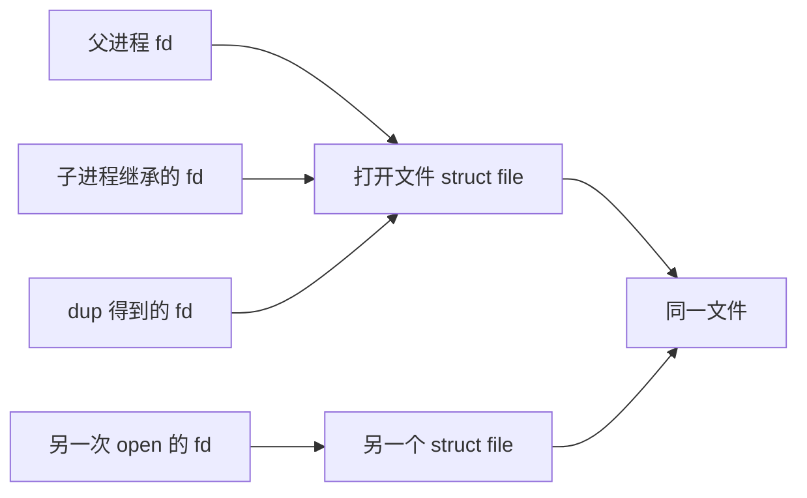

# 6.1 文件描述符指向什么？

## 6.1.1 为什么不能直接传 fd 数字？

进程打开文件后得到一个整数 fd。这个数字是当前进程文件描述符表中的索引；另一个进程的相同数字可能指向别的文件，甚至没有打开文件。因此跨进程传文件时，不能只把整数当作普通 Parcel 数据复制过去。

在 Linux 中，fd 表项引用内核的打开文件对象 `struct file`。同一个打开文件对象可以被多个 fd 或进程引用；独立 `open()` 同一路径通常创建另一个打开文件对象，具有独立文件偏移。



本章使用 `examples/6.1/` 的普通用户态程序，先观察打开文件对象的共享，不使用 Binder 驱动。

## 6.1.2 dup 和 fork 共享打开文件

源码：`examples/6.1/fd_demo.c`，第 16–35 行（节选）。

```c
    assert(fd >= 0);
    assert(write(fd, "abcdef", 6) == 6 && lseek(fd, 0, SEEK_SET) == 0);
    independent = open(path, O_RDONLY); assert(independent >= 0);
    assert(unlink(path) == 0);
    duplicate = dup(fd); assert(duplicate >= 0 && duplicate != fd);
    assert(pipe(pipefd) == 0);
    child = fork(); assert(child >= 0);
    if (!child) {
        char data[2];
        close(pipefd[0]);
        assert(read(duplicate, data, sizeof(data)) == sizeof(data));
        assert(write(pipefd[1], data, sizeof(data)) == sizeof(data));
        close(pipefd[1]); close(independent); close(duplicate); close(fd);
        _exit(0);
    }
    close(pipefd[1]);
    assert(read(pipefd[0], child_data, sizeof(child_data)) == sizeof(child_data)); close(pipefd[0]);
    assert(waitpid(child, &status, 0) == child && WIFEXITED(status) && WEXITSTATUS(status) == 0);
    assert(read(fd, parent_data, sizeof(parent_data)) == sizeof(parent_data));
    assert(read(independent, independent_data, sizeof(independent_data)) == sizeof(independent_data));
```

`dup()` 产生新的 fd，但仍指向同一个打开文件对象。`fork()` 后子进程继承表项并引用同一对象；子进程通过 duplicate 读走 `ab` 后，父进程通过 fd 接着读到 `cd`。另一次 `open()` 的文件偏移独立，仍从 `ab` 开始读取。

示例通过管道和 `waitpid()` 保证读取顺序；管道只传递读取结果，不是本章要实现的 Binder fd 传递。`unlink()` 移除临时路径，但已有打开文件仍可使用，关闭所有相关 fd 后内核再按文件系统规则回收。

## 6.1.3 实验

在 Linux 中执行：

```sh
cd examples/6.1
make
./build/fd_demo
```

Ubuntu 24.04 ARM64 上一次实际输出：

```text
fd 3 and dup 5 share an open file
child via dup: ab; parent via fd: cd
independent open: ab
```

fd 数字由当前进程的已有描述符决定，不保证每次都是 3 和 5；读取内容展示的是共享或独立的文件偏移。

## 6.1.4 限制与自测

本章通过 `fork()` 继承已有 fd，没有通过 Binder 给一个独立进程安装新 fd。两个 fd 引用同一打开文件并不意味着所有 fd 标志都相同；下一章将把 fd 作为事务对象，通过驱动在接收进程安装自己的描述符。

1. `dup()` 得到的新数字为什么能从相同文件偏移继续读？
2. 再次 `open()` 同一路径为什么可以从头读取？
3. 为什么把 fd 整数原样发给另一个已有进程不够？

参考：它们引用同一个打开文件对象；独立打开得到独立的打开文件状态；fd 是进程描述符表中的编号。
