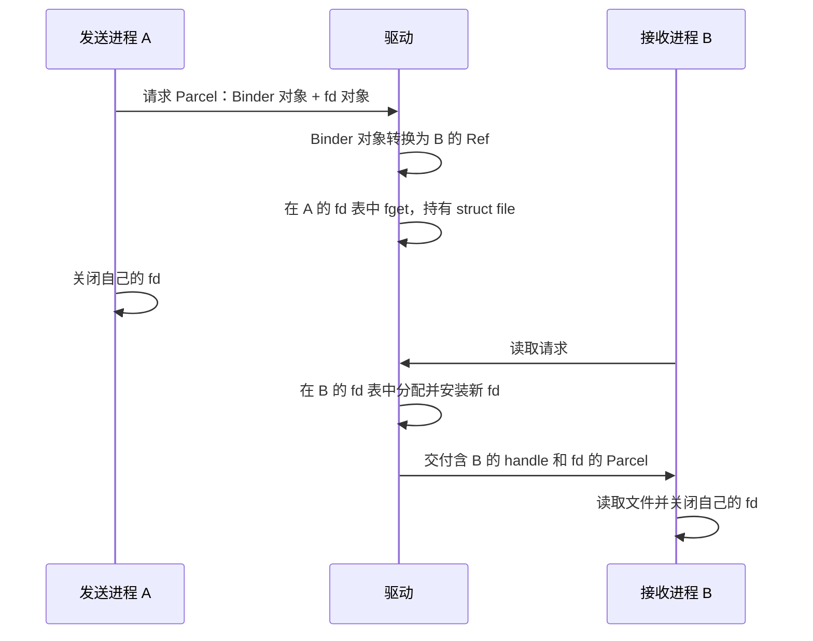

# 6.2 在请求中传递文件描述符

## 6.2.1 问题与思路

6.1 中 `fork()` 让子进程继承文件描述符。两个已经独立运行的 Binder 进程不能依靠继承；如果发送方只是把 fd 数字作为普通整数写入 Parcel，接收方会在自己的 fd 表中查找这个数字，可能得到别的文件。

本章增加 `MINI_BINDER_OBJECT_FD`：发送线程提交请求时，驱动用 `fget()` 持有该 fd 指向的 `struct file`；接收线程读取事务时，在自己的 fd 表中分配新编号并安装文件。源码在 `examples/6.2/`，协议版本 `0602`。



一个 Parcel 可以混合普通数据、Binder 对象和 fd 对象。位置表指出需要驱动处理的对象位置；Node、Ref 和 `struct file` 本身都不会被复制到用户态。

## 6.2.2 混合 Parcel 长什么样？

源码：`examples/6.2/tests/mixed_object_test.c`，第 120–129 行（节选）。

```c
    sender.call.cmd = MINI_BC_TRANSACTION; sender.call.transaction.target_node = target;
    sender.call.transaction.size = 28; sender.call.transaction.object_count = 2;
    sender.call.transaction.object_offsets[0] = 4; sender.call.transaction.object_offsets[1] = 16;
    put32(sender.call.transaction.data, 123);
    put32(sender.call.transaction.data + 4, MINI_BINDER_OBJECT_LOCAL);
    put32(sender.call.transaction.data + 8, 99);
    put32(sender.call.transaction.data + 16, MINI_BINDER_OBJECT_FD);
    invalid = sender.call; put32(invalid.transaction.data + 20, INT_MAX);
    assert(ioctl(binder, MINI_BINDER_WRITE, &invalid) == -1 && errno == EBADF);
    put32(sender.call.transaction.data + 20, (uint32_t)data_fd);
```

布局是一个普通整数、一个 12 字节本地对象描述和一个 12 字节 fd 对象描述。对象偏移为 4 和 16；fd 描述的剩余保留字段为 0。测试先提交无效 fd，验证返回 `EBADF`，再提交有效对象；接收方得到的第一个 handle 仍为 1，验证此前失败没有提交对象 Ref。

## 6.2.3 发送方：持有文件

源码：`examples/6.2/kernel/mini_binder.c`，第 160–177 行（节选）。

```c
    for (i = 0; i < transaction->object_count; i++) {
        __u32 offset = transaction->object_offsets[i], handle, type;
        __u64 id;
        if ((offset & 3) || offset > transaction->size || transaction->size - offset < 12 ||
            (i && (offset < previous || offset - previous < 12))) { ret = -EINVAL; goto fail; }
        type = get_unaligned_le32(transaction->data + offset);
        if (type == MINI_BINDER_OBJECT_FD) {
            struct file *fd_file;
            if (!request_slot) { ret = -EOPNOTSUPP; goto fail; }
            if (get_unaligned_le32(transaction->data + offset + 8)) { ret = -EINVAL; goto fail; }
            fd_file = fget(get_unaligned_le32(transaction->data + offset + 4));
            if (!fd_file) { ret = -EBADF; goto fail; }
            request_slot->fds[request_slot->fd_count].file = fd_file;
            request_slot->fds[request_slot->fd_count].offset = offset + 4;
            request_slot->fd_count++;
            previous = offset;
            continue;
        }
```

转换在发送线程上下文执行，`fget()` 查发送进程的 fd 表并取得文件引用。事务槽保存引用和要替换的位置；发送方随后关闭 fd，不会使这份引用失效。如果后面的对象校验失败，驱动释放已经取得的文件引用，且 Ref 表副本不会提交。状态和槽由 `state_lock` 保护。

## 6.2.4 接收方：安装新 fd

源码：`examples/6.2/kernel/mini_binder.c`，第 219–245 行（节选）。

```c
static long reserve_request_fds(struct transaction_slot *slot, void *buffer, int *reserved)
{
    unsigned int i;
    for (i = 0; i < slot->fd_count; i++) {
        reserved[i] = get_unused_fd_flags(O_CLOEXEC);
        if (reserved[i] < 0) {
            long ret = reserved[i];
            while (i) put_unused_fd(reserved[--i]);
            return ret;
        }
        put_unaligned_le32(reserved[i], (char *)buffer + slot->fds[i].offset);
    }
    return 0;
}

/* ... release_reserved_fds：撤销尚未安装的编号 ... */

static void install_request_fds(struct transaction_slot *slot, const int *reserved)
{
    unsigned int i;
    for (i = 0; i < slot->fd_count; i++) fd_install(reserved[i], slot->fds[i].file);
    slot->fd_count = 0;
}
```

接收线程读取请求时执行这些函数，因此分配和安装发生在接收进程的 fd 表中。驱动先预留所有编号并把它们写入接收映射，成功复制事务元数据后才调用 `fd_install()`；安装后文件引用由接收方 fd 持有，接收方负责 `close()`。编号带 `FD_CLOEXEC`。分配失败会撤销已预留编号并释放文件引用；元数据复制失败也会回滚。接收方应在 `READ` 成功返回后再读取描述。

请求尚未领取时若被取消或接收方退出，驱动释放事务槽持有的文件引用。已成功交付的 fd 则属于接收方，即使发送方随后取消，也应由接收方关闭。

## 6.2.5 实验

在可加载模块且安装匹配内核头文件的 Linux 中，先停止其他章节服务并卸载旧模块：

```sh
cd examples/6.2
make
sudo insmod kernel/mini_binder.ko
./build/version
./build/fd_request_demo
sudo rmmod mini_binder
```

Ubuntu 24.04 ARM64、Linux 6.8.0-147 上一次实际输出：

```text
mini-binder protocol version: 0602
receiver fd 4 read: data
request fd delivered
```

主实验在两个进程中传递一个管道读端；管道在 `fork()` 后创建，接收方不能依靠继承取得它。输出的 fd 数字随进程已有描述符变化。示例中发送方保持原 fd 打开直到同步调用完成，因此主实验只验证传递和读取。

源码：`examples/6.2/tests/fd_request_demo.c`，`main`，第 62–67 行（节选）。

```c
    assert(pipe(data) == 0 && write(data[1], "data", 4) == 4); close(data[1]);
    binder = open("/dev/mini_binder", O_RDWR); assert(binder >= 0); mapping = map(binder);
    call.transaction.target_node = target; call.transaction.size = 12; call.transaction.object_count = 1;
    put32(call.transaction.data, MINI_BINDER_OBJECT_FD);
    put32(call.transaction.data + 4, (uint32_t)data[0]);
    assert(ioctl(binder, MINI_BINDER_WRITE, &call) == 0);
```

对象位置默认为 0；发送方把自己的管道读端编码为 fd 对象。接收方从事务映射读取转换后的 fd，再读取并关闭它。

附加回归 `./build/mixed_object_test` 在同一事务中传递普通数据、Binder 本地对象和 fd；它等待发送线程进入 ioctl 睡眠，关闭发送方 fd，再让接收方读取，并检查接收 fd 带 `FD_CLOEXEC`。该同步检查需要可读取自身线程的 `/proc/self/task/<tid>/status` 和 `syscall`。对象路由、服务管理者、并发回复和待领取请求取消也已回归。

## 6.2.6 限制与自测

本章只支持请求中的 fd，回复中的 fd 尚不支持；如果服务端返回 fd 描述，调用者会得到 `EOPNOTSUPP`。驱动没有 Android 的 fd 接收策略和安全检查；用户能够打开教学设备就可发起传递，不能将它当作安全边界。发送阶段成功后，若接收方安装 fd 失败，之前为接收方建立的 Ref 表项不会撤销；本例没有 Ref 引用计数或单独释放。固定槽和简化 Ref 生命周期仍有前述限制，多 fd 分配失败、复制失败和复杂退出交错需要进一步验证。

1. 为什么发送方关闭原 fd 后接收方仍能读取？
2. 为什么 `get_unused_fd_flags()` 必须在接收线程上下文执行？
3. Binder 对象和 fd 对象虽然都在位置表中，转换目标有什么不同？

参考：驱动的 `fget()` 引用保活了打开文件；新编号属于接收进程的 fd 表；前者关联 Node/Ref，后者关联 `struct file` 并安装 fd。
