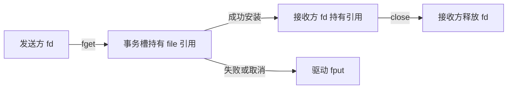

# 6.3 fd 传递失败后谁负责回收？

## 6.3.1 问题与思路

6.2 的驱动在发送时通过 `fget()` 持有文件，并在接收时预留、安装 fd。如果请求没有成功交付，谁释放这些引用？如果一次请求有两个 fd，而接收方只剩一个空闲编号，怎样避免留下半成品？

本章沿用 6.2 的请求 fd 实现，通过独立源码与实验追踪不同阶段的所有权；没有新增回复方向的 fd 支持。源码在 `examples/6.3/`，协议版本 `0603`。



安装成功前由事务槽负责引用；成功安装后由接收方负责关闭自己的 fd。发送方关闭原 fd 只释放发送方自己的引用。

## 6.3.2 还没有交付时取消或退出

源码：`examples/6.3/kernel/mini_binder.c`，第 473–483 行（节选）。

```c
finish_call:
    if (slot->state == RPC_PENDING) {
        struct mini_binder_proc *receiver_ctx = slot->receiver->private_data;
        list_del_init(&slot->work);
        atomic_dec(&receiver_ctx->pending_count);
        drop_request_fds(slot);
    }
    if (ret && slot->state == RPC_PROCESSING)
        WRITE_ONCE(slot->state, RPC_CANCELLED);
    else
        WRITE_ONCE(slot->state, RPC_IDLE);
```

请求还在 proc todo 时，客户端中断会移除待办并 `fput()` 事务槽持有的文件。接收方退出时也会对其未领取请求执行对应清理。已经成功交付的请求处于 `RPC_PROCESSING`：接收方的 fd 已安装，由接收方自行关闭，不能因发送方取消而替它关闭。

## 6.3.3 多个 fd 的预留与回滚

源码：`examples/6.3/kernel/mini_binder.c`，第 219–232 行（完整函数）。

```c
static long reserve_request_fds(struct transaction_slot *slot, void *buffer, int *reserved)
{
    unsigned int i;
    for (i = 0; i < slot->fd_count; i++) {
        reserved[i] = get_unused_fd_flags(O_CLOEXEC);
        if (reserved[i] < 0) {
            long ret = reserved[i];
            while (i) put_unused_fd(reserved[--i]);
            return ret;
        }
        put_unaligned_le32(reserved[i], (char *)buffer + slot->fds[i].offset);
    }
    return 0;
}
```

驱动先预留所有目标 fd。中途失败时，通过 `put_unused_fd()` 撤销已预留但尚未安装的编号；调用方随后释放槽中所有文件引用并让事务失败。fd 表满时，接收方读取返回 `EMFILE`，本例发送方得到 `EPIPE`。

源码：`examples/6.3/kernel/mini_binder.c`，第 547–564 行（节选）。

```c
            ret = reserve_request_fds(slot, (char *)ctx->buffer + i * MINI_BINDER_MAX_DATA, reserved);
            if (ret) {
                drop_request_fds(slot);
                WRITE_ONCE(slot->state, RPC_FAILED);
                wake_up_interruptible(&slot->caller->wait);
                mutex_unlock(&state_lock);
                return ret;
            }
            WRITE_ONCE(slot->state, RPC_PROCESSING);
            if (copy_to_user(arg, &delivered, sizeof(delivered))) {
                release_reserved_fds(slot, reserved);
                drop_request_fds(slot);
                WRITE_ONCE(slot->state, RPC_FAILED);
                wake_up_interruptible(&slot->caller->wait);
                mutex_unlock(&state_lock);
                return -EFAULT;
            }
            install_request_fds(slot, reserved);
```

即使编号都已预留，事务元数据复制失败时也不能安装 fd；驱动撤销编号并释放文件引用。只有元数据复制成功后才安装。所有这些状态变更由 `state_lock` 串行化，用户态必须在读取成功后才使用接收映射中的描述。

## 6.3.4 如何验证没有遗留文件引用？

测试把管道写端作为 fd 对象。如果发送方关闭自己的写端、驱动也释放了持有的引用，那么管道读端会得到 EOF。这个检查覆盖发送方校验失败、尚未领取时取消，以及接收方退出。

测试还让接收进程的 fd 表只剩一个空位，然后发送两个 fd；第二个编号预留失败后，检查第一个编号可重新打开。另一个实验把事务元数据的目标地址放在不可写页面边界，验证复制失败后编号同样可复用。测试源码位于 `examples/6.3/tests/fd_failure_test.c`。

## 6.3.5 实验

在可加载模块且安装匹配内核头文件的 Linux 中，先停止其他章节服务并卸载旧模块：

```sh
cd examples/6.3
make
sudo insmod kernel/mini_binder.ko
./build/version
./build/fd_failure_test
sudo rmmod mini_binder
```

Ubuntu 24.04 ARM64、Linux 6.8.0-147 上的实际输出：

```text
mini-binder protocol version: 0603
invalid fd, queued cancellation and receiver death released file references
fd-table exhaustion and copy failure rolled back reserved descriptors
```

测试需要可读自身线程的 `/proc/self/task/<tid>/status` 和 `syscall`，且接收进程的 fd 硬限制至少为 64；测试只在子进程中降低软限制。6.2 的混合对象传递和服务管理者实验也已回归。

## 6.3.6 限制与自测

本章验证请求方向的文件引用和目标 fd 编号回收，不支持回复中的 fd。接收方 fd 安装失败时，发送阶段已建立的 Binder Ref 表项不会撤销，本例缺少 Ref 引用计数和单独释放机制。也没有 Android 的安全检查或 fd 接收策略；映射并发解除等其他交错尚未穷尽。

1. `fget()` 持有的引用和接收方已经安装的 fd 分别由谁释放？
2. 为什么第二个 fd 编号预留失败时，要撤销第一个编号？
3. 为什么测试使用管道 EOF 检查文件引用？

参考：交付前驱动持有，交付后接收方关闭；避免留下未交付的预留编号；所有写端引用都关闭后读端才能看到 EOF。
