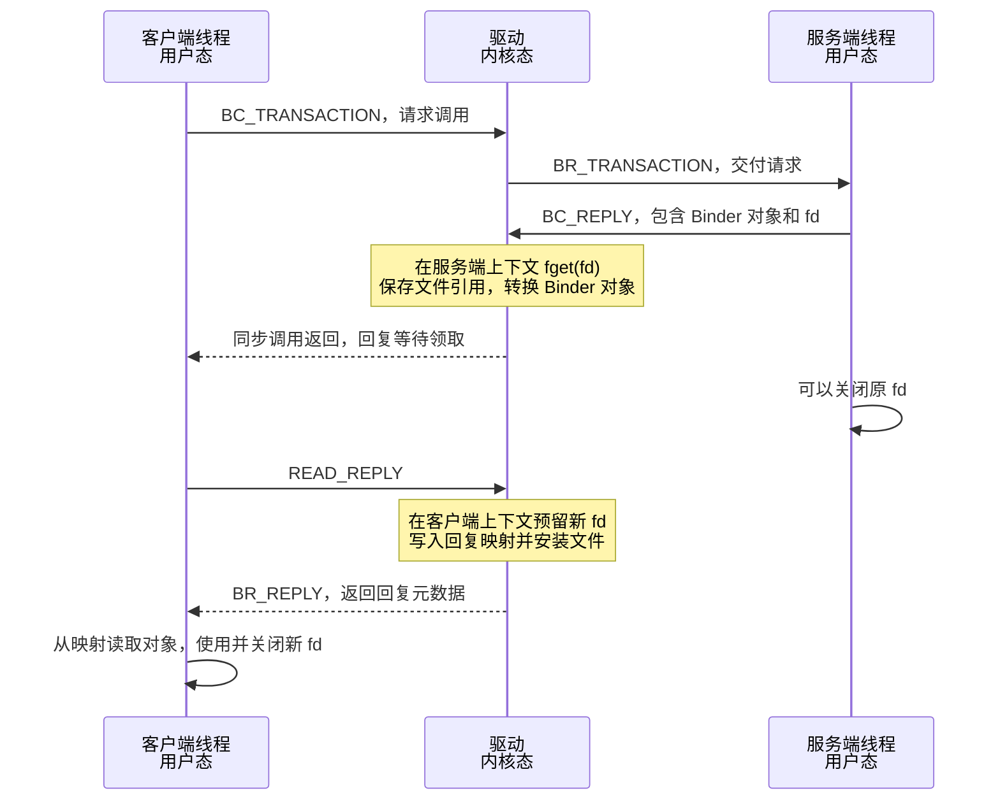

# 6.4 在回复中传递文件描述符

## 6.4.1 问题与思路

6.2 中客户端可以把 fd 当作请求参数交给服务端。如果服务端打开一个文件，要把它作为结果返回，该怎么处理？直接返回服务端的 fd 数字不行：这个数字属于服务端的 fd 表，在客户端没有相同的含义。

本章让回复中的 Parcel 同时携带普通数据、Binder 对象和 fd 对象。驱动在服务端提交回复时取得文件引用，在客户端线程读取回复时为它分配自己的 fd。示例位于 `examples/6.4/`，协议版本为 `0604`。



文件引用和 fd 数字是两回事：`fget()` 使驱动在交付前持有文件；`fd_install()` 把该引用交给接收进程的 fd 表。客户端收到的 fd 数字可能和服务端不同。

## 6.4.2 在发送方取得文件

源码：`examples/6.4/kernel/mini_binder.c`，`send_reply`，第 621–630 行（节选）。

```c
    else {
        slot->reply = incoming_transaction;
        ret = translate_objects(file, slot->caller_proc, &slot->reply, &slot->reply_fds);
        if (!ret) {
            list_add_tail(&slot->reply_work, &slot->caller->todo);
            atomic_inc(&slot->caller->todo_count);
            WRITE_ONCE(slot->state, RPC_DONE);
            wake_up_interruptible(&slot->caller->wait);
        }
    }
```

服务端提交回复时，`file` 对应发送方上下文，`slot->caller_proc` 是接收方。`translate_objects()` 在发送线程上下文解析对象并持有 fd 对应的文件；成功后才把回复加入调用线程的 todo。fd 无效时服务端得到 `EBADF`，事务仍在处理中，服务端可修正后重新提交。

源码：`examples/6.4/kernel/mini_binder.c`，`translate_objects`，第 173–184、218–224 行（节选，中间省略 Binder 对象转换）。

```c
        type = get_unaligned_le32(transaction->data + offset);
        if (type == MINI_BINDER_OBJECT_FD) {
            struct file *fd_file;
            if (get_unaligned_le32(transaction->data + offset + 8)) { ret = -EINVAL; goto fail; }
            fd_file = fget(get_unaligned_le32(transaction->data + offset + 4));
            if (!fd_file) { ret = -EBADF; goto fail; }
            fds->entries[fds->count].file = fd_file;
            fds->entries[fds->count].offset = offset + 4;
            fds->count++;
            previous = offset;
            continue;
        }
        /* ... */
    }
    memcpy(receiver->refs, refs, sizeof(refs));
    return 0;
fail:
    drop_fd_set(fds);
    return ret;
```

这里保存的是 `struct file` 引用和回复数据中 fd 字段的位置，不是接收方的 fd。对象校验失败时释放已取得的文件引用，临时准备的 Ref 表也不会提交。成功后服务端关闭原 fd，不影响驱动持有的引用。

## 6.4.3 在线程中等待领取

源码：`examples/6.4/kernel/mini_binder.c`，`call_server`，第 470–477 行（节选）。

```c
        transaction.reply_offset = (thread->reply_index + SLOT_COUNT) * MINI_BINDER_MAX_DATA;
        memcpy((char *)client_ctx->buffer + transaction.reply_offset, slot->reply.data, slot->reply.size);
        transaction.object_cookie = 0;
        thread->reply_fds = slot->reply_fds;
        slot->reply_fds.count = 0;
        thread->pending_reply = transaction;
        WRITE_ONCE(thread->reply_ready, true);
        thread->reply_delivered = false;
```

回复数据先复制到客户端映射的回复位置，文件引用从事务槽转移到发起调用的线程。此时客户端尚未取得 fd；它必须在同一线程继续执行 `READ_REPLY`。`state_lock` 保护事务、线程回复状态和引用集合的转移。

## 6.4.4 在接收方安装 fd

源码：`examples/6.4/kernel/mini_binder.c`，`read_command`，第 668–687 行（节选）。

```c
    if (kind != MINI_READ_REPLY) return -EINVAL;
    mutex_lock(&state_lock);
    if (!thread->reply_ready || thread->reply_delivered) {
        ret = -ENOENT;
    } else if (!mapping_valid(ctx, current->mm)) {
        ret = -ENXIO;
    } else {
        reply.transaction = thread->pending_reply;
        ret = reserve_fds(&thread->reply_fds,
                          (char *)ctx->buffer + reply.transaction.reply_offset, reserved);
        if (!ret && copy_to_user(read_cmd, &reply, sizeof(reply))) {
            release_reserved_fds(&thread->reply_fds, reserved);
            ret = -EFAULT;
        } else if (!ret) {
            install_fds(&thread->reply_fds, reserved);
            thread->reply_delivered = true;
        }
    }
    mutex_unlock(&state_lock);
    return ret;
```

`reserve_fds()` 在当前客户端进程预留全部新编号，并写入映射中的 fd 对象；预留失败会撤销已预留的编号。元数据复制失败也撤销编号。这两种失败都保留线程持有的文件引用，客户端修复问题后可以再次读取；只有成功复制元数据才安装 fd。安装后的 fd 带 `FD_CLOEXEC`，由客户端负责关闭。

如果客户端不领取回复，`BC_FREE_REPLY`、显式 `MINI_BINDER_THREAD_EXIT` 或最后关闭 Binder 文件会释放尚未安装的文件引用。释放回复并不会关闭已经交付给客户端的 fd，客户端仍须自行 `close()`。

## 6.4.5 实验

在支持加载模块并安装了匹配内核头文件的 Linux 中，停止其他章节服务并卸载旧模块，然后运行：

```sh
cd examples/6.4
make
sudo insmod kernel/mini_binder.ko
./build/version
./build/fd_reply_demo
sudo rmmod mini_binder
```

Ubuntu 24.04 ARM64、Linux 6.8.0-147 上的一次实际输出如下，fd 数字取决于进程已有的打开文件：

```text
mini-binder protocol version: 0604
reply fd 4 read: data
```

主实验让服务端在 `fork()` 后创建管道，将读端放进回复，客户端领取自己的 fd 并读取 `data`。fd 数字随进程已有描述符变化。实验用管道控制服务端退出时机，确保客户端完成回复读取。

源码：`examples/6.4/tests/fd_reply_demo.c`，`server`，第 33–38 行（节选）。

```c
    assert(ioctl(binder, MINI_BINDER_READ, &req) == 0);
    assert(pipe(data) == 0 && write(data[1], "data", 4) == 4); close(data[1]);
    reply.transaction.id = req.transaction.id; reply.transaction.size = 12; reply.transaction.object_count = 1;
    put32(reply.transaction.data, MINI_BINDER_OBJECT_FD);
    put32(reply.transaction.data + 4, (uint32_t)data[0]);
    assert(ioctl(binder, MINI_BINDER_WRITE, &reply) == 0); close(data[0]);
```

回复中对象位置默认为 0；服务端提交回复后关闭自己的管道读端。客户端读取到的是驱动在其 fd 表中安装的编号。

附加回归 `./build/fd_reply_test` 提交包含 Binder 对象和两个 fd 的回复：一个无效 fd 使提交失败，管道 EOF 验证此前取得的引用已释放。修正后服务端关闭原 fd，客户端触发 `EFAULT` 和 `EMFILE` 后成功重试。两个接收 fd 指向同一个打开文件，因此共享读位置。测试还检查未领取的回复在三种释放路径下不再持有管道写端。该回归要求 fd 硬限制至少为 64，临时降低的是测试进程的软限制。

## 6.4.6 限制与自测

这是教学实现，不包含 Android Binder 的文件传递安全检查和接收策略。对象转换成功后，如果接收方始终不领取回复，已经创建的 Binder Ref 不会回滚；本例尚无完整引用计数和单独释放机制。调用期间其他线程并发解除映射，可能使接收方无法读取已安装的 fd 编号；应保持映射有效直到读取完成。服务端退出与回复交付交错等情况尚未穷尽测试。

1. 为什么服务端的 fd 数字不能直接作为客户端的 fd？
2. 客户端读取回复失败后，驱动为什么还要保留文件引用？
3. 已领取回复后，释放回复缓冲区是否会替客户端关闭 fd？

参考：fd 数字只在各自进程的 fd 表中有意义；保留引用才能重试；不会，接收方应关闭已安装的 fd。

完成第六篇后，可以做[第六篇自测卷](../appendices/6-review.md)。
