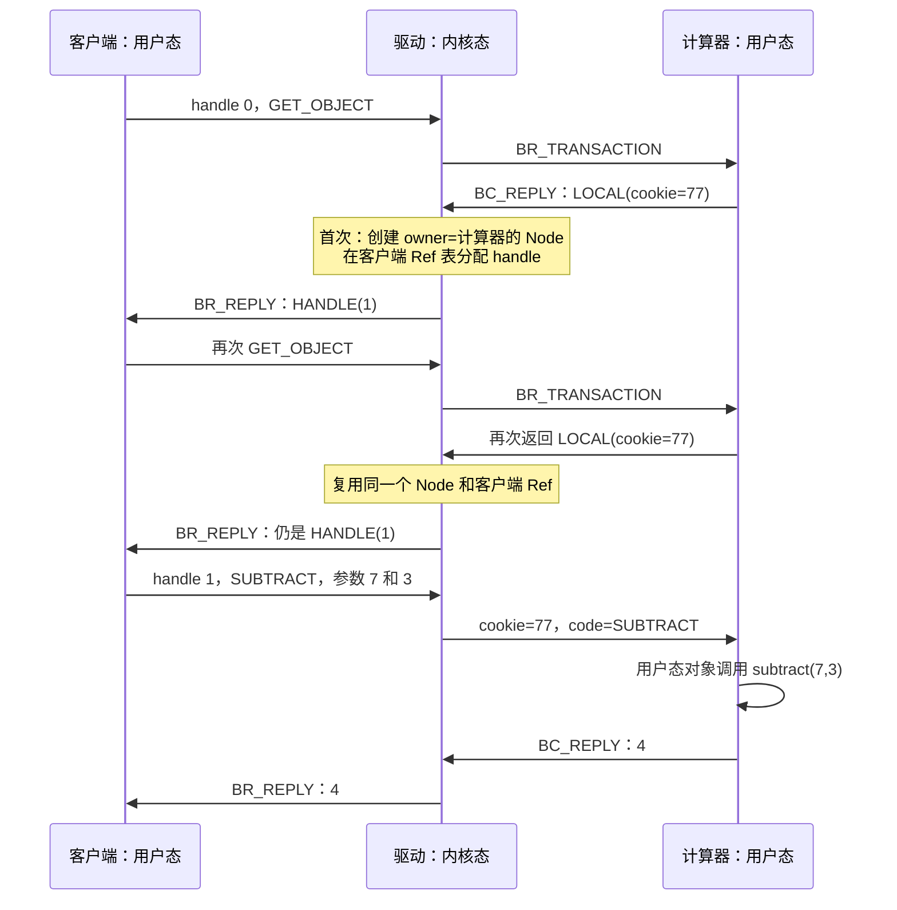

# 7.1 第一次传递本地对象时创建 Node

## 7.1.1 问题：用户态为什么要先登记对象？

6.4 已能在请求和回复中传递 Binder 对象与 fd，但本地对象必须先调用 `MINI_BINDER_CREATE_NODE`。用户态既要维护自己的对象，又要额外登记一个内核 Node。对于后续封装来说，能否只说“把这个对象作为参数或结果发送”？

本章删除专用的 CREATE_NODE ioctl 和参数结构。在发送方第一次放入 `LOCAL(cookie)` 时，驱动自动查找或创建 Node；重复传递同一对象则复用。请求、回复都调用同一个转换函数，因此规则不依赖传输方向。示例在 `examples/7.1/`，协议版本 `0701`。

选择在这里删除 CREATE_NODE，是因为前面的章节先分别观察 Node、对象转换、线程与 fd。那些实验用创建结果中的 Node 编号引导通信；现在已有管理入口和 handle，可以在不引入新发现机制的前提下取消显式登记。7.1 之后不再保留旧 ioctl，也不保留兼容分支；7.2 再删除公开的 Node 寻址字段。

本章只收敛对象的创建方式；`target_node` 暂时保留到 7.2，读取请求和回复的选择仍沿用上一章。

## 7.1.2 先预测：发送两次会创建两个对象吗？

主实验只有两个进程。服务端包含一个用户态计算器对象，客户端先通过 handle 0 请求对象两次，再通过收到的 handle 调用减法。

这里为了缩短主实验，让计算器临时承担管理入口，使用 `REGISTER_MANAGER` 接收发给 handle 0 的请求；它只返回一个对象，没有实现名称到服务的注册表。真实的三进程服务注册与查找由 `manager_test` 验证。



对象的身份由 `(发送方上下文, cookie)` 决定。不同上下文可以使用相同 cookie；同一上下文反复发送 cookie 77 表示同一个对象。cookie 不能为 0，应用须在该上下文存续期间保持对象身份稳定，不能把旧 cookie 随意复用于另一对象。

## 7.1.3 用户态对象仍然对应函数

源码：`examples/7.1/userspace/object_demo.c`，第 6–7 行（章节版本 `0701`，节选）。

```c
struct calculator { uint64_t cookie; int (*invoke)(int, int); };
static int subtract(int a, int b) { return a - b; }
```

源码：`examples/7.1/userspace/object_demo.c`，第 24–36 行（章节版本 `0701`，节选）。

```c
        if (event.transaction.code == GET_OBJECT) {
            object(&reply.transaction, 0, MINI_BINDER_OBJECT_LOCAL, calc.cookie);
        } else if (event.transaction.code == SUBTRACT) {
            assert(event.transaction.object_cookie == calc.cookie && event.transaction.size == 8);
            struct object_parcel request, result;
            uint32_t a, b;
            assert(parcel_from_transaction(&request, &event.transaction, data) == 0);
            assert(parcel_read_u32(&request.bytes, &a) == 0);
            assert(parcel_read_u32(&request.bytes, &b) == 0);
            object_parcel_init(&result, reply.transaction.data, sizeof(reply.transaction.data));
            assert(parcel_write_u32(&result.bytes, (uint32_t)calc.invoke((int)a, (int)b)) == 0);
            parcel_to_transaction(&reply.transaction, &result);
        } else assert(event.transaction.code == STOP);
```

`GET_OBJECT` 的结果是对象描述符，而不是 Node ID 或函数指针。`object()` 复用 3.3 的 object_parcel 编码类型和值，再通过事务绑定填写大小和对象位置表；不在主程序里手算对象字节位置。驱动只识别对象身份，收到后续调用时返回 `object_cookie=77`，用户态才用自己的 `calc.invoke` 调用函数。内核不会执行用户态函数指针。

`lab.h` 只抽取本章测试共用的编码和 ioctl 操作；没有实现代理对象、服务基类或 Framework 封装。完整主实验保留在 `object_demo.c`。

## 7.1.4 驱动如何查找和创建？

源码：`examples/7.1/kernel/mini_binder.c`，第 203–219 行（章节版本 `0701`，节选）。

```c
        } else if (type == MINI_BINDER_OBJECT_LOCAL) {
            __u64 cookie = get_unaligned_le32(transaction->data + offset + 4);
            cookie |= (__u64)get_unaligned_le32(transaction->data + offset + 8) << 32;
            for (j = 0; j < ARRAY_SIZE(nodes); j++)
                if (nodes[j].owner == sender && nodes[j].cookie == cookie) break;
            if (!cookie) { ret = -EINVAL; goto fail; }
            if (j == ARRAY_SIZE(nodes)) {
                for (j = 0; j < ARRAY_SIZE(nodes); j++)
                    if (!nodes[j].owner) break;
                if (j == ARRAY_SIZE(nodes)) { ret = -ENOSPC; goto fail; }
                if (next_node_id == U64_MAX) { ret = -EOVERFLOW; goto fail; }
                nodes[j].id = ++next_node_id;
                nodes[j].cookie = cookie;
                nodes[j].owner = sender;
                created |= 1UL << j;
            }
            id = nodes[j].id;
```

`sender` 来自发送方 `file->private_data`。先按 owner 与 cookie 查找；找到则复用，没有才占用空槽并分配内部 ID。`nodes[8]` 是教学实现的固定全局表，满时返回 `ENOSPC`，不会覆盖仍然存活的对象。

创建 Node 和创建接收方 Ref 是不同动作：Node 表示对象属于谁，Ref 表示接收方如何引用它。后面的转换逻辑不变：对象回到 owner 时写为 `LOCAL(cookie)`，否则在接收方 Ref 表查找或分配 handle，同一接收方重复获得同一对象会复用 handle。

## 7.1.5 半途失败，刚建的 Node 怎么办？

假设同一包中先放 `LOCAL(900)`，再放一个无效 fd。第一个对象能创建 Node，第二个对象却使转换失败；如果直接返回，重复失败会耗尽 Node 表。

本章沿用接收方 Ref 表的临时副本，同时用 `created` 位图记录本次新增的 Node。全部对象成功后才提交 Ref 表；失败则只删除本次新建的 Node，并释放已经取得的文件引用。

源码：`examples/7.1/kernel/mini_binder.c`，第 241–247 行（章节版本 `0701`，节选）。

```c
    memcpy(receiver->refs, refs, sizeof(refs));
    return 0;
fail:
    for (j = 0; j < ARRAY_SIZE(nodes); j++)
        if (created & (1UL << j)) memset(&nodes[j], 0, sizeof(nodes[j]));
    drop_fd_set(fds);
    return ret;
```

这段是 `translate_objects()` 的成功提交与失败出口。原来已经存在的 Node 不在 `created` 中，不会因一次失败传输被删除。ID 计数不回退，因此内部 ID 可以出现空缺，不能据此计算活对象数量。

转换由调用者持有的 `state_lock` 保护，Node 创建、Ref 检索和失败回滚不会与另一转换交叉提交。`mapping_lock` 继续只保护映射记录。位图不是锁。

这里回滚的是**本次对象转换失败**。转换已经成功、随后接收方读取失败时，不会回滚所有 Node/Ref；本教材尚未实现强弱引用计数和单独的对象引用释放协议。

## 7.1.6 实验与验收

在支持内核模块且安装了匹配 headers 的 Linux 环境中，先停止旧示例并卸载旧模块。获取或解压源码后：

```sh
cd examples/7.1
make
sudo insmod kernel/mini_binder.ko
./build/version
./build/object_demo
```

实际输出：

```text
mini-binder protocol version: 0701
GET_OBJECT 1: LOCAL(cookie=77) -> client handle 1
GET_OBJECT 2: LOCAL(cookie=77) -> client handle 1
handle 1: sub(7, 3) = 4
same local object reused; handle call passed
```

两次返回相同 handle，随后调用真正使用该 handle；只观察到“创建成功”还不足以证明对象可以调用。`object_demo` 用管道等待客户端消费最后一笔回复后才退出服务，避免关闭服务端文件与客户端取走回复竞争。

补充验收：

```sh
./build/protocol_test
./build/manager_test
./build/mapping_test
./build/stale_reply
./build/server_death
sudo rmmod mini_binder
```

`protocol_test` 连续制造十次“LOCAL 后接无效 fd”的失败，再成功传递八个不同本地对象，验证没有遗留新 Node；第九个新对象返回 `ENOSPC`，已有对象仍可传递。它还验证对象回到 owner、双向 fd、回复读取失败后的重试。其他测试检查服务发现、映射、迟到回复和服务端退出，具体覆盖见同目录 README。

本章在 Ubuntu 24.04 ARM64、Linux 6.8.0-147-generic 上实际构建、加载、运行并卸载；主实验和协议边界实验各额外连续运行五次通过。没有进行性能评估，也没有穷尽并发取消与映射关闭组合。

## 7.1.7 Android Binder 对照与下一步

Android 16 的 `binder_translate_binder()` 也先按本地对象查找 Node，没有才调用 `binder_new_node()`。参考固定内核版本 `android16-6.12-2026-09_r1`：[drivers/android/binder.c，binder_translate_binder](https://android.googlesource.com/kernel/common/+/894a317b5382555614ef2be7a79cca79083c6cf2/drivers/android/binder.c#2419)。

原生实现用 `flat_binder_object.binder` 查找并校验独立的 cookie，还涉及安全检查和引用计数。本章用一个非零 cookie 合并表达本地对象身份，不能直接把本章的 12 字节描述符传给 Android 驱动。

下一章继续收敛调用入口：客户端既然已经持有 handle，就不应再用全局 Node ID 绕过 Ref 表寻址。

## 7.1.8 自测

1. 两个进程都发送 `LOCAL(77)`，是否表示同一个 Node？为什么？
2. 为什么重复发送同一本地对象应复用 Node 和接收方 handle？
3. 一个对象包后半部分失败，为什么不能保留前半部分刚创建的 Node？
4. Node 创建成功是否意味着驱动会调用用户态函数指针？

答案：身份还包含发送方上下文；复用保持同一对象的引用身份并避免耗尽固定表；失败包不能逐次泄漏容量；函数分发仍在对象 owner 的用户态执行。
