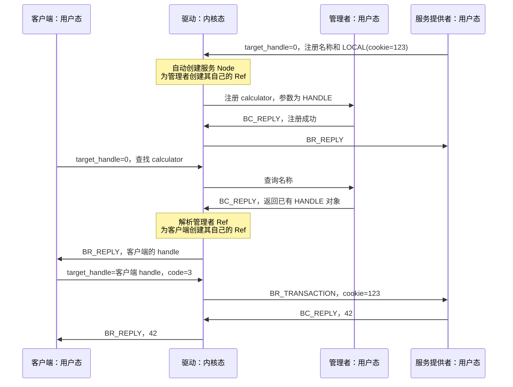

# 7.2 只用 handle 寻址服务对象

## 7.2.1 问题：为什么还有两条寻址路径？

7.1 已能通过发送 `LOCAL` 自动创建 Node，但事务头中仍有 `target_node` 和 `target_handle`。如果应用可以填写一个全局 Node ID，那么还没有收到该对象 Ref 的客户端，也能尝试绕过引用表调用它。

本章删除用户协议中的 `target_node`，普通远程调用只填当前上下文的 handle；handle 0 继续作为管理者入口。驱动内部 Node ID 暂时保留，用来关联 Ref 与 Node。示例在 `examples/7.2/`，协议版本 `0702`。主实验输出不变，这是接口收敛，不是新增一种计算功能。

## 7.2.2 统一后的事务结构

源码：`examples/7.2/include/mini_binder.h`，第 20–31 行（章节版本 `0702`，节选）。

```c
struct mini_binder_transaction_data {
    __u64 data_address;
    __u64 object_cookie;
    __u32 target_handle;
    __u32 object_count;
    __u32 object_offsets[MINI_BINDER_MAX_OBJECTS];
    __u32 reply_offset;
    __u32 size;
    __s32 status;
    __u32 code;
    __u8 data[MINI_BINDER_MAX_DATA];
};
```

`target_handle` 用于请求寻址，`code` 选择对象的方法，`object_cookie` 是驱动交付给对象 owner 的本地身份。回复沿用 5.4 的线程绑定：当前服务线程的 `current_transaction` 指向待回复事务，再沿其 `caller` 找到调用线程，不需要填写事务 id 或目标 handle。

`data_address` 是接收请求时返回的用户地址；`reply_offset` 是客户端回复映射内的位置；`object_offsets` 指出负载中的对象描述符位置。三者用途不同，本章不改变它们。`size` 描述实际负载长度；固定大小的命令包仍包含内联 `data`，这还不是 Android 的可变长事务协议。

同一个数字 handle 在不同上下文中可以指向不同 Node；不得把服务管理者收到的 handle 数字原样复制给客户端。应把它编码成 HANDLE 对象，经过驱动转换，在接收方创建或复用其自己的 Ref。

## 7.2.3 驱动如何选择接收方？

源码：`examples/7.2/kernel/mini_binder.c`，第 393–406 行（章节版本 `0702`，节选）。

```c
    if (transaction.target_handle) {
        __u64 node_id;
        if (transaction.target_handle > ARRAY_SIZE(client_ctx->refs) ||
            !client_ctx->refs[transaction.target_handle - 1].node_id) { ret = -ENOENT; goto unlock_state; }
        node_id = client_ctx->refs[transaction.target_handle - 1].node_id;
        for (i = 0; i < ARRAY_SIZE(nodes); i++)
            if (nodes[i].owner && nodes[i].id == node_id) break;
        if (i == ARRAY_SIZE(nodes)) { ret = -ENOENT; goto unlock_state; }
        transaction.object_cookie = nodes[i].cookie;
        receiver = nodes[i].owner->file;
    } else {
        transaction.object_cookie = 0;
        receiver = server_file;
    }
```

这段位于 `call_server()`，已持有 `state_lock`。非零 handle 先查调用方的 `refs[handle-1]`，再通过内部 `node_id` 找 Node；不存在的引用返回 `ENOENT`，不会把数字当作 Node ID 再尝试另一条路。Node 的 owner 提供接收方文件，cookie 告诉用户态该分发给哪个本地对象。

handle 0 不查普通 Ref 表，由驱动选择已登记的管理者文件；没有管理者时返回 `ENOTCONN`。普通 handle 失效和管理者不存在因此是两类错误。单个应用可以既发出调用，也拥有其他进程能调用的本地对象，不需要先登记为“服务端”。

`mini_binder_ref.node_id` 与全局 Node 表仍是教学实现的内部关联方式。Android 原生 `binder_ref` 关联 `binder_node` 指针；本章删除的是公开寻址旁路，不是把内部关联也强制改成指针。

## 7.2.4 通过服务管理者取得引用



服务名只在管理者用户态解析；驱动并不认识字符串 `calculator`。注册时自动创建 Node、查询时转交已有 HANDLE、调用时按客户端 Ref 寻址，三步复用同一对象转换机制。

源码 `tests/manager_test.c` 的 `provider()` 中，服务提供者先把名称和 LOCAL 对象放进请求：

源码：`examples/7.2/tests/manager_test.c`，第 77–83 行（节选）。

```c
    struct object_parcel registration;
    object_parcel_init(&registration, req.transaction.data, sizeof(req.transaction.data));
    assert(parcel_write_string(&registration.bytes, "calculator", strlen("calculator")) == 0);
    assert(object_parcel_write(&registration, OBJECT_PARCEL_LOCAL, 123) == 0);
    parcel_to_transaction(&req.transaction, &registration);
    req.transaction.code = 1;
    transact(fd, &req, &result); assert(result.transaction.status == 0); free_reply(fd);
```

`target_handle` 的默认值为 0。注册成功后，提供者等待自己的对象请求；它没有 CREATE_NODE，也不需要取得或发布全局 Node ID。管理者保存收到的 handle，查找服务时把它作为对象结果返回，驱动再完成下一次跨上下文转换。

## 7.2.5 实验：正常流程先行

先停止旧示例并卸载旧模块，然后在 Linux 中：

```sh
cd examples/7.2
make
sudo insmod kernel/mini_binder.ko
./build/version
./build/object_demo
./build/manager_test
```

`version` 输出 `mini-binder protocol version: 0702`；`object_demo` 输出与 7.1 相同，证明删除 Node ID 入口后正常调用仍可完成。`manager_test` 的实际输出：

```text
service calculator: registered, found and called (result 42)
manager handle 0: add, get, call and manager exit passed
```

它使用独立的管理者、提供者和客户端进程。先完成注册、查找、调用，然后检查缺失服务、无效名称、重复管理者登记以及退出后的行为。管理者退出后，已经拿到的普通服务 handle 仍然可以调用；提供者退出后，该 handle 则失效。

进一步检查新接口和沿用能力：

```sh
./build/protocol_test
./build/mapping_test
./build/stale_reply
./build/server_death
sudo rmmod mini_binder
```

`protocol_test` 在新客户端尚无任何 Ref 时用 handle 8 发请求，必须得到 `ENOENT`；随后通过对象传递取得的 handle 可以调用和转交。它也验证自动 Node 创建失败回滚、八对象容量、对象返回 owner，以及双向 fd 和回复读取重试。

本章在 Ubuntu 24.04 ARM64、Linux 6.8.0-147-generic 上实际构建并运行以上所有程序，模块最终卸载成功；对象主实验和协议边界实验各额外连续运行五次通过。测试没有覆盖所有线程、取消和映射关闭交错，不能当作生产级安全证明。

## 7.2.6 Android Binder 对照与下一步

Android 16 在 `binder_transaction()` 中也从请求的 `target.handle` 查发送方 Ref；handle 为 0 时走上下文管理者 Node。参考固定版本：[drivers/android/binder.c，事务目标解析](https://android.googlesource.com/kernel/common/+/894a317b5382555614ef2be7a79cca79083c6cf2/drivers/android/binder.c#3404)。原生收到请求后向用户态交付本地对象地址与 cookie，驱动内部的 Node 调试编号不是公开调用地址。

本章的管理者仍只是驱动保存的一个文件指针，没有创建原生的上下文管理者 Node，也没有实现权限策略、引用计数或多 Binder context。handle 是引用空间里的编号，本实现尚不能替代 Android 的授权和安全机制。

下一章解决另一个人为区分：调用 READ 前，为什么还要告诉驱动“我只读请求”或“我只读回复”？

## 7.2.7 自测

1. 为什么不能把全局 Node ID 当作另一种公开调用入口？
2. 管理者的 handle 1 和客户端的 handle 1 必然相等吗？
3. 管理者退出后，客户端是否必须丢弃已经取得的服务 handle？
4. 本章是不是已经把内核 Ref 改成直接保存 Node 指针？

答案：那会绕过发送方 Ref 解析；数字只在各自上下文内有意义；只要服务仍在，本章已有引用仍可调用；没有，内部仍使用 ID，变化在用户协议的寻址方式。
