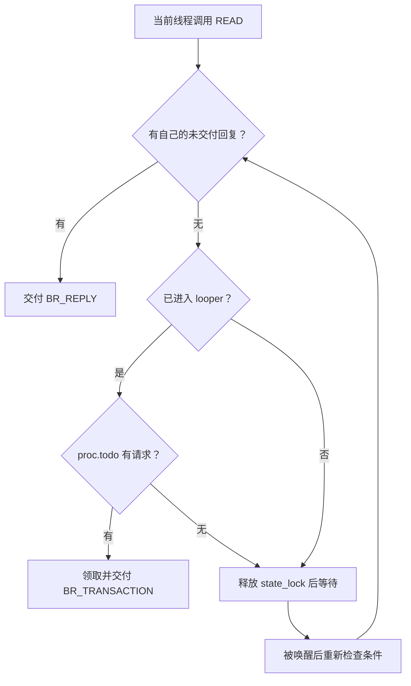
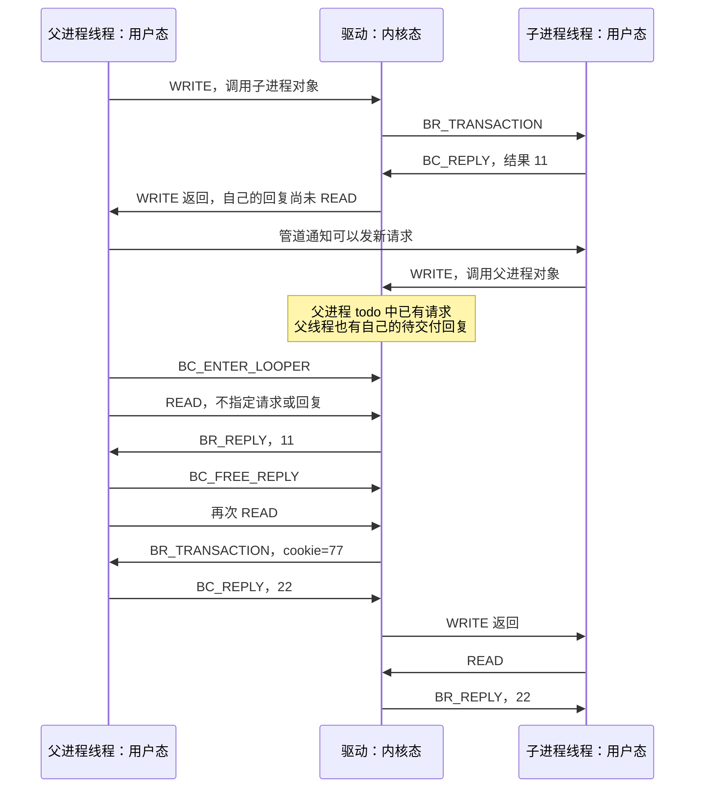

# 7.3 进入 looper，用同一个 READ 接收事件

## 7.3.1 问题：一个线程究竟在等什么？

7.2 的线程可以发送调用，也可以提供对象，但 READ 前仍要填写 `MINI_READ_REQUEST` 或 `MINI_READ_REPLY`。当一个上下文既有自己的回复，又有别人发来的请求时，用户态必须提前选择。后续封装希望统一为“读取下一个事件，再按 BR 命令处理”。

本章做两件相互配合的调整：删除 READ 的输入选择值；增加线程是否主动承担普通请求的 looper 状态。示例在 `examples/7.3/`，协议版本 `0703`。READ 的 `cmd` 现在只作为返回值，驱动不读取传入的值。

这不会自动创建线程。用户态先创建线程，再由那个线程发送 `BC_ENTER_LOOPER`。普通发起调用的线程无须进入 looper，也能取回自己的回复。

## 7.3.2 先建立调度规则

| 当前线程与数据 | READ 行为 |
|---|---|
| 当前线程有尚未交付的回复 | 返回 `MINI_BR_REPLY`，优先于普通请求 |
| 没有自己的回复，已进入 looper，进程 todo 有请求 | 返回 `MINI_BR_TRANSACTION` |
| 没有自己的回复，未进入 looper | 不领取进程请求，等待信号或映射关闭等条件 |
| 没有可领取的工作 | 阻塞，信号打断返回 `EINTR` |
| 映射无效或不属于当前地址空间 | 返回 `ENXIO` |

自己的回复始终属于发起调用的线程，进入 looper 不会让另一个线程读走它。`BC_EXIT_LOOPER` 只是放弃普通请求资格；`MINI_BINDER_THREAD_EXIT` 才是前面章节实现的线程记录与残留资源清理，两者不能混用。



图画的是正常读取决策。代码会先检查映射；等待可能被信号打断；请求 fd 交付失败会通知调用方，回复交付失败则允许当前线程重试。这些沿用的资源规则没有因为统一 READ 而取消。

## 7.3.3 用 BC 命令改变当前线程的状态

源码：`examples/7.3/include/mini_binder.h`，第 34–42 行（章节版本 `0703`，节选）。

```c
enum mini_binder_command_code {
    MINI_BC_TRANSACTION = 1,
    MINI_BC_REPLY = 2,
    MINI_BC_FREE_REPLY = 3,
    MINI_BC_ENTER_LOOPER = 4,
    MINI_BC_EXIT_LOOPER = 5,
    MINI_BR_TRANSACTION = 101,
    MINI_BR_REPLY = 102,
};
```

本章没有 `MINI_READ_REQUEST` 和 `MINI_READ_REPLY`；`MINI_BC_*` 是用户态写入的动作，`MINI_BR_*` 是内核返回的事件。

`mini_binder_thread` 新增一个 `bool looper`，初始为 false。WRITE/READ 根据 `current` 找当前线程记录，状态不属于整个进程，也不因另一个线程登记而改变。

源码：`examples/7.3/kernel/mini_binder.c`，第 628–641 行（章节版本 `0703`，节选）。

```c
    case MINI_BC_ENTER_LOOPER:
    case MINI_BC_EXIT_LOOPER: {
        long ret = 0;
        mutex_lock(&state_lock);
        if (command == MINI_BC_ENTER_LOOPER) {
            if (thread->looper) ret = -EALREADY;
            else thread->looper = true;
        } else {
            if (!thread->looper) ret = -EINVAL;
            else thread->looper = false;
        }
        mutex_unlock(&state_lock);
        return ret;
    }
```

这段位于 `write_command()`；重复 ENTER 返回 `EALREADY`，尚未进入就 EXIT 返回 `EINVAL`。状态由 `state_lock` 保护，操作不需要等待服务请求。线程退出清理时还会将 looper 恢复为 false，防止线程表槽位复用时继承资格。

用户态服务循环现在可以写成：

源码：`examples/7.3/userspace/lab.h`，第 44–48 行（章节版本 `0703`，节选）。

```c
static inline void enter_loop(int fd)
{
    struct mini_binder_command cmd = {.cmd = MINI_BC_ENTER_LOOPER};
    assert(ioctl(fd, MINI_BINDER_WRITE, &cmd) == 0);
}
```

源码：`examples/7.3/userspace/lab.h`，第 49–53 行（章节版本 `0703`，节选）。

```c
static inline void read_request(int fd, struct mini_binder_command *event)
{
    memset(event, 0, sizeof(*event));
    assert(ioctl(fd, MINI_BINDER_READ, event) == 0 && event->cmd == MINI_BR_TRANSACTION);
}
```

`read_request()` 和 `read_reply()` 都调用同一个 READ，只是测试中分别断言预期事件。在将来的通用事件循环里，可以只写一次 READ，再对返回的 `event.cmd` 做 switch；这时无需事先断言是哪一种事件。

## 7.3.4 统一 READ 的关键实现

源码：`examples/7.3/kernel/mini_binder.c`，第 661–675 行（章节版本 `0703`，节选）。

```c
        if (thread->reply_ready && !thread->reply_delivered) {
            reply.transaction = thread->pending_reply;
            ret = reserve_fds(&thread->reply_fds,
                              (char *)ctx->buffer + reply.transaction.reply_offset, reserved);
            if (!ret && copy_to_user(arg, &reply, sizeof(reply))) {
                release_reserved_fds(&thread->reply_fds, reserved);
                ret = -EFAULT;
            } else if (!ret) {
                install_fds(&thread->reply_fds, reserved);
                thread->reply_delivered = true;
            }
            mutex_unlock(&state_lock);
            return ret;
        }
        looper = thread->looper;
```

这段位于 `read_command()`，在 `state_lock` 下先处理当前线程回复。fd 预留失败或向用户态复制失败时，不将回复标为已交付；复制成功后才安装 fd，并设置 `reply_delivered`，因此重试不会重复安装已经成功交付的 fd。消费完映射数据仍需发送 `BC_FREE_REPLY`，统一 READ 并没有代替缓冲区释放。

源码：`examples/7.3/kernel/mini_binder.c`，第 675–684 行（章节版本 `0703`，节选）。

```c
        looper = thread->looper;
        mutex_unlock(&state_lock);
        if (looper) {
            ret = receive_request(file, arg);
            if (ret != -EAGAIN) return ret;
        }
        ret = wait_event_interruptible(server_wait,
                (READ_ONCE(thread->reply_ready) && !READ_ONCE(thread->reply_delivered)) ||
                (looper && atomic_read(&ctx->pending_count)) || !mapping_valid(ctx, current->mm));
        if (ret) return ret;
```

没有自己的回复时，只有 looper 才调用 `receive_request()` 尝试领取进程 todo。另一个服务线程可能抢先领取，所以它返回 `EAGAIN` 时需要继续等待，不能把这当成事务失败返回给用户。

`state_lock` 保护线程状态、todo 和事务槽；`mapping_lock` 保护映射记录。阻塞等待之前释放状态锁，醒来后重查条件，不依靠“醒了一次”推断事务一定存在。本章 READ 仍使用共享的 `server_wait`，请求到达和映射关闭会唤醒等待者；真正的同步调用回复仍通过原有调用线程的 wait 定向唤醒。

必须区分两个阶段：`send_reply()` 将工作加入调用线程 todo，唤醒正在同步 WRITE 中等待的调用线程；WRITE 取走这份工作并准备 `pending_reply`，返回用户态后，READ 才交付 `BR_REPLY`。本章没有把 WRITE 改成异步提交，也没有在 READ 中直接实现完整原生事务栈调度。

## 7.3.5 具体追踪：同一 READ 先回复，再请求

实验使用两个进程，各自拥有一个本地对象。先交换对象引用，使它们都能调用对方；随后父进程调用子进程对象。子进程先回复 11，等父进程的管道确认后才向父进程对象发出一笔新请求。

此时父进程同一个上下文中同时存在：当前线程尚未 READ 的回复，以及进程 todo 中的新请求。两笔调用不嵌套：子进程已经回复第一笔，父进程同步 WRITE 已返回，才允许子进程发第二笔。



`tests/looper_test.c` 还启动一个未进入 looper 的普通读取线程：即使已有进程请求，它也必须等待，不能偷走别的线程的回复。测试观察 `/proc/<pid>/task/<tid>/syscall` 确认线程实际处于 ioctl，再用信号打断；此观察方式用于验收，不属于驱动协议。

## 7.3.6 实验与真实输出

先停止旧示例并卸载旧模块，然后在 Linux 中：

```sh
cd examples/7.3
make
sudo insmod kernel/mini_binder.ko
./build/version
./build/looper_demo
```

实际输出：

```text
mini-binder protocol version: 0703
ordinary READ: BR_REPLY, result=11
BC_ENTER_LOOPER: current thread can receive process requests
same READ: BR_TRANSACTION, cookie=77
BC_REPLY: reverse caller received 22; BC_EXIT_LOOPER completed
```

先看这个两进程主实验：父进程把自己的 LOCAL 对象作为参数交给子进程，先收取结果 11，再进入 looper 处理对方调用，回复 22。它没有线程探测、信号或 fd 耗尽逻辑。

源码：`examples/7.3/userspace/looper_demo.c`，第 39–49 行（章节版本 `0703`，节选）。

```c
    read_reply(fd, &event);
    assert(get32(mapping + event.transaction.reply_offset) == 11); free_reply(fd);
    puts("ordinary READ: BR_REPLY, result=11");
    enter_loop(fd);
    puts("BC_ENTER_LOOPER: current thread can receive process requests");
    read_request(fd, &event); assert(event.transaction.object_cookie == 77);
    puts("same READ: BR_TRANSACTION, cookie=77");
    memset(&call, 0, sizeof(call)); call.cmd = MINI_BC_REPLY;
    call.transaction.id = event.transaction.id;
    call.transaction.size = 4; put32(call.transaction.data, 22);
    assert(ioctl(fd, MINI_BINDER_WRITE, &call) == 0);
```

这段位于 `main()`：`read_reply()` 与 `read_request()` 最终调用相同的 READ，ENTER 只改变当前线程能否领取普通请求。处理请求仍需用户态根据 cookie 分发，再携带事务 id 回复。

再运行边界实验，观察“自己的回复与进程请求同时存在”时的优先级，以及普通线程不能偷取工作：

```sh
./build/looper_test
```

实际输出：

```text
ordinary caller: unified READ returned BR_REPLY without entering looper
ordinary reader: did not steal queued request or another thread's reply
looper READ 1: BR_REPLY, result=11 (own reply has priority)
looper READ 2: BR_TRANSACTION, cookie=77
ENTER/EXIT checks, interrupted READ and unmap wakeup passed
```

实验先证明普通调用线程无须登记也能取得回复，再在两类工作同时存在时观察分发顺序。它还检查重复 ENTER、无效 EXIT、信号打断，以及解除映射使阻塞 READ 返回 `ENXIO`。测试使用一个读线程退出后再创建读线程，并显式清理线程记录；这不代表实现了任意线程异常死亡的自动清理。

所有受协议改变影响的配套程序也已迁移：

```sh
./build/object_demo
./build/manager_test
./build/protocol_test
./build/mapping_test
./build/stale_reply
./build/server_death
sudo rmmod mini_binder
```

`protocol_test` 检查失败对象包回滚、对象容量与复用、对象回到 owner、请求和回复 fd、`EFAULT`/`EMFILE` 后重试；回复包含 fd 时，读取失败不能提前安装 fd。`stale_reply` 和 `server_death` 分别验证取消后的旧回复拒绝，以及服务退出唤醒两位调用者。

本章在 Ubuntu 24.04 ARM64、Linux 6.8.0-147-generic 上实际构建并运行以上程序；`looper_demo`、`looper_test`、对象主实验和协议边界实验各额外连续运行五次通过，最终卸载模块成功。没有穷尽所有并发与复制失败交错。

## 7.3.7 现在有哪些 API？

| 入口 | 用途 |
|---|---|
| `MINI_BINDER_GET_VERSION` | 查询章节协议版本 |
| `MINI_BINDER_REGISTER_MANAGER` | 设置 handle 0 的管理入口 |
| `MINI_BINDER_GET_THREAD_ID` | 教学观察用的当前线程编号 |
| `MINI_BINDER_THREAD_EXIT` | 显式清理当前线程记录与残留回复资源 |
| `MINI_BINDER_WRITE` | 发送 TRANSACTION、REPLY、FREE_REPLY、ENTER_LOOPER 或 EXIT_LOOPER |
| `MINI_BINDER_READ` | 返回 BR_TRANSACTION 或 BR_REPLY；输入 cmd 无意义 |
| `mmap` | 映射当前上下文的只读请求与回复缓冲区 |

没有 CREATE_NODE 或 REGISTER_SERVER；LOCAL 传输自动创建对象，所有打开上下文都可以拥有对象。普通事务只携带 target_handle，handle 0 是引导入口。

## 7.3.8 和 Android Binder 已经相同了吗？

对象自动登记、发送方 handle 解析、线程主动进入 looper、读取时按 BR 分发，已经能为用户态封装提供稳定的概念入口。但协议布局和完整运行语义仍有明显差距。

参考固定 Android 16 内核 `android16-6.12-2026-09_r1`：[binder_thread_write 的 looper 命令](https://android.googlesource.com/kernel/common/+/894a317b5382555614ef2be7a79cca79083c6cf2/drivers/android/binder.c#4597)、[binder_thread_read](https://android.googlesource.com/kernel/common/+/894a317b5382555614ef2be7a79cca79083c6cf2/drivers/android/binder.c#4986)。原生通过 `BINDER_WRITE_READ` 交换变长命令流，用读写 consumed 描述进度；没有先填“读请求/读回复”的枚举。它还检查事务栈和线程工作，不能把原生规则压缩成“只要 looper=true 就可读任意进程工作”。

| 方面 | 本章 | Android Binder |
|---|---|---|
| 读写接口 | 两个 ioctl，每次固定一包 | BINDER_WRITE_READ 和命令流 |
| 同步调用 | WRITE 等待回复，READ 再取事件 | 命令提交、读取事件与事务栈协作 |
| looper | 主动 ENTER/EXIT，一个布尔状态 | 多状态位、REGISTER_LOOPER 与线程池请求等 |
| 回复存储 | 固定槽位、FREE_REPLY | allocator 管理缓冲区、BC_FREE_BUFFER |
| 管理入口 | 特殊文件指针 | 上下文管理者 Node |
| 对象与生命周期 | 固定表、内部 ID、显式线程清理 | Node/Ref 指针关联、引用计数与完整生命周期 |

本章的重复登记错误码和 EXIT 行为是教学规则，不声称与原生逐项一致。没有 `BR_SPAWN_LOOPER`、自动线程池扩容、嵌套调用、oneway 和死亡通知；槽位总数仍为 2，单包最多 256 字节，单上下文最多 8 个线程记录和 8 个 Ref，全局最多 8 个 Node。mmap 使用期间也仍由应用保证不并发解除映射。

接下来的封装可以先围绕 handle、code、对象编码和统一事件分发消除调用样板，再考虑合并读写 ioctl 与命令流。不能让用户误以为这里的头文件已经兼容 AOSP。

## 7.3.9 自测

1. 普通调用线程为什么不需要 ENTER_LOOPER 也能接收 BR_REPLY？
2. 进入 looper 会不会帮用户创建线程？
3. 同时有自己的回复与普通请求，READ 优先交付哪个？
4. EXIT_LOOPER 是否等于 THREAD_EXIT 或 FREE_REPLY？
5. 统一 READ 后，WRITE 是否已经成为异步提交？

答案：回复属于原调用线程，looper 只控制普通请求资格；线程由用户态创建；优先自己的未交付回复；三者分别改变资格、清理线程、释放回复缓冲区；WRITE 仍同步等待。

下一章[7.4 统一 WRITE_READ](7.4-write-read.md)把等待移到读阶段，并用三个独立程序完成服务注册、获取和调用。
