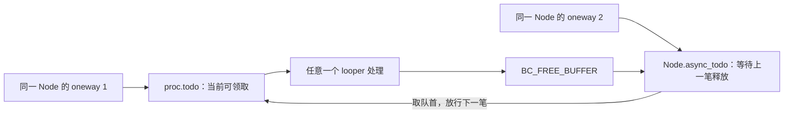

# 7.4 oneway：不等待业务回复，同一对象依次执行

7.3 的调用即使只想通知服务端“状态已经改变”，WRITE 也要等服务端回复。如果调用方不需要计算结果，能不能把请求交给驱动后继续做自己的事？

本章新增 `MINI_TF_ONE_WAY`。客户端提交后不等业务回复；服务端仍由 looper 接收 `BR_TRANSACTION`，处理完发送 `BC_FREE_BUFFER`。源码位于 `examples/7.4/`，协议 `0704`，保留 7.3 的独立 WRITE/READ；统一 WRITE_READ 留到 7.5。

## 7.4.1 先区分“提交成功”和“执行成功”

同步请求包含提交、服务端处理、业务回复和调用方消费回复。oneway 请求只把提交结果交给调用方：0 表示驱动接受了请求，不能据此判断服务端已开始、已完成或执行成功。目标无效、槽满或负载无效仍可能使提交失败；接收成功后服务进程死亡，调用方不会再收到这笔请求的业务错误。

| 阶段 | 同步调用 | oneway |
| --- | --- | --- |
| WRITE | 本章等待业务处理结果 | 接收入队后返回 |
| 服务端接收 | BR_TRANSACTION | BR_TRANSACTION，flags 含 ONE_WAY |
| 处理结束 | BC_REPLY | BC_FREE_BUFFER |
| 调用方后续 | READ 取得 BR_REPLY，再 FREE_REPLY | 不为此请求等待 BR_REPLY |
| 请求位置何时可复用 | 按同步事务原有回收路径 | 服务端释放、交付失败或退出清理后 |

只是“不调用 READ”不会变成 oneway：7.3 的同步 WRITE 本身就在等待回复。必须让驱动知道事务类型，并改变事务的所有权与回收规则。

## 7.4.2 为什么队列必须属于 Node？

两个服务线程可能同时从 proc.todo 领取任务。若将同一对象的两笔 oneway 都直接塞进 proc.todo，它们就可能同时执行，后提交的一笔甚至先结束。我们需要的规则是：**同一个 Node 的 oneway 按驱动接收入队顺序依次处理，上一笔处理完成并释放请求后，下一笔才有资格交给任一服务线程。** 多个发送线程并发提交时，顺序由 state_lock 下实际入队的先后决定。

每个 Node 因此新增一个活动标记和一个等待队列：

源码：`examples/7.4/kernel/mini_binder.c`，第 75–81 行（章节版本 `0704`，节选）。

```c
struct mini_binder_node {
    bool async_active;
    struct list_head async_todo;
    __u64 id;
    __u64 cookie;
    struct mini_binder_proc *owner;
};
```

`async_active` 为 true 表示已有一笔可领取或正在处理的 oneway。后来的同对象请求只进入 `async_todo`，不增加 proc 的 pending_count；否则等待线程会因为一个尚不可领取的任务反复醒来。不同 Node 各自维护状态，因此不同对象可以由不同线程同时处理。



这里没有承诺同步请求与 oneway 之间的统一完成顺序；串行规则只约束同一个 Node 的 oneway。

## 7.4.3 提交后，谁拥有请求？

事务结构增加 flags，未定义的位返回 EINVAL。普通同步请求 flags 为 0；oneway 为 MINI_TF_ONE_WAY。本章管理入口 handle 0 仍只支持同步控制请求，oneway 必须通过已取得的非零 handle 寻址一个 Node。

源码：`examples/7.4/include/mini_binder.h`，第 21–33 行（章节版本 `0704`，节选）。

```c
struct mini_binder_transaction_data {
    __u64 data_address;
    __u64 object_cookie;
    __u32 target_handle;
    __u32 object_count;
    __u32 object_offsets[MINI_BINDER_MAX_OBJECTS];
    __u32 reply_offset;
    __u32 size;
    __s32 status;
    __u32 code;
    __u32 flags;
    __u8 data[MINI_BINDER_MAX_DATA];
};
```

flags 随 BR_TRANSACTION 交付给接收线程，服务端据此选择回复还是释放请求。code 仍选择业务方法，两者不能混用。

客户端仍按前章要求打开设备并映射。驱动检查目标和接收映射，分配两个全局固定槽中的一个，转换对象和 fd，并把字节复制到接收映射对应位置。活动请求和在 Node 队列等待的请求都占槽，第三笔可能返回 EBUSY，不会无限排队。

源码：`examples/7.4/kernel/mini_binder.c`，第 506–527 行（章节版本 `0704`，节选 call_server 的入队分支）。

```c
    slot->async_node = oneway ? target : NULL;
    if (oneway) {
        /* Accepted work must not retain pointers into the sending thread/proc. */
        slot->caller = NULL;
        slot->caller_proc = NULL;
        if (target->async_active) {
            WRITE_ONCE(slot->state, RPC_ASYNC_QUEUED);
            list_add_tail(&slot->work, &target->async_todo);
        } else {
            target->async_active = true;
            queue_request_locked(slot);
        }
    } else {
        slot->caller = thread;
        slot->caller_proc = client_ctx;
        client_ctx->reply_used |= 1UL << reply_index;
        thread->reply_index = reply_index;
        thread->inflight = true;
        WRITE_ONCE(slot->state, RPC_PENDING);
        list_add_tail(&slot->work, &server_ctx->todo);
        atomic_inc(&server_ctx->pending_count);
    }
```

oneway 不保留 sender 的 thread/proc 指针，也不分配回复位置。提交者关闭连接，不会取消已经接收的通知。fd 转换仍持有独立 file 引用，接收方领取时才安装其 fd；未安装前的失败由驱动释放，安装后的 fd 由接收方 close。

同步分支沿用已有 caller、回复位置和等待路径。oneway 则在解锁、唤醒后直接返回，不进入同步等待。

## 7.4.4 为什么不能用 BC_REPLY 回收？

服务线程领取请求后，current_transaction 仍绑定这笔请求，防止同一线程在未处理完时再领取其他工作。oneway 没有调用线程可以回复，BC_REPLY 返回 EINVAL，绑定保持有效，服务端仍可随后正确释放。

源码：`examples/7.4/kernel/mini_binder.c`，第 164–178 行（章节版本 `0704`，节选）。

```c
static long release_request(struct file *file, struct mini_binder_thread *thread)
{
    struct transaction_slot *slot;
    long ret = 0;
    mutex_lock(&state_lock);
    slot = thread->current_transaction;
    if (!slot) ret = -ENOENT;
    else if (slot->receiver != file || !slot->async_node) ret = -EINVAL;
    else {
        thread->current_transaction = NULL;
        finish_oneway_locked(slot);
    }
    mutex_unlock(&state_lock);
    return ret;
}
```

`BC_FREE_BUFFER` 仅释放当前服务线程持有的 oneway 请求；其他线程不能代为释放，重复释放返回 ENOENT，同步请求也不能用它跳过业务回复。它不含地址参数，这是本教程“一线程最多持有一笔服务事务”的简化接口，不是 Android 的 BC_FREE_BUFFER 二进制协议。

源码：`examples/7.4/kernel/mini_binder.c`，第 137–162 行（章节版本 `0704`，节选）。

```c
static void finish_oneway_locked(struct transaction_slot *slot)
{
    struct mini_binder_node *node = slot->async_node;
    bool active = slot->state != RPC_ASYNC_QUEUED;
    if (slot->state == RPC_PENDING) {
        struct mini_binder_proc *receiver = slot->receiver->private_data;
        atomic_dec(&receiver->pending_count);
    }
    if (slot->state == RPC_PENDING || slot->state == RPC_ASYNC_QUEUED)
        list_del_init(&slot->work);
    drop_fd_set(&slot->request_fds);
    slot->async_node = NULL;
    slot->receiver = NULL;
    WRITE_ONCE(slot->state, RPC_IDLE);
    if (active) {
        node->async_active = false;
        if (!list_empty(&node->async_todo)) {
            struct transaction_slot *next = list_first_entry(&node->async_todo,
                                                              struct transaction_slot, work);
            list_del_init(&next->work);
            node->async_active = true;
            queue_request_locked(next);
        }
    }
    wake_up_interruptible_all(&server_wait);
}
```

处理中的请求释放后，槽回到 IDLE；若 Node 队列非空，就取出队首，加入 proc.todo 并增加 pending_count，随后唤醒 looper。等待者醒来后仍要在锁内重新检查，不保证由原来的同一线程继续处理。

`state_lock` 保护 Node 活动状态、Node/proc 两级队列、事务槽、线程绑定和 fd 引用转移；`mapping_lock` 继续保护映射记录。驱动不会持有这些锁执行用户态业务。

服务线程显式 THREAD_EXIT 会释放它尚未结束的 oneway 并推进队列；接收进程关闭上下文时清理活动和排队请求，再销毁 Node。请求交付的 fd 预留或 copy_to_user 失败也要回收并放行下一笔，不能把没有调用方的事务留在 FAILED 等待别人回收。退出清理不等于正常业务执行成功，也不意味着自动检测任意线程死亡。

## 7.4.5 实验：两个线程仍按对象排队

先停止旧服务并卸载旧模块，再在安装了匹配 headers 的 Linux 中执行：

```sh
cd examples/7.4
make
sudo insmod kernel/mini_binder.ko
./build/version
./build/oneway_test --demo
sudo rmmod mini_binder
```

版本输出 `mini-binder protocol version: 0704`。主实验先通过一次同步控制请求获得两个对象的 handle，然后在不允许服务线程读取的情况下向同一对象连续提交两笔通知。两次提交均已返回后，才放行第一个服务线程。第二线程进入 READ 后，实验通过自身进程可读的 proc syscall 与线程状态确认它确实在 ioctl 内睡眠，再允许第一线程释放请求。

预期输出（已在下述环境验证）：

```text
same Node: second worker slept until first FREE_BUFFER; FIFO 1 -> 2
two notifications submitted before workers ran; both completed without BC_REPLY
```

管道只用于控制实验时序；同对象串行由内核 Node 队列保证。第一笔未释放时第二线程没有获得第二笔；释放后第二笔才能被交付，并读到整数 2。

## 7.4.6 完整验收与边界

重新加载本章模块后，运行不带参数的完整模式：

```sh
sudo insmod kernel/mini_binder.ko
./build/oneway_test
sudo rmmod mini_binder
```

完整模式还验证请求交付的 copy_to_user 失败后回收并推进下一笔。完整模式验证同 Node 顺序与五轮复用、不同 Node 同时处理、第三笔槽满、非法 flags、禁止 oneway 业务回复、重复释放、无回复槽、请求中的 fd、提交者关闭、服务线程显式退出推进队列，以及接收进程退出清理活动与排队请求。实验的根进程设有 30 秒超时；外部验收也应设置超时，失败时先结束残留实验进程再卸载模块。

实际验证环境为 Ubuntu 24.04 ARM64、Linux 6.8.0-147-generic。原有协议、对象、映射、同步取消、服务端退出和 looper 测试也需通过。测试依赖能读取自身及子进程的 `/proc/.../syscall` 与线程状态，不是性能测试；未穷尽所有复制失败、取消与解除映射的交错。接收映射关闭后若既不恢复也不退出，已接受请求仍可能占槽，这一既有生命周期限制没有被 oneway 消除。

## 7.4.7 Android 对照与下一步

Android 同样保证同一 Binder Node 的异步事务串行交付，释放当前缓冲区会推进后续异步事务；不同 Node 可以并发。参见 [AOSP Binder 线程模型](https://source.android.com/docs/core/architecture/ipc/binder-threading)。本章用两个固定槽和显式当前事务释放说明规则，没有引入原生 allocator、完整引用计数或事务完成事件；提交是否成功通过 ioctl 返回值表示。

下一章统一 WRITE_READ。对 oneway，用户态只填写写方向；若同时要求读取事件，READ 仍会等待，它不会凭空得到业务回复。第八篇再把 flags、空 reply 和处理后释放封装进 IPCThreadState/BpBinder。

## 7.4.8 自测

1. oneway 提交返回 0，能否证明服务端已执行成功？
2. 同一 Node 的第二笔 oneway 为什么不直接进入 proc.todo？
3. 释放请求与回复调用方有什么区别？
4. 调用方关闭连接后，已接收通知应该靠哪个指针找到原调用线程？
5. 两个不同对象为什么可以并发，而第三笔请求仍可能 EBUSY？

参考答案：不能，只证明驱动接收；直接入 proc.todo 可能被另一线程并行领取；释放推进槽和 Node 队列，不传回业务结果；不需要也不应保留调用线程指针；每 Node 独立排队，但两个全局槽共同限制容量。
