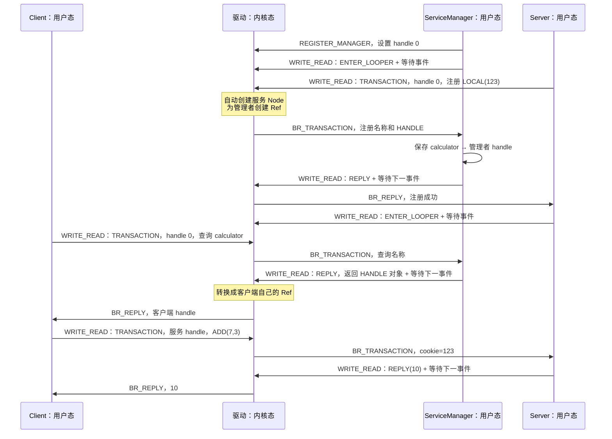

# 7.5 统一通信入口，完成一次服务调用

本章分两遍阅读：第一遍完成 7.5.2～7.5.3 的三进程主实验，再沿 7.5.4～7.5.8 追踪一次成功调用；第二遍再看 7.5.9 的进度恢复和异常回收。主实验的验收目标是“注册、找到并调用服务”，不是一次掌握所有失败分支。

## 7.5.1 问题：同步等待应该发生在哪里？

7.3 已统一 READ 返回的事件，7.4 又加入无需业务回复的 oneway。但同步调用仍要先 WRITE、再 READ，而且同步 WRITE 本身会一直等到服务端回复。用户态无法单独提交同步请求后继续执行，也难以用一个事件读取循环组织后续等待。

本章复用 2.2 的 Parcel 顺序读写和 3.3 的对象编解码，适配现有 LOCAL/HANDLE/FD 格式。服务名、对象、计算参数和结果都通过这些接口处理，不再在主程序里手算字段偏移。

本章收敛为唯一的命令交换 ioctl：`MINI_BINDER_WRITE_READ`。写阶段只提交命令，读阶段才等待并交付事件；可以只写、只读，也可以先写后读。ServiceManager、服务端与客户端同步迁移，完整展示“注册服务 → 获取服务 → 调用服务”。示例位于 `examples/7.5/`，协议版本 `0705`。

这是当前教学驱动的收尾版本，后续可以基于它封装用户态对象。这里的“完整”是指本书已经引入的主流程能够独立运行，不表示实现了 Android Binder 的全部协议和可靠性能力。7.1～7.4 仍为独立章节实验，不能与本章驱动混用。

## 7.5.2 先看最终要运行的三个程序

| 程序 | 角色 | 保存什么 |
|---|---|---|
| `servicemanager` | handle 0 的管理入口 | 单个服务名和管理者自己的 handle |
| `calculator_server` | 拥有计算器对象 | 本地 cookie 123，处理加减方法 |
| `calculator_client` | 获取并调用远程对象 | 当前客户端上下文内的服务 handle |

ServiceManager 只解析服务名，不替客户端转发计算。客户端取得引用后，直接调用计算器服务端。三个程序分别启动、持续运行或正常结束，不再要求读者先分析集中式测试中的 fork 和退出断言。



图中省略每次调用方消费回复后的 `BC_FREE_REPLY`，完整程序会发送它。`WRITE_READ` 的两个阶段依次执行：服务端先提交上一笔回复，再等下一笔请求；服务端可以仍阻塞在同一次 ioctl 中，而客户端已拿到上一笔回复。

## 7.5.3 三个终端运行主实验

先停止其他章节的服务进程并卸载旧模块。在安装了匹配内核 headers 的 Linux 中，获取或解压源码后：

```sh
cd examples/7.5
make
sudo insmod kernel/mini_binder.ko
./build/version
```

实际版本输出为 `mini-binder protocol version: 0705`。在三个终端分别进入同一个章节目录，依次运行。

终端一：

```sh
./build/servicemanager
```

终端二：

```sh
./build/calculator_server
```

终端三：

```sh
./build/calculator_client
```

客户端实际输出：

```text
getService(calculator): client handle=1
remote add(7, 3) = 10
remote sub(7, 3) = 4
```

管理者依次记录：

```text
ServiceManager ready: handle 0
addService(calculator): manager handle=1
getService(calculator): return HANDLE object
```

服务端依次记录：

```text
calculator registered: LOCAL(cookie=123)
add(7, 3) = 10
sub(7, 3) = 4
```

这里两个上下文的 handle 都恰好是 1，因为各自首先收到同一个服务对象；不是它们共享一张引用表。重复运行客户端仍能完成查询和计算；新的客户端拥有新的打开上下文。

管理者和服务端持续等待，不会因回复一笔请求自动退出。在对应终端用 Ctrl+C 停止二者，再卸载：

```sh
sudo rmmod mini_binder
```

## 7.5.4 控制结构：把写入和读取放进同一次 ioctl

源码：`examples/7.5/include/mini_binder.h`，第 52–59 行（章节版本 `0705`，节选）。

```c
struct mini_binder_write_read {
    __u64 write_size;
    __u64 write_consumed;
    __u64 write_buffer;
    __u64 read_size;
    __u64 read_consumed;
    __u64 read_buffer;
};
```

`write_buffer` 和 `read_buffer` 都是用户态命令包的地址；它们指向 `mini_binder_command`，不直接指向 mmap 数据区。请求包包含用于提交的内联数据；读取包包含 BR 事件和映射位置等元数据，实际接收负载仍从映射读取。

| 使用方式 | write_size | read_size |
|---|---|---|
| 只写：ENTER、FREE_REPLY、FREE_BUFFER 或提交 oneway | 一个包的大小 | 0 |
| 只读：等待下一事件 | 0 | 一个包的大小 |
| 写后读：提交调用并等待事件、提交回复并等待下一请求 | 一个包的大小 | 一个包的大小 |

本章每个方向仍最多一条命令，长度只能是 0 或 `sizeof(struct mini_binder_command)`；对应 consumed 只能是 0 或整个方向的长度。新操作从 consumed=0 开始；重试未完成的读阶段时，应保留已经完成的 write_consumed，而不是重新初始化控制结构。

源码：`examples/7.5/userspace/command.h`，第 10–20 行（章节版本 `0705`，节选）。

```c
static inline int command_io(int fd, struct mini_binder_command *out,
                             struct mini_binder_command *in)
{
    struct mini_binder_write_read bwr = {
        .write_size = out ? sizeof(*out) : 0,
        .write_buffer = (uintptr_t)out,
        .read_size = in ? sizeof(*in) : 0,
        .read_buffer = (uintptr_t)in,
    };
    return ioctl(fd, MINI_BINDER_WRITE_READ, &bwr);
}
```

这是 `command_io()`：非空 out/in 决定是否请求写阶段和读阶段。`mini_write()`、`mini_read()` 是这个统一 ioctl 的用户态便利函数，不是仍然保留了旧驱动入口。旧的独立 WRITE/READ ioctl 已删除。

该助手用于正常实验，失败后不自动重试。需要恢复的代码应直接保留 `mini_binder_write_read` 控制块并检查 consumed；不能在失败后无条件重新调用这个会从零初始化进度的助手。

接收方向的绑定复用已有 Parcel 结构：

源码：`examples/7.5/userspace/service.h`，第 18–32 行（章节版本 `0705`，节选）。

```c
static inline int parcel_from_transaction(struct object_parcel *p,
                                          const struct mini_binder_transaction_data *tx,
                                          const void *data)
{
    if (tx->size > MINI_BINDER_MAX_DATA || tx->object_count > OBJECT_PARCEL_MAX_OBJECTS)
        return -EINVAL;
    object_parcel_init(p, (void *)data, tx->size);
    p->bytes.size = tx->size; p->count = tx->object_count;
    memcpy(p->offsets, tx->object_offsets, p->count * sizeof(p->offsets[0]));
    for (size_t i = 0; i < p->count; i++) {
        struct parcel_object object;
        if (object_parcel_read(p, i, &object)) return -EINVAL;
    }
    return 0;
}
```

它验证负载长度和对象位置，直接借用映射数据，不再复制整份请求。这个输入视图只允许读，不能调用写接口；使用期限受事务/回复缓冲区约束。服务端应在提交回复前用完请求，客户端应在 FREE_REPLY 前用完回复。Parcel 视图不会延长映射或对象生命周期。现有 Parcel 的 data 字段是可写指针类型，因此这里用约定限制输入视图，尚无编译期 const 隔离。

对象位置继续由 object_parcel 维护，新增顺序读取接口，让名称后跟对象的负载也能顺序解码；同时补齐 FD 类型。FD 解码只读出已经由驱动转换的编号，不替进程打开或关闭文件。7.5 的驱动与线格式没有因此修改。

## 7.5.5 驱动入口：先写，再读，并记录进度

源码：`examples/7.5/kernel/mini_binder.c`，第 805–830 行（章节版本 `0705`，节选）。

```c
static long write_read(struct file *file, struct mini_binder_thread *thread, void __user *arg)
{
    struct mini_binder_write_read bwr;
    struct mini_binder_write_read __user *user = arg;
    const size_t packet = sizeof(struct mini_binder_command);
    long ret;

    if (copy_from_user(&bwr, arg, sizeof(bwr))) return -EFAULT;
    if ((bwr.write_size && bwr.write_size != packet) ||
        (bwr.read_size && bwr.read_size != packet) ||
        (bwr.write_consumed && bwr.write_consumed != bwr.write_size) ||
        (bwr.read_consumed && bwr.read_consumed != bwr.read_size)) return -EINVAL;
    /* Verify the control block is writable before submitting any command. */
    if (copy_to_user(arg, &bwr, sizeof(bwr))) return -EFAULT;
    if (bwr.write_size && !bwr.write_consumed) {
        ret = write_command(file, thread, u64_to_user_ptr(bwr.write_buffer));
        if (ret) return ret;
        if (put_user(bwr.write_size, &user->write_consumed)) return -EFAULT;
    }
    if (bwr.read_size && !bwr.read_consumed) {
        ret = read_command(file, thread, u64_to_user_ptr(bwr.read_buffer));
        if (ret) return ret;
        if (put_user(bwr.read_size, &user->read_consumed)) return -EFAULT;
    }
    return 0;
}
```

这段是唯一的命令交换入口。它先检查控制块和长度，然后执行尚未消费的写阶段；成功后立即写回 `write_consumed`，再执行读阶段。假如读包地址无效，ioctl 返回 `EFAULT`，但写阶段仍然已经提交，不能当作整个调用未发生。

控制块会先进行一次可写性检查，避免一开始就是只读地址却先提交事务。应用仍必须保证控制块、命令包和映射在调用期间有效，不被其他线程并发改写或解除映射：如果成功交付后，进度字段的最后一次写回又失败，仍然存在用户态无法确认进度的边界。本章不宣称此接口具备“任意用户地址竞态下恰好执行一次”的保证。

## 7.5.6 真正把等待移到读阶段

oneway 只写不读，提交成功后不等待 BR_REPLY；服务端处理后仍发送 FREE_BUFFER，让该 Node 的下一笔可被领取。同步调用则填写两个方向，在 READ 等待业务回复。

`submit_transaction()` 沿用 handle 寻址、对象转换、按 Node 的 oneway 队列和固定槽分配；完成入队后就返回，不再在写阶段等待回复。

源码：`examples/7.5/kernel/mini_binder.c`，第 501–524 行（章节版本 `0705`，节选）。

```c
    slot->async_node = oneway ? target : NULL;
    if (oneway) {
        /* Accepted work must not retain pointers into the sending thread/proc. */
        slot->caller = NULL;
        slot->caller_proc = NULL;
        if (target->async_active) {
            WRITE_ONCE(slot->state, RPC_ASYNC_QUEUED);
            list_add_tail(&slot->work, &target->async_todo);
        } else {
            target->async_active = true;
            queue_request_locked(slot);
        }
    } else {
        slot->caller = thread;
        slot->caller_proc = client_ctx;
        client_ctx->reply_used |= 1UL << reply_index;
        thread->reply_index = reply_index;
        thread->inflight = slot;
        WRITE_ONCE(slot->state, RPC_PENDING);
        list_add_tail(&slot->work, &server_ctx->todo);
        atomic_inc(&server_ctx->pending_count);
    }
    mutex_unlock(&state_lock);
    wake_up_interruptible_all(&server_wait);
```

这段位于 `submit_transaction()`。线程的 inflight 现在指向当前事务槽，读阶段才能继续追踪它；一个线程仍最多有一笔在途调用。在途期间再次提交，或上一笔回复缓冲区尚未释放时再次提交，都返回 `EBUSY`。

服务端 `BC_REPLY` 仍把回复加入原调用线程的 todo。读阶段发现该事务已完成后，才把回复放进调用方的映射回复位置，并准备 `BR_REPLY`：

源码：`examples/7.5/kernel/mini_binder.c`，第 768–772 行（章节版本 `0705`，节选）。

```c
        if (call_ready(thread)) {
            ret = collect_reply_locked(ctx, thread);
            if (ret) { mutex_unlock(&state_lock); return ret; }
        }
        if (thread->reply_ready && !thread->reply_delivered) {
```

这段位于 `read_command()`。`collect_reply_locked()` 取走线程回复工作，将事务槽恢复为空闲；独立的映射回复位置继续保留到 `BC_FREE_REPLY`。因此“事务槽可复用”和“客户端已释放回复缓冲区”仍是两个时间点。

自己的回复继续优先；没有在途调用、且已经进入 looper 的线程，才领取普通进程请求。在途期间不分发普通请求，避免在这一章暗中引入回调重入和事务栈。本章尚不能在同一个等待线程中服务嵌套调用。

普通调用方直接使用 `command_io(fd, &call, &event)` 提交命令并读取事件，在调用处检查 `event.cmd == MINI_BR_REPLY`。本章不额外增加只转发调用的服务封装；以后引入真正的同步事务封装时，再集中处理 BR 事件、状态和资源。当前尚未实现通用回调调度。

## 7.5.7 ServiceManager 怎样登记和循环响应？

源码：`examples/7.5/userspace/servicemanager.c`，第 13–25 行（章节版本 `0705`，节选）。

```c
    assert(ioctl(fd, MINI_BINDER_REGISTER_MANAGER) == 0);
    puts("ServiceManager ready: handle 0");
    for (;;) {
        /* First enter and read; afterwards send the previous reply and read again. */
        assert(command_io(fd, &next, &event) == 0 && event.cmd == MINI_BR_TRANSACTION);
        const struct mini_binder_transaction_data *tx = &event.transaction;
        struct object_parcel request, reply;
        struct parcel_object object;
        char name[33];
        memset(&next, 0, sizeof(next)); next.cmd = MINI_BC_REPLY;
        object_parcel_init(&reply, next.transaction.data, sizeof(next.transaction.data));
        int status = parcel_from_transaction(&request, tx, (const void *)(uintptr_t)tx->data_address);
        if (!status) status = read_service_name(&request, name);
```

这段位于 `main()`。REGISTER_MANAGER 建立 handle 0 的引导入口；ENTER_LOOPER 只赋予当前线程接收普通请求的资格。二者职责仍然分开。

循环中的 `next` 第一次是 ENTER_LOOPER；收到请求并处理后，改成 BC_REPLY。下一轮同一次 WRITE_READ 先提交这份回复，再等待下一事件，减少原先分开的调用样板。

`SM_ADD_SERVICE` 请求包含名称与对象。提供者提交的是 LOCAL，管理者接收时已经是自己上下文的 HANDLE；管理者只保存这个 handle。查询时必须把它作为 HANDLE 对象返回：

源码：`examples/7.5/userspace/servicemanager.c`，第 39–40 行（章节版本 `0705`，节选）。

```c
                assert(object_parcel_write(&reply, OBJECT_PARCEL_HANDLE, saved_handle) == 0);
                printf("getService(%s): return HANDLE object\n", name);
```

这段位于查询成功分支。对象转换让驱动在客户端创建或复用其自己的 Ref，不能把 saved_handle 当普通整数原样交付。本章名称表只保存一项；再次注册返回 `EEXIST`，不做覆盖、服务死亡后的删除与重新注册。这些仍是后续管理策略，不属于统一 ioctl 的实现范围。

## 7.5.8 服务注册与普通调用

服务端 `calculator_server.c` 构造注册请求。Parcel 写入名称，object_parcel 紧接着写入 LOCAL 对象并记录位置，绑定函数将大小与对象位置填进事务头：

源码：`examples/7.5/userspace/calculator_server.c`，第 12–17 行（章节版本 `0705`，节选）。

```c
    call.transaction.code = SM_ADD_SERVICE; /* handle 0 is the manager. */
    object_parcel_init(&registration, call.transaction.data, sizeof(call.transaction.data));
    assert(parcel_write_string(&registration.bytes, CALCULATOR_NAME, strlen(CALCULATOR_NAME)) == 0);
    assert(object_parcel_write(&registration, OBJECT_PARCEL_LOCAL, CALCULATOR_COOKIE) == 0);
    parcel_to_transaction(&call.transaction, &registration);
    assert(command_io(fd, &call, &event) == 0 && event.cmd == MINI_BR_REPLY);
```

这段位于 `main()`。`target_handle` 默认为 0；`SM_ADD_SERVICE` 是管理者方法的 code。对象 cookie 只标识拥有者自己的用户态对象，驱动自动创建 Node，服务端无需调用 CREATE_NODE 或 REGISTER_SERVER。

注册成功、释放注册回复后，服务端进入 looper。其循环与管理者相同：先写 ENTER 或上一条 REPLY，再读取新请求。服务方法通过 cookie 和 code 分发，加减法仍在用户态执行，使用 32 位无符号整数，溢出按模 2³² 处理。请求直接借用驱动映射数据，通过 Parcel 的 position 顺序读取：

源码：`examples/7.5/userspace/calculator_server.c`，第 32–41 行（章节版本 `0705`，节选）。

```c
        int status = parcel_from_transaction(&request, tx, (const void *)(uintptr_t)tx->data_address);
        if (status || tx->object_cookie != CALCULATOR_COOKIE || request.count ||
            parcel_read_u32(&request.bytes, &a) || parcel_read_u32(&request.bytes, &b) ||
            request.bytes.position != request.bytes.size) next.transaction.status = -EINVAL;
        else if (tx->code == CALCULATOR_ADD || tx->code == CALCULATOR_SUBTRACT) {
            /* Unsigned 32-bit arithmetic has defined wraparound behaviour. */
            uint32_t result = tx->code == CALCULATOR_ADD ? a + b : a - b;
            assert(parcel_write_u32(&reply.bytes, result) == 0);
            printf("%s(%u, %u) = %u\n", tx->code == CALCULATOR_ADD ? "add" : "sub", a, b, result);
        } else next.transaction.status = -ENOSYS;
```

两次 parcel_read_u32 读出两个参数；缺少参数或还有未消费的尾部字节都会被拒绝。reply 是服务端自己的可写 Parcel，计算结果经 parcel_write_u32 序列化；循环尾部再绑定到回复事务。

客户端先查询服务名，读取自己映射中的 HANDLE 对象，再用这个 handle 调用方法：

源码：`examples/7.5/userspace/calculator_client.c`，第 25–33 行（章节版本 `0705`，节选）。

```c
    uint32_t handle = (uint32_t)object.value; free_reply(fd);
    printf("getService(%s): client handle=%u\n", name, handle);
    for (unsigned int code = CALCULATOR_ADD; code <= CALCULATOR_SUBTRACT; code++) {
        memset(&call, 0, sizeof(call)); call.cmd = MINI_BC_TRANSACTION;
        call.transaction.target_handle = handle; call.transaction.code = code;
        object_parcel_init(&request, call.transaction.data, sizeof(call.transaction.data));
        assert(parcel_write_u32(&request.bytes, 7) == 0 && parcel_write_u32(&request.bytes, 3) == 0);
        parcel_to_transaction(&call.transaction, &request);
        assert(command_io(fd, &call, &event) == 0 && event.cmd == MINI_BR_REPLY);
```

这段位于 `main()`。查询用 handle 0；后续调用用查询返回的 handle。客户端通过 object_parcel_read_next 获取 HANDLE；计算结果也用 parcel_read_u32 读取。两个 code 枚举分属不同对象：管理者的 ADD/GET_SERVICE 与计算器的 ADD/SUBTRACT 并不是全局共享的方法编号。收到结果后消费映射，再释放回复；正常客户端完成两次计算后自己结束，不需要 ENTER/EXIT_LOOPER。

## 7.5.9 进阶验收：进度恢复与生命周期

也可以先保持没有手动启动的服务进程，用一个终端自动运行同样的三个可执行文件：

```sh
sudo insmod kernel/mini_binder.ko
python3 tests/service_flow.py
./build/write_read_test
```

`service_flow.py` 还运行 service_parcel_test，对真实管理者发送截断服务名、对真实计算器发送缺失/多余参数，并确认正常请求仍可完成。parcel_test 检查已有基础编解码；parcel_binding_test 检查旧线格式兼容、对象/FD 描述、截断和位置边界，它不执行真实 fd 转移。

`service_flow.py` 观察子进程就绪日志后才继续，不使用固定启动延迟；它验证未注册名称、注册后两轮查询与计算、两个并发客户端和重复注册拒绝，并在结束时清理自己的进程。它启动的是真实二进制，不是模拟日志。

`write_read_test` 的实际输出：

```text
write-only returned before server received request
read retry preserved write_consumed: each request submitted exactly once
closing callers before receive reclaimed pending slots
closing callers after receive detached pointers; late replies rejected
thread-exit cancellation and completed reply after server close passed
```

只写测试用管道让服务端暂时不能领取请求；客户端只写返回后才通知它，因此能区分“写阶段只提交”和“写阶段仍等待”。进度测试故意给出无效读地址，保留 consumed 修复地址后重试，验证不会重复发送同一事务。

写阶段不再持续持有阻塞系统调用，调用方可能提交后就关闭文件。因此本章补齐对应的有限生命周期处理：

- 请求尚在接收方 todo 时，取消或调用方最终关闭可移除工作并回收槽位和未交付的文件引用。
- 请求已经被服务端领取时，取消将槽位置为 CANCELLED，切断 caller 指针；服务端迟到回复得到 ECANCELED，并回收槽位。服务端一直不回复也不退出时，这个已领取的取消槽仍会占用，不代表实现了超时强制回收。
- 服务端尚未完成回复就关闭，读阶段返回 EPIPE；成功回复已入队后再关闭，则保留回复供调用方读取。
- 显式 THREAD_EXIT 现在也可以取消当前在途调用；普通线程消失但没有显式清理、且共享文件仍被其他线程持有时，不保证立即回收，仍需按本教材约定清理。
- 读等待被信号打断时，本章取消当前在途调用；这是教学规则，不能仅看 write_consumed 就假设它还在等待，信号后也不应盲目重发可能已执行的方法。

`state_lock` 保护 inflight、事务状态、工作队列和 Node/Ref 转换；`mapping_lock` 只保护映射记录。等待前释放状态锁。本章统一读等待仍用共享的等待队列唤醒后筛选当前线程可领取的工作，不具有原生 Binder 的完整线程选择和调度优化。

其他能力的回归入口：

```sh
./build/parcel_test
./build/parcel_binding_test
./build/thread_reply_test
./build/object_demo
./build/protocol_test
./build/manager_test
./build/mapping_test
./build/stale_reply
./build/server_death
./build/looper_demo
./build/looper_test
sudo rmmod mini_binder
```

这里的 manager_test 是额外边界回归，正文的三个独立程序才是主实验。对象自动创建回滚、返回 owner、fd 双向交付与失败重试、取消、映射和退出等实验的目的见本章源码 README。

## 7.5.10 与 Android Binder 的距离

参考固定 Android 16 内核 `android16-6.12-2026-09_r1`：[binder_write_read 结构](https://android.googlesource.com/kernel/common/+/894a317b5382555614ef2be7a79cca79083c6cf2/include/uapi/linux/android/binder.h#224)、[binder_ioctl_write_read](https://android.googlesource.com/kernel/common/+/894a317b5382555614ef2be7a79cca79083c6cf2/drivers/android/binder.c#5729)。原生同样先处理写命令，再处理读取，并返回 consumed；本章据此区分提交和等待。

目前主干概念已经接近，但两套头文件不能混用：本章仍是一方向一包，使用固定 64 位控制字段、自己的 ioctl 编码和 12 字节对象描述符；没有原生的变长命令流和兼容模式。还保留两笔固定事务槽、单线程一笔在途、256 字节负载、全局八 Node 与每上下文八 Ref/八线程记录。FREE_REPLY 仍是回复位置释放，不是原生通用的 BC_FREE_BUFFER。

自动扩容 allocator、强弱引用计数、事务栈和嵌套调用、oneway、死亡通知、安全策略、完整线程池扩容以及多 Binder context 均未实现。ServiceManager 仍以特殊文件指针引导，名称表也没有生产级生命周期管理。对象转换失败可以回滚，但成功转换后未领取对象的完整 Ref 回收尚未实现。应用还需在使用期间保持 mmap 与控制块有效。

## 7.5.11 下一步：对象身份怎样关联用户态函数？

有必要定义统一的用户态调用签名，但应放在接下来的对象封装章节。内核 Node 的职责是关联 owner 和本地对象身份；它不保存可供内核调用的用户态方法签名，也不会直接执行函数。

后续可以让用户态根据 cookie 找到本地对象，通过统一的分发函数接收 code、请求 Parcel 和回复 Parcel，再选择具体加减方法。远端则由“handle + 代理对象”封装请求。服务管理者也能使用同一个分发约定处理 ADD_SERVICE/GET_SERVICE。

本章复用前面已经完成的 Parcel 和 object_parcel，service.h 只增加它们与当前事务结构之间的绑定，以及操作码和最小传输助手。尚未引入统一 on_transact 签名、虚表或代理/桩框架；不要把后续拟定的函数签名误认为当前已实现的接口。

## 7.5.12 自测与实际验证范围

1. 写阶段成功、读阶段 EFAULT，能否把 consumed 清零重发？
2. 服务端用 REPLY+READ 阻塞等待下一笔请求，会不会阻止上一位客户端取得回复？
3. 为什么异步提交后必须处理“客户端提交后直接关闭”的情况？
4. ServiceManager 返回的 handle 数字为什么不能当成客户端的全局对象编号？
5. 本章还缺哪些能力，不能直接与 Android libbinder 通信？

答案：不能，事务可能已执行，应按进度和具体错误处理；不会，回复已在写阶段提交；写阶段返回后文件可能不再有活动调用持有，必须切断槽位中的调用方指针并回收资源；handle 只属于各自引用空间，应通过对象转换获得客户端 Ref；至少命令流、对象布局、ioctl 编码和生命周期协议都还不同。

本章已在 Ubuntu 24.04 ARM64、Linux 6.8.0-147-generic 实际构建、加载，运行三个独立程序和上述全部回归。包含两个并发客户端的服务流程、共享文件两个线程倒序回复各额外连续五轮通过；WRITE_READ 进度与回收、对象/fd 协议、looper、取消旧回复也各额外五轮通过，模块最终卸载成功。Parcel 接入后另行重新构建并运行主流程、基础 Parcel 和绑定测试及全部回归，两个并发客户端与真实截断参数/恢复实验通过。记录见源码 README。测试通过不等于穷尽取消、映射关闭、用户地址变化与资源耗尽的全部组合。
