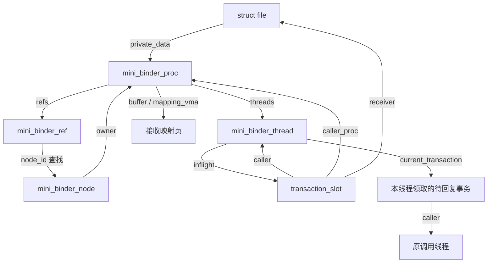

# 7.6 驱动接口与数据结构总览

7.5 已经能完成注册服务、获取服务和调用服务。现在的问题是：若不再从头追踪示例，能否只看几张表，就知道用户态怎样进入驱动、请求怎样找到对象、回复怎样回到线程？

本章整理已有协议，为后续用户态封装提供查阅入口，不增加驱动能力。源码继续使用 `examples/7.5/`，构建版本为 `0705`；没有独立的 `7.6/` 源码副本，也不改变之前的协议或测试结果。

## 7.6.1 先分清三个层次

| 层次 | 回答的问题 | 本版表示 |
| --- | --- | --- |
| 设备与控制入口 | 对哪个设备执行哪类操作？ | `/dev/mini_binder`、`open`、`mmap`、`ioctl`、`close` |
| 命令与事件 | 提交请求、回复，还是改变线程状态？ | `mini_binder_write_read` 携带 `mini_binder_command`，其中 `cmd` 为 BC 或 BR |
| 业务事务 | 调用哪个对象、哪个方法，参数是什么？ | `mini_binder_transaction_data` 中的 `target_handle`、`code` 和 Parcel 字节 |

例如调用计算器加法时：ioctl 是 `MINI_BINDER_WRITE_READ`，包内 `cmd` 是 `MINI_BC_TRANSACTION`，事务的 `code` 是 `CALCULATOR_ADD`。三者分别负责进入驱动、选择协议动作、选择用户态业务方法，不能合并为同一个编号。

ServiceManager 的 `SM_ADD_SERVICE = 1` 与计算器的 `CALCULATOR_ADD = 1` 可以同时存在。先由 handle 找到接收对象，接收方再解释自己的 code。驱动不执行加法函数，也不解析服务名。

## 7.6.2 对外提供哪些接口？

### 7.6.2.1 设备操作

| 操作 | 作用与前提 |
| --- | --- |
| `open("/dev/mini_binder", O_RDWR)` | 创建一个打开文件上下文及对应的 `mini_binder_proc`；再次独立 open 得到另一上下文，dup 共享原上下文 |
| `mmap(..., PROT_READ, MAP_SHARED, fd, 0)` | 映射一页接收缓冲区；长度必须是 `PAGE_SIZE`，不能请求可写、可执行或非零文件偏移；每个上下文只允许一份有效映射 |
| `ioctl(fd, ..., ...)` | 进入下表中的控制操作或命令交换；设备没有实现普通 `read`、`write` 文件操作 |
| `munmap(...)` | 清除映射记录并唤醒等待者；应用处理映射数据时必须保持映射有效 |
| `close(fd)` | 最后一个打开文件引用释放时执行上下文清理；关闭某个 dup 得到的 fd 不一定立即销毁上下文 |

mmap 只建立读取位置，不会主动发起事务或启动服务线程。映射不随 fork 继承，禁止 mremap；接收时还会检查当前地址空间。

### 7.6.2.2 五个 ioctl

源码：`examples/7.5/include/mini_binder.h`，第 15–19 行（章节版本 `0705`，节选）。

```c
#define MINI_BINDER_IOC_MAGIC 'M'
#define MINI_BINDER_GET_VERSION _IOR(MINI_BINDER_IOC_MAGIC, 0, __u32)
#define MINI_BINDER_REGISTER_MANAGER _IO(MINI_BINDER_IOC_MAGIC, 22)
#define MINI_BINDER_GET_THREAD_ID _IOR(MINI_BINDER_IOC_MAGIC, 23, __u32)
#define MINI_BINDER_THREAD_EXIT _IO(MINI_BINDER_IOC_MAGIC, 24)
```

前四个 ioctl 分别管理版本、管理者入口和线程记录；请求与回复统一使用下面的 WRITE_READ 入口。

源码：`examples/7.5/include/mini_binder.h`，第 61–61 行（章节版本 `0705`，节选）。

```c
#define MINI_BINDER_WRITE_READ _IOWR(MINI_BINDER_IOC_MAGIC, 25, struct mini_binder_write_read)
```

WRITE_READ 的参数是可读写的控制块，控制块再描述命令包的地址和读写进度。各 ioctl 的作用如下。

| ioctl | 参数与结果 | 用途 |
| --- | --- | --- |
| `MINI_BINDER_GET_VERSION` | `__u32 *`；输出内部整数 705，示例程序格式化为 `0705` | 确认当前模块版本 |
| `MINI_BINDER_REGISTER_MANAGER` | 无参数 | 将当前打开文件设为唯一管理入口；handle 0 路由到此处，已有管理者时返回 `EBUSY` |
| `MINI_BINDER_GET_THREAD_ID` | `__u32 *` | 获取或创建当前 Linux 线程在此上下文内的记录，输出教学线程编号 |
| `MINI_BINDER_THREAD_EXIT` | 无参数 | 显式取消本线程发出的调用，结束尚未回复的服务事务，清理线程记录及残留回复；不会结束 Linux 线程 |
| `MINI_BINDER_WRITE_READ` | `mini_binder_write_read *` | 先提交命令，再按需等待并领取事件；可以只写、只读或先写后读 |

WRITE_READ 会按需建立当前线程记录，正常调用不必先执行 GET_THREAD_ID。REGISTER_MANAGER 也不等于 ENTER_LOOPER：前者设置 handle 0 的目标，后者让当前线程有资格接收普通请求。

本版已不再提供 CREATE_NODE、REGISTER_SERVER、独立 WRITE/READ 或按事务阶段拆分的旧 ioctl。普通进程直接传 LOCAL 对象即可按需创建 Node，无需先注册“服务端身份”。

### 7.6.2.3 BC 与 BR

源码：`examples/7.5/include/mini_binder.h`，第 35–44 行（章节版本 `0705`，节选）。

```c
enum mini_binder_command_code {
    MINI_BC_TRANSACTION = 1,
    MINI_BC_REPLY = 2,
    MINI_BC_FREE_REPLY = 3,
    MINI_BC_ENTER_LOOPER = 4,
    MINI_BC_EXIT_LOOPER = 5,
    MINI_BC_FREE_BUFFER = 6,
    MINI_BR_TRANSACTION = 101,
    MINI_BR_REPLY = 102,
};
```

| 写入的 cmd | 当前动作 | 读取侧的结果 |
| --- | --- | --- |
| `MINI_BC_TRANSACTION` | 按目标 handle 找到接收方，转换参数对象，把请求加入目标 proc 的 todo；写阶段不等待业务回复 | 接收线程取得 `MINI_BR_TRANSACTION`；同步调用线程之后取得 `MINI_BR_REPLY`；ONE_WAY 无业务回复 |
| `MINI_BC_FREE_BUFFER` | 释放当前线程持有的 oneway 请求，归还槽位并放行同 Node 队首 | 不产生业务回复；不能用来结束同步请求 |
| `MINI_BC_REPLY` | 从当前服务线程的 current_transaction 找到已领取的请求，转换回复对象，将回复工作加入原调用线程的 todo | 原调用线程取得 `MINI_BR_REPLY` |
| `MINI_BC_FREE_REPLY` | 释放当前线程保留的回复映射位置及尚未安装的文件引用 | 不产生单独的成功 BR；成功写入后该动作完成 |
| `MINI_BC_ENTER_LOOPER` | 将当前线程的 looper 标记设为 true | 之后可读取本 proc 的普通请求；不会创建线程或立即产生一个确认事件 |
| `MINI_BC_EXIT_LOOPER` | 清除当前线程的 looper 标记 | 停止领取普通请求，不清除线程记录或自动释放已保留回复 |

普通调用线程不需要 ENTER_LOOPER 就能领取自己的 BR_REPLY。BR_TRANSACTION 则要求接收线程是 looper，且当前没有等待回复的在途调用。读取优先交付当前线程尚未交付的回复，再考虑 proc 请求；如果条件都不满足，就在等待队列中睡眠。

BC_FREE_REPLY 不能省略为“下一次调用自动覆盖”。请求映射位置跟随事务槽回收，而回复映射位置要保留到应用读完并释放。已安装到用户进程的 fd 仍由接收方调用 close，FREE_REPLY 不替应用关闭它。

## 7.6.3 从控制块到事务结构

### 7.6.3.1 mini_binder_write_read：描述命令包在哪里

源码：`examples/7.5/include/mini_binder.h`，第 52–59 行（章节版本 `0705`，节选）。

```c
struct mini_binder_write_read {
    __u64 write_size;
    __u64 write_consumed;
    __u64 write_buffer;
    __u64 read_size;
    __u64 read_consumed;
    __u64 read_buffer;
};
```

write_buffer/read_buffer 是调用进程中命令包的用户地址，不是 mmap 数据的地址。write_size/read_size 表示包的字节数，本版每个方向只能是 0 或一个完整 `mini_binder_command` 的大小；0 表示不执行该方向。

write_consumed/read_consumed 表示已经完成的方向进度。保留已成功写入的 consumed，才能在适用的读失败场景中避免重复提交业务请求。但不能把所有错误一概视为可重试：信号打断等待会取消当前调用；最终进度写回失败等竞态也没有完整的 exactly-once 保证。

用户态 `command_io` 只负责构造控制块并调用 ioctl，不是业务 RPC 框架，也没有自动重试策略。

源码：`examples/7.5/userspace/command.h`，第 10–20 行（章节版本 `0705`，节选）。

```c
static inline int command_io(int fd, struct mini_binder_command *out,
                             struct mini_binder_command *in)
{
    struct mini_binder_write_read bwr = {
        .write_size = out ? sizeof(*out) : 0,
        .write_buffer = (uintptr_t)out,
        .read_size = in ? sizeof(*in) : 0,
        .read_buffer = (uintptr_t)in,
    };
    return ioctl(fd, MINI_BINDER_WRITE_READ, &bwr);
}
```

out 为 NULL 时只读，in 为 NULL 时只写；两个都存在时先写后读。此助手把进度保存在局部变量中，因此返回错误后不能再次调用它就假定会接着未完成阶段执行。

### 7.6.3.2 mini_binder_command：一条协议动作

源码：`examples/7.5/include/mini_binder.h`，第 46–49 行（章节版本 `0705`，节选）。

```c
struct mini_binder_command {
    __u32 cmd;
    struct mini_binder_transaction_data transaction;
};
```

cmd 决定 transaction 的解释方式。TRANSACTION 和 REPLY 使用事务内容；ENTER、EXIT、FREE_REPLY 和 FREE_BUFFER 不携带业务 Parcel。它们仍占一个固定大小命令包，这是教学协议的取舍。

### 7.6.3.3 mini_binder_transaction_data：请求与回复的共同容器

源码：`examples/7.5/include/mini_binder.h`，第 21–33 行（章节版本 `0705`，节选）。

```c
struct mini_binder_transaction_data {
    __u64 data_address;
    __u64 object_cookie;
    __u32 target_handle;
    __u32 object_count;
    __u32 object_offsets[MINI_BINDER_MAX_OBJECTS];
    __u32 reply_offset;
    __u32 size;
    __s32 status;
    __u32 code;
    __u32 flags;
    __u8 data[MINI_BINDER_MAX_DATA];
};
```

同一结构用于两个方向，并不表示每个字段在每个阶段都有意义。

| 字段 | BC_TRANSACTION / BC_REPLY 输入 | BR_TRANSACTION / BR_REPLY 输出 |
| --- | --- | --- |
| `target_handle` | 请求目标：0 为管理入口，非零为发送方 Ref 表中的 handle；回复由当前线程绑定的事务定位 | 接收方不靠它寻找用户态对象 |
| `flags` | 请求为 0 或 MINI_TF_ONE_WAY，其他位拒绝 | BR_TRANSACTION 保留标记，服务端据此选择 REPLY 或 FREE_BUFFER |
| `code` | 请求选择目标对象的方法 | BR_TRANSACTION 转交请求 code；当前 BR_REPLY 不保留原请求 code |
| `object_cookie` | 请求中由驱动根据目标 Node 填写，不能由客户端冒充目标对象身份 | BR_TRANSACTION 用它找到本地对象；驱动不会调用这个值指向的函数 |
| `size` | data 中有效字节数，上限 256 | 对应映射区域内的有效数据长度 |
| `data` | 请求参数或回复结果的 Parcel 字节 | 接收程序从映射读取有效负载，不把输出包内的 data 当成有效负载来源 |
| `object_count`、`object_offsets` | 哪些负载位置是 LOCAL、HANDLE 或 FD 对象 | 给出转换后的对象位置；偏移以这笔负载起点为基准 |
| `data_address` | 不由发送方指定接收映射位置 | BR_TRANSACTION 中的接收方用户地址，指向请求数据 |
| `reply_offset` | 不由回复方分配客户端的位置 | BR_REPLY 中的映射区内偏移；客户端从 `mapping + reply_offset` 读取 |
| `status` | BC_REPLY 填 0 或负错误码，不能填正数 | BR_REPLY 的业务状态；应与 ioctl 的返回值和 errno 分开检查 |

请求地址计算是接收方映射基址加事务槽位置；回复位置由调用线程预留。两者都指向接收进程自己的映射，不能跨进程直接使用。object_offsets 则指向负载内部的对象条目，与 reply_offset 的基准不同。

接收命令包仍需要 copy_to_user；发送的事务及其内嵌 data 仍需要 copy_from_user，驱动还会 memcpy 到接收映射。mmap 省掉的是把有效负载另行复制到用户接收缓冲区的过程，不能称为完全零拷贝。

### 7.6.3.4 Parcel 不属于内核协议结构体

`parcel` 管理用户态字节缓冲区、容量、长度和读写游标；`object_parcel` 增加对象位置表；`parcel_object` 是解码后得到的 type/value。它们不会被整块复制给驱动。

`parcel_to_transaction` 把有效字节和对象位置写入事务，`parcel_from_transaction` 用收到的元数据与映射地址建立借用视图。用户态对象条目按明确格式编码为 12 字节，不能直接用 `sizeof(struct parcel_object)` 代替线格式长度，因为 C 结构体可能包含对齐填充。

## 7.6.4 内核用哪些结构保存关系？

下面是结构关系图，箭头表示字段关联或解析关系，不是执行时序，也不代表完整引用计数。



### 7.6.4.1 proc 与 thread

源码：`examples/7.5/kernel/mini_binder.c`，第 34–57 行（章节版本 `0705`，节选）。

```c
struct mini_binder_thread {
    struct transaction_slot *current_transaction;
    struct pid *pid;
    __u32 id;
    struct list_head todo;
    bool looper;
    struct transaction_slot *inflight;
    bool reply_ready;
    bool reply_delivered;
    unsigned int reply_index;
    struct mini_binder_fd_set reply_fds;
    struct mini_binder_transaction_data pending_reply;
};

struct mini_binder_proc {
    struct file *file;
    void *buffer;
    struct vm_area_struct *mapping_vma;
    unsigned long reply_used;
    struct mini_binder_ref refs[MINI_BINDER_MAX_OBJECTS];
    struct mini_binder_thread threads[8];
    struct list_head todo;
    atomic_t pending_count;
};
```

proc 随打开文件上下文创建，统一持有映射、Ref 表、线程记录和进程请求 todo；不是按 PID 查找的全局唯一进程对象。一个进程两次独立 open 可以有两个 proc，dup 则共享同一个 proc。

thread 用 `task_pid(current)` 对应调用的 Linux 线程。looper 是领取普通请求的资格；inflight 指向本线程发出的在途调用；current_transaction 指向本线程领取、尚未回复的请求；todo 接收发给此线程的回复工作。reply_ready/pending_reply 表示回复已经移入本上下文的映射，等待交付或释放。教学线程 id 是该上下文中的数组位置编号，不能当作 Linux TID，也不用于用户态指定回复对象。从 5.4 起，公开事务结构不再含 id；一个服务线程先回复当前请求，再领取下一笔。

### 7.6.4.2 Node 与 Ref

源码：`examples/7.5/kernel/mini_binder.c`，第 22–24 行（章节版本 `0705`，节选）。

```c
struct mini_binder_ref {
    __u64 node_id;
};
```

Ref 只保存关联 Node 的内部编号；handle 的作用域和下标由它所在的 proc 引用表决定。

源码：`examples/7.5/kernel/mini_binder.c`，第 73–79 行（章节版本 `0705`，节选）。

```c
struct mini_binder_node {
    bool async_active;
    struct list_head async_todo;
    __u64 id;
    __u64 cookie;
    struct mini_binder_proc *owner;
};
```

Node 的 async_active/async_todo 只调度同对象的 oneway：当前请求释放后，下一笔才进入 proc.todo；不同对象可并发。Node 保存 owner 与 cookie：同一 owner 重复发送同一非零 cookie 时复用 Node。cookie 是本地对象标记，当前计算器用 123；它不是内核可执行的用户函数指针。

Ref 位于接收方 proc 的数组中，本版 handle 等于数组下标加 1，Ref 的 node_id 再关联全局 Node 表。同样的 handle 数字在不同 proc 中可表示不同对象，内部 node_id 则是这一驱动实例分配的身份，不是给业务层使用的全局调用接口。这里的 Ref 记录也不等于已实现完整的强弱引用计数。

LOCAL 参数跨到其他上下文时转换为 HANDLE；HANDLE 参数转交给第三方时建立或复用第三方 Ref；回到 Node 拥有者时恢复 LOCAL(cookie)。这些转换只发生在 object_offsets 标出的对象位置，普通整数不会自动变为引用。

### 7.6.4.3 transaction_slot 与文件引用

源码：`examples/7.5/kernel/mini_binder.c`，第 59–71 行（章节版本 `0705`，节选）。

```c
struct transaction_slot {
    struct mini_binder_node *async_node;
    struct list_head work;
    struct list_head reply_work;
    struct file *receiver;
    struct mini_binder_thread *caller;
    struct mini_binder_proc *caller_proc;
    struct mini_binder_fd_set request_fds;
    struct mini_binder_fd_set reply_fds;
    enum rpc_state state;
    struct mini_binder_transaction_data request;
    struct mini_binder_transaction_data reply;
};
```

同步事务槽保存请求、回复、接收文件及原调用线程；oneway 的 caller/caller_proc 为空，async_node 指向目标 Node，work 在 Node 等待队列或 proc 可执行队列之间移动。work 接入目标 proc.todo，reply_work 接入 caller.todo；它们是同一个事务的两个不同队列节点。caller_proc 直接关联调用方上下文，避免把回复交给其他线程或其他打开文件。

`mini_binder_fd_set` 则暂存 file 引用与负载中的 fd 写入位置：发送时 fget，接收线程预留编号后 fd_install；失败时撤销预留并释放尚未转移的引用。fd 是进程表中的编号，struct file 是被引用的内核对象，二者不能混为一谈。不是所有保存 struct file 指针的字段都自行持有一份文件引用。

源码：`examples/7.5/kernel/mini_binder.c`，第 26–32 行（章节版本 `0705`，节选）。

```c
struct mini_binder_fd_set {
    struct {
        struct file *file;
        __u32 offset;
    } entries[MINI_BINDER_MAX_OBJECTS];
    unsigned int count;
};
```

entries 保存尚待交付的文件引用和需要改写的 fd 位置，count 记录有效条目数；它不等同于应用的 fd 表。

state_lock 这把 mutex 保护事务状态、工作队列、对象/引用表、线程与回复位置等共享状态；mapping_lock 这把 spinlock 保护映射记录，嵌套时先 state_lock 后 mapping_lock。server_wait 是共享等待队列，唤醒后仍须检查本线程的回复或可领取的 proc 请求。todo 链表和锁自身不会让线程睡眠；睡眠与唤醒由等待队列操作完成。

## 7.6.5 用这份总览追踪一次加法

假设管理者已经注册，客户端已获取 calculator 的本地 handle。

1. 客户端用 Parcel 写入 7、3，设置 target_handle 和 CALCULATOR_ADD，再将 BC_TRANSACTION 命令包地址交给 WRITE_READ 控制块。
2. 驱动由调用方 proc.refs 找 Node，从 Node.owner 确定接收文件，从 Node.cookie 得到 123；预留回复位置并把事务槽加入接收方 proc.todo。
3. 已进入 looper 的计算器线程 READ 取得 BR_TRANSACTION，获得 cookie、code 和请求映射地址。它在用户态检查对象与参数，然后执行加法。
4. 领取请求的计算器线程提交 BC_REPLY，在 Parcel 中写入 10。驱动通过该线程的 current_transaction 找到原事务和调用线程，将回复工作加入原调用线程 todo 并唤醒等待者，随后清除服务线程绑定。
5. 客户端读阶段把完成事务的结果收进自身回复映射，再得到 BR_REPLY；检查 status，按 reply_offset 解码 10。
6. 客户端发送 BC_FREE_REPLY 后，回复位置才可复用；全局事务槽已在结果转移到回复映射时归还。这两个回收时点不同。

如果将目标换为 handle 0、code 换为 SM_GET_SERVICE，仍使用同一 ioctl、命令包和事务结构；差别是目标为管理者，Parcel 中放服务名，回复中放 HANDLE 对象。

## 7.6.6 怎样对照源码验收？

本章只整理 7.5，继续在 Linux 的 `examples/7.5` 中运行实验，不需要新驱动或新二进制。

终端一：

```sh
cd examples/7.5
make
sudo insmod kernel/mini_binder.ko
./build/version
./build/servicemanager
```

终端二、三分别进入同一个章节目录，依次运行：

```sh
./build/calculator_server
```

```sh
./build/calculator_client
```

客户端主实验输出沿用 7.5 已有实测记录：

```text
getService(calculator): client handle=1
remote add(7, 3) = 10
remote sub(7, 3) = 4
```

阅读输出时回答：为什么服务发现走 handle 0，计算走另一个 handle？哪次回复含对象，哪次只有普通整数？哪处调用负责释放回复位置？实验后停止服务端和管理者，再执行 `sudo rmmod mini_binder`。

需要检查协议进度与回收错误路径时，先停止上述三个程序，在模块仍加载时直接运行已有 `./build/write_read_test`；它覆盖写阶段提前返回、读失败后进度保留和部分关闭回收场景，不能证明所有用户地址竞态都只执行一次。

本章新增内容的验证是结构体/接口逐项核对和源码引用校验；Linux 环境、真实输出与异常覆盖沿用 7.5 的记录，不表示本章重新运行过驱动实验。网页中的终端依然只是明确标识的模拟回放。

本版已经支持按 Node 串行的 oneway，处理后使用 FREE_BUFFER 回收，仍不保证业务执行成功；handle 0 控制请求限定同步。

## 7.6.7 这份接口还缺什么？

本版只有两个全局事务槽、八个 Node、每个上下文八个 Ref 和八个线程记录；一笔负载最多 256 字节、八个对象。每线程最多一笔在途，等待自身回复期间不领取普通请求，不支持嵌套同步调用。

单页映射采用固定位置，不是通用 allocator。没有完整强弱引用、事务栈、自动线程退出清理、线程池扩容、oneway、死亡通知或安全策略；ServiceManager 的名称表仍只有一项。命令编号、对象线格式、结构布局与 ioctl 编码都是本教程的协议，不能与 Android libbinder 混用。

后续用户态封装可以把 cookie 映射为本地对象，把 code、请求 Parcel 和回复 Parcel 交给统一分发函数，并用代理对象隐藏 handle 和 ioctl。这样的封装应建立在现有驱动边界上，不能把尚未实现的函数签名当作当前内核 API。

## 7.6.8 自测

1. ioctl、cmd、code 分别决定什么？计算器和 ServiceManager 能否都用 code 1？
2. write_buffer 与 data_address 分别指向什么？object_offsets 与 reply_offset 的基准相同吗？
3. 没有 ENTER_LOOPER 的线程能否取得自己的回复？ENTER_LOOPER 是否会创建线程？
4. 为什么不能直接把 ServiceManager 的 handle 数字复制给客户端使用？
5. 收到 BR_REPLY 后，事务槽和回复映射位置是否同时释放？

参考答案：分别选择控制入口、协议动作、目标对象的方法；可以，由 handle 先确定目标；前者为调用方命令包地址，后者为接收方请求映射中的用户地址；对象偏移以负载起点为基准，回复偏移以映射基址为基准；可以取得回复，ENTER 不创建线程；handle 属于各自 proc，应通过对象参数转换；不会同时释放，事务槽在转移回复时回收，回复位置在 FREE_REPLY 后回收。
