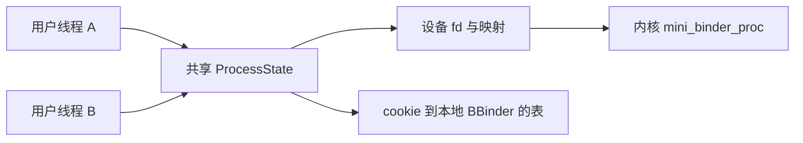

# 8.2 ProcessState：谁管理进程共享的设备连接？

8.1 已经把本地业务放进 `BBinder`。准备接回 7.5 的驱动时，又遇到两个归属问题：哪些线程共用同一个 fd 与映射？收到对象 cookie 后，到哪里找到本地 `BBinder`？

本章增加 `ProcessState`：进程内只有一个用户态连接管理对象，保存一次 open 的 fd、一页只读映射和本地对象表。源码在 `examples/8.2/`；驱动及共享协议头与 7.5 **逐字相同**，查询版本仍为 `0705`。本章还没有线程通信类或远端代理。

## 8.2.1 用户态 ProcessState 与内核 proc 是什么关系？



`ProcessState` 是 C++ 用户态对象，`mini_binder_proc` 是内核为打开文件创建的结构。两者不是同一份内存。本库约定每进程只 open 一次，因而共同对应一个内核上下文；内核本身仍允许同一进程再次独立 open，产生另一个上下文。

## 8.2.2 第一次进入才打开设备

源码：`examples/8.2/framework/binder.cpp`，第 75–88 行（封装版本 `8.2`，节选）。

```cpp
ProcessState::ProcessState() {
    fd_ = ::open("/dev/mini_binder", O_RDWR | O_CLOEXEC);
    if (fd_ < 0) throw std::system_error(errno, std::generic_category(), "open binder");
    long page = ::sysconf(_SC_PAGESIZE);
    if (page <= 0) { ::close(fd_); throw std::runtime_error("invalid page size"); }
    page_size_ = static_cast<size_t>(page);
    void *address = ::mmap(nullptr, page_size_, PROT_READ, MAP_SHARED, fd_, 0);
    if (address == MAP_FAILED) {
        int error = errno;
        ::close(fd_);
        throw std::system_error(error, std::generic_category(), "mmap binder");
    }
    mapping_ = static_cast<const unsigned char *>(address);
}
```

先 open，再映射。open 失败抛出包含 errno 的异常；mmap 失败先关闭刚打开的 fd，再抛出异常。只有两步都成功才构造出可用对象，应用不会拿到半初始化的连接。析构函数解除映射并关闭 fd。`O_CLOEXEC` 避免在 exec 后误保留设备描述符；这并不等于支持 fork 后继续使用该库。

源码：`examples/8.2/framework/binder.cpp`，第 93–97 行（封装版本 `8.2`，节选）。

```cpp
std::shared_ptr<ProcessState> ProcessState::self() {
    // Function-local static initialization is serialized by C++11 and later.
    static auto process = std::shared_ptr<ProcessState>(new ProcessState);
    return process;
}
```

函数内的 `static` 变量只初始化一次；C++11 起，多个线程同时首次进入时，语言保证初始化串行完成。`std::shared_ptr` 是用户态共享所有权：调用者复制它不会再次 open，最后一个持有者释放后才销毁 C++ 对象。这里的 static 自身也保留一个引用，因此连接在本进程的正常运行期间保持不变。

它与驱动 Node/Ref 的引用计数不是一回事，不能因此声称内核对象已获得完整保活机制。普通线程结束也不应关闭其他线程仍在使用的共享 fd。

## 8.2.3 本地对象表解决哪个问题？

8.1 的本地调用直接持有 `Calculator`。跨进程接收只能拿到事务中的 cookie；不能任意把外来整数强转为可执行函数指针。本章让每个 `BBinder` 保存应用分配的非零 cookie，并先在表中登记它。

源码：`examples/8.2/framework/binder.cpp`，第 98–108 行（封装版本 `8.2`，节选）。

```cpp
status_t ProcessState::addObject(const std::shared_ptr<BBinder> &object) {
    if (!object || !object->cookie()) return -EINVAL;
    std::lock_guard<std::mutex> guard(objects_lock_);
    if (!objects_.emplace(object->cookie(), object).second) return -EEXIST;
    return 0;
}
std::shared_ptr<BBinder> ProcessState::findObject(uint64_t cookie) {
    std::lock_guard<std::mutex> guard(objects_lock_);
    auto it = objects_.find(cookie);
    return it == objects_.end() ? nullptr : it->second;
}
```

`objects_lock_` 保护表的插入和查找；重复 cookie 返回 `-EEXIST`，不存在返回空智能指针。查找复制一个 `shared_ptr` 后就释放锁，业务函数执行期间不持有表锁。本章让表持续持有对象到连接销毁，不实现对象删除、弱引用或与内核引用计数联动。

`addObject()` 只登记用户态对象，**不会创建内核 Node，也不会向管理者注册服务**。后面仍要发送 LOCAL 对象，驱动才按第 7.1 章的规则创建 Node。本章的按 cookie 查表实验只做本地调用。

## 8.2.4 实验：两个线程共享一份连接

需要与 7.5 相同的 Linux 内核模块环境，以及 G++：

```sh
cd examples/8.2
make
sudo insmod kernel/mini_binder.ko
./build/version
./build/process_demo
sudo rmmod mini_binder
```

在 Ubuntu 24.04 ARM64、Linux `6.8.0-147-generic` 的实际输出：

```text
mini-binder protocol version: 0705
two threads: one ProcessState, shared device fd; protocol=0705
cookie 123 -> local BBinder: add(7, 3) = 10
```

两个线程分别首次调用 `self()`，主线程 join 后检查两者与自己的智能指针、fd 相同。再把计算器加入表，按 cookie 取出并直接执行本地加法。版本查询验证设备确实可用；对象调用仍在本进程，没有事务收发。线程编号与 fd 数字不是预期输出的一部分。

## 8.2.5 对照与限制

Android 16 [`ProcessState.cpp`](https://android.googlesource.com/platform/frameworks/native/+/2827a4a16b0340ecd07c2d5a6c89991799b362bb/libs/binder/ProcessState.cpp#606) 同样管理驱动连接与映射，并提供更多代理缓存和线程池功能。这里的 cookie 对象表是教学分发方式，不是原生 ProcessState 内部结构的逐字段复制。

本例无 fork 后保护、驱动选择、代理缓存或自动线程池。应用应在创建连接前完成需要的 fork，子进程 exec 后再初始化库；下一章的真实三个程序均独立启动。映射只由 ProcessState 管理，不能并发绕过库解除它。

1. 两个线程复制 `shared_ptr<ProcessState>` 会不会打开两次设备？
2. 为什么只看内核结构名相似，不能认为两个 proc 是同一个对象？
3. 在用户态表里登记 cookie，是否已经向 ServiceManager 注册？
4. 对象表锁为什么不应该一直持有到业务函数执行完？

验证环境、覆盖范围与原始日志见[第八篇验证记录](../../validation/README.md)。
