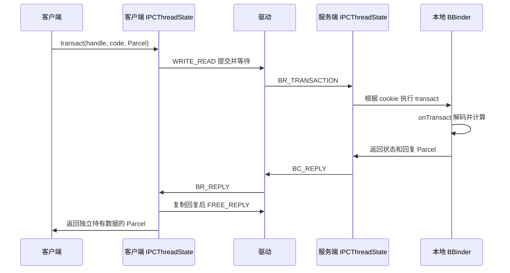

# 8.3 IPCThreadState：把线程的通信循环收进库

8.2 已经统一 fd、映射和本地对象表，但应用仍要逐处编写 BC/BR 包、WRITE_READ、cookie 查找、回复释放。本章把这些动作放进每个线程自己的 `IPCThreadState`。源码在 `examples/8.3/`；驱动与 7.4 相同，仍为 `0704`。

本章先直接调用 `IPCThreadState::transact(handle, code, data, &reply)`，保留 handle 参数，下一章再将它收进 `BpBinder`。这里已经能完成真实跨进程调用。

## 8.3.1 共享连接，区分线程状态

源码：`examples/8.3/framework/binder.cpp`，第 133–141 行（封装版本 `8.3`，节选）。

```cpp
IPCThreadState::IPCThreadState() : process_(ProcessState::self()) {}
IPCThreadState *IPCThreadState::self() {
    static thread_local IPCThreadState thread;
    return &thread;
}
IPCThreadState::~IPCThreadState() {
    // Release the kernel thread record, but leave the shared fd open.
    ::ioctl(process_->driverFD(), MINI_BINDER_THREAD_EXIT);
}
```

`thread_local` 使每个 C++ 线程第一次进入时构造一份对象，同一线程再次调用返回同一个对象，不同线程各有自己的实例。每份实例引用同一个 ProcessState，因此也使用同一 fd。内核线程记录仍由 ioctl 根据 `current` 查找；用户态 TLS 地址不会传给驱动充当线程 ID。

正常线程退出时，TLS 析构调用 `MINI_BINDER_THREAD_EXIT` 回收内核线程记录和残留状态，再释放自己持有的用户态连接引用；它不 close 共享 fd。异常进程终止不保证运行 C++ 析构，依然依赖驱动的文件关闭清理，也没有实现任意线程死亡的自动恢复。

## 8.3.2 统一进入驱动

源码：`examples/8.3/framework/binder.cpp`，第 142–150 行（封装版本 `8.3`，节选）。

```cpp
status_t IPCThreadState::talkWithDriver(mini_binder_command *out, mini_binder_command *in) {
    mini_binder_write_read bwr{};
    bwr.write_size = out ? sizeof(*out) : 0;
    bwr.write_buffer = reinterpret_cast<uintptr_t>(out);
    bwr.read_size = in ? sizeof(*in) : 0;
    bwr.read_buffer = reinterpret_cast<uintptr_t>(in);
    if (::ioctl(process_->driverFD(), MINI_BINDER_WRITE_READ, &bwr) < 0) return -errno;
    return 0;
}
```

这正是 7.4 控制块的 C++ 包装：out 或 in 为空时省略对应方向。ioctl 返回 -1 时立即捕获 errno 并转成负错误码，不与业务结果混淆。此函数没有自动重试；尤其本驱动在信号打断等待时会取消调用，不能清零 consumed 后盲目重发。

## 8.3.3 transact 怎样取得可保留的回复？

源码：`examples/8.3/framework/binder.cpp`，第 151–170 行（封装版本 `8.3`，节选）。

```cpp
status_t IPCThreadState::transact(uint32_t handle, uint32_t code, Parcel &data, Parcel *reply) {
    if (!reply) return -EINVAL;
    mini_binder_command out{}, event{};
    out.cmd = MINI_BC_TRANSACTION;
    out.transaction.target_handle = handle;
    out.transaction.code = code;
    data.exportData(&out.transaction);
    int ret = talkWithDriver(&out, &event);
    if (ret) return ret; // EINTR cancels the call: do not silently resubmit it.
    if (event.cmd != MINI_BR_REPLY) return -EPROTO;
    const auto &tx = event.transaction;
    if (tx.reply_offset > process_->page_size_ ||
        tx.size > process_->page_size_ - tx.reply_offset) ret = -EPROTO;
    else ret = reply->importData(process_->mapping_ + tx.reply_offset, tx);
    // Reply owns the bytes before FREE_REPLY makes this mapping position reusable.
    mini_binder_command release{};
    release.cmd = MINI_BC_FREE_REPLY;
    int freed = talkWithDriver(&release, nullptr);
    return ret ? ret : (freed ? freed : tx.status);
}
```

输入 Parcel 导出已有字节与对象位置表，WRITE_READ 写入请求后在读阶段等待。收到 BR_REPLY 后检查范围，把只读映射中的结果复制到调用者的 Parcel，最后发送 FREE_REPLY。复制后，调用者可以在下一笔事务复用内核回复位置时继续读取旧结果。

这是本章刻意选择的所有权规则：C++ Parcel 自己持有最多 256 字节，并复用原有 C `parcel`/`object_parcel` 编解码。请求分发也先复制成拥有数据的 Parcel，避免业务函数长期借用映射。代价是用户态多一份有界复制；尚未采用原生 Parcel 的外部缓冲区释放回调，不能拿它作零拷贝性能实现。

## 8.3.4 服务循环如何执行 BBinder？

`joinThreadPool()` 先提交 ENTER_LOOPER，再循环读取事件；名字表示当前线程加入处理循环，函数不会创建 pthread。收到请求后，`executeCommand()` 检查数据地址、导入 Parcel，按 cookie 从 ProcessState 取出对象，再调用它的公共 transact。

源码：`examples/8.3/framework/binder.cpp`，第 171–187 行（封装版本 `8.3`，节选）。

```cpp
status_t IPCThreadState::executeCommand(const mini_binder_command &event) {
    if (event.cmd != MINI_BR_TRANSACTION) return -EPROTO;
    const auto &tx = event.transaction;
    Parcel data, reply;
    uintptr_t base = reinterpret_cast<uintptr_t>(process_->mapping_);
    int status = -EPROTO;
    if (tx.data_address >= base && tx.data_address - base <= process_->page_size_ &&
        tx.size <= process_->page_size_ - (tx.data_address - base))
        status = data.importData(reinterpret_cast<const void *>(tx.data_address), tx);
    auto object = process_->findObject(tx.object_cookie);
    if (!status) status = object ? object->transact(tx.code, data, &reply) : -ENOENT;
    mini_binder_command out{};
    out.cmd = MINI_BC_REPLY;
    out.transaction.status = status;
    if (!status) reply.exportData(&out.transaction);
    return talkWithDriver(&out, nullptr);
}
```

对象不存在回复 `-ENOENT`，参数解码或业务失败回复负状态；成功则导出 reply。服务线程发送 BC_REPLY 时仍靠内核 current_transaction/caller 关系找到调用者，库没有恢复公开事务 id。ProcessState 的表锁在调用 onTransact 前已释放；内核状态锁也不会跨 ioctl 返回到用户态，用户态对象本身的并发由应用处理。



## 8.3.5 实验：先直接使用线程通信类

三个终端分别在本章目录执行。先编译并启动沿用的 C 管理者：

```sh
cd examples/8.3
make
sudo insmod kernel/mini_binder.ko
./build/servicemanager
```

另一个终端启动 C++ 服务端：

```sh
cd examples/8.3
./build/framework_server
```

第三个终端运行：

```sh
cd examples/8.3
./build/framework_client
```

实际输出中，服务端和客户端分别显示：

```text
BBinder calculator registered: LOCAL(cookie=123)
IPCThreadState calculator: handle=1
IPCThreadState add(7, 3) = 10
IPCThreadState sub(7, 3) = 4
```

管理者仍使用 7.4 的 C 协议，以便检查新封装没有改变服务名、LOCAL/HANDLE 或参数格式。服务端先将 BBinder 加入用户态表，再向 handle 0 注册 LOCAL(cookie)，注册成功后当前线程进入 joinThreadPool。客户端的 getCalculator 助手也使用本线程的 transact 查询管理者，尚无远端代理类。

停止手动启动的客户端、服务和管理者后，可在模块仍加载时运行完整实验脚本，脚本自建并清理子进程：

```sh
python3 tests/framework_flow.py
sudo rmmod mini_binder
```

脚本除正常三进程流程外，还验证未知方法、截断 Parcel、回复在复用后仍可读取；两个调用线程共享 fd 而 TLS 不同；连续创建 12 个调用线程后内核表项可复用。旧 C 客户端也能调用新 BBinder。实际环境为 Ubuntu 24.04 ARM64、Linux `6.8.0-147-generic`，日志见[验证记录](../../validation/README.md)。

## 8.3.6 对照与限制

Android 16 [`IPCThreadState.cpp`](https://android.googlesource.com/platform/frameworks/native/+/2827a4a16b0340ecd07c2d5a6c89991799b362bb/libs/binder/IPCThreadState.cpp#1042) 同样每线程引用 ProcessState，并通过 talkWithDriver 与 executeCommand 组织通信，但它使用命令流、事务等待循环和更完整的生命周期。本章每次只交换一个固定包，transact 只等待自己的回复，不在等待中分发同步回调；驱动也没有嵌套事务栈。

服务循环读写失败时退出并返回负错误码，不悄悄重发业务。没有主动线程池扩容、oneway 或强弱引用。C++ Parcel 可以读已有对象描述，但尚未提供自动关闭 fd 或 Binder 智能指针编码。

1. TLS 私有对象为什么仍使用共享 fd？
2. 为什么必须先复制回复，再发送 FREE_REPLY？
3. joinThreadPool 是否会创建一个 Linux 线程？
4. BC_REPLY 没有目标 handle，驱动怎样找到原调用者？
5. 本章为什么还没有解决 A→B→A 的原线程嵌套？
