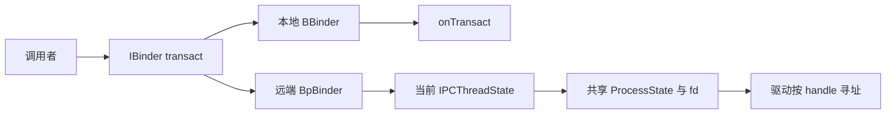

# 8.4 BpBinder：把远端 handle 变成对象

8.3 已能跨进程调用，但每次业务代码还要携带 handle，再找到当前 IPCThreadState。8.1 的本地对象却已经通过 IBinder::transact 调用。能不能让调用者用同一个入口表示“调用这个对象”，而由对象自己决定本地执行还是进入驱动？

本章增加 `BpBinder`，保存当前进程中的远端 handle，并实现同一 IBinder 接口。源码在 `examples/8.4/`；ProcessState、IPCThreadState 和驱动沿用上一章，驱动版本仍为 `0705`。

## 8.4.1 一套接口，两条路径

源码：`examples/8.4/framework/binder.h`，第 61–68 行（封装版本 `8.4`，节选）。

```cpp
class BpBinder : public IBinder {
public:
    explicit BpBinder(uint32_t handle) : handle_(handle) {}
    status_t transact(uint32_t code, Parcel &data, Parcel *reply, uint32_t flags = 0) override;
    uint32_t handle() const { return handle_; }
private:
    uint32_t handle_;
};
```

它不保存远端地址或函数指针。handle 只在当前 ProcessState 对应的内核 Ref 表中有效；复制数字到别的进程不会得到等价代理。本例没有代理缓存，同一 handle 可创建多个轻量 BpBinder，但它们不额外创建内核 Ref，也不代表实现了 AOSP 强弱引用计数。

源码：`examples/8.4/framework/binder.cpp`，第 218–220 行（封装版本 `8.4`，节选）。

```cpp
status_t BpBinder::transact(uint32_t code, Parcel &data, Parcel *reply, uint32_t flags) {
    return IPCThreadState::self()->transact(handle_, code, data, reply, flags);
}
```

调用 BpBinder 时先取得当前线程的 IPCThreadState，再交出保存的 handle。与之相对，BBinder::transact 直接进入本地 onTransact，不经驱动。公共接口统一的是“提交 code 和 Parcel”，没有把本地函数调用变成远程调用。



本章给 IBinder::transact 增加默认 flags 参数，BBinder、BpBinder 的重写签名一起调整，原有三参数调用继续使用默认值。BpBinder 同步调用默认 flags=0；通知调用使用 `service.transact(kNotify, notice, nullptr, MINI_TF_ONE_WAY)`。flags 原样交给 IPCThreadState，后者只写不读；服务端执行后发送 FREE_BUFFER。客户端返回只证明提交成功。同一 Node 的排队由驱动保证。

本地 BBinder 即使传 ONE_WAY，也直接在当前线程执行；这个标志不会给普通 C++ 函数调用自动创建异步线程。允许空 reply 时内部使用临时 Parcel，结果不交给调用者。

## 8.4.2 查找服务也是一次对象调用

源码：`examples/8.4/framework/calculator.h`，第 33–45 行（封装版本 `8.4`，节选）。

```cpp
inline status_t getCalculator(uint32_t *handle) {
    BpBinder manager(0);
    Parcel query, found;
    int ret = query.writeString("calculator");
    if (ret) return ret;
    ret = manager.transact(kGetService, query, &found);
    if (ret) return ret;
    parcel_object object{};
    if (found.objectCount() != 1 || found.readObject(&object) || !found.atEnd() ||
        object.type != OBJECT_PARCEL_HANDLE || !object.value) return -EPROTO;
    *handle = static_cast<uint32_t>(object.value);
    return 0;
}
```

`BpBinder(0)` 代表本章的管理入口。请求仍按旧 Parcel 格式写入 calculator 名称，返回值必须恰好有一个 HANDLE 对象。驱动已经将管理者的 Ref 转换成客户端自己的 Ref；助手提取该值后，客户端才构造 BpBinder(handle)。管理者不替客户端转发后续加减调用。

本章没有实现 IServiceManager 或 IInterface；getCalculator 只是示例的名称查询助手，计算器的 code 和参数编码仍由调用处填写。下一阶段如果要把“transact(code, Parcel)”变成类型化的 add(a, b)，再增加接口与代理类。

## 8.4.3 服务端仍是 BBinder

服务端的 onTransact、对象注册表和线程循环都来自 8.3。变化是注册服务时也通过 BpBinder(0) 发起调用，而不再由应用显式调用 IPCThreadState::transact。

源码：`examples/8.4/framework/framework_server.cpp`，第 14–23 行（封装版本 `8.4`，节选）。

```cpp
        BpBinder manager(0);
        Parcel registration, reply;
        if (registration.writeString("calculator") ||
            registration.writeLocal(calculator->cookie())) return 1;
        ret = manager.transact(kAddService, registration, &reply);
        if (ret) {
            std::fprintf(stderr, "addService: %d\n", ret);
            return 1;
        }
        std::puts("BBinder calculator registered: LOCAL(cookie=123)");
```

这里先把本地 Calculator 加入 ProcessState 的表，再公开 LOCAL(cookie)。表保证服务线程能找到本地对象；驱动中 Node 的创建仍发生在发送该 LOCAL 描述时。发布后计算器对象一直由表持有，本例不提供卸载对象或替换服务的接口。

## 8.4.4 实验：用四个类串起完整调用

与前章一样用三个终端，从本章目录构建和运行。第一个终端：

```sh
cd examples/8.4
make
sudo insmod kernel/mini_binder.ko
./build/servicemanager
```

第二个终端：

```sh
cd examples/8.4
./build/framework_server
```

第三个终端：

```sh
cd examples/8.4
./build/framework_client
```

在 Ubuntu 24.04 ARM64、Linux `6.8.0-147-generic` 上，服务端和客户端分别打印：

```text
BBinder calculator registered: LOCAL(cookie=123)
BpBinder calculator: handle=1
BpBinder add(7, 3) = 10
BpBinder sub(7, 3) = 4
oneway submitted: 42 (business completion is not acknowledged)
```

一次加法的完整路径是：客户端 BpBinder::transact → 当前 IPCThreadState::transact → ProcessState 的共享 fd → 驱动按 handle 取得 Node owner → 服务线程 executeCommand → 查表取得 BBinder → onTransact → BC_REPLY 沿内核线程绑定返回 → 客户端复制回复并释放映射位置。不同进程各有自己的 ProcessState，远端 BpBinder 不直接访问服务端 C++ 对象。

停止手动启动的服务与管理者后，可在模块仍加载时执行：

```sh
python3 tests/framework_flow.py
sudo rmmod mini_binder
```

完整验收沿用 8.3 的并发、线程回收与错误参数场景，并验证旧 C 客户端调用 C++ 服务端、重复注册被拒绝、回复生命周期。原 C 的三进程 service_flow 与所有适用驱动回归也在本章独立副本重新运行，详见[验证记录](../../validation/README.md)。

## 8.4.5 对照与本篇边界

Android 16 [`BpBinder::transact()`](https://android.googlesource.com/platform/frameworks/native/+/2827a4a16b0340ecd07c2d5a6c89991799b362bb/libs/binder/BpBinder.cpp#366) 的内核 Binder 路径同样转给当前 IPCThreadState，传入自身的 handle；原生还处理存活状态、flags 等。这里仅建立同样的职责分工，类名相同不表示可链接 Android libbinder 或兼容其 ABI。

四章新增的是用户态库，8.2～8.4 的 kernel/mini_binder.c 与 include/mini_binder.h 均与 7.5 逐字相同；8.1 完全不需要驱动。没有新增 ioctl、修改锁或改变队列与事务路由。原驱动的固定容量、简化 Node/Ref 生命周期和并发边界继续存在。

本篇尚无 IInterface、Bn/Bp 业务接口、完整 ServiceManager 封装、代理缓存、死亡通知、自动线程池扩容或嵌套回调。用户态 shared_ptr 只管理用户态对象，不自动实现内核 Binder 引用计数；本地对象表无删除能力，内存成本随已登记对象增加。异常退出与并发交错没有穷尽。

1. 为什么 BBinder 与 BpBinder 可以实现同一个 IBinder？
2. BpBinder 的 handle 与 BBinder 的 cookie 为什么不能互换？
3. 创建一个 BpBinder 是否会独立 open 设备？
4. 复制一个 BpBinder 是否会建立一个新的内核 Ref？
5. 本篇完成后，业务代码为什么仍需要知道 code 和参数顺序？

可继续做[第八篇自测](../appendices/8-review.md)。
